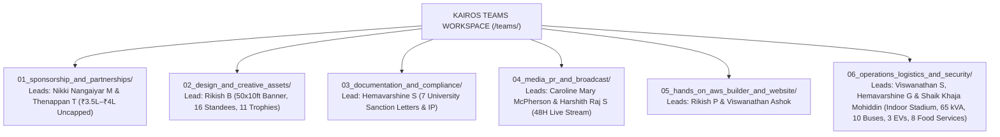
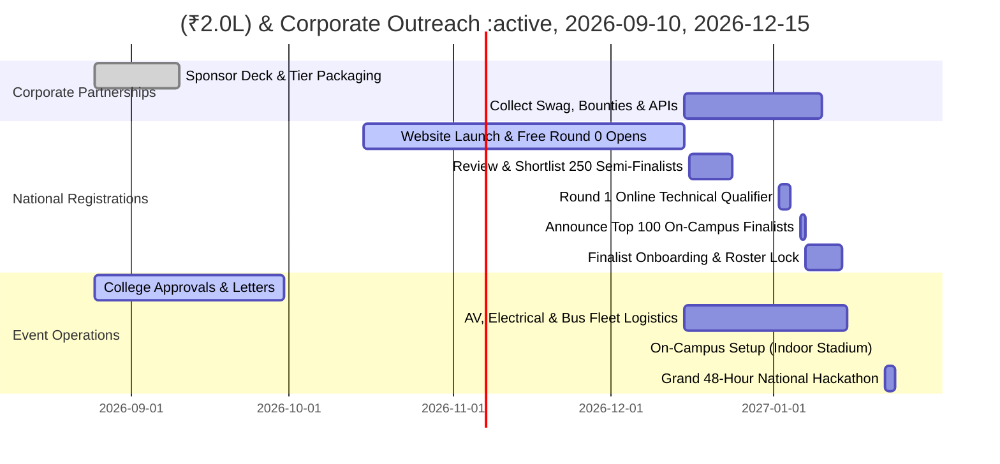

# KAIROS 2027 — Master Hackathon Documentation Hub (Grand Edition)
> **"The Opportune Moment to Build. 48 Hours Non-Stop on AWS Cloud."**  
> **Flagship National Hackathon Organized by AWS Student Builder Group (AWS SBG), Sathyabama Institute of Science and Technology**

---

## 1. Event Overview & Core Parameters (Grand Edition)

* **Event Dates:** January 22 – January 24, 2027 (48 Hours Continuous Non-Stop Sprint)
* **Venue:** Sathyabama Indoor Stadium (Indoor Auditorium Arena Floor, Elevated Stage, Backstage Green Rooms 1 & 2, Upper Bleachers Nap Pods), Sathyabama Campus, Chennai
* **Registration Fee:** **100% FREE — ZERO ENTRY FEE** for all participants (Fully sponsored by corporate partners and institutional grants).
* **Dual-Phase Quality Gate:**
  * **Round 0 (National Applications):** Oct 15 – Dec 15, 2026 (Free online abstract & architecture submission from 2,000+ teams).
  * **Round 1 (Online Technical Qualifier):** **January 02 – 04, 2027** (Top 250 Semi-Finalists undergo a 48-hour virtual code sprint, Loom prototype demo, and live technical defense).
  * **Round 2 (On-Campus Grand Finale):** **January 22 – 24, 2027** (**Top 100 Elite National Teams / Teams of 4–6 students, ~400–600 Developers** on campus at Sathyabama Institute of Science and Technology, Chennai).
* **Command Structure:** **6 Core Teams** reporting directly to **President Thenappan T** (Register No: `44110855`), commanding **106 dedicated student organizers** across pre-event, online qualifier, on-ground sprint, and post-event phases.
* **Faculty Coordinators:** **Dr. K. Ashok Kumar** & **Dr. Balapriya .S** (Department of Computer Science & Engineering, SIST).
* **Financial Model & Sponsorship:**
  * **Target Capital Pool:** **₹3,50,000 – ₹4,00,000+ (Uncapped)**
  * **Title Sponsor (Presented By):** **₹2,00,000 / 2 Lakhs**
  * **Co-Powered By Sponsor:** **₹1,00,000 / 1 Lakh**
  * **Track Partners (5 Tracks):** **₹25,000 – ₹50,000 each**
  * **Sathyabama Institutional Grant:** **₹50,000**
  * **Participant Entry Fees:** **₹0 (100% FREE for All Students)**
  * **Pure Cash Prize Pool:** **₹1,75,000 Pure Cash Escrow** (1st: ₹60,000, 2nd: ₹35,000, 3rd: ₹20,000, 5 Tracks: ₹35,000, Special Bounties: ₹25,000)
  * **In-Kind Ecosystem Grants:** $50,000+ AWS Cloud Credits, 2,000+ Red Bull Energy Cans, JetBrains & Postman Developer Packs.

---

## 2. Multi-Team Collaborative Workspaces (`teams/`)

To enable parallel execution across all club domains, the repository features dedicated operational team directories under [`teams/`](./teams/). **Every folder and subfolder contains a specialized specification document and ready-to-use template** with designated owners, verified contact info, dimensions, and checklists:

| Domain & Team Directory | Team Leads / Accountable Leads | Subfolders & Core Deliverables | Dedicated Workspace Link |
|---|---|---|:---:|
| **1. Sponsorship & Partnerships** | **Nikki Nangaiyar M** (Sponsorship Team Lead, `44612059`) & **Thenappan T** (President, `44110855`) | • `pitch_decks/`: 14-slide master corporate pitch deck architecture • `company_leads_tracker/`: 7-stage CRM with verified leads • `signed_mous_and_contracts/`: Standard MoU & proposal letters • `sponsor_deliverables_and_assets/`: Vector logo ingestion & PoP • `word_documents/`: 8 production-grade Word `.docx` masters • `scripts/`: Automated Python document compilers | [01_sponsorship_and_partnerships/](./teams/01_sponsorship_and_partnerships/) |
| **2. Design & Creative Assets** | **Rikish B** (Design Team Lead, `44110664`) & **Caroline Mary McPherson** (Media & PR Team Lead) | • `stage_and_venue_banners/`: 50x10ft backdrop & 12x8ft LED video wall • `standees/`: 16 units of 6x3ft rollup aluminum banners • `badges_and_lanyards/`: 85.6x53.98mm CR80 NFC smart badges • `apparel_and_merchandise/`: 380 GSM hoodies & 180 GSM tees • `certificates_and_awards/`: 11 canonical hourglass acrylic trophies • `social_media_creatives/`: 4:5 posts, 9:16 reels & 16:9 covers | [02_design_and_creative_assets/](./teams/02_design_and_creative_assets/) |
| **3. Documentation & Compliance** | **Hemavarshine S** (Documentation Lead, `44110263`) & **Shaik Khaja Mohiddin** (Safety & Governance Lead) | • `official_letters/`: 7 University Sanctions, Police, OD & Signed PDF • `reports_and_minutes/`: Weekly MoM & executive sprint templates • `participant_rules_and_agreements/`: 100% Student IP & DPDP consent | [03_documentation_and_compliance/](./teams/03_documentation_and_compliance/) |
| **4. Media, PR & Broadcast** | **Caroline Mary McPherson** (Media & PR Team Lead, `44110124`) & **Harshith Raj S** (Socials & PR Lead) | • `press_releases_and_articles/`: National news & tech wires • `broadcast_and_streaming/`: 48H multicam OBS/ATEM live rig • `campus_ambassador_toolkit/`: 120+ national CA handbook • `social_media_campaigns/`: Multi-channel social launch copy | [04_media_pr_and_broadcast/](./teams/04_media_pr_and_broadcast/) |
| **5. Hands-On Builder & Website** | **Rikish P** (Technical Team Lead) & **Viswanathan Ashok** (Hands-On Builder Lead, `44110907`) | • `website_frontend_source/`: Next.js 14 App Router specifications • `sandbox_and_aws_credits/`: 100 AWS Bedrock accounts & sandbox • `evaluation_and_scoring_system/`: Z-score normalization engine • `participant_dashboard_and_portal/`: DynamoDB & candidate portal | [05_hands_on_aws_builder_and_website/](./teams/05_hands_on_aws_builder_and_website/) |
| **6. Operations, Logistics & Security** | **Viswanathan S** (Operations Team Lead), **Hemavarshine G** (Hospitality Lead) & **Shaik Khaja Mohiddin** (Safety & Governance Lead) | • `venue_floorplans_and_power/`: Indoor Stadium 65 kVA grid & bays • `transport_and_fleet/`: 10 bus route timetables & 3 EV buggies • `hospitality_and_catering/`: 8 food services (6 buffets, high teas, midnight pizza drops) • `safety_medical_and_night_lockin/`: 10 PM - 6 AM lock-in & Sathyabama General Hospital clinic | [06_operations_logistics_and_security/](./teams/06_operations_logistics_and_security/) |

---

## 3. Complete Documentation Ecosystem & Navigation Map

The entire strategic, financial, technical, operational, and media architecture is modularized into **21 production-grade documents** in `docs/` (Executive Planning Framework):

```mermaid
graph TD
    Hub[Kairos Master Documentation Hub] --> D20[20. Indoor Stadium Transition & Budget Plan]
    Hub --> D18[18. Master Workforce Architecture & Team Structure]
    Hub --> D0[00. Master Brief & Executive Vision]
    Hub --> D1[01. Sponsorship Deck & Outreach]
    Hub --> D2[02. Agenda & 100-Pt Rubrics]
    Hub --> D3[03. Budget & Procurement Catalog]
    Hub --> D4[04. Design & Brand Kit]
    Hub --> D5[05. Marketing & Media Rota]
    Hub --> D6[06. Tracks & AWS Architecture]
    Hub --> D7[07. Judges & Grand Jury Playbook]
    Hub --> D8[08. Operations & Shift Roster]
    Hub --> D9[09. Participant Handbook & Rules]
    Hub --> D10[10. Side Events & Mini-Quests]
    Hub --> D11[11. Crisis & Safety Protocols]
    Hub --> D12[12. Post-Event & Sponsor ROI]
    Hub --> D13[13. Hackathon 101 Primer]
    Hub --> D14[14. Official Letters & Approvals]
    Hub --> D15[15. Registration & Screening]
    Hub --> D16[16. Website PRD & Experience]
    Hub --> D17[17. Copy Bank & Outreach Kits]
    Hub --> D19[19. Operations & Logistics CRUD]
```

### 3.1 Core Strategy, Finance & Operations (`docs/`)

| Document | Primary Owner | Description & Key Contents | Clickable File Link |
| **21. Official Institutional Master Proposal** | President & Faculty Coordinators | **Master Official College Submission Proposal**, complete institutional submission blueprint with calibrated ₹4.50L budget (modeled on Vexora'26), college-level requisitions, venue plan, sponsorship model, and official sign-off matrix. | [`21_official_college_submission_master_proposal.md`](./docs/21_official_college_submission_master_proposal.md) · [`.docx`](./docs/21_official_college_submission_master_proposal.docx) |
| **20. Indoor Stadium Transition & Budget Plan** | Sponsorship Lead & Operations Lead | **Master Indoor Auditorium Transition Plan**, empirical learnings from Vexora'26 report, itemized ₹3.50L budget, college-level provisions, 48h accommodation & rest architecture. | [`20_indoor_auditorium_venue_transition_and_budget_plan.md`](./docs/20_indoor_auditorium_venue_transition_and_budget_plan.md) |
| **18. Master Workforce Architecture & Team Structure** | President & Executive Office | **Apex Command Hierarchy**, Core Team Leads, 106 dedicated organizers, sub-heads, headcounts, 4-phase workflows (Pre, Online Qualifier, On-Ground, Post), and procurement catalog. | [`18_team_structure_leads_and_workforce_deployment.md`](./docs/18_team_structure_leads_and_workforce_deployment.md) |
| **00. Master Brief & Executive Summary** | Apex Directorate | Grand vision, high-level timeline, 100-team on-ground scale, Online Qualifier (Jan 02–04), ₹3.5L capital pool, zero entry fee, and cross-functional RACI. | [`00_hackathon_master_brief.md`](./docs/00_hackathon_master_brief.md) |
| **01. Sponsorship Strategy & Pitch Deck** | Sponsorship Team Lead | Enterprise sponsorship tiers (Title ₹2L, Powered-By ₹1L, Associate ₹50k, Track Bounties ₹25k), zero-fee student impact narrative, pitch scripts, and corporate MoU. | [`01_sponsorship_deck_and_outreach.md`](./docs/01_sponsorship_deck_and_outreach.md) |
| **02. Master Agenda & Judging Rubrics** | Safety & Governance Lead & Technical Lead | Online Qualifier evaluation rubric, 48-Hour on-ground minute-by-minute timeline, 3 Progressive Gates, and automated scoring normalization. | [`02_agenda_rounds_and_judging_rubric.md`](./docs/02_agenda_rounds_and_judging_rubric.md) |
| **03. Itemized Budget & Procurement Catalog**| Sponsorship Team Lead & Treasury | Balanced ₹3,50,000 zero-fee budget model, ₹1,75,000 cash prize allocation, itemized purchasing catalog (swag, standees, banners, AV, food, celebrations). | [`03_budget_and_financial_tracker.md`](./docs/03_budget_and_financial_tracker.md) |
| **04. Design Identity & Brand Guidelines** | Design Team Lead | Obsidian-Gold visual identity, stage backdrop, streetwear hoodies, laser-etched smart badges, and print specifications. | [`04_design_and_branding_guidelines.md`](./docs/04_design_and_branding_guidelines.md) |
| **05. Marketing, PR & Media Strategy** | Media & PR Team Lead | 120+ Campus Ambassador national network, 2,000+ applicant funnel, Online Qualifier broadcast, 48-hour live stream production, and aftermovie brief. | [`05_marketing_media_and_promotion.md`](./docs/05_marketing_media_and_promotion.md) |
| **06. Tracks, Problem Statements & Tech** | Technical Team Lead | 5 Enterprise Grand Innovation Tracks (GenAI/Bedrock, Serverless, IoT/Smart Cities, FinTech/Trust, Open Innovation), AWS architecture blueprints, and API sandbox specs. | [`06_tracks_problem_statements_and_tech.md`](./docs/06_tracks_problem_statements_and_tech.md) |
| **07. Judges & Grand Jury Playbook** | Safety & Governance Lead | Target executive/VP profiles, Online Qualifier review protocols, VIP hospitality protocol in Backstage Green Room 2, scoring portal guide, and conflict-of-interest rules. | [`07_judges_and_mentors_handbook.md`](./docs/07_judges_and_mentors_handbook.md) |
| **08. Operations & Volunteer Shift Roster** | Operations Team Lead | Physical venue layout across Sathyabama Indoor Stadium, 65 kVA arena power grid, campus LAN, and 3-shift rotating volunteer roster for 106 organizers. | [`08_event_operations_and_volunteer_manual.md`](./docs/08_event_operations_and_volunteer_manual.md) |
| **09. Participant Handbook & Rulebook** | Hospitality & Experience Lead | Comprehensive handbook: teams of 4–6 students, zero entry fee, direct event day venue reporting, 100% student IP ownership, fresh code rules, hardware maker bay access, cloud credit usage, and Code of Conduct. | [`09_participant_handbook_and_rules.md`](./docs/09_participant_handbook_and_rules.md) |
| **10. Side Events & Hacker Culture Playbook** | Hospitality & Experience Lead | Midnight Lightning CTF, Speed Typing Championship, retro arcade arena, 3 AM AI Prompt Battles, live acoustic set, and foam-mattress rest zones. | [`10_side_events_and_engagement_playbook.md`](./docs/10_side_events_and_engagement_playbook.md) |
| **11. Crisis Management & Safety Protocols** | Safety & Governance Lead | Three-tier crisis response matrix, generator auto-switchover, 24/7 on-campus ambulance liaison with Sathyabama General Hospital, and segregated rest sanctuaries. | [`11_crisis_management_and_safety_protocol.md`](./docs/11_crisis_management_and_safety_protocol.md) |
| **12. Post-Event Impact & Sponsor ROI** | Sponsorship Team Lead | Executive sponsor ROI proof-of-performance report, resume database release via affirmative opt-in consent, instant NEFT prize escrow disbursement, and digital credential engine. | [`12_post_event_report_and_sponsor_roi_deck.md`](./docs/12_post_event_report_and_sponsor_roi_deck.md) |
| **13. Hackathon 101: Core Team Primer** | Core Team Onboarding | Grounded training manual for all 106 student organizers, stakeholder psychology, rookie mistake prevention, and emergency reflexes. | [`13_hackathon_101_core_team_primer.md`](./docs/13_hackathon_101_core_team_primer.md) |
| **14. Official Administrative Approvals** | Executive Office | All 7 formal university permission letters (Indoor Stadium reservation, night pass safety, AV/power requisition, bus transit, VIP dining, EV buggy transit, and student OD sanction). | [`14_official_letters_and_administrative_approvals.md`](./docs/14_official_letters_and_administrative_approvals.md) |
| **15. Google Form & Screening Schemas** | Technical & Screening Lead | Schema definitions for Round 0 free applications, Online Qualifier submission schema, on-campus confirmation workflows, and Discord onboarding. | [`15_google_form_registration_and_confirmation_template.md`](./docs/15_google_form_registration_and_confirmation_template.md) |
| **16. Website PRD & Design Specification** | Media Lead & Technical Lead | Full Product Requirements Document, live terminal CLI simulator, live 48-hour countdown, interactive judging portal, and real-time leaderboard specs. | [`16_website_design_and_experience_specification.md`](./docs/16_website_design_and_experience_specification.md) |
| **17. Content Reference & Copy Bank** | Media & PR Team Lead | Production-ready cold emails, sponsor pitches (Title ₹2L), press release copy, social media broadcast scripts, and complete FAQ banks. | [`17_content_reference_and_copy_bank.md`](./docs/17_content_reference_and_copy_bank.md) |
| **19. Operations & Logistics CRUD Specification** | Technical Lead & Operations Lead | Complete relational PostgreSQL DDL schemas, REST API contracts, and operational state machines for all 10 on-ground micro-logistics domains. | [`19_operations_logistics_crud_and_system_specs.md`](./docs/19_operations_logistics_crud_and_system_specs.md) |

---

## 4. The Master Execution Runway (September 2026 – January 2027)

