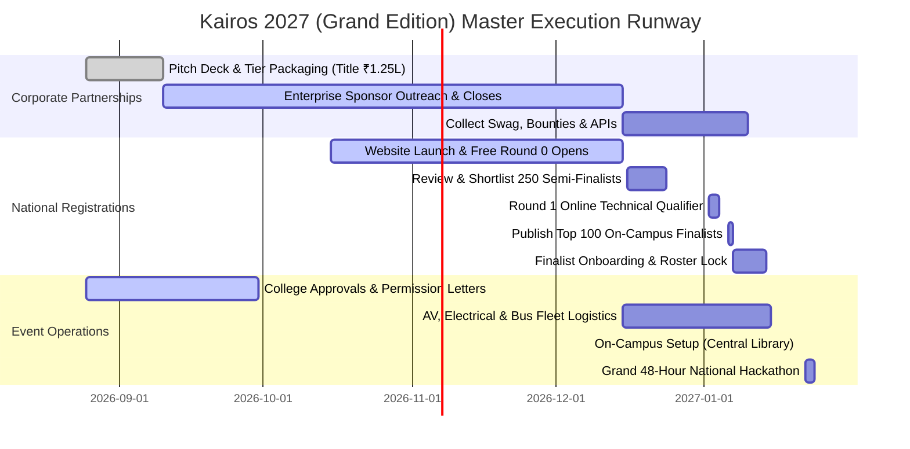

# Kairos 2027 — Hackathon Master Brief & Executive Strategic Plan (Grand Edition)

**Governing Standards:** `E:\AWS SBGL\ANTI-Help\04_FLAGSHIP_EVENT_DEEPDIVES_AND_POST_EVENT_REPORTS.md` & `10_HACKATHON_SPONSORSHIP_LETTERS_AND_OUTREACH_KIT.md`  
**Organized by:** AWS Student Builder Group (AWS SBG) — SIST Chapter, Sathyabama Institute of Science and Technology  
**Grand Finale Event Window:** January 22–24, 2027 (48 Hours Non-Stop, Friday 08:00 AM to Sunday 05:00 PM)  
**Location:** Central Library Complex (Auditorium, 1st Floor Lab, 2nd Floor Lecture Halls 1–3, Top Floor VIP Lounge), Sathyabama Campus, Chennai  
**Target Scale:** 100 Shortlisted National Finalist Teams (~400–500 Participants + 106 Organizers & 25+ Mentors)  
**Preparation Runway:** 5 Months (September 2026 – January 2027)  
**Lead Signatory:** Thenappan T (Register No: 44110855), President & SBGL  
**Faculty Coordinators:** Dr. Balapriya .S & Dr. K. Ashok Kumar (Department of CSE, SIST)  

---

## 1. Executive Summary & Vision (Grand Edition)

### 1.1 The Concept: "Kairos" (καιρός)
In ancient Greek, *Kairos* signifies the opportune, critical, and defining moment — the exact juncture in time where bold action creates transformative change.

**Kairos 2027 (Grand Edition)** is the premier 48-hour national hackathon hosted by **AWS Student Builder Group SIST**. Postponed to January 2027 to unlock a 5-month corporate sponsorship runway, Kairos brings together enterprise partners, AWS cloud architects, and 400+ of India's finest student engineers for an unforgettable builder experience.

### 1.2 Core Pillars
* **Builder-First Ethos:** 48 hours of continuous building with dedicated AWS cloud infrastructure support, enterprise-grade APIs, high-density power bays, and zero-downtime LAN/Wi-Fi.
* **Rigorous Milestone Evaluation:** 3 progressive evaluation gates (Architecture & Cloud Feasibility, Code & Integration Checkpoint, Grand Demo & Pitch) ensuring only working, deployable products reach the finale.
* **Industry & Startup Immersion:** Mentorship and judging powered by AWS community builders, tech leads, startup founders, and distinguished alumni.
* **Grand Hospitality & Safety:** Central Library venue with independent stairwells for boys and girls mess access, 10:00 PM – 06:00 AM night lock-in, dedicated VIP dining in the Top Floor Lounge, campus EV buggy transit, and free university bus fleet access.

---

## 2. Key Hackathon Facts & Parameters

| Parameter | Specification |
|---|---|
| **Event Duration** | 48 Hours Continuous (Friday 08:00 AM – Sunday 05:00 PM) |
| **Target Finale Dates** | January 22 – 24, 2027 |
| **Round 0 (Online Free Applications)** | October 15 – December 15, 2026 (Free online national screening) |
| **Round 1 (Online Technical Qualifier)** | January 02 – 04, 2027 (Top 250 Semi-Finalists) |
| **On-Campus Shortlist Announcement** | January 06, 2027 (100 Selected Finalist Teams) |
| **Registration Model** | **100% FREE — ZERO ENTRY FEE** (No fees collected from students) |
| **Participant Scale** | 100 Elite Teams (400–500 total hackers) |
| **College Management Grant** | ₹50,000 + Venue, Central Labs, High-Speed LAN, Security & Bus Services |
| **Corporate Sponsorship Target** | **₹3,00,000** (Title Sponsor ₹1.25L + Powered By ₹70k + Track Partners) |
| **Total Operational Capital Pool** | **₹3,50,000** |
| **Pure Liquid Cash Prize Pool** | **₹1,75,000 Pure Cash** (1st: ₹60k, 2nd: ₹35k, 3rd: ₹20k, Tracks: ₹35k, Bounties: ₹25k) |
| **In-Kind Ecosystem Grants** | $50,000+ AWS Cloud Credits, 1,200+ Red Bull Energy Cans, DevTool Packs |

---

## 3. High-Level Hackathon Roadmap

```mermaid
graph TD
    A[Oct 15: National Applications Open] --> B[Dec 15: Round 0 Abstract Submissions Close]
    B --> C[Dec 16-24: Screening of 2,000+ Applicant Teams]
    C --> D[Dec 24: Announcement of Top 250 Online Semi-Finalists]
    D --> E[Jan 02-04: Round 1 Online Technical Qualifier Sprint]
    E --> F[Jan 06: Announcement of Top 100 On-Campus Finalists]
    F --> G[Jan 07-14: On-Campus Finalist Free Onboarding & Roster Lock]
    
    subgraph On-Ground 48 Hours: Jan 22-24, 2027
        G --> H[Day 1: Check-in, Keynote & Hacking Begins]
        H --> I[Round 1: Architecture & Feasibility Gate]
        I --> J[Night 1: 1-on-1 Mentor Clinics & Midnight Fuel Station]
        J --> K[Day 2: Mid-Hack Progress & Round 2 Gate]
        K --> L[Night 2: Sponsor Tech Talks & Final Sprint]
        L --> M[Day 3: Final Code Freeze & Round 3 Grand Demos]
        M --> N[Grand Valedictory & Prize Distribution]
    end
```

---

## 4. Master 5-Month Execution Schedule


