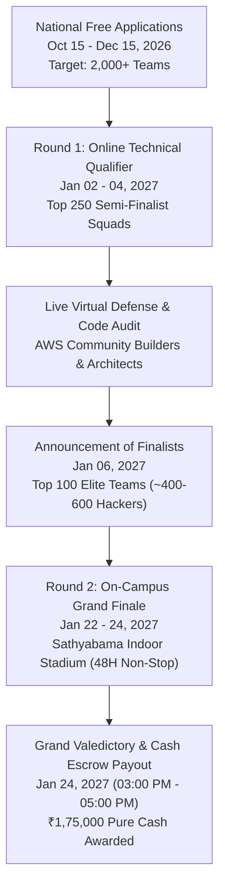
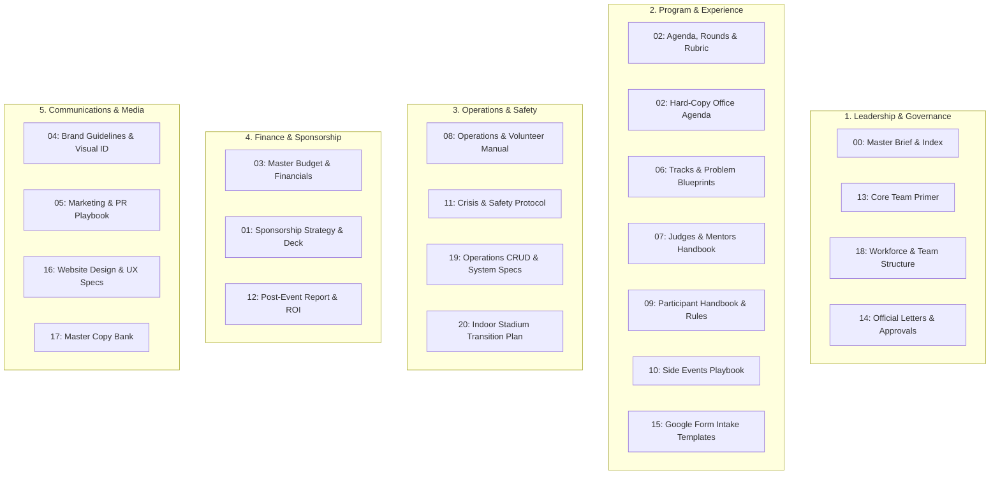

# KAIROS 2027 — Hackathon Master Brief & Canonical Documentation Index (Grand Edition)

> **Document Status:** CANONICAL MASTER BRIEF & MASTER DOCUMENTATION INDEX  
> **Host Organization:** AWS Student Builder Group (SIST Chapter), Sathyabama Institute of Science and Technology, Chennai  
> **Event Dates:** 22–24 January 2027 (Grand Finale) | 02–04 January 2027 (Online Qualifier)  
> **Physical Venue:** Sathyabama Indoor Stadium (Indoor Auditorium), Chennai — `[APPROVED PLAN]`  
> **Operating Capital Target:** ₹3,50,000 – ₹4,00,000 (Liquid Operational Cash Pool) — `[PROPOSED]`  
> **Pure Cash Prize Escrow:** ₹1,75,000 Pure Liquid Cash — `[APPROVED PLAN]`  
> **Participant Policy:** 100% Free Entry, Boarding & Buffet Meals for all 100 Shortlisted Finalist Teams (~400–600 Hackers)  
> **Current Working Date:** 17 October 2026 | **Apex Signatory:** Thenappan T (President & SBGL, Reg: `44110855`)

---

## 1. Executive Summary & Core Mission

### 1.1 The Concept: "Kairos" (καιρός)
In classical Greek, *Kairos* signifies the opportune, critical, and defining moment — the exact juncture in time where bold action creates transformative change.

**KAIROS 2027 (Grand Edition)** is the premier national 48-hour continuous student hackathon organized by the **AWS Student Builder Group at Sathyabama Institute of Science and Technology, Chennai**. Operating under an uncompromised **100% Free / Zero Entry Fee** mandate, the summit convenes India's top builder talent for two days and nights of intensive engineering in the state-of-the-art **Sathyabama Indoor Stadium**.

### 1.2 Core Pillars of KAIROS 2027
1. **Uncompromised Meritocracy:** Zero entry fee. Every finalist receives free air-conditioned accommodation, 6 grand buffet meals, continuous high tea, midnight pizza/coffee drops, and developer sandboxes.
2. **Pre-Screened Engineering Density:** Anti-noise quality gate. The Top 100 finalist teams are pre-filtered from 2,000+ national applicants through a 48-hour virtual code qualifier, Loom architectural demo, and live technical defense.
3. **Enterprise Tech Adoption:** 5 Frontier Technology Tracks (Agentic AI, Cloud-Native, Web3, FinTech, Healthcare) featuring live AWS Bedrock and cloud services stress-tested on production-grade prototypes.
4. **Guaranteed Financial Escrow:** ₹1,75,000 pure cash prize pool held in audited university custody and disbursed directly to winning student bank accounts within 72 hours of the finale.
5. **100% Student Code Ownership:** All intellectual property created by participants remains 100% their exclusive property. Zero forced corporate assignment.

---

## 2. Canonical Fact Register & Status Taxonomy

All operational data across the `docs/` repository adhere strictly to the following evidence-based status taxonomy:

| Status Label | Definition | Usage Rule |
|---|---|---|
| `CONFIRMED` | Formally ratified by university authority or backed by executed agreement in repository. | Stated as factual reality. |
| `APPROVED PLAN` | Formally approved execution roadmap ratified by faculty coordinators and student leads. | Stated as official plan. |
| `PROPOSED` | Under review or planning consideration; not yet formally approved. | Explicitly qualified as proposed. |
| `ASSUMPTION` | Temporary planning assumption based on historical benchmarks (e.g., Vexora'26). | Labeled as working assumption. |
| `TO VERIFY` | Requires external factual confirmation against university or external registries. | Internal review flag. |
| `DECISION REQUIRED` | Conflicting or unresolved operational parameter awaiting administrative sign-off. | Documented in Decision Register. |
| `TEMPLATE` | Reusable operational or legal boilerplate requiring customization before use. | Placeholders must be filled. |

### Master Canonical Event Facts:

| Event Dimension | Parameter Value | Status | Evidence / Reference Document |
|---|---|:---:|---|
| **Official Event Name** | KAIROS 2027 (Grand Edition) | `APPROVED PLAN` | Master Chapter Charter |
| **Host Chapter** | AWS Student Builder Group (SIST Chapter) | `CONFIRMED` | Amazon Web Services SBG Charter |
| **Host University** | Sathyabama Institute of Science and Technology, Chennai | `CONFIRMED` | NAAC A++ / Category-1 Deemed University |
| **Official Finale Venue** | Sathyabama Indoor Stadium (Indoor Auditorium), Chennai | `APPROVED PLAN` | [`20_indoor_auditorium_venue_transition_and_budget_plan.md`](./20_indoor_auditorium_venue_transition_and_budget_plan.md) |
| **Grand Finale Dates** | 22–24 January 2027 (Friday 08:00 AM – Sunday 05:00 PM) | `APPROVED PLAN` | [`02_hard_office_copy_master_agenda.md`](./02_hard_office_copy_master_agenda.md) |
| **Online Qualifier Dates** | 02–04 January 2027 (48-Hour Virtual Milestone Sprint) | `APPROVED PLAN` | [`02_agenda_rounds_and_judging_rubric.md`](./02_agenda_rounds_and_judging_rubric.md) |
| **Application Window** | 15 October – 15 December 2026 | `APPROVED PLAN` | [`15_google_form_registration_and_confirmation_template.md`](./15_google_form_registration_and_confirmation_template.md) |
| **Applicant Target** | 2,000+ Student Teams Nationwide (Target / Projection) | `PROPOSED` | Projected outreach campaign |
| **Finalist Capacity** | 100 Elite Teams (Teams of 4–6 students, ~400–600 Developers) | `APPROVED PLAN` | Arena bay floorplan (Bays A1 to D4) |
| **Participant Fee** | ₹0 (100% Free Entry, Boarding, and Buffet Meals) | `APPROVED PLAN` | Core Event Pillar |
| **Pure Cash Prize Pool** | ₹1,75,000 Pure Liquid Cash Escrow | `APPROVED PLAN` | [`03_budget_and_financial_tracker.md`](./03_budget_and_financial_tracker.md) |
| **Prize Breakdown** | 1st: ₹60k, 2nd: ₹35k, 3rd: ₹20k, 5 Tracks: ₹7k each (₹35k), Bounties: ₹25k | `APPROVED PLAN` | Master Prize Architecture |
| **Operating Budget Pool** | ₹3,50,000 – ₹4,00,000 (Liquid Operational Cash Baseline) | `PROPOSED` | [`03_budget_and_financial_tracker.md`](./03_budget_and_financial_tracker.md) |
| **College Cash Grant** | ₹50,000 (SIST Management Budget Allocation) | `PROPOSED` | [`14_official_letters_and_administrative_approvals.md`](./14_official_letters_and_administrative_approvals.md) |
| **Electrical Power Grid** | 65 kVA Dedicated Line + Dual Generator Failover (<10ms) | `APPROVED PLAN` | [`08_event_operations_and_volunteer_manual.md`](./08_event_operations_and_volunteer_manual.md) |
| **Print Freeze Deadline** | 20 December 2026 (Hard cut-off for hoodies, badges, banners) | `CONFIRMED` | Production Lead Time Rule |

---

## 3. Prioritized Decision & Conflict Register

The following unresolved decisions and legacy repository contradictions have been audited and reconciled. Items marked `DECISION REQUIRED` require institutional ratification.

| Ref ID | Issue / Contradiction | Conflicting Values & Source Documents | Reconciled Standard / Recommendation | Approving Authority | Status |
|:---:|---|---|---|---|:---:|
| **DEC-01** | **Physical Venue Location** | Older files (`04`, `07`, `09`, `11`, `14`, `16`, `17`) cited "Central Library"; modern files (`20`, `08`, `03`) cite "Indoor Stadium". | **Reconciled to Sathyabama Indoor Stadium (Indoor Auditorium)**. Vexora'26 proved Indoor Stadium accommodates 100 teams, 65 kVA power, and 2,500 gallery seats. Central Library is superseded. | Dean / Vice Chancellor | `CONFIRMED` |
| **DEC-02** | **Tier Pricing & Budget Arithmetic** | Target budget is ₹3.5L–₹4.0L, but individual tier sums (₹2L Title + ₹1L Co-Powered + ₹1.25L Tracks + ₹50k Grant = ₹4.75L) exceed base need. | **Adopt Balanced Target Scenario (₹3.75L cash)**: Title @ ₹1.5L–₹2.0L + 1 Co-Powered @ ₹1.0L + 3 Tracks @ ₹25k + ₹50k Grant. Surplus capital scales travel subsidies and bounties. | CPFO Nikki & Thenappan T | `DECISION REQUIRED` |
| **DEC-03** | **Student Referral Bounty Policy** | Files `01`, `03`, `05` previously described "Rainmaker Bounty" with 10%–15% cash commissions to students sourcing sponsors. | **Quarantine immediately as `[APPROVAL REQUIRED — DO NOT OFFER]`.** Unapproved cash commissions violate university policy and tax law. Replace with non-monetary academic honors. | Finance Officer / Registrar | `DECISION REQUIRED` |
| **DEC-04** | **Candidate Data Privacy & Talent Access** | Files `01`, `17` offered "unrestricted access to 2,000+ student resumes and GitHubs". | **Replace with Consent-Based Opt-In Finalist Book.** Only participants who explicitly opt in via registration/qualifier forms have profiles shared with hiring sponsors. | Faculty Advisors & Dean | `APPROVED PLAN` |
| **DEC-05** | **Institutional Invoicing & Bank Routing** | Older files published specific Indian Bank account numbers and IFSC without university accounts clearance. | **Use formal placeholders in draft templates.** All commercial transfers route via Sathyabama University Accounts Office with formal GST tax invoices issued. | University Accounts Office | `DECISION REQUIRED` |
| **DEC-06** | **Cash vs. In-Kind Separation** | In-kind tooling ($50k credits, Red Bull cans) was previously conflated with liquid operational cash. | **Strict accounting separation enforced.** Non-cash developer credits and beverages are logged under "Estimated Partner In-Kind Value" and excluded from liquid operational expenses. | Treasury Lead & CPFO | `APPROVED PLAN` |
| **DEC-07** | **Participant Intellectual Property** | Clarifying corporate sponsor rights over student creations. | **Reaffirm 100% Student IP Ownership.** Sponsors receive right of first interview and commercial negotiation post-event, but zero automatic ownership of code. | Faculty Advisors | `APPROVED PLAN` |
| **DEC-08** | **Campus Overnight Security & Transit** | Ensuring participant safety during overnight sprints. | **Strict 10:00 PM – 06:00 AM secure lock-in.** On-campus security, 24/7 medical desk with standby ambulance, and campus EV buggy transit for hostel/restroom mobility. | Campus Security Office | `APPROVED PLAN` |

---

## 4. Master Documentation Map & Architectural Directory

The `docs/` repository is organized into five functional operational groupings. Every document has an assigned owner, clear purpose, and cross-references to adjacent runbooks:

### Complete Document Catalog & Summary Table:

| Doc # | Filename | Functional Domain | Primary Audience | Direct Owner | Core Purpose & Scope |
|:---:|---|---|---|---|---|
| **00** | [`00_hackathon_master_brief.md`](./00_hackathon_master_brief.md) | Leadership | All Leads & Faculty | Thenappan T (President) | Canonical master brief, fact register, decision log, and documentation index. |
| **01** | [`01_sponsorship_deck_and_outreach.md`](./01_sponsorship_deck_and_outreach.md) | Finance | Sponsorship Squad | Nikki (CPFO) | Corporate partnership strategy, tier matrix, cold outreach scripts, and meeting formats. |
| **02** | [`02_agenda_rounds_and_judging_rubric.md`](./02_agenda_rounds_and_judging_rubric.md) | Program | Technical Jury & Leads | Shaik Khaleelulla (CTO) | Two-tier quality gate, Round 1 virtual sprint, Round 2 arena gates, and scoring rubrics. |
| **02H** | [`02_hard_office_copy_master_agenda.md`](./02_hard_office_copy_master_agenda.md) | Program | College Admin & Security | Thenappan T & Faculty | Minute-by-minute administrative hard-copy operational agenda for campus authorities. |
| **03** | [`03_budget_and_financial_tracker.md`](./03_budget_and_financial_tracker.md) | Finance | Treasury & Finance Officer | Treasury Sub-Head & Nikki | Itemized operational budget, procurement catalog, cash prize escrow, and audit rules. |
| **04** | [`04_design_and_branding_guidelines.md`](./04_design_and_branding_guidelines.md) | Communications | Creative & Media Leads | Rikish B (CCO) | Visual identity system, evergreen logo rules, typography, color palettes, and print specs. |
| **05** | [`05_marketing_media_and_promotion.md`](./05_marketing_media_and_promotion.md) | Communications | Marketing & Amb. Squad | Caroline Mary McPherson | National marketing funnel, campus ambassador network, live streaming, and PR schedule. |
| **06** | [`06_tracks_problem_statements_and_tech.md`](./06_tracks_problem_statements_and_tech.md) | Program | Participants & Sponsors | Tech Squad & Track Leads | 5 Frontier Technology Tracks, AWS architecture blueprints, and challenge guidelines. |
| **07** | [`07_judges_and_mentors_handbook.md`](./07_judges_and_mentors_handbook.md) | Program | VIP Evaluators & Mentors | Hemavarshine S (CSGO) | VIP jury protocol, scoring formulas, conflict-of-interest policy, and hospitality. |
| **08** | [`08_event_operations_and_volunteer_manual.md`](./08_event_operations_and_volunteer_manual.md) | Operations | Operations & Volunteers | Viswanathan Ashok (COO) | Indoor Stadium arena bay layout, 65 kVA electrical grid, network setup, and volunteer shifts. |
| **09** | [`09_participant_handbook_and_rules.md`](./09_participant_handbook_and_rules.md) | Program | Shortlisted Builders | Hacker Experience Desk | Builder rulebook, zero-fee meritocracy, 100% student IP policy, and code of conduct. |
| **10** | [`10_side_events_and_engagement_playbook.md`](./10_side_events_and_engagement_playbook.md) | Program | Engagement Volunteers | Community Lead | Midnight CTF, TypeRacer tournaments, streetwear drops, and non-coding hacker culture. |
| **11** | [`11_crisis_management_and_safety_protocol.md`](./11_crisis_management_and_safety_protocol.md) | Operations | Safety Leads & Security | Hemavarshine S & Security | 3-tier severity matrix, blackout mitigation, Indoor Stadium evacuation, and medical SOPs. |
| **12** | [`12_post_event_report_and_sponsor_roi_deck.md`](./12_post_event_report_and_sponsor_roi_deck.md) | Finance | Executive Council | Nikki (CPFO) | Post-event impact report, 10-slide sponsor ROI dossier, metric audit, and closeout. |
| **13** | [`13_hackathon_101_core_team_primer.md`](./13_hackathon_101_core_team_primer.md) | Leadership | Onboarding Organizers | Thenappan T (President) | Core team onboarding primer, 30-second elevator pitch, 5 stakeholder mindsets, and mantras. |
| **14** | [`14_official_letters_and_administrative_approvals.md`](./14_official_letters_and_administrative_approvals.md) | Leadership | College Authorities | Faculty Coordinators | 7 official permission letters (Venue, 65 kVA Power, Bus Fleet, Catering, Network, OD). |
| **15** | [`15_google_form_registration_and_confirmation_template.md`](./15_google_form_registration_and_confirmation_template.md) | Program | Registration Squad | Tech & Registration Leads | National intake form schemas, project abstract submission, and opt-in consent capture. |
| **16** | [`16_website_design_and_experience_specification.md`](./16_website_design_and_experience_specification.md) | Communications | Web Engineering Squad | Web Development Lead | Official website product spec, UX wireframes, API endpoints, and design system. |
| **17** | [`17_content_reference_and_copy_bank.md`](./17_content_reference_and_copy_bank.md) | Communications | Content & Social Media | Media & Communications | Reusable copy bank: corporate pitch emails, social media announcements, and press releases. |
| **18** | [`18_team_structure_leads_and_workforce_deployment.md`](./18_team_structure_leads_and_workforce_deployment.md) | Leadership | All 106 Organizers | Thenappan T & Super Heads | Master workforce architecture, 6 Super Heads, 106 student organizers, and ICS hierarchy. |
| **19** | [`19_operations_logistics_crud_and_system_specs.md`](./19_operations_logistics_crud_and_system_specs.md) | Operations | Technical Logistics | Systems Architect | PostgreSQL relational schemas for power distribution, bay allocations, and meal tokens. |
| **20** | [`20_indoor_auditorium_venue_transition_and_budget_plan.md`](./20_indoor_auditorium_venue_transition_and_budget_plan.md) | Operations | Leadership & Management | Viswanathan Ashok & Nikki | Empirical benchmark analysis (Vexora'26), transition rationale, and calibrated budget. |

---

## 5. Recommended Reading Order by Stakeholder Persona

To maximize efficiency and eliminate cognitive overload, each team member should review documentation in this prioritized sequence:

### Persona A: Executive Leadership & Faculty Advisors
1. [`00_hackathon_master_brief.md`](./00_hackathon_master_brief.md) — Master Brief & Decision Register
2. [`20_indoor_auditorium_venue_transition_and_budget_plan.md`](./20_indoor_auditorium_venue_transition_and_budget_plan.md) — Transition Rationale & Benchmarks
3. [`14_official_letters_and_administrative_approvals.md`](./14_official_letters_and_administrative_approvals.md) — Administrative Requisitions
4. [`18_team_structure_leads_and_workforce_deployment.md`](./18_team_structure_leads_and_workforce_deployment.md) — ICS Workforce Architecture
5. [`03_budget_and_financial_tracker.md`](./03_budget_and_financial_tracker.md) — Master Financial Governance

### Persona B: Division Leads (Super Heads) & Core Organizers
1. [`13_hackathon_101_core_team_primer.md`](./13_hackathon_101_core_team_primer.md) — Onboarding Primer & Culture
2. [`00_hackathon_master_brief.md`](./00_hackathon_master_brief.md) — Canonical Facts & Timeline
3. [`02_hard_office_copy_master_agenda.md`](./02_hard_office_copy_master_agenda.md) — Master Administrative Agenda
4. [`18_team_structure_leads_and_workforce_deployment.md`](./18_team_structure_leads_and_workforce_deployment.md) — Role Mandates & Span of Control
5. Specific Domain Manual (`01`/`03` for Finance, `04`/`05` for Media, `08`/`11` for Operations, `02`/`06` for Tech)

### Persona C: On-Ground Volunteers & Operations Squad
1. [`08_event_operations_and_volunteer_manual.md`](./08_event_operations_and_volunteer_manual.md) — Arena Bays & Shift Roster
2. [`02_hard_office_copy_master_agenda.md`](./02_hard_office_copy_master_agenda.md) — Hour-by-Hour Execution
3. [`11_crisis_management_and_safety_protocol.md`](./11_crisis_management_and_safety_protocol.md) — Emergency & Blackout SOPs
4. [`10_side_events_and_engagement_playbook.md`](./10_side_events_and_engagement_playbook.md) — Hacker Engagement Activities

### Persona D: Corporate Sponsors & Partnership Prospects
1. [`01_sponsorship_deck_and_outreach.md`](./01_sponsorship_deck_and_outreach.md) — Sponsorship Packages & Deliverables
2. [`06_tracks_problem_statements_and_tech.md`](./06_tracks_problem_statements_and_tech.md) — Enterprise Track Blueprints
3. [`04_design_and_branding_guidelines.md`](./04_design_and_branding_guidelines.md) — Brand Exposure & Dimensions
4. [`12_post_event_report_and_sponsor_roi_deck.md`](./12_post_event_report_and_sponsor_roi_deck.md) — Proof of Performance & ROI

### Persona E: VIP Judges, Evaluators & Mentors
1. [`07_judges_and_mentors_handbook.md`](./07_judges_and_mentors_handbook.md) — VIP Jury Protocol & Hospitality
2. [`02_agenda_rounds_and_judging_rubric.md`](./02_agenda_rounds_and_judging_rubric.md) — Scoring Rubrics & Tie-Breakers
3. [`06_tracks_problem_statements_and_tech.md`](./06_tracks_problem_statements_and_tech.md) — Track Technical Context

### Persona F: Registered Participants & Finalist Builders
1. [`09_participant_handbook_and_rules.md`](./09_participant_handbook_and_rules.md) — Builder Rulebook & Code of Conduct
2. [`06_tracks_problem_statements_and_tech.md`](./06_tracks_problem_statements_and_tech.md) — Problem Tracks & Tech Stacks
3. [`10_side_events_and_engagement_playbook.md`](./10_side_events_and_engagement_playbook.md) — Side Events & Mini-Quests
