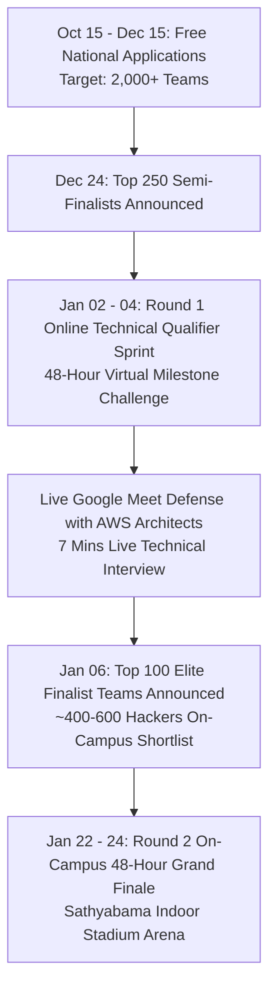
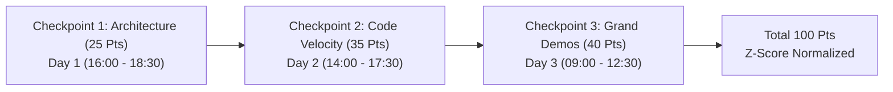

# KAIROS 2027 — Master Agenda, Evaluation Gates & Judging Rubrics (Grand Edition)

> **Document Status:** CANONICAL PROGRAM & EVALUATION SPECIFICATION  
> **Executive Governance:** Super Head 6 (Chief Safety, Governance & Jury Officer) in coordination with Super Head 2 (CTO)  
> **Reporting Directly To:** Thenappan T (Register No: `44110855`), President & Student Builder Group Leader (AWS SBGL)  
> **Faculty Coordinators:** Dr. K. Ashok Kumar & Dr. Balapriya S (Department of CSE, SIST)  
> **Registration Model:** **100% FREE — ZERO ENTRY FEE**  
> **Selection Pipeline:** 2,000+ Applicant Teams $\rightarrow$ **Top 250 Online Semi-Finalists (Jan 02–04)** $\rightarrow$ **Top 100 Elite Finalists (Jan 22–24)**  
> **Venue:** Sathyabama Indoor Stadium (Indoor Auditorium), Chennai — `[APPROVED PLAN]`  
> **Pure Cash Prize Pool:** **₹1,75,000 Pure Liquid Cash Escrow** — `[APPROVED PLAN]`  
> **Source of Truth:** [`00_hackathon_master_brief.md`](./00_hackathon_master_brief.md) · [`02_hard_office_copy_master_agenda.md`](./02_hard_office_copy_master_agenda.md)

---

## 1. The Dual-Phase Quality Architecture

To ensure only production-grade engineering prototypes reach our on-campus stage, KAIROS 2027 deploys a **Two-Tier Technical Evaluation Funnel**:

---

## 2. Round 1: Online Technical Qualifier (January 02–04, 2027)

### 2.1 Virtual Sprint Format & Deliverables
The **Top 250 Semi-Finalist Teams** participate in a mandatory 48-hour virtual milestone evaluation:
* **GitHub Repository Initialization:** Mandatory Kairos webhook attached; initial code scaffolding committed.
* **Architecture Blueprint & Cloud Data Flow (PDF):** High-level topology diagram specifying compute, storage, APIs, and model choices.
* **3-Minute Loom Video Walkthrough:** Screen recording demonstrating the working proof-of-concept / API sandbox execution.
* **Live 7-Minute Virtual Pitch Defense:** Held over 10 parallel Google Meet rooms on **Sunday, January 03 & Monday, January 04** with AWS Solutions Architects and faculty jury (4 mins pitch + 3 mins live Q&A).

### 2.2 50-Point Online Qualifier Rubric:

| Criterion | Description | Points |
|---|---|:---:|
| **1. Problem Depth & Novelty** | Significance of the real-world enterprise/societal challenge; competitive differentiation. | **15 Pts** |
| **2. Cloud Architecture Rigor** | Coherence of AWS cloud topology, microservices design, security/IAM, and scalability. | **15 Pts** |
| **3. Codebase Proof-of-Concept** | Authenticity of working local/sandbox code; quality of initial Git commits; zero boilerplates. | **10 Pts** |
| **4. Live Virtual Defense** | Clarity of thought during live Q&A; understanding of technical trade-offs and edge cases. | **10 Pts** |
| **TOTAL QUALIFIER SCORE** | **Top 100 teams advance to On-Campus Grand Finale (Jan 22–24, 2027).** | **50 Pts** |

---

## 3. Round 2: On-Campus 48-Hour Minute-by-Minute Master Agenda

> **Companion Agenda References:**  
> • **Participant Rulebook & Timeline:** See [`09_participant_handbook_and_rules.md`](./09_participant_handbook_and_rules.md) for participant rules, deliverables, and milestone checkpoints.  
> • **Hard Administrative Copy:** See [`02_hard_office_copy_master_agenda.md`](./02_hard_office_copy_master_agenda.md) for the minute-by-minute operational run of show with power/network telemetry, volunteer shift rotas, and university signoffs.

### Day 1: Friday, January 22, 2027 — Kickoff, Architecture & Cloud Gate
* **09:30 – 10:45 | Grand Red-Carpet Registration & Foyer Check-in:**
  * Verification of College Student ID and Government Photo ID.
  * Distribution of 100% Free Developer Kits (Tees, Smart NFC Badges, Stickers).
  * Bay assignment across Sathyabama Indoor Stadium (Arena Bays A1–D4) and Wi-Fi credential provisioning.
* **10:45 – 12:00 | Grand Inauguration & Keynote Plenary (Indoor Stadium Stage):**
  * Presidential remarks by Institutional Leadership (Vice Chancellor, Dean School of Computing, HOD CSE).
  * **20-Minute Keynote Address by Title Partner Executive** (11:15 AM).
  * **10-Minute Technical Briefing by Co-Powered Partner** (11:35 AM).
  * Unveiling of the 5 Grand Enterprise Innovation Tracks, Evaluation Model, and Code of Conduct.
* **12:00 – 12:15 | Team Relocation to Arena Bays:**
  * Teams settle into designated workstations in Bays A1–D4; spike-protected power strips energized.
* **12:15 | 🚀 CLOCK STARTS: HACKATHON LIVE (48 Hours Continuous Sprint):**
  * Siren sounds; Kairos GitHub Webhook system activated for 100 teams; 48-Hour Sprint officially commences.
* **13:00 – 14:30 | Complimentary Builder Lunch Buffet:**
  * Staggered lunch buffet; VIP Dignitary & Jury Luncheon in Mezzanine Executive Lounge.
* **16:00 – 18:30 | 🔍 CHECKPOINT 1: Architecture & Cloud Feasibility Gate (25 Points):**
  * Table-side technical review by Senior AWS Solutions Architects and Faculty Domain Experts.
* **20:30 – 22:00 | Complimentary Dinner Buffet:**
  * Staggered hot dinner buffet via designated campus dining transit.
* **22:00 | 🔒 Campus Night Lock-In Enforced:**
  * Sathyabama Indoor Stadium exterior secured; campus perimeter security active; zero external movement until 06:00 AM.
* **22:00 – 01:30 | Night 1 Deep Sprint & Architecture Clinics:**
  * High-intensity hacking; quiet rest bays accessible in mezzanine lounge.

---

### Day 2: Saturday, January 23, 2027 — Code Velocity, Plagiarism Audit & The Night Push
* **07:30 – 09:00 | Breakfast Buffet & Refreshments:**
  * Continuous filter coffee bar refreshed.
* **09:30 – 11:30 | AWS Cloud Architecture Walkabout:**
  * AWS Solutions Architects review resource provisioning, serverless latency, and Bedrock model integration.
* **13:00 – 14:30 | Executive Lunch Buffet:**
  * Balanced catering to combat builder fatigue; jury briefing luncheon in Mezzanine Lounge.
* **14:00 – 17:30 | ⚡ CHECKPOINT 2: Code Velocity, API Integration & Plagiarism Audit (35 Points):**
  * In-depth table-side code review by Startup CTOs and Staff Engineers.
  * Verification of live microservices, frontend-backend communication, and API integration.
  * Automated commit history audit: verification that 100% of code was authored during the hackathon window.
* **20:30 – 22:00 | Dinner Buffet & Housekeeping Purge:**
  * Nourishing dinner; stadium arena trash sweep.
* **22:00 | 🔒 Campus Night Lock-In Enforced:**
  * Overnight security perimeter active; medical desk on standby.
* **01:30 | Night 2 Midnight Fuel Booster:**
  * Hot coffee and energy snack drops across all arena bays.
* **02:30 – 06:30 | The Final Sprint (The "Kairos Hours"):**
  * Core development wrap; final UI polish; unit tests, containerization, and pitch slide preparation.

---

### Day 3: Sunday, January 24, 2027 — Grand Demos, Valedictory & Celebrations
* **07:30 – 08:30 | Breakfast & Refreshments**
* **08:30 | 🛑 HARD CODE FREEZE & GITHUB SUBMISSION LOCK:**
  * Automated GitHub repository commit lock via webhook; final submission of video demos and pitch decks.
* **09:00 – 12:30 | 🏆 CHECKPOINT 3: Grand Finale Live Demonstrations (40 Points):**
  * Simultaneous jury panels across Arena Bays and Main Stage.
  * 7-minute live presentation: 4 minutes working demo + 3 minutes grilling by VC Partners, CTOs, and AWS Leaders.
  * Real-time automated scoring with Z-score variance normalization.
* **12:30 – 13:30 | Grand Festive Luncheon:**
  * Celebration buffet for all 400–600 builders, 106 student organizers, faculty, and visiting corporate dignitaries.
* **13:30 – 14:15 | Jury Deliberation & Grand Champion Finalization:**
  * Grand Jury convenes in Mezzanine Executive Lounge; Z-score algorithm normalizes judge variance.
* **14:30 – 16:30 | 🎆 Grand Valedictory, Award Ceremony & Finale (Indoor Stadium Stage):**
  * Address by Keynote VIPs and University Leadership.
  * Presentation of Track Bounties & Special Category Bounties.
  * **Grand Winner Announcement: 2nd Runner-Up, 1st Runner-Up, and Grand Champion (National Trophy & Awards Conferral)**.
* **16:30 – 17:30 | Departure via Chartered University Bus Fleet:**
  * Chartered buses depart campus to major Chennai transit hubs (Central, Egmore, Airport, Tambaram, CMBT).

---

## 4. The 3 On-Campus Evaluation Gates (100-Point Model)

### Detailed Rubric Breakdown:

| Checkpoint Gate | Evaluation Criteria & Descriptions | Max Points |
|---|---|:---:|
| **Checkpoint 1: Architecture & Cloud Feasibility** *(Friday 16:00 – 18:30)* | • Problem Validation & Scope (7 Pts) • AWS Architecture Coherence & Cloud Service Mapping (8 Pts) • Database & Dataflow Resilience (6 Pts) • Security, IAM Roles & Principle of Least Privilege (4 Pts) | **25 Points** |
| **Checkpoint 2: Code Velocity & Anti-Plagiarism** *(Saturday 14:00 – 17:30)* | • Commit Frequency & Authenticity of Git Commits (10 Pts) • Working API & SDK Integration Depth (10 Pts) • Microservice Scaffolding & Code Quality (8 Pts) • Fresh Code Verification (Zero Pre-Built Boilerplates) (7 Pts) | **35 Points** |
| **Checkpoint 3: Grand Finale Live Demo & Pitch** *(Sunday 09:00 – 12:30)* | • Functional Working Prototype & Real-World Execution (15 Pts) • Business Viability, Market Fit & Practical Utility (10 Pts) • Cloud Scalability, Error Handling & System Resilience (8 Pts) • Live Pitch Delivery, Clarity & Defense Under Q&A (7 Pts) | **40 Points** |
| **GRAND TOTAL** | **Cumulative On-Campus Evaluative Score** | **100 Points** |

---

## 5. Algorithmic Z-Score Normalization Engine

Because multiple panels of judges evaluate 100 teams, raw scores are normalized to eliminate judge severity or leniency bias:

$$Z_{i,j} = \frac{X_{i,j} - \mu_j}{\sigma_j}$$

Where:
* $X_{i,j}$ = Raw score assigned by Judge $j$ to Team $i$
* $\mu_j$ = Mean score of all evaluations completed by Judge $j$
* $\sigma_j$ = Standard deviation of scores from Judge $j$

Normalized scores are converted into a scaled index ($T = 50 + 10 \cdot Z_{i,j}$). In the event of a tie:
1. **Tie-Breaker 1:** Higher score in Checkpoint 3 (Working Functional Prototype).
2. **Tie-Breaker 2:** Higher score in Checkpoint 2 (Code Velocity & Authenticity).
3. **Tie-Breaker 3:** Grand Jury Chair consensus review.

---

## 6. Judge Conflict-of-Interest & Ethics Policy

1. **Mandatory Disclosure:** Evaluators must declare any conflict of interest (e.g., student from their alma mater, family relation, direct mentee, or company employee) prior to round commencement.
2. **Automated Recusal:** Any judge with a declared conflict is automatically reassigned to a different track or evaluation bay.
3. **No Commercial Exclusivity Claims:** Evaluators cannot require student teams to assign intellectual property as a condition of receiving high scores. All participant code remains 100% student-owned.
