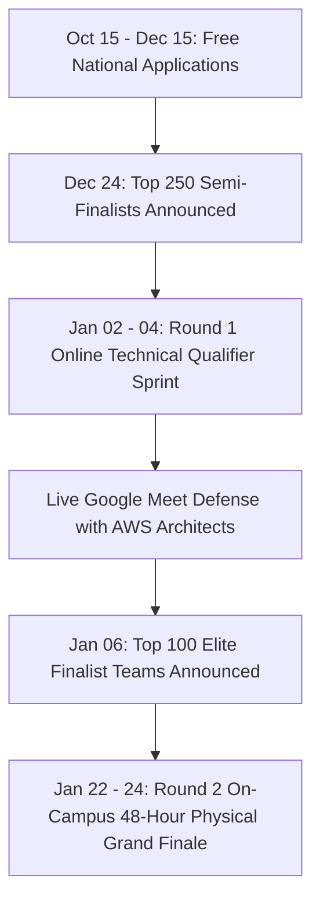

# Kairos 2027 — Master Agenda, Evaluation Gates & Judging Rubrics (Grand Edition)

**Executive Governance:** Super Head 6 (Chief Safety, Governance & Jury Officer) in coordination with Super Head 2 (CTO)  
**Reporting Directly To:** Thenappan T (Register No: 44110855), President & Student Builder Group Leader (AWS SBGL)  
**Faculty Coordinators:** Dr. Balapriya .S & Dr. K. Ashok Kumar (Department of CSE, SIST)  
**Registration Model:** **100% FREE — ZERO ENTRY FEE**  
**Selection Pipeline:** 2,000+ Applicant Teams $\rightarrow$ **Top 250 Online Semi-Finalists (Jan 02–04)** $\rightarrow$ **Top 100 Elite Finalists (Jan 22–24)**  
**Pure Cash Prize Pool:** **₹1,75,000 Pure Liquid Cash**  

---

## 1. The Dual-Phase Quality Architecture

To ensure only peak-quality engineering systems reach our on-campus stages, Kairos 2027 deploys a **Two-Tier Technical Evaluation Funnel**:

---

## 2. Round 1: Online Technical Qualifier (January 02–04, 2027)

### 2.1 Virtual Sprint Format & Deliverables
The **Top 250 Semi-Finalist Teams** participate in a mandatory 48-hour virtual milestone evaluation:
* **GitHub Repository Initialization:** Mandatory Kairos webhook attached; initial code scaffolding committed.
* **Architecture Blueprint & Cloud Data Flow (PDF):** High-level topology diagram specifying compute, storage, APIs, and model choices.
* **3-Minute Loom Video Walkthrough:** Screen recording demonstrating the working proof-of-concept / API sandbox execution.
* **Live 7-Minute Virtual Pitch Defense:** Held over 10 parallel Google Meet rooms on **Sunday, January 03 & Monday, January 04** with AWS Solutions Architects and faculty jury (4 mins pitch + 3 mins live Q&A).

### 2.2 50-Point Online Qualifier Rubric:
| Criterion | Description | Points |
|---|---|:---:|
| **1. Problem Depth & Novelty** | Significance of the real-world enterprise/societal challenge; competitive differentiation. | **15 Pts** |
| **2. Cloud Architecture Rigor** | Coherence of AWS cloud topology, microservices design, security/IAM, and scalability. | **15 Pts** |
| **3. Codebase Proof-of-Concept**| Authenticity of working local/sandbox code; quality of initial Git commits; zero boilerplates. | **10 Pts** |
| **4. Live Virtual Defense** | Clarity of thought during live Q&A; understanding of technical trade-offs and edge cases. | **10 Pts** |
| **TOTAL SCORE** | Top 100 teams advance to the On-Campus Grand Finale on January 22–24, 2027. | **50 Pts** |

---

## 3. Round 2: On-Campus 48-Hour Minute-by-Minute Master Agenda

### Day 1: Friday, January 22, 2027 — Kickoff, Architecture & Cloud Gate
* **07:30 – 09:30 | Grand Red-Carpet Registration & Foyer Check-in:**
  * Verification of Government/College Photo IDs.
  * Distribution of 100% Free Developer Kits (Tees, Smart Badges, Stickers).
  * Room allocation across Central Library Lecture Halls 1–3 and high-speed Wi-Fi onboarding.
* **09:30 – 10:45 | Grand Inauguration & Keynote Plenary (Central Library Auditorium):**
  * Welcome address by **Thenappan T (President & SBGL, AWS SBG SIST)**.
  * Presidential remarks by Institutional Leadership (Vice Chancellor, Dean School of Computing).
  * **20-Minute Keynote Address by Title Sponsor Executive** (AWS / Enterprise Tech Partner).
  * **10-Minute Technical Briefing by Co-Powered By Sponsor**.
  * Unveiling of the 5 Grand Enterprise Innovation Tracks and Hackathon Code of Conduct.
* **10:45 – 11:00 | Team Relocation to Hacking Bays:**
  * Teams settle into designated bays across Lecture Halls 1–3; connection to spike-protected power strips.
* **11:00 | 🚀 CLOCK STARTS: HACKATHON LIVE (48 Hours Continuous Sprint):**
  * Official GitHub repository initialization with mandatory Kairos webhook listeners.
* **13:00 – 14:30 | Complimentary Lunch Buffet (Mess Halls & VIP Dining in Top Lounge):**
  * Staggered lunch buffet; continuous filter coffee bar opens.
* **16:00 – 18:30 | 🔍 CHECKPOINT 1: Architecture & Cloud Feasibility Gate (25 Points):**
  * Table-side technical review by Senior AWS Solutions Architects and Faculty Domain Experts.
* **19:00 – 20:00 | Sponsor Tech Masterclasses & API Sandboxes (Auditorium):**
  * Optional deep-dive masterclasses by Track Sponsors on generative AI, distributed databases, and edge IoT telemetry.
* **20:30 – 22:00 | Complimentary Dinner Buffet:**
  * Staggered dinner via segregated stairwells (North for Boys, South for Girls).
* **22:00 | 🔒 Campus Night Lock-In Enforced:**
  * Central Library doors secured; night perimeter security active; zero external movement until 06:00 AM.
* **23:30 – 01:00 | Round 1 1-on-1 Mentor Clinics:**
  * Mentors rotate through hacking bays unblocking cloud roadblocks and API limits.
* **01:30 | Midnight Energy Drop & Coffee Bar:**
  * Fresh coffee/tea and energy snacks delivered at the Library Foyer.

---

### Day 2: Saturday, January 23, 2027 — Prototyping, Code Velocity & Night CTF
* **07:30 – 09:00 | Builder Breakfast & Filter Coffee:**
  * South Indian & Continental breakfast buffet; continuous coffee and fruit baskets.
* **09:30 – 11:30 | AWS Cloud Architecture Optimization Walkabout:**
  * AWS Solutions Architects review resource provisioning and Bedrock model latency.
* **13:00 – 14:30 | Executive Lunch Buffet:**
  * Balanced meal to combat fatigue.
* **14:00 – 17:30 | ⚡ CHECKPOINT 2: Code Velocity, API Integration & Plagiarism Audit (35 Points):**
  * In-depth code review by Startup CTOs and Staff Engineers.
  * Verification of live running local/cloud microservices, working frontend-backend communication, and API integration.
  * Automated commit history audit: verification that 100% of code was authored during the hackathon window.
* **18:00 – 19:30 | Mid-Hack De-Stress Hour & Live Esports Showcase:**
  * Retro arcade corner and acoustic performance in the library courtyard.
* **20:30 – 22:00 | Dinner Buffet & Refreshments:**
  * Nourishing dinner via segregated mess corridors.
* **23:00 – 01:00 | Midnight Lightning CTF & Speed Typing Battle:**
  * 30-minute mini-quests for cash and swag bounties.
* **01:30 | Night 2 Midnight Fuel Booster:**
  * Hot coffee and energy snack drops across all lecture halls.
* **02:30 – 06:30 | The Final Sprint (The "Kairos Hours"):**
  * Core development wrap; final UI polish; unit tests, and containerization.

---

### Day 3: Sunday, January 24, 2027 — Grand Demos, Valedictory & Celebrations
* **07:30 – 08:30 | Final Sprint Breakfast:**
  * Quick-service breakfast buffet.
* **08:30 | 🛑 HARD CODE FREEZE & GITHUB SUBMISSION LOCK:**
  * Automated GitHub repository commit lock via webhook; final submission of video demos and pitch decks.
* **09:00 – 12:30 | 🏆 CHECKPOINT 3: Grand Finale Live Demonstrations (40 Points):**
  * Simultaneous jury panels across Lecture Halls 1–3 and Auditorium.
  * 7-minute live presentation: 4 minutes working demo + 3 minutes grilling by VC Partners, CTOs, and AWS Leaders.
  * Real-time automated scoring with Z-score variance normalization.
* **12:30 – 13:30 | Grand Festive Luncheon:**
  * Celebration buffet for all participants, organizers, mentors, and jury members.
* **13:30 – 14:15 | Jury Deliberation & Top 10 Plenary Shortlisting:**
  * Grand Jury convenes in the Top Floor Executive Lounge to finalize the Overall Champions and Track Winners.
* **14:30 – 16:30 | 🎆 Grand Valedictory, Award Ceremony & Finale (Auditorium):**
  * Address by Keynote VIPs and University Leadership.
  * Presentation of Track Bounties (5 × ₹7,000 = ₹35,000 Cash).
  * Presentation of Special Category Bounties (₹25,000 Cash).
  * **Grand Winner Announcement: 2nd Runner Up (₹20,000), 1st Runner Up (₹35,000), and Grand Champion (₹60,000 Pure Cash + Grand Trophy)**.
  * Celebration and departure via chartered university bus fleet.

---

## 4. The 3 On-Campus Evaluation Gates (100-Point Model)

* **Checkpoint 1: Architecture & Cloud Feasibility (25 Points):** Problem validation (7 Pts), AWS architecture & services (8 Pts), technical scope (6 Pts), security & IAM (4 Pts).
* **Checkpoint 2: Code Velocity & Anti-Plagiarism (35 Points):** Git commit cadence (10 Pts), API/SDK integration (10 Pts), software engineering quality (8 Pts), fresh code authenticity (7 Pts).
* **Checkpoint 3: Grand Finale Live Demo & Pitch (40 Points):** Working functional prototype (15 Pts), business viability & market fit (10 Pts), cloud scalability & resilience (8 Pts), pitch articulation (7 Pts).

---

## 5. Algorithmic Z-Score Normalization Engine

Because multiple panels of judges evaluate 100 teams, raw scores are normalized using the Z-score algorithm:

$$Z_{i,j} = \frac{X_{i,j} - \mu_j}{\sigma_j}$$

Where $X_{i,j}$ is raw score, $\mu_j$ is judge mean, and $\sigma_j$ is judge standard deviation. This mathematical model neutralizes judge severity bias across all panels.
