# KAIROS 2027 — Itemized Master Budget, Procurement Catalog & Financial Governance (Grand Edition)

> **Document Status:** CANONICAL FINANCIAL GOVERNANCE & BUDGET MODEL  
> **Executive Oversight:** Super Head 1 (CPFO) in coordination with Treasury Sub-Head  
> **Accountable Leads:** Nikki (Nangaiyar M, Reg: `44612059`), CPFO & Sponsorship Head; Reporting to Thenappan T (President & SBGL, Reg: `44110855`)  
> **Faculty Coordinators:** Dr. K. Ashok Kumar & Dr. Balapriya S (Department of CSE, SIST)  
> **Target Event Dates:** January 22 – 24, 2027 (On-Campus Grand Finale) · January 02 – 04, 2027 (Online Technical Qualifier)  
> **Registration Model:** **100% FREE — ZERO ENTRY FEE** (Funded via corporate sponsorships and institutional grant)  
> **Venue:** Sathyabama Indoor Stadium (Indoor Auditorium), Chennai — `[APPROVED PLAN]`  
> **Pure Cash Prize Escrow:** **₹1,75,000 Pure Liquid Cash** — `[APPROVED PLAN]`  
> **Operating Budget Model:** **₹3,50,000 – ₹4,00,000 Liquid Operational Capital Baseline**  
> **Source of Truth:** [`00_hackathon_master_brief.md`](./00_hackathon_master_brief.md) · [`20_indoor_auditorium_venue_transition_and_budget_plan.md`](./20_indoor_auditorium_venue_transition_and_budget_plan.md)

---

## 1. Master Financial Architecture & Inflow Modeling

The KAIROS 2027 financial architecture operates under an enterprise capital structure calibrated against empirical post-event benchmarks from **Vexora’26** (ACM Sathyabama Hackathon conducted at Sathyabama Indoor Stadium).

The budget separates **Liquid Operational Cash** (which covers round tables, stage production, LED walls, merchandise, catering, and the guaranteed pure cash prize escrow) from **Estimated In-Kind Partner Value** (cloud credits, developer tooling licenses, and energy beverages).

```mermaid
graph TD
    INFLOW["Total Working Capital Pool<br/>Target: ₹3,50,000 – ₹4,00,000 Liquid Cash"]
    
    INFLOW --> S1["External Corporate Cash Sponsorship: ₹3,00,000 – ₹3,50,000<br/>(Title ₹2.0L + Co-Powered ₹1.0L + Tracks @ ₹25k)"]
    INFLOW --> S2["Sathyabama Institutional Grant: ₹50,000<br/>(Approved Management Budget Allocation)"]
    INFLOW --> S3["Participant Entry Fees: ₹0<br/>(100% Free Meritocratic Model)"]
    
    INFLOW --> EXP1["Pure Cash Prize Escrow: ₹1,75,000"]
    INFLOW --> EXP2["Arena Table Infrastructure & Linens: ₹38,000"]
    INFLOW --> EXP3["Stage Production & LED Video Wall: ₹32,000"]
    INFLOW --> EXP4["Participant Swag Kits & Smart Badges: ₹45,000"]
    INFLOW --> EXP5["Continuous Refreshments & Midnight Fuel: ₹25,000"]
    INFLOW --> EXP6["VIP Dignitary Care & Executive Lounge: ₹15,000"]
    INFLOW --> EXP7["Stadium Mega Banners & Trophies: ₹12,000"]
    INFLOW --> EXP8["Arena Ambience & Contingency Buffer: ₹8,000"]
```



### 1.1 Inflow Scenarios & Mathematical Reconciliation

To ensure fiscal stability across variable closing cycles, the team operates under three calibrated funding scenarios:

| Revenue Category | Conservative Baseline (₹2.5L) | Balanced Target Model (₹3.75L) | Stretch Enterprise Model (₹5.0L) | Operational Certainty |
|---|:---:|:---:|:---:|---|
| **Title Presenting Partner** | ₹1,50,000 (1 discounted slot) | **₹2,00,000 (1 full slot)** | ₹2,00,000 (1 full slot) | `[PROPOSED]` |
| **Co-Powered By Partners** | ₹0 (No slot closed) | **₹1,00,000 (1 slot closed)** | ₹2,00,000 (2 slots closed) | `[PROPOSED]` |
| **Associate Partners** | ₹0 | **₹0** | ₹50,000 (1 slot closed) | `[PROPOSED]` |
| **Track Bounty Partners** | ₹50,000 (2 tracks @ ₹25k) | **₹75,000 (3 tracks @ ₹25k)** | ₹1,00,000 (4 tracks @ ₹25k) | `[PROPOSED]` |
| **Sathyabama Institutional Grant** | ₹50,000 | **₹50,000** | ₹50,000 | `[PROPOSED]` |
| **Participant Entry Fees** | **₹0 (FREE)** | **₹0 (FREE)** | **₹0 (FREE)** | `[APPROVED PLAN]` |
| **TOTAL LIQUID CASH INFLOW** | **₹2,50,000** | **₹3,75,000 (Target Model)** | **₹6,00,000 (Capped @ ₹5.0L)** | — |
| *Estimated Partner In-Kind Value* | *~$10,000 Credits* | *~$50,000 Credits + Fuel* | *~$100,000 Credits + Tooling + Fuel* | Non-Liquid Grants |

---

## 2. Exhaustive Itemized Expenditure Catalog (Indoor Auditorium Model)

*(Calibrated against Vexora’26 Post-Event Report benchmarks; see full deep dive in [`20_indoor_auditorium_venue_transition_and_budget_plan.md`](./20_indoor_auditorium_venue_transition_and_budget_plan.md))*

```text
========================================================================================================
KAIROS 2027 (INDOOR AUDITORIUM EDITION) — ITEMIZED MASTER EXPENDITURE CATALOG
========================================================================================================
REF   CATEGORY / ITEM DESCRIPTION                 SPECIFICATIONS & NOTES        QTY    UNIT (₹) TOTAL (₹)
--------------------------------------------------------------------------------------------------------
1. PURE CASH PRIZE POOL (ESCROW DISBURSEMENT VIA DIRECT WIRE)
1.1   Grand National Champion (1st Place Overall) Pure Liquid Cash + Trophy + VC  1      60,000   ₹60,000
1.2   First Runner-Up (2nd Place Overall)         Pure Liquid Cash + Trophy       1      35,000   ₹35,000
1.3   Second Runner-Up (3rd Place Overall)        Pure Liquid Cash + Trophy       1      20,000   ₹20,000
1.4   5 Enterprise Track Category Winners         5 Tracks × ₹7,000 Pure Cash     5       7,000   ₹35,000
1.5   Best All-Women Hacker Team Bounty           Special Category Cash Bounty    1      10,000   ₹10,000
1.6   Best Freshman / Rookie Team Bounty          Special Category Cash Bounty    1       7,500    ₹7,500
1.7   Most Scalable AWS Architecture Bounty       Special Category Cash Bounty    1       7,500    ₹7,500
--------------------------------------------------------------------------------------------------------
SUBTOTAL: CASH PRIZES (NON-NEGOTIABLE ESCROW)                                                 ₹1,75,000
--------------------------------------------------------------------------------------------------------

2. VENUE FLOOR INFRASTRUCTURE & ARENA TABLE SETUP (INDOOR STADIUM REQUIREMENT)
2.1   Banquet Round Tables with Heavy Cover Cloth 5ft Round Foldable Tables +     75        360   ₹27,000
                                                  Full Black/Navy Fitted Linens
                                                  (Negotiated 48h campus bulk rate)
2.2   Heavy-Duty Rubber Floor Cable Ramps & Mats  Dual-Channel Cable Cross Ramps  20        300    ₹6,000
                                                  protecting power runs on arena
2.3   Arena Cable Binding & Heavy Floor Mat Tape  High-adhesion gaffer/duct tape  12 rolls   250   ₹3,000
2.4   Extra 16A Spike Boards / Surge Adapters     Buffer units for central hubs   10        200    ₹2,000
--------------------------------------------------------------------------------------------------------
SUBTOTAL: ARENA FLOOR & TABLE INFRASTRUCTURE                                                   ₹38,000
--------------------------------------------------------------------------------------------------------

3. STAGE PRODUCTION, LED VIDEO WALL & STADIUM AUDIO REINFORCEMENT
3.1   Stage P2.5/P3 High-Res LED Video Display    12ft × 8ft Active Stage Canvas  3 days  18,000  ₹18,000
                                                  (Leaderboards, Timer, Demos)
3.2   Stadium Acoustic Line-Array PA Reinforcement 4 Concert Tops + Audio Mixer +  3 days   9,000   ₹9,000
                                                  Equalizer tuned for stadium echo
3.3   Wireless Cordless UHF & Lapel Microphones   Shure UHF tuned multi-channel   6 sets   5,000   ₹5,000
--------------------------------------------------------------------------------------------------------
SUBTOTAL: STAGE PRODUCTION & AUDIO-VISUAL                                                      ₹32,000
--------------------------------------------------------------------------------------------------------

4. PARTICIPANT MERCHANDISE, SMART ID BADGES & DEVELOPER KITS
4.1   Dry-Fit Builder T-Shirts (180 GSM)          Cyber Gradient AWS/Kairos Tee   450        55   ₹24,750
4.2   Smart Lanyards & Laser-Etched QR ID Badges  Matte PVC Badge + Woven Ribbon  450        22    ₹9,900
4.3   Vinyl Die-Cut Laptop Sticker Packs (4/pack) Custom AWS & Kairos Vinyl Art   450 pk     12    ₹5,400
4.4   High-GSM Foil Embossed Participation Certs  Hard Stock Folders + Seals      450 sets   11    ₹4,950
--------------------------------------------------------------------------------------------------------
SUBTOTAL: MERCHANDISE, BADGES & DEVELOPER KITS                                                 ₹45,000
--------------------------------------------------------------------------------------------------------

5. CONTINUOUS REFRESHMENTS, 48-HOUR MIDNIGHT FUEL & SNACKS SUPPLEMENT
5.1   Evening High Tea & Fresh Snacks Supplement  Tea/Filter Coffee + Hot Snacks  450 pax    18    ₹8,100
                                                  (Samosas/Cutlets) both evenings
5.2   Midnight Continuous Fuel Bar (Both Nights)  01:30 AM Fresh Hot Coffee/Tea   2 nights 4,450   ₹8,900
                                                  and High-Energy Glucose Biscuits
5.3   Mineral Water Bubble Tops & Dispensers      20L Water Cans placed in arena  60 cans    80    ₹4,800
5.4   In-Kind Red Bull Activation & Chiller Logistics Chiller setup, ice & cups   1 lot    3,200   ₹3,200
--------------------------------------------------------------------------------------------------------
SUBTOTAL: REFRESHMENTS & MIDNIGHT FUEL                                                         ₹25,000
--------------------------------------------------------------------------------------------------------

6. VIP JURY CARE, DIGNITARY HOSPITALITY & GREEN ROOM AMENITIES
6.1   Mezzanine VIP Lounge Gourmet Hospitality    Espresso Bar, Fresh Dry Fruits, 30 pax    250    ₹7,500
                                                  Assorted Cookies & Refreshments
6.2   Grand Jury Day 3 Executive Buffet Lunch     Special Chef Buffet for VCs &   25 pax    180    ₹4,500
                                                  Sponsor CXOs (Mezzanine Lounge)
6.3   Traditional Shawls & Custom Mementos        Handcrafted Brass/Wood Memento  15 units  200    ₹3,000
                                                  for Industry Judges
--------------------------------------------------------------------------------------------------------
SUBTOTAL: VIP HOSPITALITY & MEMENTOS                                                           ₹15,000
--------------------------------------------------------------------------------------------------------

7. STADIUM BRANDING, MEGA BACKDROP, STANDEES & TROPHY SUITE
7.1   Indoor Stadium Mega Stage Backdrop Banner   50ft × 10ft High-Res Vinyl      1 unit   5,500   ₹5,500
7.2   Roll-Up Metal Standees (6ft × 3ft)          Track info & sponsor branding   10 units  350    ₹3,500
7.3   Indoor Stadium Entrance Welcome Arch Banner 15ft × 6ft Arch Vinyl           1 unit   1,200   ₹1,200
7.4   Laser-Cut Acrylic & Metal Trophies          Champions & Track Award Set     8 units   225    ₹1,800
--------------------------------------------------------------------------------------------------------
SUBTOTAL: BRANDING, MEGA BANNERS & AWARDS                                                      ₹12,000
--------------------------------------------------------------------------------------------------------

8. ON-SPOT VENUE OPERATIONS, DECOR & CONTINGENCY BUFFER
8.1   Arena Floor Decor & Creative Ambience       Black drapes, neon signage,     1 lot    3,500   ₹3,500
                                                  props & boundary markers
8.2   Live Printouts, Score Sheets & Stationeries Evaluation forms, clipboard pads 1 lot   2,000   ₹2,000
8.3   On-Spot Emergency Consumables & Tools       Scissors, cutters, extra cords, 1 lot    2,500   ₹2,500
                                                  marker pens, first-aid replenishment
--------------------------------------------------------------------------------------------------------
SUBTOTAL: ARENA DECOR, PRINTING & CONTINGENCY                                                   ₹8,000
--------------------------------------------------------------------------------------------------------

========================================================================================================
GRAND TOTAL EXPENDITURE BUDGET: ₹3,50,000 | BALANCED AGAINST INFLOW: ₹3,50,000
========================================================================================================
```

---

## 3. Financial Governance, Audit & Escrow Disbursement

1. **Pure Cash Prize Escrow Assurance**:
   * Prize monies (₹1,75,000) are ring-fenced and locked in audited institutional escrow prior to January 20, 2027.
   * Winners receive direct, instant NEFT bank transfers upon identity verification at the Valedictory Ceremony.
2. **Dual-Signoff Protocol**:
   * Any expenditure above ₹5,000 requires joint written authorization from President **Thenappan T** and Faculty Coordinator **Dr. Balapriya S**.
3. **Transparency & GST Invoicing**:
   * All vendor procurements (tables, banners, AV, hardware) must provide official GST invoices.
   * A post-event financial utilization audit report will be submitted to the Dean (School of Computing) and Vice Chancellor within 7 business days of event conclusion.
4. **Policy Notice: Referral Bounty Quarantine**:
   > [!WARNING]
   > **`[APPROVAL REQUIRED — DO NOT OFFER]`**  
   > The previously drafted "Rainmaker Bounty" (paying 10%–15% cash commissions to students for sourcing sponsors) is **NOT an active policy**. Unapproved cash commissions carry statutory tax (TDS) and university compliance risks. Organizers must NOT offer cash bounties to students. Contributor recognition operates via non-monetary academic honors (Letters of Commendation, VIP Passes, Awards).
