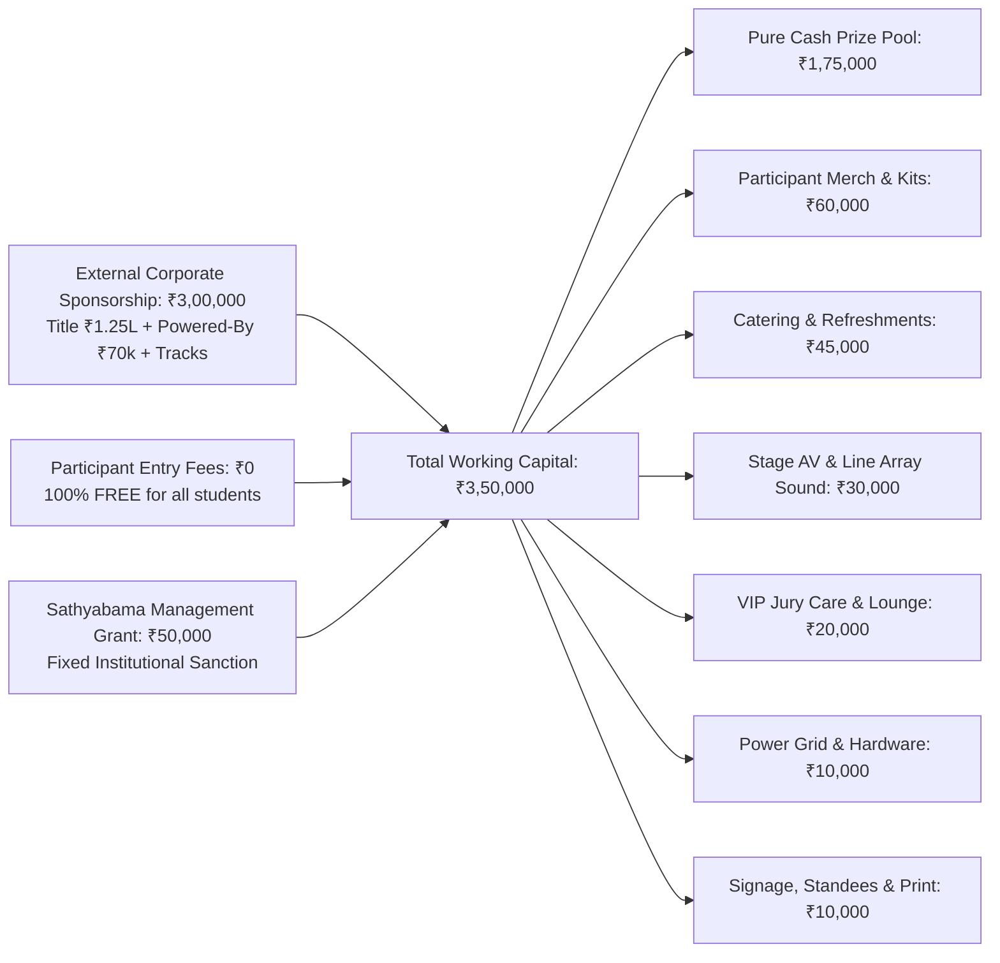

# Kairos 2027 — Itemized Master Budget, Procurement Catalog & Financial Governance (Grand Edition)

**Super Head 1 Mandate:** Command the Financial Architecture; manage ₹3,50,000 in operational capital under a **100% Free / Zero Entry Fee Model**; enforce procurement audits; manage GST compliance; guarantee instant NEFT escrow disbursement of the ₹1,75,000 pure cash prize pool.  
**Governing Standard:** `E:\AWS SBGL\ANTI-Help\10_HACKATHON_SPONSORSHIP_LETTERS_AND_OUTREACH_KIT.md`  
**Accountable Leads:** Chief Partnerships & Finance Officer (CPFO) & Treasurer — Reporting directly to President Thenappan T (Register No: 44110855)  
**Faculty Coordinators:** Dr. Balapriya .S & Dr. K. Ashok Kumar (Department of CSE, SIST)  
**Event Dates:** January 22 – 24, 2027 (On-Campus Grand Finale) · January 02 – 04, 2027 (Online Technical Qualifier)  
**Registration Model:** **100% FREE — ZERO ENTRY FEE** (Funded 100% via corporate sponsorships and institutional grant)  
**Scale:** 100 Shortlisted National Teams (400–500 Hackers) · 106 Organizers · 40+ Industry Mentors/VIPs  

---

## 1. Master Financial Architecture & Income Streams

The Kairos 2027 financial model is built on an enterprise capital structure totaling **₹3,50,000 in working operational capital**, anchored by **₹3,00,000 in external corporate sponsorships** and a **₹50,000 Sathyabama management grant**:



### 1.1 Inflow Breakdown: Realistic Scenarios

| Revenue Stream | Baseline Conservative | Target Grand Model | Stretch Enterprise | Status / Pipeline |
|---|:---:|:---:|:---:|---|
| **External Corporate Sponsorship (Cash)** | ₹2,50,000 | **₹3,00,000** | ₹3,50,000 | Active Outreach |
| • *Title Sponsor (1 Partner) [Target > ₹1L]* | ₹1,00,000 | **₹1,25,000** | ₹1,50,000 | High-Priority Outreach |
| • *Co-Powered By Sponsor (1 Partner)* | ₹50,000 | **₹70,000** | ₹80,000 | In Active Pipeline |
| • *Track Bounty & Associate Partners (3 Partners)* | ₹75,000 | **₹1,05,000** | ₹1,20,000 | Dedicated Track Challenges |
| **Sathyabama Institutional Grant** | ₹50,000 | **₹50,000** | ₹50,000 | Approved by Management |
| **Participant Entry Fees** | **₹0 (FREE)** | **₹0 (FREE)** | **₹0 (FREE)** | **100% Free Meritocracy** |
| **TOTAL WORKING OPERATIONAL INFLOW** | **₹3,00,000** | **₹3,50,000** | **₹4,00,000** | — |

---

## 2. Exhaustive Itemized Expenditure Catalog

```text
========================================================================================================
KAIROS 2027 (GRAND EDITION) — ITEMIZED MASTER EXPENDITURE CATALOG (100% FREE MODEL)
========================================================================================================
CATEGORY / ITEM DESCRIPTION                 SPECIFICATIONS & BRANDING            QTY   UNIT (₹) TOTAL (₹)
--------------------------------------------------------------------------------------------------------
1. PURE CASH PRIZE POOL (ESCROW DISBURSEMENT)
• Grand Champion (1st Place Overall)        Pure Cash + Trophy + VC Fast-Track   1       60,000   ₹60,000
• 1st Runner-Up (2nd Place Overall)         Pure Cash + Trophy                   1       35,000   ₹35,000
• 2nd Runner-Up (3rd Place Overall)         Pure Cash + Trophy                   1       20,000   ₹20,000
• 5 Grand Track Category Winners            5 Tracks × ₹7,000 Pure Cash          5        7,000   ₹35,000
• Best All-Women Hacker Team Bounty         Special Category Pure Cash Bounty    1       10,000   ₹10,000
• Best Freshman / Rookie Team Bounty        Special Category Pure Cash Bounty    1        7,500    ₹7,500
• Most Scalable AWS Architecture Bounty     Special Category Pure Cash Bounty    1        7,500    ₹7,500
--------------------------------------------------------------------------------------------------------
SUBTOTAL: CASH PRIZES                                                                           ₹1,75,000
--------------------------------------------------------------------------------------------------------

2. PARTICIPANT MERCHANDISE, STREETWEAR & DEVELOPER KITS
• Dry-Fit Builder T-Shirts (180 GSM)        Cyber Gradient / Official Hackathon  500         70   ₹35,000
• Laser-Etched Smart ID Badges & Lanyards   Matte Finish + Custom Woven Ribbon   500         25   ₹12,500
• Tech Sticker Packs & Badges               Die-Cut Vinyl AWS/Kairos Stickers    500 pk      10    ₹5,000
• Certificate Printing & Folders            High-GSM Embossed Foil Certificates  500 sets    15    ₹7,500
--------------------------------------------------------------------------------------------------------
SUBTOTAL: MERCHANDISE & KITS                                                                     ₹60,000
--------------------------------------------------------------------------------------------------------

3. CATERING SUPPLEMENT, REFRESHMENTS & MIDNIGHT ENERGY STATIONS
• Mess Hall Buffet Coordination Supplement  High-Protein Subsidy & Water Cans    450 pax     40   ₹18,000
• Evening High Tea & Fresh Snacks (2 Days)  Samosas / Cutlets / Filter Coffee    450 pax     30   ₹13,500
• Midnight Coffee, Tea & Biscuit Fuel       Continuous 01:30 AM Fuel Bar (2 Nts) 2 nts    6,750   ₹13,500
--------------------------------------------------------------------------------------------------------
SUBTOTAL: REFRESHMENTS & FUEL                                                                    ₹45,000
--------------------------------------------------------------------------------------------------------

4. STAGE PRODUCTION, AUDIO-VISUAL & SOUND REINFORCEMENT
• Auditorium Line Array PA & Sound System   Concert Sound Tops + Audio Mixer     3 days  15,000   ₹15,000
• Stage Truss Lighting & Foyer Spots        Sharpy Moving Lights + Stage Washes  3 days  10,000   ₹10,000
• Wireless Cordless & Collar Microphones    Shure UHF Multi-Frequency Mics       8 units  5,000    ₹5,000
--------------------------------------------------------------------------------------------------------
SUBTOTAL: STAGE & AV PRODUCTION                                                                  ₹30,000
--------------------------------------------------------------------------------------------------------

5. VIP JURY CARE, MENTOR HOSPITALITY & MEMENTOS
• Top Floor VIP Executive Lounge Dining     High Tea, Dry Fruits & Special Lunch 35 pax     300   ₹10,500
• Traditional Silk Shawls & Mementos        Handcrafted Sandalwood/Brass Mementos 20 units   475    ₹9,500
--------------------------------------------------------------------------------------------------------
SUBTOTAL: VIP HOSPITALITY                                                                        ₹20,000
--------------------------------------------------------------------------------------------------------

6. INFRASTRUCTURE, ELECTRICAL EXTENSIONS & HARDWARE
• Heavy-Duty Multi-Socket Power Strips      6A/16A Spike Protected (40 units)    1 lot    6,000    ₹6,000
• Industrial DB Hub Cables & Connectors     Master DB Distribution & Cabling     1 lot    4,000    ₹4,000
--------------------------------------------------------------------------------------------------------
SUBTOTAL: ELECTRICAL & INFRASTRUCTURE                                                            ₹10,000
--------------------------------------------------------------------------------------------------------

7. SIGNAGE, STANDS, BANNERS & TROPHIES
• Metal Standee Display Banners (6x3ft)     16 Units across Central Library      16 units   350    ₹5,600
• Main Stage Metal Frame Backdrop Banner    20ft × 10ft High-Res Vinyl Banner    1 unit   2,400    ₹2,400
• Custom Trophy Set (Champions & Tracks)    Laser Engraved Acrylic & Metal       8 units    250    ₹2,000
--------------------------------------------------------------------------------------------------------
SUBTOTAL: BRANDING & TROPHIES                                                                    ₹10,000
--------------------------------------------------------------------------------------------------------

========================================================================================================
GRAND TOTAL EXPENDITURE BUDGET: ₹3,50,000 | BALANCED AGAINST INFLOW: ₹3,50,000
========================================================================================================
```

---

## 3. Financial Governance, Audit & Escrow Disbursement

1. **Pure Cash Prize Escrow Assurance**:
   * Prize monies will be locked in an institutional escrow account prior to January 20, 2027.
   * Winners receive direct, instant NEFT wire transfers upon identity verification at the Valedictory Ceremony.
2. **Dual-Signoff Protocol**:
   * Any expenditure above ₹5,000 requires joint written authorization from President **Thenappan T** and Faculty Coordinator **Dr. Balapriya .S**.
3. **Transparency & GST Compliance**:
   * All vendors (printing, AV, catering, hardware) must provide valid GST invoices.
   * A post-event financial audit report will be submitted to the Dean (School of Computing) and Vice Chancellor within 7 business days of event conclusion.
