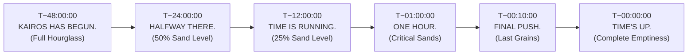
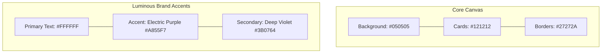

# KAIROS — Master Brand Guidelines & Visual Identity System

> **Visual Governance:** Division 2 (Design & Creative Assets) & Division 4 (Media & PR)  
> **Direct Leads:** **Rikish B** (Design Lead, Reg: `44110664`) & **Caroline Mary McPherson** (Media Head 1, Reg: `44110124`)  
> **Supervising Authority:** **Thenappan T** (President & SBGL, Reg: `44110855`, AWS Student Builder Group SIST)  
> **Governing Standards:** [00_hackathon_master_brief.md](./00_hackathon_master_brief.md) · [05_marketing_media_and_promotion.md](./05_marketing_media_and_promotion.md) · [16_website_design_and_experience_specification.md](./16_website_design_and_experience_specification.md) · [17_content_reference_and_copy_bank.md](./17_content_reference_and_copy_bank.md) · [20_indoor_auditorium_venue_transition_and_budget_plan.md](./20_indoor_auditorium_venue_transition_and_budget_plan.md)  
> **Master Slogan:** **`KAIROS: MAKE TIME. MAKE SOMETHING.`**  
> **Core Narrative:** `Time → Idea → Build → Ship`  
> **Visual Direction:** Cosmic Cyber Violet · Deep Void Obsidian · Precision Celestial Engineering  
> **Recognition Objective:** *Someone should see any KAIROS asset for 2 seconds and immediately recognize the hackathon.*  

---

## 🏛️ Executive Brand Philosophy & Evergreen Architecture

### The Meaning of "Kairos" (καιρός)
In classical Greek philosophy, *Chronos* represents quantitative, sequential time—the ticking of an ordinary clock. In contrast, **Kairos** represents the supreme, qualitative, fleeting moment of opportunity: the right time, the opportune hour where preparation meets historic possibility.

For the **AWS Student Builder Group at Sathyabama Institute of Science and Technology (SIST), Chennai**, KAIROS embodies the intense 48-hour event horizon where raw student intellect transforms into enterprise-grade cloud systems and autonomous intelligent agents.

```
       ✦                             ✦
             ╭──────────────────╮
         ─── │   K A I R O S    │ ───
             ╰──────────────────╯
       ✦        [ HOURGLASS ]        ✦
           MAKE TIME. MAKE SOMETHING.
```

### ⚠️ Critical Design Rule: Evergreen Logo Architecture
> [!IMPORTANT]
> **Do NOT put "48-HOUR HACKATHON" inside the main circular logo anymore.**  
> Keep the primary circular logo strictly **evergreen**. The circular mark consists solely of the outer concentric rings, `K A I R O S` arch, central celestial hourglass with planetary orbit, and the base arch `AWS STUDENT BUILDER GROUP SATHYABAMA`.  
> 
> Put specific event descriptors (such as *"48 HOURS. ONE CHANCE."*, *"48 HOURS TO BUILD WHAT'S NEXT."*, or *"2027 GRAND EDITION"*) exclusively on supporting assets (badges, web heroes, banners, apparel, and certificates). This guarantees the master KAIROS mark remains permanently reusable across future hackathon editions, regional chapters, apparel runs, social profiles, and institutional archives.

---

## 🎨 1. Core Brand Assets — Primary Logo

The circular KAIROS logo is the foundational centerpiece of the entire visual system.

### Primary Use Cases:
* Registration page & Main Website
* Social Media Profile & Watermarks
* Official Certificates & Accreditations
* Corporate Sponsor Decks & Outreach Proposals
* Official Event Announcements & Letters
* Large Stage Backdrops & Physical Event Signage

### Official Logo Variants:

| Variant | Canvas / Background | Elements & Mark Treatment | Primary Application |
|---|---|---|---|
| **A. Dark** | Deep Void Black (`#050505` / `#000000`) | Pure White typography + Electric Violet (`#A855F7`) glowing accents & orbit | Default primary format across all dark surfaces, website hero, OLED stage walls, and hoodies. |
| **B. Light** | Crisp Pure White (`#FFFFFF`) | Dense Black typography + Electric Violet / Deep Orchid accents | Formal administrative proposals, university approvals, white paper prints, and daytime stationary. |
| **C. Monochrome** | Pure Black OR Pure White | Single-color 100% Black silhouette or 100% White reverse | Laser etching on anodized aluminum badges, single-color silkscreen apparel, embossing, wax seals. |
| **D. Icon-Only** | Any approved background | Standalone Celestial Hourglass mark (No `KAIROS` text, No `SBG` text) | Favicon, app launcher, profile avatar, zipper pulls, chest embroidery, countdown telemetry. |

> **Brand Mark Role:** The standalone **Hourglass Icon** serves as our official **secondary brand mark**, recognized instantly even in isolation.

---

## ⏳ 2. The KAIROS Icon System

The hourglass is our single most recognizable asset. To preserve clarity across micro-displays and massive architectural facades, three distinct icon variants are maintained:

```
┌─────────────────────────┐  ┌─────────────────────────┐  ┌─────────────────────────┐
│         ICON 01         │  │         ICON 02         │  │         ICON 03         │
│     Full Hourglass      │  │    Minimal Hourglass    │  │       Micro Icon        │
│   (Hourglass + Orbit)   │  │  (Clean Silhouette)     │  │   (Pixel-Crisp 16-32px) │
└─────────────────────────┘  └─────────────────────────┘  └─────────────────────────┘
```

### 1. Icon 01 — Full Hourglass
* **Composition:** Complete celestial hourglass with glowing internal stardust sands, three temporal beads, surrounding elliptical planetary orbit, and astral sparkle constellation.
* **Usage:** High-resolution digital displays, large print, splash screens, stage backdrop centerpieces, and vector trophy engravings.

### 2. Icon 02 — Minimal Hourglass
* **Composition:** Stripped-down, sharp geometric hourglass silhouette without orbital rings or secondary stars. High-contrast line art.
* **Usage:** Screen-printed apparel chest hits, sticker packs, metal badge stamps, document watermarks, and subtle slide footers.

### 3. Icon 03 — Micro Icon
* **Composition:** Radical geometric simplification engineered strictly for ultra-low resolutions (~16–32 px). Thickened waist, bold outer facets, zero internal noise.
* **Usage:** Browser favicon (`16×16` / `32×32`), mobile app launcher, Discord channel emoji, WhatsApp community badge, and live telemetry pill tags.

### Independent Icon Touchpoint Manifest:
1. **App Favicon & PWA Icon**
2. **Website Favicon**
3. **Instagram Profile Picture** (`@awssbg_sist`)
4. **Discord Community Server Icon**
5. **WhatsApp Announcement Community Icon**
6. **T-Shirt & Hoodie Left-Chest Print**
7. **Die-Cut Laptop Stickers**
8. **CR80 Smart NFC Badge Face**
9. **Custom Woven Lanyards**
10. **Laptop & Equipment Decals**
11. **Master Presentation Slide Watermark**
12. **Live On-Screen Countdown Graphics**

---

## 🪪 3. Participant Identity

Participant credentials establish the physical prestige and sense of belonging during the 48-hour hackathon.

### 3.1 Participant Badge (CR80 Standard: 85.60 mm × 53.98 mm)
* **Substrate:** Heavyweight Matte Velvet PVC / Anodized Black Aluminium Alloy.
* **Front Face:**
  * **Header:** `K A I R O S` in crisp Astral White.
  * **Event Descriptor:** `48 HOURS. ONE CHANCE.` (Tracked uppercase in Electric Violet `#A855F7`).
  * **Visual Centerpiece:** The standalone Celestial Hourglass icon prominently centered.
  * **Builder Details:**
    * Participant Full Name (`Space Grotesk Bold`, 16pt)
    * Team Name & Assigned Hacker Bay (`Plus Jakarta Sans SemiBold`, 11pt)
    * Institution / College Name (`Inter Regular`, 9pt)
  * **Role Identification:** Color-coded status pill (`HACKER` / `EVALUATOR` / `JURY` / `ORGANIZER`).
* **Back Face:**
  * High-density Dynamic Verification QR Code $\rightarrow$ resolves directly to the live event portal / builder dossier (`https://kairos.sathyabama.ac.in/team/[TEAM_ID]`).
  * Contactless NFC Tap target (NTAG213 chip position).
  * Emergency Hotline & Wi-Fi SSID access credentials.

### 3.2 Premium Woven Lanyard
* **Ribbon:** 20 mm high-density double-layer jacquard woven satin in Deep Void Black (`#000000`).
* **Repeating Pattern:**
  ```text
  KAIROS  •  [ ⏳ ]  •  KAIROS  •  [ ⏳ ]  •  KAIROS  •  [ ⏳ ]  •  KAIROS
  ```
* **Colorway:** Crisp Astral White typography with tiny woven Electric Violet (`#A855F7`) hourglass symbols between words.
* **Hardware:** Matte gunmetal black lobster-claw swivel clip and quick-release breakaway safety buckle at the neck nape.

---

## 👕 4. T-Shirt & Merchandise System

Avoid placing a generic logo squarely in the center. The KAIROS apparel system features curated front-and-back compositions engineered for high developer appeal:

```
┌────────────────────────────────────────────────────────────────────────┐
│                        KAIROS APPAREL BLUEPRINTS                       │
├────────────────────────────────────────────────────────────────────────┤
│ OPTION A: MINIMAL STREETWEAR                                           │
│ • Front: Left-chest minimal hourglass icon + "KAIROS" wordmark         │
│ • Back:  Large high-density circular KAIROS logo with orbital ring     │
├────────────────────────────────────────────────────────────────────────┤
│ OPTION B: HACKER AESTHETIC                                             │
│ • Front: "KAIROS" + digital terminal timer "48:00:00"                  │
│ • Back:  Massive distressed celestial hourglass accompanied by:        │
│          "BUILD BEFORE TIME RUNS OUT."                                 │
├────────────────────────────────────────────────────────────────────────┤
│ OPTION C: CORE TEAM & ORGANIZER SHIRT                                  │
│ • Front: "KAIROS" + "AWS STUDENT BUILDER GROUP"                        │
│ • Back:  The 48-Hour Builder Journey Pipeline:                         │
│          "48 HOURS → IDEA → BUILD → SHIP"                              │
└────────────────────────────────────────────────────────────────────────┘
```

* **Fabric Quality:** 180 GSM Ring-Spun Combed Dry-Fit Poly-Cotton for Hackers; 380 GSM Heavyweight Organic French Terry Fleece for Crew Hoodies.
* **Base Color:** Void Black (`#000000`).
* **Print Technology:** Direct-to-Film (DTF) elastomeric print and 3D puff silicone gel ink.

---

## 🎟️ 5. Sticker Pack (8 Collector Stickers)

Stickers turn every developer laptop into an organic billboard. The official 8-sticker sheet features durable 120-micron waterproof vinyl with soft-touch matte lamination and spot-UV gloss highlights:

| Sticker # | Visual Layout & Artwork | Exact Typography / Copy | Dimensions |
|:---:|---|---|:---:|
| **Sticker 01** | The Master Celestial Hourglass Emblem | *None (Pure Mark)* | 60 mm × 60 mm (Contour cut) |
| **Sticker 02** | Geometric KAIROS badge with temporal lines | **KAIROS**<br/>`MAKE TIME MATTER.` | 75 mm × 35 mm (Rounded pill) |
| **Sticker 03** | Digital retro terminal LED clock | **47:59:59** | 65 mm × 22 mm (Terminal box) |
| **Sticker 04** | Celestial Hourglass + Speed vectors | **SHIP IT.** | 55 mm × 55 mm (Die-cut) |
| **Sticker 05** | Stylized orbital hourglass with code brackets | **NO SLEEP.<br/>JUST BUILDS.** | 60 mm × 60 mm (Hexagon) |
| **Sticker 06** | Minimalist developer syntax badge | `< BUILD >` | 50 mm × 20 mm (Micro pill) |
| **Sticker 07** | Official institutional collaboration badge | **AWS SBG Sathyabama × KAIROS** | 70 mm × 25 mm (Dual lockup) |
| **Sticker 08** | Developer culture meme sticker | **IT WORKED ON MY MACHINE.** | 75 mm × 28 mm (Monospace pill) |

---

## 🌐 6. Website / Landing Page Architecture

The web platform ([`https://kairos.sathyabama.ac.in`](https://kairos.sathyabama.ac.in)) uses the brand system as the foundation of its interactive language:

### 6.1 Hero Section
* **Master Title:** **KAIROS** (Large geometric display font with luminous violet back-glow).
* **Hero Headline:**  
  ### **48 HOURS TO BUILD WHAT'S NEXT.**
* **Primary Call-To-Action:** `[ REGISTER NOW (100% FREE) ]` (Electric Violet button with smooth hover glow expansion).
* **Giant Live Countdown Timer:**
  ```text
  47  :  23  :  08  :  41
  DAYS     HOURS     MINS     SECS
  ```
* **Visual Anchor:** 3D interactive, slowly rotating celestial hourglass positioned beside/behind the countdown timer, reacting gently to cursor parallax.

---

## 📱 7. Social Media Identity System

The social campaign operates across Instagram ([`@awssbg_sist`](https://instagram.com/awssbg_sist)), LinkedIn, and YouTube using a strictly modular template system:

### 7.1 Master Post & Story Templates:
1. **Phase 1 — Teaser / Announcement:**
   * Headline: **KAIROS IS COMING.**
   * Visual: Dark obsidian canvas, centered minimal hourglass with subtle purple pulse, no dates.
2. **Phase 2 — Registration Launch:**
   * Headline: **REGISTRATIONS ARE OPEN.**
   * Subtext: `48 HOURS. ONE CHALLENGE. 100% FREE.`
   * CTA: `Link in Bio · Limited to 100 Shortlisted Teams.`
3. **Phase 3 — Speaker & Mentor Spotlight:**
   * Headline: **MEET THE MENTOR**
   * Structure: Grayscale portrait cutout with electric violet rim light, Name, Role, Company logo.
4. **Phase 4 — Corporate Partner Announcement:**
   * Headline: **POWERED BY**
   * Structure: Prominent corporate vector logo framed by glowing violet orbital ring.
5. **Phase 5 — Problem Statement & Track Reveal:**
   * Headline: **YOUR MISSION:**
   * Structure: Track category name, challenge brief, and AWS reference architecture chips.
6. **Phase 6 — Milestone Countdown Series:**
   * Standalone bold typography:  
     `7 DAYS` $\rightarrow$ `6 DAYS` $\rightarrow$ `48 HOURS` $\rightarrow$ `24 HOURS` $\rightarrow$ `12 HOURS` $\rightarrow$ `01 HOUR`.
7. **Phase 7 — Live Event Telemetry (Jan 22–24):**
   * Real-time story templates:
     * **HACKING HAS BEGUN.**
     * **24 HOURS LEFT.**
     * **12 HOURS LEFT.**
     * **6 HOURS LEFT.**
     * **SHIP IT.**

---

## 🖥️ 8. Presentation & Pitch Deck System

Every master deck (corporate sponsorship, judge briefing, orientation) adheres to strict slide aesthetics:

### Design Rules:
* **Background:** Deep Black canvas (`#050505`).
* **Typography:** Crisp Astral White (`#FFFFFF`) for titles, subtle Starlight Lavender (`#E9D5FF`) for body.
* **Accent:** Electric Violet (`#A855F7`) used sparingly for metrics, key numbers, and buttons.
* **Watermark:** Minimal Hourglass icon subtly debossed at 8% opacity in the top right corner.
* **Header & Footer:** Persistent chapter attribution (`AWS Student Builder Group SIST`) in header; active slide name and page counter (`04 / 11`) in footer.

### The Canonical 11-Slide Master Deck:
1. **Slide 01 — KAIROS Cover:** Primary wordmark, event dates, "MAKE TIME. MAKE SOMETHING."
2. **Slide 02 — About KAIROS:** The 48-hour mission, free participant model, national footprint.
3. **Slide 03 — The Theme:** Cloud Computing, Foundation Models, and Autonomous AI.
4. **Slide 04 — Problem Statement Tracks:** The 5 Grand Innovation Tracks.
5. **Slide 05 — Rules & Code of Conduct:** Team composition (4–6 builders), original code policy.
6. **Slide 06 — 48-Hour Sprint Timeline:** Checkpoint gates, meal intervals, midnight reviews.
7. **Slide 07 — Judging Criteria:** Technical complexity, architecture, UI/UX, enterprise viability.
8. **Slide 08 — Prizes & Bounties:** ₹1,75,000+ pure cash pool, AWS credits, venture incubation.
9. **Slide 09 — Corporate Sponsors:** Title sponsor benefits, recruitment pipeline, branding tiers.
10. **Slide 10 — Mentors & VIP Jury:** Industry leaders, enterprise architects, VC partners.
11. **Slide 11 — Closing & Call to Action:** Contact channels, registration QR code, institutional credits.

---

## 🪧 9. Physical Event Branding & Venue Scenography

High-contrast physical branding transforms the **Sathyabama Indoor Stadium (Indoor Auditorium)** into an immersive technology arena:

```
┌────────────────────────────────────────────────────────────────────────┐
│                        VENUE BRANDING ARTIFACTS                        │
├────────────────────────────────────────────────────────────────────────┤
│ 1. MAIN ENTRANCE FOYER WELCOME BANNER (12 ft × 8 ft)                   │
│    "KAIROS"                                                            │
│    "48 HOURS TO BUILD WHAT'S NEXT."                                    │
├────────────────────────────────────────────────────────────────────────┤
│ 2. MEGA STADIUM STAGE BACKDROP (50 ft × 10 ft) + 12×8ft LED WALL       │
│    Illuminated circular KAIROS logo centered with corporate lockups    │
│    Underneath: "AWS STUDENT BUILDER GROUP SATHYABAMA"                  │
├────────────────────────────────────────────────────────────────────────┤
│ 3. REGISTRATION & VERIFICATION DESK                                    │
│    "WELCOME TO KAIROS" with central celestial hourglass               │
├────────────────────────────────────────────────────────────────────────┤
│ 4. DIRECTIONAL SIGNAGE SYSTEM (Electric Violet Arrow Language)         │
│    • REGISTRATION →                                                    │
│    • HACKING AREA →                                                    │
│    • MENTOR ZONE →                                                     │
│    • FOOD & REFRESHMENTS →                                             │
│    • REST AREA →                                                       │
└────────────────────────────────────────────────────────────────────────┘
```

---

## ⏱️ 10. Signature Countdown System

The KAIROS countdown is not merely a clock—it is a progressive narrative where the **celestial hourglass empties dynamically** as the 48-hour hackathon unfolds across digital displays, stage LED walls, and mobile alerts:



* **T−48:00:00:** `KAIROS HAS BEGUN.` (Hourglass completely full of glowing purple stardust).
* **T−24:00:00:** `HALFWAY THERE.` (Hourglass 50% depleted; mid-way evaluation checkpoint).
* **T−12:00:00:** `TIME IS RUNNING.` (Hourglass 75% depleted; night lock-in sprint).
* **T−01:00:00:** `ONE HOUR.` (Hourglass down to final trickle; code freeze warning).
* **T−00:10:00:** `FINAL PUSH.` (Pulsing neon alert; Git repository commit buffer).
* **T−00:00:00:** `TIME'S UP.` (Hourglass empty; supernova burst transition on stage LED wall).

---

## 🏆 11. Certificates & Recognition Architecture

Certificates are issued with cryptographic verification QR codes and premium physical production:

### 11.1 Participant Certificate
```text
This certifies that
[NAME]
participated in
KAIROS — 48-Hour Hackathon
Organized by AWS Student Builder Group Sathyabama
```

### 11.2 Winner Certificate
* Identical premium grid but elevated with **🥇 WINNER** insignia and a distinctive metallic Electric Violet foil border treatment.

### 11.3 Formal Award Categories (11 Canonical Categories Matching ₹1,75,000 Pure Cash Pool):
1. **Grand Champion / 1st Place Overall** (₹60,000 Pure Cash)
2. **First Runner-Up / 2nd Place Overall** (₹35,000 Pure Cash)
3. **Second Runner-Up / 3rd Place Overall** (₹20,000 Pure Cash)
4. **Track 1 Winner:** Agentic AI & Next-Gen Autonomous Systems (₹7,000 Pure Cash)
5. **Track 2 Winner:** Cloud-Native, Serverless & Distributed Systems (₹7,000 Pure Cash)
6. **Track 3 Winner:** Web3, Decentralized Identity & Zero-Trust Security (₹7,000 Pure Cash)
7. **Track 4 Winner:** FinTech, High-Frequency Systems & Algorithmic Trust (₹7,000 Pure Cash)
8. **Track 5 Winner:** Open Enterprise & Sustainable Engineering Solutions (₹7,000 Pure Cash)
9. **Special Bounty:** Best All-Women Engineering Team (₹10,000 Pure Cash)
10. **Special Bounty:** Best Freshmen / First-Time Hackers (₹7,500 Pure Cash)
11. **Special Bounty:** Most Scalable Cloud Architecture (₹7,500 Pure Cash)

---

## 🏅 12. Winner Trophy & Medal Specifications

Discard generic gold plastic cups. The KAIROS trophy is a custom physical embodiment of the brand:

* **Form Factor:** Laser-cut **physical hourglass silhouette**.
* **Substrates:** Dual-layer architectural composition:
  * Base: Heavyweight solid matte black acrylic base (100 mm × 100 mm × 35 mm).
  * Column: Precision laser-cut 15 mm optical clear acrylic in the exact contour of the hourglass.
* **Engraving:** Reverse laser-etched with vibrant ultraviolet purple epoxy ink infill.
* **Official Inscription:**
  ```text
  KAIROS
  BUILD • CREATE • SHIP
  [AWARD CATEGORY] — 2027
  AWS Student Builder Group · Sathyabama
  ```

---

## 💻 13. Digital Event UI & Design Tokens

To maximize contrast and visual punch, the web interface and live dashboard remain **relatively flat and dark**, allowing the glowing logo and accent tokens to pop with maximum intensity:



### Official Design Token Matrix:

| UI Token | Value / Hex Code | CSS Application Rule |
|---|:---:|---|
| **Background Canvas** | `#050505` | Infinite dark body canvas; avoids generic muddy grays. |
| **Primary Typography** | `#FFFFFF` | Headings, hero display titles, primary data values. |
| **Primary Brand Accent** | `#A855F7` | Primary CTA buttons, active glows, badge pill strokes. |
| **Secondary Accent** | `#3B0764` / `#4C1D95` | Ambient drop glows, radial shadows, container backdrops. |
| **Card Surfaces** | `#121212` / `#18181B` | Elevated card containers, modals, table surfaces. |
| **Border Strokes** | `#27272A` / `rgba(168, 85, 247, 0.25)` | Clean 1px solid card dividers; purple hover triggers. |
| **Headings Font** | *Space Grotesk* / *Syne* | Bold geometric display (`font-weight: 700`). |
| **Body Font** | *Inter* / *Plus Jakarta Sans* | Clean modern sans-serif (`font-weight: 400`, line-height: 1.5). |
| **Corner Radius** | `8px` to `12px` | Slightly rounded corners (`rounded-lg` / `rounded-xl`). |
| **Icon Style** | Minimal Line Icons | 1.5px stroke width; Lucide / Feather icon family. |

> [!TIP]
> **Anti-Gradient Rule:** Do not wash whole pages with excessive, noisy gradients. Maintain clean, flat `#050505` containers so the **glowing KAIROS hourglass logo** becomes the unmistakable focal point.

---

## 🎨 14. Core Visual Language (5 Recurring Motifs)

All promotional graphics, slides, stage animations, and swag designs draw upon **5 foundational motifs**:

```
┌─────────────┬───────────────────────────┬─────────────────────────────────────────────────┐
│ MOTIF       │ SYMBOL & MEANING          │ GRAPHIC TREATMENT                               │
├─────────────┼───────────────────────────┼─────────────────────────────────────────────────┤
│ ⏳ Time     │ The Hourglass             │ Celestial hourglass silhouette, glowing stardust│
│ ✦ Innovation│ Four-Point Star           │ Crisp astral sparkle representing breakthroughs │
│ ◯ Movement  │ Orbital Ring              │ Elliptical planetary ring encircling the core   │
│ • Progress  │ Falling Temporal Dots     │ Quantized sand beads descending through space   │
│ → Momentum  │ Sweeping Orbital Line     │ Curved comet tail driving visual forward motion │
└─────────────┴───────────────────────────┴─────────────────────────────────────────────────┘
```

Together, these five motifs communicate the unified KAIROS narrative:  
### **Time → Idea → Build → Ship**

---

## 📦 15. The Minimum Brand Package (Top 15 Priority Assets)

When preparing for launch, designers must produce these **15 core assets** first before expanding into auxiliary collateral:

| Priority Tier | Asset # | Asset Name | Production Format | Primary Distribution Channel |
|:---:|:---:|---|---|---|
| 🔴 **Critical** | **01** | Primary Circular Logo | Vector SVG + 4K PNG (Evergreen) | Master brand identity vault, stage, all decks |
| 🔴 **Critical** | **02** | Standalone Hourglass Icon | 3 Variants: Full, Minimal, Micro | Favicon, app mark, watermarks, stickers |
| 🔴 **Critical** | **03** | Black Logo Lockup | White + Purple on `#050505` | Dark mode website, night stage, hoodies |
| 🔴 **Critical** | **04** | White Logo Lockup | Black + Purple on `#FFFFFF` | Administrative letters, sponsor invoices |
| 🔴 **Critical** | **05** | Instagram Profile Avatar | Square 1080 × 1080 px | Official Instagram ([`@awssbg_sist`](https://instagram.com/awssbg_sist)) |
| 🔴 **Critical** | **06** | Instagram Post Template | 4:5 Portrait (1080 × 1350 px) | Feed announcements, track spotlights |
| 🔴 **Critical** | **07** | Instagram Story Template | 9:16 Vertical (1080 × 1920 px) | Daily hype, speaker cards, live updates |
| 🔴 **Critical** | **08** | Website Hero Section | Full-width responsive component | Official registration portal |
| 🔴 **Critical** | **09** | Participant Badge Layout | CR80 Front + Back (300 DPI) | Physical check-in desk, hacker bays |
| 🟠 **High** | **10** | Official Event T-Shirt | Options A, B, and C vectors | 550+ Builder kits & crew apparel |
| 🟠 **High** | **11** | 8-Sticker Collector Sheet | Die-cut vector with 3mm bleed | Builder kit swag pouch, laptop stickers |
| 🟠 **High** | **12** | Official Certificate | Participant + Winner (300 DPI A4) | Valedictory ceremony & digital credential |
| 🟠 **High** | **13** | Main Stage 50×10ft Backdrop & LED Wall | 300 DPI Vinyl Truss Banner + 12×8ft LED loop | Sathyabama Indoor Stadium Main Stage |
| 🟠 **High** | **14** | Presentation Master Template| 16:9 Widescreen (11 slides) | Corporate pitches, judge briefings |
| 🟠 **High** | **15** | Countdown Graphics Suite | 6-Stage Progressive Hourglass | LED wall, website timer, social stories |

---

## 🎯 Master Sign-Off & Governance

All designs produced under the KAIROS brand must be reviewed and certified against this document prior to manufacturing, commercial printing, or digital deployment.

* **Design Lead:** **Rikish B** (Reg: `44110664`, AWS Student Builder Group SIST)  
* **Media & PR Head:** **Caroline Mary McPherson** (Reg: `44110124`, AWS Student Builder Group SIST)  
* **Executive Authority:** **Thenappan T** (President & SBGL, Reg: `44110855`, AWS Student Builder Group SIST)
