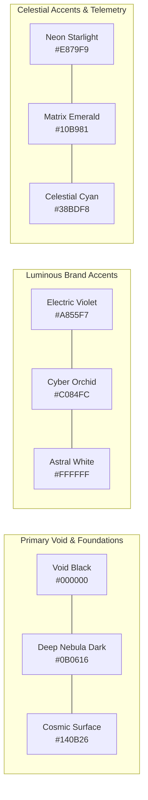

# Kairos 2027 — Design Identity, Brand Guidelines & Asset Specifications (Grand Edition)

> **Visual Governance:** Division 2 (Design & Creative Assets) & Division 4 (Media & PR)  
> **Direct Leads:** **Rikish B** (Design Lead, Reg: `44110664`) & **Caroline Mary McPherson** (Media Head 1, Reg: `44110124`)  
> **Supervising Authority:** **Thenappan T** (President & SBGL, Reg: `44110855`, AWS Student Builder Group SIST)  
> **Design Philosophy:** Cosmic Cyberpunk · Electric Violet & Void Obsidian · Precision Celestial Engineering  
> **Official Tagline:** *"IDEAS TODAY — IMPACT TOMORROW"*  
> **Sub-Descriptor:** *"A 48-HOUR HACKATHON"*  

---

## 1. Brand Identity & Visual Philosophy

### 1.1 The Meaning of "Kairos" (καιρός)
In classical Greek thought, *Chronos* represents quantitative, sequential time—the ticking of an ordinary clock. In contrast, **Kairos** represents the supreme, fleeting, qualitative moment where extraordinary preparation collides with historic opportunity. 

For the **AWS Student Builder Group at Sathyabama Institute of Science and Technology, Chennai**, Kairos 2027 embodies the 48-hour event horizon where raw student intellect is transformed into enterprise-grade cloud systems.

```
       ✦                             ✦
             ╭──────────────────╮
         ─── │   K A I R O S    │ ───
             ╰──────────────────╯
       ✦        [ HOURGLASS ]        ✦
             IDEAS TODAY — IMPACT TOMORROW
```

### 1.2 The Triad of Core Visual Elements
1. **The Celestial Hourglass:** Time as a focused vector of creation. The physical sand is replaced by glowing purple stardust particles, descending through three temporal beads into a sharp crystalline pyramid bank.
2. **The Orbital Planetary Rings:** An elliptical celestial orbit sweeping around the hourglass and typography, featuring an orbiting planetary satellite that symbolizes distributed microservices, multi-agent AI swarms, and cloud infrastructure revolving around a central mission.
3. **Cosmic Sparkle Constellation:** Four-pointed astral stars representing breakthroughs, code commits, and deploy milestones during the 48-hour sprint.

---

## 2. Official Brand Assets & Logo System

The visual identity of Kairos 2027 is anchored by three official graphic assets stored in [`teams/02_design_and_creative_assets/brand_identity_and_logos/`](file:///e:/AWS%20SBGL/Events/Kairos/teams/02_design_and_creative_assets/brand_identity_and_logos/):

### 2.1 Primary Logo Lockup (`kairos_primary_logo_lockup.png`)
* **Asset Location:** [`kairos_primary_logo_lockup.png`](file:///e:/AWS%20SBGL/Events/Kairos/teams/02_design_and_creative_assets/brand_identity_and_logos/kairos_primary_logo_lockup.png)
* **Anatomy:**
  * Bold futuristic geometric sans-serif lettering: **"K A [Hourglass] R O S"**.
  * The letter **"I"** is seamlessly replaced by the illuminated celestial hourglass mark.
  * The letter **"O"** contains an embedded four-pointed glowing star at its geometric center.
  * A luminous, ethereal electric violet orbital comet tail wraps around the base of the "K", arches behind the hourglass, and crests above the "O" and "S" ending in a celestial star sparkle.
  * **Descriptor:** `A 48-HOUR HACKATHON` in widely tracked, uppercase typography.
  * **Tagline Rule:** `IDEAS TODAY — IMPACT TOMORROW` framed by dual subtle lavender rules.
* **Usage:** Main website hero, stage backdrop center, roll-up standee headers, official proposal letterheads, and YouTube stream overlays.
* **Clearspace:** A mandatory isolation zone equal to 1.0× the width of the central hourglass must be maintained on all 4 borders.
* **Minimum Size:** Print: 45mm width | Digital: 180px width.

### 2.2 Standalone Celestial Hourglass Emblem (`kairos_hourglass_emblem.png`)
* **Asset Location:** [`kairos_hourglass_emblem.png`](file:///e:/AWS%20SBGL/Events/Kairos/teams/02_design_and_creative_assets/brand_identity_and_logos/kairos_hourglass_emblem.png)
* **Anatomy:**
  * Precision beveled white framing with glowing neon purple inner glass refractions.
  * Dynamic orbital planetary ring in vibrant violet with an orbiting satellite sphere.
  * Constellation of three four-pointed stars positioned at key orbital azimuths.
* **Usage:** Browser favicons, animated loading states, Discord server icon, trophy engravings, app icons, and stage LED particle triggers.
* **Minimum Size:** Print: 15mm height | Digital: 32px height.

### 2.3 Official Circular Patch, Seal & Sticker (`kairos_official_circular_sticker_seal.jpg`)
* **Asset Location:** [`kairos_official_circular_sticker_seal.jpg`](file:///e:/AWS%20SBGL/Events/Kairos/teams/02_design_and_creative_assets/brand_identity_and_logos/kairos_official_circular_sticker_seal.jpg)
* **Anatomy:**
  * Dual concentric circular border: an outer glowing electric violet neon ring and an inner crisp white border ring.
  * **Top Arch:** `K A I R O S` in tracked uppercase sans-serif.
  * **Core Center:** The celestial hourglass mark with planetary orbital ring and cosmic stars.
  * **Bottom Arch:** `AWS STUDENT BUILDER GROUP SATHYABAMA` in uppercase sans-serif.
* **Usage:** 3-inch die-cut waterproof vinyl laptop stickers, woven jacquard hoodie sleeve patches, laser-engraved metal smart NFC badges, and formal certificate wax/foil seals.

---

## 3. Official Color System & Design Tokens

The Kairos 2027 color system transitions entirely away from generic amber to a curated, high-impact **Cosmic Cyber Violet** palette tailored for OLED displays, stage lighting, and dark-mode developer aesthetics:



### 3.1 Color Token Palette Matrix

| Token Name | HEX Code | RGB | HSL | CMYK (Print) | Primary Application |
|---|:---:|:---:|:---:|:---:|---|
| **Void Black (Canvas)** | `#000000` | `0, 0, 0` | `0°, 0%, 0%` | `75, 68, 67, 90` | Infinite background, stage LED canvas, hoodie base fabric |
| **Deep Nebula Dark** | `#0B0616` | `11, 6, 22` | `259°, 57%, 5%` | `78, 75, 55, 80` | Card containers, modal sheets, elevated UI surfaces |
| **Cosmic Surface Dark**| `#140B26` | `20, 11, 38` | `260°, 55%, 10%`| `75, 70, 48, 65` | Interactive card hover states, table rows, border strokes |
| **Deep Orbital Violet** | `#3B0764` | `59, 7, 100` | `274°, 87%, 21%`| `70, 95, 0, 30` | Ambient drop glows, radial glow origins, container borders |
| **Electric Violet (Core)**| `#A855F7` | `168, 85, 247`| `271°, 91%, 65%`| `45, 72, 0, 0` | **Primary Brand Accent**, primary CTA buttons, active glows |
| **Cyber Orchid (Glow)** | `#C084FC` | `192, 132, 252`| `270°, 95%, 75%`| `32, 54, 0, 0` | Secondary gradients, orbital ring shimmer, badge highlights |
| **Starlight Lavender** | `#E9D5FF` | `233, 213, 255`| `269°, 100%, 92%`| `10, 18, 0, 0` | Subtitles, pill badge backgrounds, subtle rules |
| **Astral White (Light)**| `#FFFFFF` | `255, 255, 255`| `0°, 0%, 100%` | `0, 0, 0, 0` | Primary headings, hourglass structural framing, star sparkles |
| **Matrix Emerald** | `#10B981` | `16, 185, 129` | `160°, 84%, 39%`| `75, 0, 60, 0` | Checkpoint verified states, successful Git commits |
| **Celestial Cyan** | `#38BDF8` | `56, 189, 248` | `198°, 93%, 60%`| `65, 15, 0, 0` | Terminal telemetry, live server status, network nodes |
| **Crimson Surge** | `#EF4444` | `239, 68, 68` | `0°, 84%, 60%` | `0, 85, 75, 0` | Hard code freeze, night lock-in security alerts |

---

## 4. Typography Hierarchy & Rules

| Hierarchy Level | Primary Typeface | Alternative Fallback | Weight | Tracking | Primary Color |
|---|---|---|:---:|:---:|:---:|
| **Hero Display Titles** | *Syne* / *Space Grotesk* | *Inter Tight* | Bold (700/800) | `-0.03em` | Astral White (`#FFFFFF`) with Electric Violet glow |
| **H1 Section Headings** | *Space Grotesk* | *Plus Jakarta Sans* | SemiBold (600) | `-0.02em` | Astral White (`#FFFFFF`) |
| **H2 Component Cards** | *Plus Jakarta Sans* | *Inter* | SemiBold (600) | `-0.01em` | Cyber Orchid (`#C084FC`) |
| **Body Copy & Longform**| *Inter* | *Roboto* | Regular (400) | `Normal` | Starlight Lavender (`#E9D5FF`) / `#94A3B8` |
| **Terminal & Code Logs**| *JetBrains Mono* | *Fira Code* | Medium (500) | `+0.02em` | Celestial Cyan (`#38BDF8`) / `#A855F7` |

---

## 5. Physical Merchandise & Swag Engineering

### 5.1 Heavyweight Streetwear Cotton Fleece Hoodies (500 Units)
* **Base Fabric:** 380 GSM, 100% Super-Combed Ring-Spun Cotton Fleece, Bio-Washed, Anti-Pilling & Pre-Shrunk.
* **Base Color:** Deep Void Black (`#000000`).
* **Front Chest:** 6-inch High-Density 3D Rubberized Gel Print of the **Primary Logo Lockup** (`K A [Hourglass] R O S` in Astral White and Electric Violet `#A855F7` glow).
* **Left Sleeve:** 2.75-inch circular woven jacquard patch of the **Official Circular Sticker Seal** with satin purple edge overlocking.
* **Right Sleeve:** Subtle tonal silicone print: `"IDEAS TODAY — IMPACT TOMORROW"`.
* **Backprint:** Futuristic schematic circuit grid displaying the 5 Hackathon Tracks and Title Sponsor credits.

### 5.2 Official Circular Die-Cut Vinyl Stickers (3,000 Units)
* **Specs:** 3.0-inch circular die-cut, 6-mil ultra-heavyweight waterproof vinyl.
* **Artwork:** High-resolution reproduction of [`kairos_official_circular_sticker_seal.jpg`](file:///e:/AWS%20SBGL/Events/Kairos/teams/02_design_and_creative_assets/brand_identity_and_logos/kairos_official_circular_sticker_seal.jpg).
* **Finish:** Matte soft-touch lamination with spot UV gloss over the electric violet orbital ring and central hourglass.
* **Usage:** 5 stickers packed into each of the 500 Builder Kits, plus distribution to judges, mentors, and VIPs.

### 5.3 Laser-Etched Metal NFC Smart Badges (600 Units)
* **Dimensions:** Standard CR80 format (85.6 mm × 54.0 mm × 0.8 mm).
* **Material:** Anodized Matte Black Aluminium Alloy with laser-etched chamfered silver-violet edges.
* **Front Face:** Laser-etched participant name, team name, team ID, and dynamic QR code. Top right features the **Celestial Hourglass Emblem**.
* **Rear Face:** High-contrast laser etching of the **Official Circular Seal** with embedded NTAG213 NFC chip.
* **Lanyard Ribbon:** 20mm premium jacquard woven ribbon in Deep Void Black (`#000000`) with woven Electric Violet (`#A855F7`) and Astral White (`#FFFFFF`) lettering: `"KAIROS 2027 • AWS STUDENT BUILDER GROUP • SIST"`.

---

## 6. Stage Scenography & 4K LED Screen Asset Specifications

### 6.1 P2.5 4K LED Main Stage Wall (20 ft × 10 ft — 3840 × 1920 px)
* **Aspect Ratio:** Custom 2:1 Ultra-Wide Screen (`3840 × 1920 px`, 60fps, ProRes 422 / MP4 H.265).
* **Background Canvas:** Pure Void Black (`#000000`) with subtle slow-motion ambient cosmic dust drifting in Electric Violet (`#A855F7`).
* **Motion Graphics Loops:**
  1. *Countdown to Genesis:* 60-second 3D rotating hourglass with cosmic sands cascading into a supernova flash at 00:00:00.
  2. *Live Hacking Ambience:* Slowly orbiting planetary ring with glowing stars and live countdown clock widget.
  3. *Checkpoint Gate Interstitials:* High-voltage purple shockwave transition across the LED wall when gates lock.
  4. *Grand Valedictory Celebration:* Majestic purple and gold starlight confetti burst with spotlight sweep.

### 6.2 Roll-Up Display Standees (16 Units — 6 ft × 3 ft)
* **Hardware:** Luxury teardrop aluminium rollup base with chrome magnetic endcaps.
* **Print Substrate:** 340 GSM Non-Tear Matte Poly-Film with anti-curl backing.
* **Design Scheme:** Deep Void Black background with top Electric Violet orbital header, Primary Logo Lockup, and bottom Official Circular Seal footer.

---

## 7. Digital Web & Social Asset Guidelines

* **Website Dark Mode Standard:** Pure Void Black `#000000` body background with subtle radial gradient glow:
  ```css
  background: radial-gradient(circle at 50% 0%, #1a0b2e 0%, #000000 70%);
  ```
* **Interactive Hover States:** `box-shadow: 0 0 25px rgba(168, 85, 247, 0.45);` with `border-color: #A855F7;`.
* **Social Media Cards (Instagram 4:5 & LinkedIn 1:1):** Bold Astral White typography on Void Black with glowing Electric Violet orbital rings framing the content.
