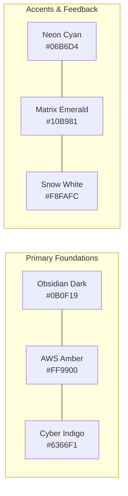

# Kairos 2027 — Design Identity, Brand Guidelines & Asset Specifications (Grand Edition)

**Super Head 5 Mandate:** Shape the visual language, typography, 3D motion graphics, digital media assets, stage production visuals, and premium developer merchandise for Kairos 2027.  
**Accountable Lead:** Chief Creative & Media Officer (CCMO) — Reporting directly to President Thenappan T  
**Design Ethos:** Cyber-Cloud Grandeur · Obsidian-Amber High-Voltage Dark Mode · Precision Engineering (Benchmarked against THREX & PEC Hacks)  
**Event Dates:** January 22 – 24, 2027  

---

## 1. Brand Identity & Visual Philosophy

### 1.1 The Meaning Behind "Kairos" (καιρός)
The name **Kairos** represents the supreme, fleeting moment where extraordinary preparation meets limitless opportunity. The visual identity fuses:
* **Deep Obsidian `#0B0F19` Canvas:** The infinite, focused midnight hacking realm.
* **AWS Builder Amber `#FF9900` Accent:** High-voltage energy, ambition, and cloud computing mastery.
* **Cyber Indigo `#6366F1` & Neon Cyan `#06B6D4`:** Intelligent multi-agent architectures, distributed computing networks, and futuristic telemetry.

---

## 2. Color System & Design Tokens

| Token Name | HEX Code | RGB | HSL | Prime Application |
|---|:---:|:---:|:---:|---|
| **Obsidian Dark (Canvas)** | `#0B0F19` | `11, 15, 25` | `223°, 39%, 7%` | Primary background, deck backdrops, stage LED canvas |
| **Surface Dark (Card)** | `#1E293B` | `30, 41, 59` | `217°, 33%, 17%` | UI cards, modal surfaces, badge backdrops, table rows |
| **AWS Builder Amber** | `#FF9900` | `255, 153, 0` | `36°, 100%, 50%` | Primary brand accent, primary CTA buttons, highlight glow |
| **Cyber Indigo** | `#6366F1` | `99, 102, 241` | `239°, 84%, 67%` | Secondary gradients, tech track tags, interactive link states |
| **Neon Cyan** | `#06B6D4` | `6, 182, 212` | `189°, 94%, 43%` | Glow accents, terminal text, live countdown digits |
| **Matrix Emerald** | `#10B981` | `16, 185, 129` | `160°, 84%, 39%` | Verified badges, success states, live round checkpoint indicators |
| **Snow Light** | `#F8FAFC` | `248, 250, 252`| `210°, 40%, 98%` | Headlines, primary text, high-contrast labels |
| **Muted Steel** | `#94A3B8` | `148, 163, 184`| `215°, 20%, 65%` | Subheadings, body copy, timestamps, inactive borders |

---

## 3. Typography Hierarchy

| Level | Font Family | Weight | Size (Print / Web) | Tracking |
|---|---|:---:|:---:|:---:|
| **Display Hero** | *Space Grotesk* / *Syne* | Bold (700) | 48–64pt / 4rem | -0.03em (Tight) |
| **Section Heading (H1)**| *Space Grotesk* | SemiBold (600) | 32–40pt / 2.5rem | -0.02em |
| **Card Heading (H2)** | *Plus Jakarta Sans* | Bold (700) | 20–24pt / 1.5rem | -0.01em |
| **Body Text** | *Inter* | Regular (400) / Medium (500) | 10–12pt / 1rem | Normal (0em) |
| **Code / Badges** | *JetBrains Mono* | Medium (500) | 9–11pt / 0.875rem | +0.02em (Spaced) |

---

## 4. Stage Production & 4K LED Screen Asset Specifications

### 4.1 P2.5 4K LED Stage Wall (20 ft × 10 ft)
* **Native Pixel Resolution:** 3840 × 1920 px (Custom 2:1 Ultra-Wide Aspect Ratio).
* **Color Space:** Rec.709 / sRGB, 60fps progressive scan.
* **Motion Graphics Stingers:**
  1. *Master Opening Countdown:* 60-second synchronized 3D cyber clock stinger with spatial audio build-up.
  2. *Track Reveal Loops:* 10-second looping 3D ambient backgrounds for each of the 5 Grand Enterprise Tracks.
  3. *Live Hacking Ambient Loop:* Subtle obsidian-gold particle flow with dynamic sponsor logo rotation bug.
  4. *Checkpoint Gate Countdown:* 15-minute countdown clock for submission freezes.
  5. *Grand Winner Reveal Stinger:* Gold particle explosion with cold pyro trigger cue.

---

## 5. Streetwear Merchandise & Hardware Kit Specifications

### 5.1 Heavyweight Streetwear Cotton Fleece Hoodies (500 Units)
* **Fabric:** 280 GSM, 100% Super-Combed Ring-Spun Cotton Fleece, Bio-Washed & Pre-Shrunk.
* **Color:** Obsidian Pitch Black (`#0B0F19`).
* **Chest Branding:** 4-inch High-Density 3D Rubberized Gel Print ("KAIROS καιρός" in Snow White & Neon Orange).
* **Left Sleeve Patch:** Woven Jacquard Embroidered Patch featuring the AWS Student Builder Group Crest.
* **Backprint:** Futuristic schematic circuit grid displaying the 5 Hackathon Tracks and Title Sponsor credits.

### 5.2 Laser-Etched Metal NFC Smart Badges (600 Units)
* **Material:** 0.8mm Anodized Matte Black Aluminium Alloy with beveled silver edges.
* **Dimensions:** Standard CR80 Credit Card Size (85.6 mm × 54 mm).
* **Chipset:** NTAG213 High-Frequency (13.56 MHz) NFC chip embedded behind a protective matte overlay.
* **Front Engraving:** Laser-etched participant name, team name, team ID, and high-contrast dynamic QR code.
* **Lanyard Ribbon:** 20mm Premium Jacquard Woven Silk Ribbon with dual metal lobster claw hooks and safety breakaway clasp.

### 5.3 Die-Cut Holographic Sticker Packs (600 Packs)
* **Quantity:** 5 Die-Cut Stickers per pack.
* **Material:** 6-mil Heavy Duty Waterproof Vinyl with Rainbow Holographic Metallic Sheen.
* **Themes:**
  1. Kairos 2027 Main Geometric Logo (Holographic).
  2. "Deploy on AWS or Cry Trying" (Cyberpunk Terminal Badge).
  3. "48 Hours Non-Stop Builder" (Matrix Green Badge).
  4. AWS Bedrock Generative AI Builder Mascot.
  5. Title Sponsor Custom Co-Branded Sticker.

---

## 6. Print & Wayfinding Specifications

* **Main Plenary Star-Flex Backdrop:** 24 ft (W) × 12 ft (H) Star Flex on 2-inch wood frame.
* **Roll-Up Display Standees (16 Units):** 6 ft (H) × 3 ft (W) teardrop aluminium base. 
  * 2 at Main Registration Foyer.
  * 5 for Track Hacking Bays (Lecture Halls 1–3).
  * 3 for Sponsor Exhibition Area.
  * 2 for VIP Executive Lounge.
  * 4 for Dining & Rest Zone Navigation.
* **Giant Novelty Winner Cheques (8 Units):** 4 ft × 2 ft mounted on 5mm high-density foam board with high-gloss laminate.
* **Certificates of Merit & Participation (600 Units):** 300 GSM Royal Matte Textured Cardstock with Embossed Gold Foil Seal.
