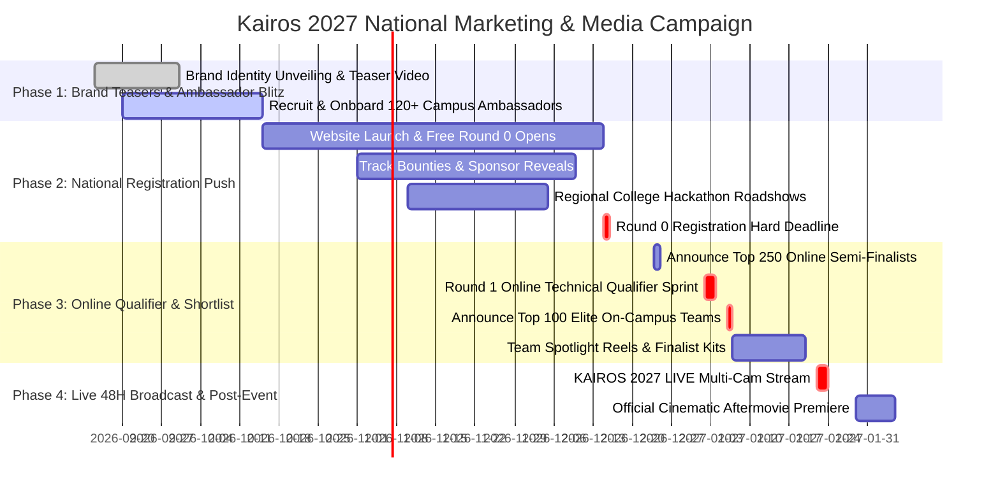

# Kairos 2027 — National Marketing, PR, Broadcast & Media Playbook (Grand Edition)

**Governing Standard:** `E:\AWS SBGL\ANTI-Help\01_CHAPTER_GOVERNANCE_AND_LEADERSHIP_ROSTER.md` & `06_BRANDING_CREATIVE_ASSETS_AND_DIGITAL_MEDIA_GUIDE.md`  
**Host Community:** AWS Student Builder Group (AWS SBG) — SIST Chapter  
**Sponsoring Department:** School of Computing, Sathyabama Institute of Science and Technology  
**Super Head 5 Mandate:** Direct national marketing campaigns, PR distributions, 120+ Campus Ambassador Network, Online Qualifier broadcast, 48-hour live multicam broadcast, and the official cinematic aftermovie.  
**Accountable Media Leads:**  
• **Caroline Mary McPherson** (Register No: `44110124`), Media Head 1  
• **Harshith Raj S**, Socials Lead  
• Reporting directly to **Thenappan T** (Register No: `44110855`), President & SBGL  
**Official Handles:** Instagram: [`@awssbg_sist`](https://instagram.com/awssbg_sist) | LinkedIn: `aws-sbg-sist` | Email: `sistawscc@gmail.com`  
**Campaign Runway:** September 04, 2026 – January 24, 2027 (Post-Event Release: Feb 05, 2027)  
**Registration Model:** **100% FREE — ZERO ENTRY FEE** (National talent meritocracy)  
**Target Acquisition Funnel:** 2,000+ National Applicant Teams $\rightarrow$ 250 Online Semi-Finalists $\rightarrow$ 100 Elite On-Campus Finalist Teams (400–500 Hackers)  

---

## 1. National Marketing Strategy & Funnel Architecture

### 1.1 Funnel Benchmarks:
* **Zero Entry Fee Impact:** With zero entry fees, national registrations are projected to exceed **2,000+ teams (8,000+ students)** across 22+ states.
* **Campus Ambassador Incentive Structure:**
  * Highest Referring Ambassador: **₹10,000 Pure Cash Bounty** + VIP Pass to Kairos 2027.
  * 2nd & 3rd Referrals: **₹5,000 Cash Bounties** + Exclusive Streetwear Hoodie.
  * All Ambassadors achieving 10+ verified registrations receive official **Letter of Recommendation from President Thenappan T** and verified digital credentials.

---

## 2. Multi-Month National Campaign Roadmap

---

## 3. Broadcast Operations: Online Qualifier & On-Ground Grand Finale

* **Online Semi-Finals Live Coverage (Jan 02–04):** The media team streams live technical panel highlights, jury reactions, and founder interviews across YouTube and LinkedIn.
* **On-Ground 48-Hour Multicam Stream (Jan 22–24):** 3 4K cameras, Blackmagic ATEM switcher, roving wireless gimbals, and dedicated student commentary desk streaming continuously.
* **Cinematic Aftermovie:** Color-graded 4K master film released within 7 business days post-event on official channels.
