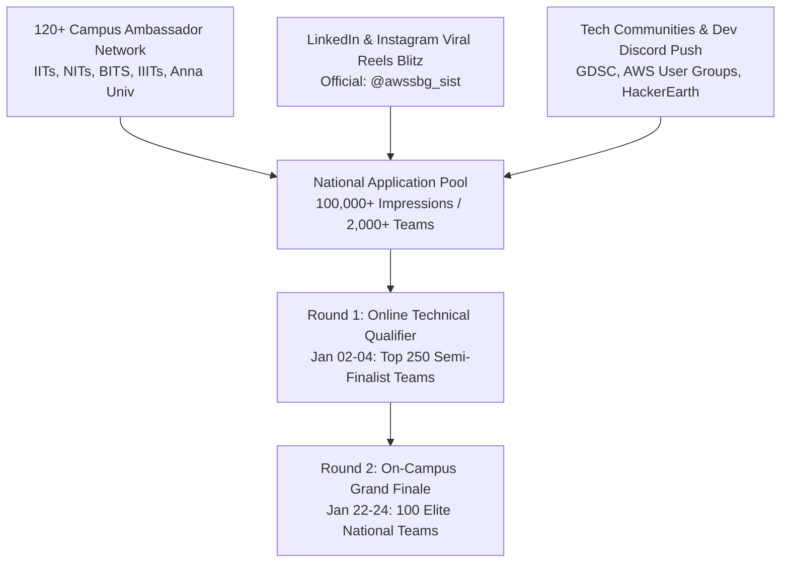
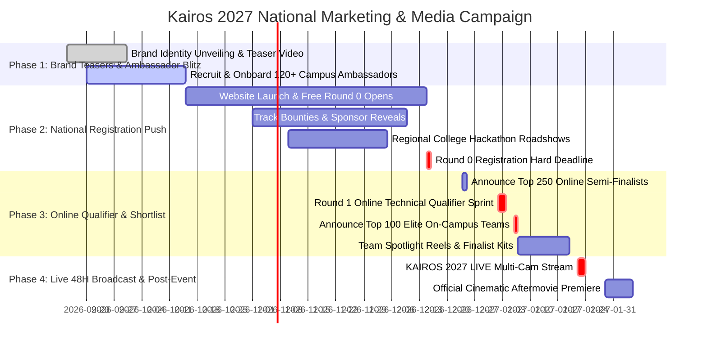

# KAIROS 2027 — National Marketing, PR, Broadcast & Media Playbook (Grand Edition)

**Document Reference:** `docs/05_marketing_media_and_promotion.md`  
**Host Entity:** AWS Student Builder Group (AWS SBG) — SIST Chapter  
**Sponsoring Department:** School of Computing, Sathyabama Institute of Science and Technology (Deemed to be University), Chennai – 600119  
**Super Head Mandate:** Super Head 5 (Chief Creative & Media Officer — Caroline Mary McPherson) & Harshith Raj S (Socials Lead)  
**Reporting Authority:** Thenappan T (Register No: `44110855`), President & SBGL  
**Governing Standards:** [00_hackathon_master_brief.md](./00_hackathon_master_brief.md) · [01_sponsorship_deck_and_outreach.md](./01_sponsorship_deck_and_outreach.md) · [03_budget_and_financial_tracker.md](./03_budget_and_financial_tracker.md) · [04_design_and_branding_guidelines.md](./04_design_and_branding_guidelines.md) · [16_website_design_and_experience_specification.md](./16_website_design_and_experience_specification.md) · [17_content_reference_and_copy_bank.md](./17_content_reference_and_copy_bank.md) · [20_indoor_auditorium_venue_transition_and_budget_plan.md](./20_indoor_auditorium_venue_transition_and_budget_plan.md)  
**Official Handles:** Instagram: [`@awssbg_sist`](https://instagram.com/awssbg_sist) | LinkedIn: `aws-sbg-sist` | Email: `sistawscc@gmail.com`  
**Campaign Runway:** September 15, 2026 – January 24, 2027 (Post-Event Closeout: February 08, 2027)  
**Registration Model:** **100% FREE — ZERO ENTRY FEE** (National talent meritocracy)  
**Target Acquisition Funnel:** 2,000+ National Applicant Teams $\rightarrow$ 250 Online Semi-Finalists $\rightarrow$ 100 Elite On-Campus Finalist Teams (Teams of 4–6 students, ~400–600 Hackers)  
**Grand Finale Venue:** Sathyabama Indoor Stadium (Indoor Auditorium), Sathyabama Campus  
**Status:** `APPROVED PLAN`  

---

## 1. National Marketing Strategy & Funnel Architecture

The marketing engine for KAIROS 2027 is structured to build massive nationwide developer awareness, attract elite student engineering talent across premier institutions (IITs, NITs, IIITs, BITS, and top accredited universities), and convert applicants through our dual-phase merit funnel:

### 1.1 Funnel Benchmarks & Free-Entry Impact
* **Zero Entry Fee Advantage:** By eliminating all registration barriers, the applicant pool is projected to exceed **2,000+ teams (8,000–12,000 engineering students)** across 22+ Indian states.
* **Merit-Driven Quality:** The 2-tier funnel ensures that only working architectures with verified GitHub repositories and live Google Meet defenses qualify for the physical grand finale.

### 1.2 Policy on Referral Cash Commissions ("Rainmaker Bounties")
> [!WARNING]
> **GOVERNANCE NOTICE: REFERRAL CASH COMMISSIONS QUARANTINED**  
> **Status:** `[DECISION REQUIRED / APPROVAL REQUIRED — DO NOT OFFER]` (DEC-05)  
> 
> A proposal previously circulated suggesting that 3rd-party students or campus ambassadors could earn an instant 10%–15% liquid cash commission (₹2,500 to ₹30,000) for bringing corporate sponsors to Kairos 2027.  
> 
> **Audit Finding & Policy:** This commission mechanism has **NOT** received approval from Sathyabama University Finance, the Registrar, or the Vice-Chancellor. Disbursing institutional cash commissions to students without a formal tax compliance structure (TDS under Section 194H, GST compliance, and formal institutional contracts) creates severe regulatory liabilities.  
> 
> **Operating Directive:** Student ambassadors and organizers must **NOT** publicly advertise or promise cash referral commissions. All corporate sponsorships must be processed via formal university MoUs and institutional bank transfers. Student ambassadors are recognized through official Letters of Recommendation, VIP stage passes, and AWS Builder Kits.

---

## 2. Multi-Month National Campaign Roadmap

---

## 3. Broadcast Operations: Online Qualifier & Sathyabama Indoor Stadium

### 3.1 Online Semi-Finals Live Coverage (January 02–04, 2027)
* The media team streams live technical highlights, architecture spotlights, and mentor interviews across YouTube and LinkedIn.
* Automated social posts feature the daily leaderboard and git commit velocity metrics.

### 3.2 Sathyabama Indoor Stadium 48-Hour Multicam Stream (January 22–24, 2027)
* **Production Rigs:** 3 4K PTZ and wireless broadcast cameras, Blackmagic ATEM video switcher, roving gimbals, and high-fidelity Line Array audio feeds.
* **Stream Bay Location:** Stationed in the Central Arena War Room pod with dedicated high-speed gigabit uplink.
* **On-Air Features:**
  * Live stage keynotes, track releases, and Grand Finale pitching plenary.
  * Roving interviews with student hackers at their arena pods (Bays A–D).
  * Midnight hacker culture highlights, typing tournament, and prompt battles.
  * 24/7 countdown timer with progressive celestial hourglass telemetry.

### 3.3 Cinematic Aftermovie Release (T+7 Days)
* Official 4K color-graded aftermovie premiered on YouTube and LinkedIn by **Sunday, January 31, 2027 (19:00 IST)**.
* Embedded prominently into the post-event sponsor ROI decks delivered to all corporate partners.
