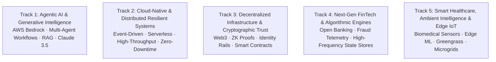

# KAIROS 2027 — Enterprise Innovation Tracks, Problem Blueprints & AWS Architecture (Grand Edition)

> **Document Status:** CANONICAL TECHNICAL SPECIFICATION  
> **Executive Oversight:** Super Head 2 (CTO) in coordination with Super Head 1 (CPFO)  
> **Accountable Lead:** Shaik Khaleelulla (CTO, Reg: `44110756`)  
> **Reporting Directly To:** Thenappan T (President & SBGL, Reg: `44110855`)  
> **Event Dates:** 22–24 January 2027 (Grand Finale) | 02–04 January 2027 (Online Qualifier)  
> **Pure Cash Prize Model:** **₹1,75,000 Total Cash Escrow** (Grand Champion ₹60k, 1st Runner-Up ₹35k, 2nd Runner-Up ₹20k, 5 Tracks @ ₹7,000 = ₹35k, Special Bounties ₹25k) — `[APPROVED PLAN]`  
> **Custom Sponsor Track Bounties:** Enterprise track partners may endow additional scaled cash bounties (e.g., +₹10,000–₹25,000) on top of the base pool.  
> **Source of Truth:** [`00_hackathon_master_brief.md`](./00_hackathon_master_brief.md) · [`02_agenda_rounds_and_judging_rubric.md`](./02_agenda_rounds_and_judging_rubric.md)

---

## 1. The 5 Grand Enterprise Innovation Tracks

KAIROS 2027 features five specialized architectural domains designed around real-world enterprise engineering challenges and modern cloud stacks:



---

### Track 1: Agentic AI & Generative Intelligence
* **Baseline Track Award:** **₹7,000 Pure Cash Prize** + Track Trophy + Fast-Track Incubation Pipeline.
* **Corporate Sponsoring Tier:** Dedicated Track Partner (₹25,000) with option to endow custom cash bounties.
* **Core Technical Focus:** Autonomous multi-agent orchestration, deterministic LLM execution engines, multimodal reasoning, and production-grade retrieval-augmented generation (RAG) using **AWS Bedrock** (Anthropic Claude 3.5 Sonnet, Amazon Titan, Meta Llama 3).
* **Sample Enterprise Problem Blueprints:**
  1. *Autonomous Enterprise IT Incident Resolver:* An agentic swarm that ingests CloudWatch/OpenTelemetry logs, formulates root-cause hypotheses, writes and validates unit test fixes in isolated containers, and prepares production-ready GitHub PRs.
  2. *Multimodal Clinical Diagnostics Assistant:* A multi-agent copilot that synthesizes DICOM medical imaging, electronic health records (EHR), and PubMed research literature with sub-second retrieval latency and audit trails.
* **Recommended AWS Stack:** Amazon Bedrock, Amazon OpenSearch Serverless (Vector Engine), AWS Lambda, Amazon Kendra, LangChain / LangGraph, AWS Step Functions.

---

### Track 2: Cloud-Native, High-Throughput & Distributed Systems
* **Baseline Track Award:** **₹7,000 Pure Cash Prize** + Track Trophy + Priority Interview Fast-Track.
* **Corporate Sponsoring Tier:** Dedicated Track Partner (₹25,000).
* **Core Technical Focus:** Ultra-resilient, event-driven, horizontally scalable cloud systems capable of handling 100,000+ requests per second with deterministic microsecond latency and zero single points of failure.
* **Sample Enterprise Problem Blueprints:**
  1. *Real-Time Global Order Book Matching Engine:* Microsecond event-driven matching system with deterministic transaction sequencing, audit logs, and dynamically partitioned state stores.
  2. *Disaster-Resilient Mesh Network Protocol:* A decentralized peer-to-peer cloud-hybrid communication relay for emergency first responders operating under telecommunication blackouts.
* **Recommended AWS Stack:** Amazon EventBridge, AWS Step Functions, Amazon DynamoDB Global Tables, Amazon ECS on AWS Fargate, Amazon ElastiCache (Redis), AWS CloudTrail.

---

### Track 3: Decentralized Infrastructure, Web3 & Cryptographic Security
* **Baseline Track Award:** **₹7,000 Pure Cash Prize** + Track Trophy + Web3 Ecosystem Grants.
* **Corporate Sponsoring Tier:** Dedicated Track Partner (₹25,000).
* **Core Technical Focus:** Cryptographic trust architectures, zero-knowledge proofs, decentralized identity registries, privacy-preserving compliance rails, and verifiable smart contract execution.
* **Sample Enterprise Problem Blueprints:**
  1. *Zero-Knowledge Proof KYC & Solvency Verification:* Privacy-preserving compliance engine that verifies user accreditation and solvency without revealing underlying financial statements.
  2. *Decentralized Supply Chain Provenance Oracle:* Verifiable hardware-backed cryptographic ledger tracking pharmaceutical custody and cold-chain integrity from factory to patient.
* **Recommended AWS Stack:** Amazon Managed Blockchain, Amazon KMS, AWS Lambda@Edge, Amazon Aurora Serverless v2, IPFS/Arweave integration.

---

### Track 4: Next-Gen FinTech, Open Banking & Algorithmic Engines
* **Baseline Track Award:** **₹7,000 Pure Cash Prize** + Track Trophy + FinTech Mentorship.
* **Corporate Sponsoring Tier:** Dedicated Track Partner (₹25,000).
* **Core Technical Focus:** Real-time algorithmic fraud mitigation, synthetic identity detection, open banking API integrations, automated micro-lending underwriting, and anti-money laundering (AML) graph analytics.
* **Sample Enterprise Problem Blueprints:**
  1. *Real-Time Cross-Border Fraud Vector Scoring Engine:* Graph neural network model analyzing transaction topologies in under 50 milliseconds to flag mule account syndicates.
  2. *Autonomous Micro-Lending Underwriting Engine:* Non-traditional credit scoring model utilizing device telemetry, cash-flow velocity, and behavioral signals for unbanked micro-entrepreneurs.
* **Recommended AWS Stack:** Amazon Neptune (Graph Database), Amazon Fraud Detector, Amazon DynamoDB, Amazon SageMaker, AWS Secrets Manager.

---

### Track 5: Smart Healthcare, Ambient Intelligence & Edge Computing
* **Baseline Track Award:** **₹7,000 Pure Cash Prize** + Track Trophy + HealthTech Pilot Grant.
* **Corporate Sponsoring Tier:** Dedicated Track Partner (₹25,000).
* **Core Technical Focus:** Telemetry data acquisition from biomedical edge sensors, edge ML inference, smart hospital resource optimization, automated vitals monitoring, and remote patient telemetry.
* **Sample Enterprise Problem Blueprints:**
  1. *Edge IoT Patient Vitals Anomaly Sentinel:* Low-power micro-controller processing continuous ECG/SpO2 telemetry with edge anomaly detection alerting nursing stations before clinical decompensation.
  2. *Autonomous Dynamic Campus Emergency Transit Router:* Predictive passenger demand forecasting and real-time dispatch optimization for university emergency vehicles and campus EV buggies.
* **Recommended AWS Stack:** AWS IoT Core, AWS IoT Greengrass, Amazon Timestream, Amazon SageMaker Edge Manager, AWS AppSync.

---

## 2. Special Category Innovation Bounties (₹25,000 Pool)

In addition to the 5 Track Prizes and Overall Champion awards, the following special cash bounties are conferred:

* **Best All-Women Engineering Team Bounty (₹10,000 Pure Cash):** Awarded to the highest-scoring squad comprised entirely of female builders across all tracks.
* **Best Freshman / Rookie Builder Team Bounty (₹7,500 Pure Cash):** Conferred to the top-performing squad composed entirely of 1st and 2nd-year undergraduate developers.
* **Most Scalable AWS Architecture Bounty (₹7,500 Pure Cash):** Evaluated strictly on adherence to the **AWS Well-Architected Framework** (Operational Excellence, Security, Reliability, Performance Efficiency, Cost Optimization, Sustainability).

---

## 3. Custom Corporate Bounty Integration Workflow

Corporate partners sponsoring a dedicated track can introduce proprietary problem statements and scale cash bounties under this standardized protocol:

```text
================================================================================
KAIROS 2027 — CUSTOM CORPORATE TRACK BOUNTY SPECIFICATION SCHEMA
================================================================================
1. Track Assignment: [e.g., Track 1: Agentic AI / Custom Enterprise Bounty]
2. Corporate Partner Name: [Company Entity Name]
3. Custom Challenge Title: [Short, punchy problem title]
4. Background & Industry Need: [1-2 paragraphs detailing the engineering bottleneck]
5. Required Tech Stack & APIs: [Mandatory partner APIs, SDKs, or cloud models]
6. Developer Sandbox Provisioning: [API keys, credits, documentation URLs]
7. Specific Evaluation Criteria: [Track-specific scoring weights]
8. Additional Bounty Consideration: [Optional: e.g., ₹15,000 cash added to base prize]
9. Designated Corporate Mentor/Jury: [Name, Title, Official Corporate Email]
================================================================================
```
