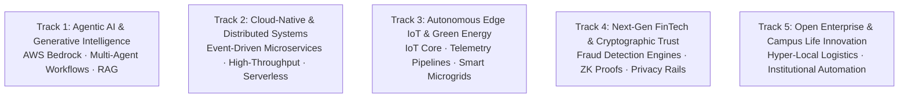

# Kairos 2027 — Enterprise Innovation Tracks, Problem Blueprints & AWS Architecture (Grand Edition)

**Super Head 2 Mandate:** Direct the Technical Architecture Division; define the 5 Grand Innovation Tracks; provision AWS Bedrock developer sandboxes; curate enterprise problem statements and reference architectures.  
**Accountable Lead:** Chief Technology & Infrastructure Officer (CTO) — Reporting directly to President Thenappan T  
**Event Window:** January 22 – 24, 2027  
**Track Cash Prize Pool:** **5 Tracks × ₹25,000 = ₹1,25,000 Pure Cash** (+ ₹50,000 in Special Category Bounties)  
**Cloud Sandbox Support:** $50,000+ AWS Cloud Promotional Credits  

---

## 1. The 5 Grand Enterprise Innovation Tracks

---

### Track 1: Agentic AI & Generative Intelligence
* **Enterprise Bounty:** **₹25,000 Pure Cash** + Fast-Track AI Startup Incubation.
* **Core Focus:** Autonomous multi-agent coordination, deterministic LLM execution engines, multimodal reasoning, and real-time knowledge synthesis using **AWS Bedrock** (Anthropic Claude 3.5 Sonnet, Amazon Titan, Meta Llama 3).
* **Sample Enterprise Problem Statements:**
  1. *Autonomous Enterprise IT Incident Resolver:* An agentic workflow that parses Datadog/CloudWatch telemetry alerts, dynamically generates root-cause hypotheses, writes and validates unit test fixes, and prepares ready-to-merge PRs.
  2. *Multimodal Medical Diagnostics Copilot:* An end-to-end multi-agent clinical assistant that cross-references DICOM scans, electronic health records, and clinical trial literature with sub-second retrieval.
* **Key AWS Stack:** Amazon Bedrock, Amazon OpenSearch Serverless (Vector Search), AWS Lambda, Amazon Kendra, LangChain / LangGraph.

---

### Track 2: Cloud-Native, High-Throughput & Distributed Systems
* **Enterprise Bounty:** **₹25,000 Pure Cash** + Technical Interview Bounties.
* **Core Focus:** Ultra-resilient, event-driven, horizontally scalable cloud systems capable of handling 100,000+ operations per second with sub-millisecond p99 latency.
* **Sample Enterprise Problem Statements:**
  1. *Real-Time Global Financial Order Book Matching Engine:* Event-driven matching system with microsecond deterministic transaction logging and dynamic partitioned state stores.
  2. *Distributed Disaster-Resilient Mesh Network Protocol:* A decentralized peer-to-peer cloud-hybrid communication relay for emergency first responders during telecommunications blackouts.
* **Key AWS Stack:** Amazon EventBridge, AWS Step Functions, Amazon DynamoDB Global Tables, Amazon ECS on AWS Fargate, Amazon ElastiCache (Redis).

---

### Track 3: Autonomous Edge IoT & Sustainable Green Energy
* **Enterprise Bounty:** **₹25,000 Pure Cash** + Hardware Development Kits.
* **Core Focus:** Telemetry data acquisition from edge sensors, real-time edge AI inference, smart microgrids, automated carbon footprint optimization, and industrial automation.
* **Sample Enterprise Problem Statements:**
  1. *Smart Industrial Microgrid Power Balancer:* Real-time load prediction and bidirectional solar/battery power routing for heavy manufacturing plants using edge telemetry.
  2. *Autonomous Drone Crop Disease Sentinel:* Edge-computed drone imagery analysis flagging crop fungal infections and precision agricultural pesticide routing.
* **Key AWS Stack:** AWS IoT Core, AWS IoT Greengrass, Amazon Timestream, Amazon SageMaker Edge, AWS AppSync.

---

### Track 4: Next-Gen FinTech, Trust & Cryptographic Security
* **Enterprise Bounty:** **₹25,00,0 Pure Cash** + Fintech Accelerator Credits.
* **Core Focus:** High-security financial transactions, algorithmic fraud mitigation, zero-knowledge privacy verification, automated credit underwriting, and anti-money laundering (AML).
* **Sample Enterprise Problem Statements:**
  1. *Cross-Border Fraud Vector Scoring Engine:* Graph neural network engine analyzing payment topologies to identify synthetic identity rings in under 50 milliseconds.
  2. *Zero-Knowledge Proof Identity & KYC Verification:* Privacy-preserving compliance engine verifying user solvency and accreditation without revealing underlying personal data.
* **Key AWS Stack:** Amazon Neptune (Graph Database), Amazon KMS, Amazon QLDB, AWS Lambda@Edge, Amazon Fraud Detector.

---

### Track 5: Open Enterprise & Campus Life Innovation
* **Enterprise Bounty:** **₹25,000 Pure Cash** + Campus Deployment Pilot Grant.
* **Core Focus:** Hyper-local student systems, campus resource optimization, digital credential registries, peer learning networks, and automated administrative operations.
* **Sample Enterprise Problem Statements:**
  1. *Autonomous Dynamic Campus Shuttle Fleet Routing:* Predictive passenger demand forecasting and real-time route optimization for university buses and EV shuttles.
  2. *Verified Academic Credential & Research Exchange:* Verifiable digital credential registry and decentralized peer review platform for student researchers.
* **Key AWS Stack:** AWS Amplify, Amazon Cognito, Amazon Aurora Serverless v2, Amazon S3, AWS CloudFront.

---

## 2. Special Category Cash Bounties (₹50,000 Pool)

* **Best All-Women Hacker Team Bounty (₹20,000 Pure Cash):** Conferred to the highest-scoring team composed entirely of female developers across all tracks.
* **Best Freshman / Rookie Team Bounty (₹15,000 Pure Cash):** Awarded to the top-performing team comprised entirely of 1st and 2nd-year undergraduate students.
* **Most Scalable AWS Architecture Bounty (₹15,000 Pure Cash):** Evaluated strictly on adherence to the **AWS Well-Architected Framework** (Operational Excellence, Security, Reliability, Performance Efficiency, Cost Optimization, Sustainability).
