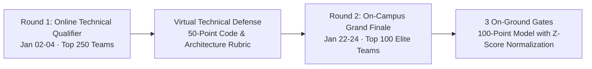

# Kairos 2027 — Judges, Grand Jury & VIP Dignitary Handbook (Grand Edition)

**Super Head 6 Mandate:** Oversee Online Technical Qualifier Jury Governance, On-Campus VIP Jury Hospitality, Technical Evaluation Deployments, Digital Scoring Portal Operations, and Evaluation Integrity.  
**Accountable Lead:** Chief Safety, Governance & Jury Officer (CSO) — Reporting directly to President Thenappan T  
**Event Architecture:**  
* **Round 1 (Online Technical Qualifier):** January 02 – 04, 2027 (Evaluating Top 250 Semi-Finalists)  
* **Round 2 (On-Campus Grand Finale):** January 22 – 24, 2027 (Evaluating Top 100 Elite Finalists)  
**Dignitary Roster:** 15+ High-Profile Industry Jury Members · 25+ Technical Evaluators (AWS Community Builders, Tech Leads, Startup Founders, Distinguished Alumni, and any other industry professionals with technical knowledge who volunteer)  
**Jury Hospitality Suite:** Top Floor Executive Lounge, Central Library Complex  

---

## 1. Dual-Phase Evaluation Governance

To ensure our on-campus builders represent the absolute peak of student engineering in India, the Jury Division governs both the **Virtual Semi-Finals** and the **On-Ground Grand Finale**:

---

## 2. Round 1: Online Technical Qualifier Jury Protocol (Jan 02–04, 2027)

* **Review Setup:** 10 parallel Google Meet rooms managed by Technical Leads.
* **Evaluation Format:** 7-Minute Live Review per team (4 minutes team pitch/demo + 3 minutes jury defense).
* **Deliverables Reviewed:**
  1. Working GitHub repository commit history.
  2. Cloud architecture diagram & AWS stack.
  3. 3-Minute Loom video demonstration.
* **50-Point Virtual Scoring Rubric:** Problem depth (15 Pts), cloud architecture rigor (15 Pts), codebase proof-of-concept (10 Pts), live Q&A poise (10 Pts).
* **Shortlist Selection:** Top 100 teams (teams of 4–6 students, ~400–600 developers) with the highest composite scores earn formal invitations to the on-campus finale. There is no pre-event on-campus onboarding; finalist teams report directly to the venue at Sathyabama Institute of Science and Technology, Chennai on Event Day (Jan 22, 2027).

---

## 3. Round 2: On-Campus Five-Star VIP Hospitality & Executive Protocol

### 3.1 Top Floor Executive VIP Lounge (Central Library Complex)
* **Amenities:** Continuous five-star catering (fresh seasonal juices, artisanal coffee, hot hors d'oeuvres, executive buffet lunches), dedicated high-speed Wi-Fi network, and private soundproof deliberation suites.

### 3.2 Travel & Chauffeur Services:
* Dedicated chauffeured AC sedans for all outstation judges arriving at Chennai International Airport (MAA) or Central Railway Station.
* Executive gift hampers containing handcrafted silk shawls, artisanal forest honey, exotic dry fruits, and custom brass Kairos 2027 mementoes.

---

## 4. Digital Scoring Portal Operations & Z-Score Normalization

Judges evaluate teams via the **Kairos Digital Jury Portal** with automated **Z-score normalization**:

$$Z_{i,j} = \frac{X_{i,j} - \mu_j}{\sigma_j}$$

Where $X_{i,j}$ is the raw score, $\mu_j$ is the judge mean, and $\sigma_j$ is the standard deviation. This mathematically eliminates judge severity bias across all panels.
