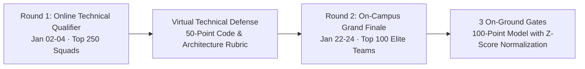

# KAIROS 2027 — Judges, Grand Jury & VIP Dignitary Handbook (Grand Edition)

> **Document Status:** CANONICAL JURY EVALUATION & HOSPITALITY MANUAL  
> **Executive Oversight:** Super Head 6 (Chief Safety, Governance & Jury Officer)  
> **Accountable Lead:** Hemavarshine S (CSGO, Reg: `44110263`)  
> **Reporting Directly To:** Thenappan T (President & SBGL, Reg: `44110855`)  
> **Faculty Coordinators:** Dr. K. Ashok Kumar & Dr. Balapriya S (Department of CSE, SIST)  
> **VIP Hospitality Suite:** Mezzanine VIP Executive Lounge, Sathyabama Indoor Stadium  
> **Source of Truth:** [`00_hackathon_master_brief.md`](./00_hackathon_master_brief.md) · [`02_agenda_rounds_and_judging_rubric.md`](./02_agenda_rounds_and_judging_rubric.md)

---

## 1. Dual-Phase Evaluation Governance Overview

To ensure our on-campus builders represent the absolute peak of student engineering in India, the Jury Division governs both the **Virtual Semi-Finals** and the **On-Ground Grand Finale**:

---

## 2. Round 1: Online Technical Qualifier Jury Protocol (Jan 02–04, 2027)

* **Virtual Sprint Setup:** 10 parallel Google Meet rooms managed by Technical Leads.
* **Evaluation Format:** 7-Minute Live Review per team (4 minutes working prototype/Loom demo + 3 minutes technical Q&A).
* **Deliverables Audited:**
  1. Working GitHub repository commit history (verified via Kairos webhook).
  2. Cloud architecture diagram & AWS service mapping (PDF).
  3. 3-Minute Loom video demonstration of working code.
* **50-Point Virtual Scoring Rubric:**
  - Problem Depth & Novelty: **15 Pts**
  - Cloud Architecture Rigor & Scalability: **15 Pts**
  - Working Codebase & Zero-Boilerplate Proof-of-Concept: **10 Pts**
  - Live Virtual Defense & Technical Clarity: **10 Pts**
* **Shortlist Selection:** Top 100 teams (~400–600 developers) with the highest composite scores earn formal invitations to the on-campus finale at Sathyabama Indoor Stadium.

---

## 3. Round 2: On-Campus VIP Hospitality & Executive Protocol

### 3.1 Mezzanine VIP Executive Lounge (Sathyabama Indoor Stadium)
* **Executive Amenities:** Continuous five-star hospitality (fresh South Indian filter coffee, artisanal teas, dry fruits, fresh juices, hot appetizers, and executive buffet dining).
* **Deliberation Suites:** Soundproof executive meeting rooms equipped with high-speed private Wi-Fi (`KAIROS-ADMIN`) and digital scoring consoles.

### 3.2 Chauffeur & Transit Logistics:
* Dedicated chauffeured AC sedans for all outstation judges arriving at Chennai International Airport (MAA) or Chennai Central Railway Station.
* Executive gift hampers containing handcrafted silk shawls, artisanal mementos, and official KAIROS 2027 commemorative plaques.

---

## 4. Digital Scoring Portal Operations & Z-Score Normalization

Judges evaluate teams via the **Kairos Digital Jury Portal** operating on secure tablets. To eliminate judge severity or leniency bias across parallel panels, raw scores are normalized algorithmically:

$$Z_{i,j} = \frac{X_{i,j} - \mu_j}{\sigma_j}$$

Where:
* $X_{i,j}$ = Raw score assigned by Judge $j$ to Team $i$
* $\mu_j$ = Mean score of all evaluations completed by Judge $j$
* $\sigma_j$ = Standard deviation of scores from Judge $j$

Normalized scores are converted into an index ($T = 50 + 10 \cdot Z_{i,j}$) ensuring fair cross-panel comparisons.

---

## 5. Judge Conflict-of-Interest & Code of Ethics

1. **Mandatory Declaration:** Judges must declare any conflict of interest (e.g., student from their alma mater, family relation, personal mentee, or direct corporate employee) during the briefing session.
2. **Automated Recusal:** Any judge with a declared conflict is automatically reassigned to a different track or evaluation bay.
3. **100% Student Code Ownership:** Judges may not demand intellectual property assignment, equity, or proprietary rights as a condition for scoring. All participant IP remains 100% student-owned.
4. **Constructive Professional Feedback:** Even during rigorous technical grilling, all evaluations must maintain an encouraging, educational, and professional tone.

---

## 6. On-Campus Judge Briefing Checklist

- [ ] **T-60 Mins (08:30 AM Day 3):** Convenes in Mezzanine VIP Executive Lounge for Grand Jury Breakfast Briefing.
- [ ] **T-45 Mins (08:45 AM):** Review the 40-point Checkpoint 3 rubric and Z-score normalization model.
- [ ] **T-30 Mins (09:00 AM):** Receive assigned tablet with pre-authenticated Digital Jury Portal access.
- [ ] **T-00 Mins (09:00 AM – 12:30 PM):** Execute 7-minute live demo reviews (4 mins demo + 3 mins Q&A strictly timed).
- [ ] **T+30 Mins (01:30 PM – 02:15 PM):** Convene for Grand Deliberation, review normalized rankings, and countersign the official prize winners sheet.
