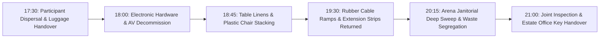

# KAIROS 2027 — On-Ground Operations, Venue Architecture & Shift Roster Manual (Grand Edition)

**Document Reference:** `docs/08_event_operations_and_volunteer_manual.md`  
**Host Entity:** AWS Student Builder Group (AWS SBG) — SIST Chapter  
**Sponsoring Institution:** Sathyabama Institute of Science and Technology (Deemed to be University), Chennai – 600119  
**Super Head Mandate:** Super Head 3 (Chief Operations & Logistics Officer — COO) & Super Head 4 (Chief Experience & Hospitality Officer — CXO)  
**Governing Standards:** [00_hackathon_master_brief.md](./00_hackathon_master_brief.md) · [02_hard_office_copy_master_agenda.md](./02_hard_office_copy_master_agenda.md) · [11_crisis_management_and_safety_protocol.md](./11_crisis_management_and_safety_protocol.md) · [14_official_letters_and_administrative_approvals.md](./14_official_letters_and_administrative_approvals.md) · [18_team_structure_leads_and_workforce_deployment.md](./18_team_structure_leads_and_workforce_deployment.md) · [19_operations_logistics_crud_and_system_specs.md](./19_operations_logistics_crud_and_system_specs.md) · [20_indoor_auditorium_venue_transition_and_budget_plan.md](./20_indoor_auditorium_venue_transition_and_budget_plan.md)  
**Operational Scope:** Sathyabama Indoor Stadium (Indoor Auditorium Arena Floor, Stage Complex, Backstage Green Rooms 1 & 2, Upper Bleachers Quiet Pods, and Foyer)  
**Event Window:** January 22 – 24, 2027 (48 Continuous Hours)  
**Participant Model:** **100% FREE — ZERO ENTRY FEE** (Complimentary lodging, 8 food services, power, and high-speed Wi-Fi)  
**Status:** `APPROVED PLAN`  

---

## 1. Sathyabama Indoor Stadium Venue Allocation & Architecture

The physical grand finale for KAIROS 2027 is staged inside the **Sathyabama Indoor Stadium (Indoor Auditorium)**, transitioned from the Central Library to house all 100 finalist teams under one unified, climate-controlled roof.

```mermaid
graph TD
    subgraph Sathyabama Indoor Stadium (Indoor Auditorium)
        STAGE[Elevated Stage Complex<br/>50x10ft Mega Backdrop · 12x8ft P2.5 LED Wall · Line Array PA]
        ARENA[Main Stadium Arena Floor<br/>100 Team Pods / 75-80 Round Banquet Tables · Linens · Floor Cable Ramps]
        GR1[Backstage Green Room 1<br/>Female Rest Sanctuary · AC · Private Restroom & Security Escort]
        GR2[Backstage Green Room 2<br/>VIP Industry Jury Lounge · Executive Dining & Scoring Terminals]
        WAR[Central Arena War Room Pod<br/>Apex Ops Desk · AWS Architecture Clinic · Network NOC & Stream Bay]
        BLEACH[Upper Spectator Bleachers<br/>Quiet Nap Pods · 40 Padded Mats · 100% Silent Rest Zone]
        FOYER[Stadium Portico & Foyer<br/>Registration Desks · 24/7 Filter Coffee Fuel Bar · EV Buggy Terminal]
    end
```

### 1.1 Zone Specifications & Capacities

| Venue Zone | Functional Purpose | Equipment & Furnishings | Access Policy |
|---|---|---|---|
| **Main Arena Floor (Bays A–D)** | 24/7 Prototyping arena for 100 finalist teams (450–600 hackers). | 75–80 round banquet tables with fitted navy linens, 550+ chairs, 3 trunk power lines, rubber cable ramps. | Open 24/7 to all badge holders. |
| **Elevated Stage Complex** | Inauguration, keynotes, track releases, and Grand Finale pitching. | 50×10ft stadium backdrop banner, 12×8ft P2.5 LED wall, Line Array PA, confidence monitors, podium. | Stage crew, speakers, and presenting teams only. |
| **Backstage Green Room 1** | Dedicated Female Rest Sanctuary & wellness lounge. | Air-conditioned, private attached washrooms, rest couches, vanity supplies, sanitary dispensers. | Strictly female participants, female faculty proctors, and lady marshals. |
| **Backstage Green Room 2 / Mezzanine** | VIP Industry Jury Lounge & Deliberation Suite. | High-speed scoring Wi-Fi, executive dining buffet, private espresso bar, deliberation boardroom. | Industry judges, AWS dignitaries, CPFO, and Faculty Coordinators. |
| **Central Arena Apex War Room** | Incident triage, logistics CRUD, Network NOC, and live broadcast. | 6 multi-screen ops desks, dual-ISP fiber terminals, walkie-talkie base station, stream encoding rigs. | Super Heads, Division Leads, and NOC engineers. |
| **Upper Bleachers Mezzanine** | Quiet Nap Pods (Short-duration power naps). | 40 padded floor mats, sanitized blankets, ambient soundproofing. Strict zero-noise policy. | 30–60 min nap rotation for exhausted hackers. |
| **Stadium Foyer & Portico** | Check-in, smart badge pairing, helpdesk, and 24/7 coffee bar. | 4 registration desks, barcode scanners, 24/7 filter coffee brewers, first-aid post, EV buggy dock. | Public arrival point for delegates and VIPs. |
| **University Hostel Guest Wings** | Deep sleep rotations (Tier 1 rest) and shower facilities. | 40 requisitioned hostel rooms (20 boys, 20 girls) connected via 24/7 EV Buggies. | Staggered 3-shift sleep rotations (01:00–06:00). |

---

## 2. Arena Electrical Power Grid (65 kVA) & High-Density Network

### 2.1 Power Grid Architecture & Sports Floor Safety
* **Total Continuous Power Draw:** **55–65 kVA** (600 laptops @ 65W avg = ~39 kW + mobile chargers, monitors, switches, LED wall, Line Array PA, and coffee brewers).
* **3-Phase Load Balancing:** 3 Dedicated industrial 32A 3-Phase Main Distribution Board (DB) feed lines dropped from stadium perimeter panels to 3 arena trunk channels (Red, Yellow, Blue phases balanced evenly).
* **Athletic Floor Preservation:** Sathyabama Indoor Stadium features a treated athletic sports floor. Dragging bare metal furniture is strictly prohibited. All table legs must have rubber shoes. All high-traffic floor cable crossings must be encased inside **heavy-duty dual-channel rubber cable ramps** taped flush with residue-free venue mat tape.
* **Team Pod Power:** 100–120 heavy-duty 6A/16A surge-protected extension boards (5m leads) provided via SIST Maintenance requisition (1 dedicated board per team pod, ensuring a minimum of 4 usable ports per team).
* **Power Redundancy:** Continuous tie-in to **Dual Campus 125 kVA Diesel Generators** with automatic synchronized switchover in **<10 milliseconds**.

### 2.2 Stadium-Wide High-Density Wi-Fi 6 Infrastructure
* **Primary Enterprise Leased Line:** 1 Gbps+ symmetrical enterprise campus bandwidth with QoS traffic shaping prioritizing Kairos developer subnets and judging streams.
* **High-Density AP Deployment:** 18–20 Enterprise Dual-Band Wi-Fi 6 Access Points ceiling-hung from stadium rafters and perimeter stanchions, configured for 1,000+ concurrent active client devices with band steering and zero channel overlap.
* **Wired Backbone:** 100 Cat6 LAN patch cables and 24-port gigabit switches connecting the central war room, jury terminals, and video broadcast desk.

---

## 3. 48-Hour Master 3-Shift Operating Engine

To guarantee zero organizer burnout across 48 continuous hours, all 106 student organizers operate under **3 rotating 8-hour shifts with a 30-minute transition overlap**:

```mermaid
gantt
    title 48-Hour 3-Shift Continuous Operating Engine
    dateFormat  HH:mm
    axisFormat %H:%M
    section Day 1 (Jan 22)
    Shift Alpha (Day Operations)      :08:30, 7.5h
    Shift Bravo (Evening & Checkpoints):15:30, 8.5h
    Shift Charlie (Graveyard Midnight):23:30, 8.5h
    section Day 2 (Jan 23)
    Shift Alpha (Day Operations)      :07:30, 8.5h
    Shift Bravo (Evening & Demos)     :15:30, 8.5h
    Shift Charlie (Final Code Sprint) :23:30, 8.5h
    section Day 3 (Jan 24)
    Shift Alpha (Grand Finale & Strike):07:30, 10.5h
```



### 3.1 Shift Roster & Handoff Protocols

| Shift Code | Active Hours | Primary Operational Focus | Super Head on Duty | Handover Gate |
|---|:---:|---|---|---|
| **Shift Alpha (Day)** | 07:30 – 16:00 | Check-in, inaugurals, breakfast/lunch service, day checkpoints, VIP reception. | Super Head 3 (COO) & Super Head 4 (CXO) | Joint walkaround with Shift Bravo lead; ticket backlog scrub. |
| **Shift Bravo (Evening)** | 15:30 – 00:00 | Evening snacks, Checkpoint 1 & 2 judging, dinner rush, night lock-in prep. | Super Head 1 (CPFO) & Super Head 5 (CMO) | Gate lockdown verification; radio battery recharge cycle. |
| **Shift Charlie (Graveyard)** | 23:30 – 08:00 | 10 PM – 6 AM lock-in enforcement, midnight fuel drops, sleep pod monitoring, NOC watch. | Super Head 6 (CSO) & Super Head 2 (CTO) | Headcount reconciliation; morning breakfast queue prep. |

### 3.2 Shift Handover Checklist (Mandatory Sign-Off)
1. **Headcount Reconciliation:** Verified number of participants on the arena floor vs. resting in hostel wings.
2. **War Room Ticket Clearance:** Zero unresolved `HIGH` or `CRITICAL` tickets in the ops Kanban ([19_operations_logistics_crud_and_system_specs.md](./19_operations_logistics_crud_and_system_specs.md)).
3. **Power & Network Telemetry:** Confirmation of nominal load across Red/Yellow/Blue phases and Wi-Fi AP health.
4. **Restroom Sanitation Audit:** Verification that janitorial sweep was stamped clean within the last 45 minutes.
5. **Radio Equipment Check:** Handover of all 16 UHF radio units with fully charged backup lithium batteries.

---

## 4. University Bus Fleet & Campus EV Buggy Transit (100% Free)

* **10 Sathyabama University Buses:** Chartered to pick up arriving outstation participants on Friday morning (06:30 – 09:00, arriving on campus before 09:15 AM ahead of 09:30 AM registration) and return them on Sunday evening (17:30 – 20:00) across Chennai Central, Tambaram, Airport, and CMBT Koyambedu.
* **3 Dedicated Campus EV Shuttles / Buggies:** Running continuous 24/7 transit loops between **Sathyabama Indoor Stadium, University Hostels, Campus Health Centre, and Dining Messes** for participants, VIP dignitaries, and equipment transit at zero cost.

---

## 5. Radio Communication Hierarchy & Channel Plan

All physical coordinators and response squads communicate via 16 UHF walkie-talkie units operating across dedicated channels:

```
+--------------------------------------------------------------------------------------------------+
| KAIROS 2027 UHF RADIO CHANNEL DIRECTORY                                                          |
+---------+----------------------------+-----------------------------------+-----------------------+
| Channel | Assigned Domain            | Primary Call-Signs                | Monitored By          |
+---------+----------------------------+-----------------------------------+-----------------------+
| CH 1    | Apex Command & Governance  | APEX-LEAD, FACULTY-1, CSO-CHIEF   | President & SuperHeads|
| CH 2    | Stage, AV & Production     | STAGE-MGR, LED-OPS, AUDIO-TECH    | Media & Stage Squad   |
| CH 3    | Floor Logistics & Power    | OPS-RUNNER-1, POWER-ELEC, NOC-NET | Operations Squad      |
| CH 4    | Security, Curfew & Health  | GATE-NORTH, GATE-SOUTH, FIRST-AID | Security & Health Desk|
| CH 5    | Hospitality & Catering     | MESS-LEAD, COFFEE-BAR, VIP-HOST   | Hospitality Squad     |
+---------+----------------------------+-----------------------------------+-----------------------+
```

### 5.1 Radio Etiquette Code
* Keep transmissions under 10 seconds.
* State call sign first: *"Ops-Runner-1 to Apex-Lead, go ahead."*
* Use standard brevity words: *Acknowledged*, *Affirmative*, *Negative*, *Standby*, *En Route*.
* Never transmit sensitive participant medical details or personal contact numbers over open radio; use telephone escalation for private matters.

---

## 6. Teardown & Venue Strike Plan (Sunday 17:30 – 21:00)

Following the Valedictory Ceremony at 17:00 on Sunday, January 24, 2027, the operations squad executes an orderly 3.5-hour teardown:



1. **Luggage Release (17:30 – 18:15):** Cloakroom returns all luggage against physical brass/PVC tokens.
2. **Electronics Retrieval (18:00 – 19:00):** Network APs, switches, patch cords, and LED monitors retrieved, logged, and boxed.
3. **Furniture & Electrical Handover (18:45 – 20:00):** 550 plastic chairs stacked in batches of 20; 80 round tables wiped and folded; 120 extension boards coiled and returned to Maintenance.
4. **Zero-Waste Campus Sweep (20:00 – 20:45):** Clean campus volunteer drive segregates dry plastic waste, paper, and food scraps.
5. **Final Clearance (21:00):** Super Head 3 (COO) and Estate Office Inspector conduct joint walkthrough of the stadium floor and sign the physical clearance certificate.
