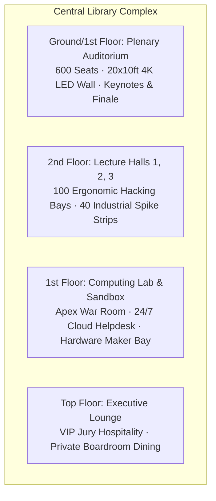

# Kairos 2027 — On-Ground Operations, Venue Architecture & Shift Roster Manual (Grand Edition)

**Super Head 3 Mandate:** Command On-Ground Logistics, Physical Venue Architecture, 45 kVA High-Power Grid, Dual 10Gbps Fiber Network, University Bus Fleet, and the 106-Organizer 3-Shift Operational Engine under a **100% Free Participant Model**.  
**Accountable Lead:** Chief Operations & Logistics Officer (COO) — Reporting directly to President Thenappan T  
**Operational Scope:** Central Library Complex (Auditorium, 1st Floor Lab, 2nd Floor Lecture Halls 1–3, Top Floor Lounge)  
**Event Window:** January 22 – 24, 2027 (48 Continuous Hours)  
**Participant Model:** **100% FREE — ZERO ENTRY FEE** (All meals, kits, and facilities completely complimentary)  

---

## 1. Central Library Venue Allocation & Architecture

### 1.1 Floor-by-Floor Specifications:
* **Ground & 1st Floor Auditorium:** Hosts Grand Inauguration, Keynote Addresses, Sponsor Tech Briefings, Grand Finale Plenary, and Award Distribution. Equipped with 20x10ft P2.5 4K LED video wall and concert truss lighting.
* **2nd Floor Lecture Halls 1, 2, and 3:** The primary 24/7 hacking arena hosting the 100 elite teams (400–500 developers) who qualified through the Online Semi-Finals. Wide desk footprints, central AC, and dedicated high-voltage power distribution.
* **1st Floor Computing Lab:** Serves as the Central Apex War Room, network server terminal, AWS cloud architecture clinic, and hardware maker sandbox.
* **Top Floor Executive Lounge:** Exclusively reserved for VIP Jury, keynote speakers, and institutional dignitaries for private dining and scoring deliberations.

---

## 2. Electrical Power Grid (45 kVA) & Dual 10Gbps Network Infrastructure

### 2.1 Power Grid Load Balance & Redundancy:
* **Total Continuous Power Load:** **45 kVA** (500 laptops @ 65W avg = ~32.5 kW + monitors, switches, chargers, and stage LED).
* **Industrial Spike Boards:** 40 heavy-duty 16A surge-protected strips (6 sockets each, 5-meter lead) distributed across LH 1, 2, and 3.
* **Power Redundancy:** Direct tie-in to **Dual Campus Diesel Generators** with an online industrial UPS switchover executing in **<10 milliseconds**, guaranteeing zero laptop reboot or power drops.

### 2.2 Dual-ISP 10Gbps Enterprise Wi-Fi:
* **Primary Fiber:** 10 Gbps symmetrical enterprise leased line.
* **Secondary Backup:** Dedicated redundant dark fiber circuit via secondary telecom provider with automatic BGP failover.
* **Wireless Access:** 8 enterprise Ruckus Wi-Fi 6 Access Points ceiling-mounted across Lecture Halls 1–3, supporting up to 800 simultaneous active devices.

---

## 3. 48-Hour Master 3-Shift Operating Engine

All 106 on-ground organizers operate on **3 rotating 8-hour shifts with a 30-minute transition overlap**:

```mermaid
gantt
    title 48-Hour 3-Shift Continuous Operating Engine
    dateFormat  HH:mm
    axisFormat %H:%M
    section Day 1 (Jan 22)
    Shift Alpha (Day Operations)      :07:30, 8.5h
    Shift Bravo (Evening & Checkpoints):15:30, 8.5h
    Shift Charlie (Graveyard Midnight):23:30, 8.5h
    section Day 2 (Jan 23)
    Shift Alpha (Day Operations)      :07:30, 8.5h
    Shift Bravo (Evening & Demos)     :15:30, 8.5h
    Shift Charlie (Final Code Sprint) :23:30, 8.5h
    section Day 3 (Jan 24)
    Shift Alpha (Grand Finale & Strike):07:30, 10h
```

---

## 4. University Bus Fleet & Campus EV Buggy Transit (100% Free)

* **10 University Buses:** Chartered to pick up arriving outstation participants on Friday morning (06:00 – 08:30) and return them on Sunday evening (17:30 – 20:00) across Chennai Central, Tambaram, Airport, and CMBT Koyambedu.
* **3 Campus EV Shuttles/Buggies:** Running continuous loops 24/7 between Central Library, Hostels, and Dining Messes for participants and VIP transfers at zero charge.
