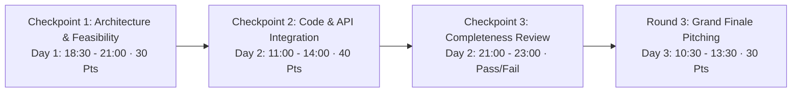

# KAIROS 2027 — Participant Handbook, Rulebook & Builder Code of Conduct (Grand Edition)

**Document Reference:** `docs/09_participant_handbook_and_rules.md`  
**Host Entity:** AWS Student Builder Group (AWS SBG) — SIST Chapter  
**Sponsoring Institution:** Sathyabama Institute of Science and Technology (Deemed to be University), Chennai – 600119  
**Executive Leadership:** Thenappan T (Register No: `44110855`), President & SBGL  
**Faculty Coordinators:** Dr. K. Ashok Kumar & Dr. Balapriya .S (Department of CSE)  
**Governing Standards:** [00_hackathon_master_brief.md](./00_hackathon_master_brief.md) · [02_agenda_rounds_and_judging_rubric.md](./02_agenda_rounds_and_judging_rubric.md) · [06_tracks_problem_statements_and_tech.md](./06_tracks_problem_statements_and_tech.md) · [07_judges_and_mentors_handbook.md](./07_judges_and_mentors_handbook.md) · [08_event_operations_and_volunteer_manual.md](./08_event_operations_and_volunteer_manual.md) · [11_crisis_management_and_safety_protocol.md](./11_crisis_management_and_safety_protocol.md) · [15_google_form_registration_and_confirmation_template.md](./15_google_form_registration_and_confirmation_template.md)  
**Registration Model:** **100% FREE — ZERO ENTRY FEE** (No fees collected from students at any stage)  
**Dual-Phase Quality Funnel:** Round 0 Application $\rightarrow$ Round 1 Online Technical Qualifier (Jan 02–04) $\rightarrow$ Round 2 On-Campus Grand Finale (Jan 22–24)  
**Grand Finale Scale:** 100 Elite National Finalist Teams (Teams of 4–6 students, ~400–600 Hackers)  
**Official Venue:** Sathyabama Indoor Stadium (Indoor Auditorium), Sathyabama Campus  
**Pure Cash Prize Pool:** **₹1,75,000 Pure Cash Escrow** + $50,000+ AWS Cloud Credits  
**Status:** `APPROVED PLAN`  

---

## 1. Builder Arrival, Check-In & The Zero-Fee Meritocracy

Welcome to **KAIROS 2027 (Grand Edition)**. Over the next 48 continuous hours, you and your team will engineer production-grade cloud and artificial intelligence prototypes on AWS, compete for **₹1,75,000 in pure liquid cash prizes**, and pitch directly to enterprise engineering directors and venture capital evaluators.

### 1.1 Zero Entry Fee Guarantee
* Participation in KAIROS 2027 is **100% FREE**. 
* We do NOT charge an application fee, screening fee, or on-campus attendance fee.
* **Direct Venue Reporting:** There is no prior on-campus onboarding. Finalist teams confirm roster lock remotely (Jan 07–14) and report directly to the **Sathyabama Indoor Stadium, Sathyabama Campus, Chennai** on Event Day (Friday, Jan 22, 2027 by 09:30 AM) for on-ground check-in and kit collection.
* Your hostel accommodation, 8 buffet meal/snack services, 24/7 filter coffee/tea bar, midnight energy snacks, developer kits, smart badges, campus EV buggy transits, bus fleet transit, and $50–$100 AWS Cloud Credits are **100% complimentary**, fully sponsored by our corporate enterprise partners and Sathyabama Institute of Science and Technology.

### 1.2 What to Bring (Packing Checklist)
* **Hardware:** Laptops, 3-pin chargers, extension cables, external mice/keyboards, hardware microcontrollers (ESP32, Raspberry Pi, sensors) if competing in hardware-enabled tracks.
* **Identification:** College Student ID Card and Government Photo ID (Aadhaar / Driving License / Passport) — Mandatory for check-in and night pass issuance.
* **Personal Comfort:** Personal toiletries, warm jacket/hoodie (indoor stadium central air conditioning operates at 20°C continuous), reusable water bottle, personal medications.
* **Sleeping Supplies:** Light blanket or travel neck pillow (stadium mezzanine quiet nap pods and hostel rest beds provided).

---

## 2. Universal Rules & Code Integrity Charter

1. **Fresh Code Policy (100% Zero Pre-Built Codebases):**
   * All project code, architectures, and models must be initialized after the official hackathon start at **12:00 PM on Friday, January 22, 2027**.
   * The use of open-source frameworks, public libraries, pre-trained open weights (via AWS Bedrock or HuggingFace), and public APIs is permitted, provided they are declared in the project README.
   * Any team found using pre-existing codebases, private commits predating the event, or unauthorized templates will face **immediate disqualification**.
2. **Commit Velocity & GitHub Audit:**
   * All teams must link their GitHub repository to the Kairos Webhook at project kick-off.
   * Commits must be made continuously across the 48 hours to demonstrate authentic milestone progression.
3. **100% Student Intellectual Property (IP) Ownership:**
   * **You own 100% of everything you build at Kairos 2027.** Neither the organizers, Sathyabama Institute of Science and Technology, nor corporate sponsors claim any equity, patent ownership, or intellectual property rights over participant code or projects.
4. **Team Composition & Eligibility:**
   * Teams consist strictly of **4 to 6 registered student developers** currently enrolled in an accredited undergraduate or postgraduate program. Inter-disciplinary and cross-college teams are permitted.
5. **Candidate Data Privacy & Opt-In Recruitment Notice:**
   * In compliance with data privacy regulations (DPDP Act), student resumes, portfolios, and contact details are shared with corporate sponsors **exclusively on an affirmative opt-in basis**.
   * During registration confirmation, students select whether to be included in the verified Corporate Talent Book. Opting out has zero impact on judging, evaluation, or prize eligibility.

---

## 3. Judging Process & Milestone Checkpoints

Evaluation across the 48 hours is conducted in strict alignment with [02_agenda_rounds_and_judging_rubric.md](./02_agenda_rounds_and_judging_rubric.md) and [07_judges_and_mentors_handbook.md](./07_judges_and_mentors_handbook.md):

### 3.1 100-Point Scoring Breakdown
* **Checkpoint 1 (30 Points):** Problem definition (10 pts), Cloud architectural feasibility (10 pts), Innovation & originality (10 pts).
* **Checkpoint 2 (40 Points):** Live code execution & functionality (15 pts), AWS/API technical depth (15 pts), UI/UX workflow (10 pts).
* **Round 3 Grand Finale Pitch (30 Points):** Working demo execution (15 pts), Business model & scalability (10 pts), Pitch clarity & Q&A defense (5 pts).
* **Statistical Normalization:** All raw scores undergo Z-score normalization across jury panels to eliminate scoring disparity between panels.

---

## 4. Community Code of Conduct & Safe Space Policy

* **Zero-Tolerance Harassment Policy:** Any verbal abuse, intimidation, discriminatory remarks, inappropriate physical contact, or unwanted sexual attention will result in **immediate badge revocation, expulsion from campus by security, and reporting to the student's parent institution**.
* **Campus Substance Ban:** Sathyabama Campus is a strictly alcohol-free, drug-free, and tobacco-free environment. Bringing contraband onto campus grounds results in immediate police handover.
* **Perimeter Curfew & Night Safety (10:00 PM – 06:00 AM):** All participants must remain inside the **Sathyabama Indoor Stadium** during the night curfew. Leaving stadium grounds without written authorization signed jointly by the Chief Safety Officer (CSO) and a Faculty Coordinator is strictly prohibited.
* **Female Rest Sanctuary:** Backstage Green Room 1 is exclusively reserved for female participants and female faculty proctors, protected 24/7 by a female security guard.

---

## 5. Dispute Resolution & Appeals

* If a team suspects plagiarism or pre-existing code from a competitor, an official appeal must be lodged with the Chief Safety Officer (CSO) in the Central Arena War Room within **60 minutes** of the checkpoint conclusion.
* Appeals require verifiable evidence (commit timestamps, public repositories, or binary diffs). The Decision of the Faculty Coordination Board and Grand Jury is final and binding.
