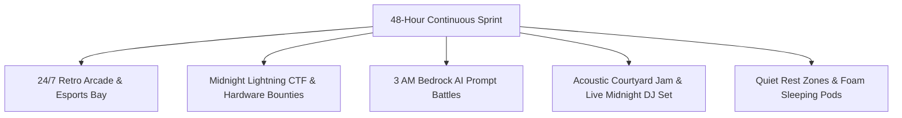

# Kairos 2027 — Side Events, Hacker Culture & Engagement Playbook (Grand Edition)

**Super Head 4 Mandate:** Drive Developer Morale, Midnight Energy Boosters, Mini-Quests, Hacker Culture, and Restful Wellness.  
**Accountable Lead:** Chief Experience & Hospitality Officer (CXO) — Reporting directly to President Thenappan T  
**Event Window:** January 22 – 24, 2027  
**Inspiration Benchmarks:** PEC Hacks (High-voltage dev culture) & THREX (Midnight intensity)  

---

## 1. Engagement Philosophy & Hacker Experience

Building continuously for 48 hours requires more than caffeine — it demands a vibrant, supportive culture that keeps energy soaring through the graveyard hours while respecting the need for rest and focus.

---

## 2. Master Schedule of Side Events & Mini-Quests

### 2.1 Midnight Lightning CTF (Night 1: 00:00 – 01:00)
* **Format:** 60-minute rapid Capture-The-Flag cybersecurity challenge hosted on our local sandbox server.
* **Challenges:** Cryptographic decryption, web exploitation, AWS IAM privilege escalation, and memory forensics.
* **Prizes:** **₹5,000 Pure Cash** + Custom RGB Mechanical Keyboards for the Top 3 individual solvers.

### 2.2 The 150 WPM Speed Typing Championship (Night 1: 02:30 – 03:00)
* **Format:** Multi-round MonkeyType knockout tournament on mechanical switches.
* **Prizes:** High-precision gaming mice and developer desk mats.

### 2.3 3 AM AWS Bedrock Prompt Battles (Night 2: 02:30 – 03:30)
* **Format:** Live head-to-head AI generation duel. Participants are given complex creative or code constraints and must craft the most precise Claude 3.5 Sonnet / Llama 3 prompts under a 90-second countdown.
* **Prizes:** $250 AWS Promotional Credit Vouchers + Red Bull merchandise crates.

### 2.4 Retro Arcade & Console Exhibition (24/7 Arena in 1st Floor Foyer)
* **Equipment:** 2 Custom Arcade Bartop Cabinets (Street Fighter, Pac-Man, Metal Slug) + 2 PS5 Console setups running Mario Kart and FIFA for quick 10-minute mental resets.

### 2.5 Midnight Acoustic Jam & Electronic DJ Set (Night 2: 00:30 – 01:30)
* **Format:** Low-fi ambient electronic DJ set followed by live acoustic guitar jamming in the central courtyard under festival fairy lights.

---

## 3. Hacker Rest Zones & Wellness Infrastructure

* **Quiet Rest Pods:** Dedicated gender-segregated halls equipped with 80+ comfortable foam mattresses, clean bedsheets, and sleeping pillows.
* **Strict Noise Ordinance:** Rest zones enforce a 100% silence policy with zero laptop screens allowed; ambient white noise machines deployed for restorative power naps.
* **Morning Stretching & Ergonomics Clinic:** 15-minute guided developer stretching sessions on Saturday and Sunday morning at 08:00 AM to relieve neck and back strain.
