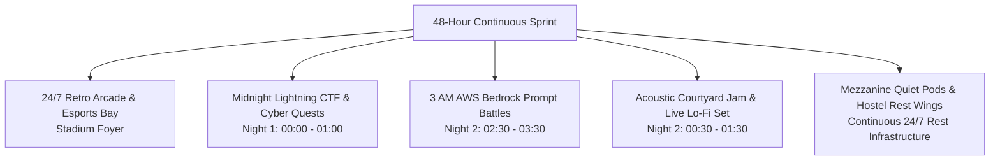

# KAIROS 2027 — Side Events, Hacker Culture & Engagement Playbook (Grand Edition)

**Document Reference:** `docs/10_side_events_and_engagement_playbook.md`  
**Host Entity:** AWS Student Builder Group (AWS SBG) — SIST Chapter  
**Sponsoring Institution:** Sathyabama Institute of Science and Technology (Deemed to be University), Chennai – 600119  
**Super Head Mandate:** Super Head 4 (Chief Experience & Hospitality Officer — CXO Hemavarshine G) & Super Head 5 (Chief Creative & Media Officer — Caroline Mary McPherson)  
**Governing Standards:** [00_hackathon_master_brief.md](./00_hackathon_master_brief.md) · [02_hard_office_copy_master_agenda.md](./02_hard_office_copy_master_agenda.md) · [08_event_operations_and_volunteer_manual.md](./08_event_operations_and_volunteer_manual.md) · [09_participant_handbook_and_rules.md](./09_participant_handbook_and_rules.md) · [18_team_structure_leads_and_workforce_deployment.md](./18_team_structure_leads_and_workforce_deployment.md) · [20_indoor_auditorium_venue_transition_and_budget_plan.md](./20_indoor_auditorium_venue_transition_and_budget_plan.md)  
**Event Window:** January 22 – 24, 2027 (48 Continuous Hours)  
**Venue:** Sathyabama Indoor Stadium (Indoor Auditorium), Sathyabama Campus  
**Status:** `APPROVED PLAN`  

---

## 1. Engagement Philosophy & Hacker Culture

Building continuously for 48 hours requires more than caffeine — it demands a vibrant, supportive culture that keeps energy high through the graveyard hours while respecting the need for rest, ergonomics, and mental wellness.

---

## 2. Master Schedule of Side Events & Mini-Quests

> [!NOTE]
> All mini-quest awards are funded via sponsor merchandise, peripheral hardware, and promotional cloud credits. They do not deplete the ring-fenced ₹1,75,000 hackathon pure cash prize escrow.

### 2.1 Midnight Lightning CTF (Night 1: 00:00 – 01:00)
* **Format:** 60-minute rapid Capture-The-Flag cybersecurity challenge hosted on our local sandbox server.
* **Challenges:** Cryptographic decryption, web exploitation, AWS IAM privilege escalation, and memory forensics.
* **Prizes:** Custom RGB Mechanical Keyboards + Premium DevTool Subscriptions for the Top 3 individual solvers.

### 2.2 The 150 WPM Speed Typing Championship (Night 1: 02:30 – 03:00)
* **Format:** Multi-round MonkeyType knockout tournament on mechanical switches.
* **Prizes:** High-precision ergonomic gaming mice and developer desk mats.

### 2.3 3 AM AWS Bedrock Prompt Battles (Night 2: 02:30 – 03:30)
* **Format:** Live head-to-head AI generation duel. Participants are given complex creative or code constraints and must craft the most precise Claude 3.5 Sonnet / Llama 3 prompts under a 90-second countdown.
* **Prizes:** $250 AWS Promotional Credit Vouchers + Red Bull merchandise crates.

### 2.4 Retro Arcade & Console Exhibition (24/7 in Stadium Foyer)
* **Equipment:** 2 Custom Arcade Bartop Cabinets (Street Fighter, Pac-Man, Metal Slug) + 2 PS5 Console setups running Mario Kart and FIFA for quick 10-minute mental resets.
* **Rule:** Maximum 15 minutes per session to prevent blocking team sprint progress.

### 2.5 Midnight Acoustic Jam & Electronic Lo-Fi Set (Night 2: 00:30 – 01:30)
* **Format:** Ambient electronic lo-fi set followed by live acoustic guitar jamming in the **Stadium Outdoor Portico Lawn** under festival fairy lights.
* **Refreshments:** Midnight hot filter coffee, tea, and cookies served simultaneously.

---

## 3. Hacker Rest Zones & Wellness Infrastructure

* **Upper Bleachers Mezzanine (Quiet Nap Pods):** Shaded mezzanine above the arena equipped with 40 padded floor mats and sanitized blankets for 30–60 minute power naps in a strict zero-noise, zero-laptop zone.
* **Backstage Green Room 1 (Female Rest Sanctuary):** Dedicated female-only sanctuary equipped with rest couches, vanity amenities, attached private washrooms, and 24/7 female security guard stationed at the door.
* **University Hostel Guest Wings (Tier 1 Deep Sleep):** 40 requisitioned hostel rooms (20 boys, 20 girls) connected via 24/7 EV Buggies for full 3-shift sleep and shower rotations.
* **Morning Stretching & Ergonomics Clinic:** 15-minute guided developer stretching sessions on Saturday and Sunday morning at **08:00 AM** led by campus wellness volunteers to relieve cervical and lower-back strain.
