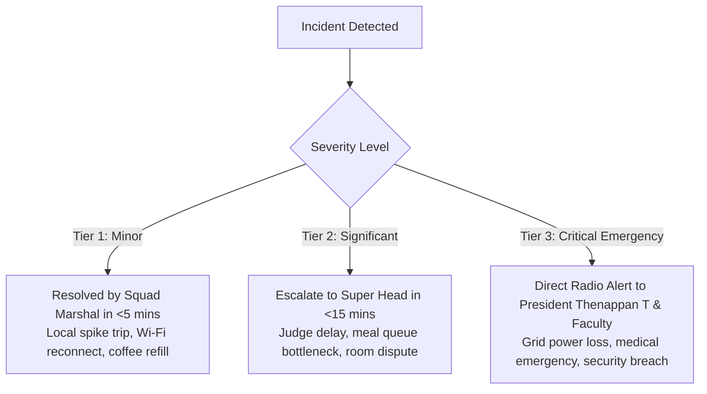

# Kairos 2027 — Crisis Management, Safety & Emergency Protocols (Grand Edition)

**Super Head 6 Mandate:** Maintain absolute campus security, medical readiness, infrastructural redundancy, and crisis escalation response.  
**Accountable Lead:** Chief Safety, Governance & Jury Officer (CSO) — Reporting directly to President Thenappan T  
**Event Window:** January 22 – 24, 2027 (48 Continuous Hours)  
**Campus Security Alignment:** Sathyabama University Security Directorate & Local Police Intimation  

---

## 1. The Three-Tier Crisis Severity Matrix

---

## 2. Infrastructure Redundancy & Zero-Downtime SOPs

### 2.1 Power Grid Failure (Blackout Mitigation)
* **Risk:** Main TNEB electrical grid blackout.
* **Redundancy Setup:** 
  1. Central Library is directly tied to **Dual 125 kVA Campus Diesel Generators** on hot standby with 500 liters of diesel pre-fueled.
  2. All server racks, network switches, and stage consoles are buffered by **Online Industrial True-Sine-Wave UPS Systems**.
* **Action SLA:** Auto-switchover occurs in **<10 milliseconds**, ensuring zero computer restarts, projector flickers, or network dropouts.

### 2.2 Dual-ISP 10Gbps Fiber Network Failover
* **Risk:** Fiber cut or upstream telecom provider outage.
* **Redundancy Setup:** Dual independent fiber links terminate at the 1st Floor Server Room (Primary 10Gbps Leased Line + Secondary 5Gbps Backup Line).
* **Action SLA:** Automated BGP route failover occurs seamlessly within **3 seconds**. Two enterprise 5G industrial cellular routers provide emergency tertiary coverage.

---

## 3. Medical Emergency, Trauma Care & Hospital Protocol

* **On-Site Ambulance:** Dedicated Sathyabama General Hospital emergency ambulance stationed 24/7 outside the Central Library main portico with driver on constant standby.
* **Medical Team on Duty:** 1 Emergency Physician and 2 Trauma Nurses stationed in the **1st Floor First Aid Bay** equipped with AED (Automated External Defibrillator), oxygen cylinders, trauma dressing kits, and emergency medications.
* **Hospital Transfer Protocol:** In the event of acute illness or trauma, the patient is transferred directly to **Sathyabama General Hospital Emergency Wing** (located on campus, 3 minutes transit time).

---

## 4. Night-Stay Security & Gender Safety Charter

* **Strict Campus Lock-In:** A complete building lock-in is enforced from **10:00 PM to 06:00 AM**. No participant is allowed to exit the Central Library Complex without written authorization from the CSO and Faculty Advisor.
* **Segregated Corridors & Hostels:**
  * **Strictly independent stairwells and transit corridors** are designated for female and male participants traveling to campus dining messes and restrooms.
  * Female participants are accompanied by female security marshals and faculty coordinators during all night movements.
* **Photo ID Badge Enforcement:** 24/7 static security guards stationed at every building portal. **Zero-Badge = Zero-Entry** policy strictly enforced.

---

## 5. Emergency Incident Directory & Radio Hierarchy

* **Channel 1 Radio:** Apex Executive Command (President Thenappan T, Faculty Advisor, CSO).
* **Channel 4 Radio:** Security, Hostels & Medical Response.
* **Campus Chief Security Officer Hotline:** +91 [Direct Phone]
* **Sathyabama General Hospital Emergency Wing:** Ext. 108 / +91 [Direct Phone]
* **Semmancheri Police Station Intimation Desk:** Ref: `SIST/AWS-SBG/2027/POL-001`
