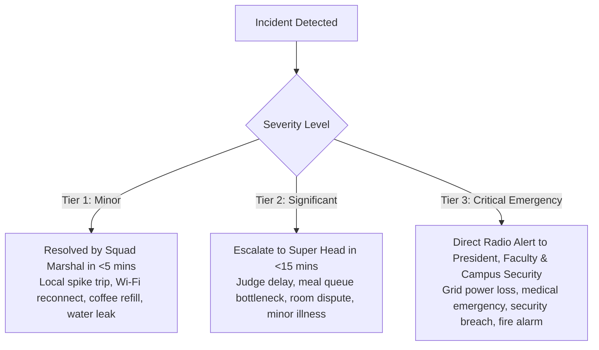
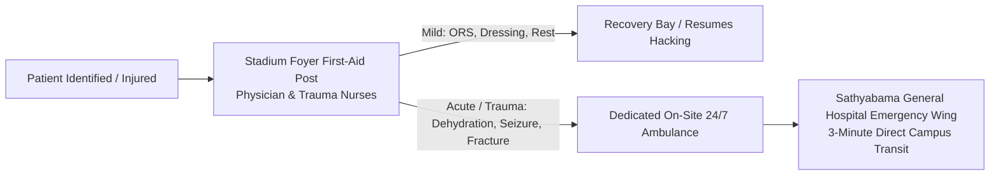

# KAIROS 2027 — Crisis Management, Safety & Emergency Protocols (Grand Edition)

**Document Reference:** `docs/11_crisis_management_and_safety_protocol.md`  
**Host Entity:** AWS Student Builder Group (AWS SBG) — SIST Chapter  
**Sponsoring Institution:** Sathyabama Institute of Science and Technology (Deemed to be University), Chennai – 600119  
**Super Head Mandate:** Super Head 6 (Chief Safety, Governance & Jury Officer — CSO) & Super Head 3 (Chief Operations & Logistics Officer — COO)  
**Governing Standards:** [00_hackathon_master_brief.md](./00_hackathon_master_brief.md) · [08_event_operations_and_volunteer_manual.md](./08_event_operations_and_volunteer_manual.md) · [09_participant_handbook_and_rules.md](./09_participant_handbook_and_rules.md) · [14_official_letters_and_administrative_approvals.md](./14_official_letters_and_administrative_approvals.md) · [18_team_structure_leads_and_workforce_deployment.md](./18_team_structure_leads_and_workforce_deployment.md) · [19_operations_logistics_crud_and_system_specs.md](./19_operations_logistics_crud_and_system_specs.md) · [20_indoor_auditorium_venue_transition_and_budget_plan.md](./20_indoor_auditorium_venue_transition_and_budget_plan.md)  
**Campus Security Alignment:** Sathyabama University Security Directorate & Semmancheri Police Station Intimation Desk  
**Event Window:** January 22 – 24, 2027 (48 Continuous Hours)  
**Operational Venue:** Sathyabama Indoor Stadium (Indoor Auditorium), Sathyabama Campus  
**Status:** `APPROVED PLAN`  

---

## 1. The Three-Tier Crisis Severity Matrix

Every operational anomaly, safety concern, or infrastructural failure must be classified instantly into one of three standardized severity tiers:



### 1.1 Escalation Matrix & Response SLA

| Tier | Severity Definition | Examples | Response SLA | Accountable Lead | Escalation Protocol |
|---|---|---|:---:|---|---|
| **Tier 1 (Minor)** | Localized friction not impacting schedule or safety. | Blown power strip fuse, coffee urn empty, temporary Wi-Fi blip on 1 desk, spilled beverage. | **< 5 Minutes** | Floor Squad Runner / Table Marshal | Log in War Room Kanban ([19_operations_logistics_crud_and_system_specs.md](./19_operations_logistics_crud_and_system_specs.md)); resolve locally. |
| **Tier 2 (Significant)** | Operational disruption affecting multiple teams or VIPs. | Major Wi-Fi access point failure, 30-minute catering queue, external judge delayed in traffic, verbal dispute between teams. | **< 15 Minutes** | Super Head 3 (COO) / Super Head 4 (CXO) | Dispatch specialized backup runner; inform War Room Apex Lead over Radio Channel 3. |
| **Tier 3 (Critical Emergency)** | Immediate threat to life, campus security, major infrastructure, or event integrity. | Main transformer blackout, acute medical collapse, physical altercation, fire alarm, unauthorized intruder during night lock-in. | **< 60 Seconds** | President Thenappan T, Super Head 6 (CSO), Faculty Coordinators | Immediate broadcast on Radio Channel 1; alert Campus Security Directorate and Campus Health Center. |

---

## 2. Infrastructure Redundancy & Zero-Downtime SOPs

### 2.1 Power Grid Blackout Failover (65 kVA Stadium Load)
* **Risk:** Main TNEB electrical grid feeder trip or sub-station failure.
* **Redundancy Setup:** 
  1. The Sathyabama Indoor Stadium distribution panels are continuously tied into **Dual 125 kVA Campus Diesel Generators** on hot standby with 500 liters of diesel pre-fueled.
  2. All network switches, core routers, stage LED controllers, and sound consoles are buffered by **Online Industrial True-Sine-Wave UPS Systems**.
* **Action SLA:** Automated synchronized transfer switch engages in **< 10 milliseconds**. Laptops and network gear experience zero reboots or flickers.
* **Floor Protocol:**
  * If arena lights extinguish, Table Marshals instantly activate emergency battery-powered floodlights at both stadium corridors.
  * Floor Marshals instruct participants to remain seated at their tables. Zero panic movement on the dark arena floor.

### 2.2 Dual-ISP High-Speed Fiber Network Failover
* **Risk:** Physical fiber cut or upstream ISP outage.
* **Redundancy Setup:** Dual independent enterprise fiber lines terminate in the Central Arena War Room (Primary 1 Gbps Leased Line + Secondary 500 Mbps Backup Line).
* **Action SLA:** Automated BGP route failover occurs seamlessly within **3 seconds**.
* **Tertiary Failover:** Two industrial 5G cellular routers provide immediate emergency coverage for judging terminals and stage scoring feeds if fiber feeds are disrupted.

---

## 3. Medical Emergency, Trauma Care & Hospital Protocol

Sathyabama Institute of Science and Technology houses the multi-specialty **Sathyabama General Hospital** directly on campus, providing immediate clinical escalation.



### 3.1 Medical Capabilities on Duty
* **On-Site 24/7 Ambulance:** Dedicated emergency ambulance stationed continuously at the Sathyabama Indoor Stadium outer portico with driver and emergency oxygen kit on board.
* **Stadium Foyer First-Aid Bay:** Staffed continuously by 1 Emergency Medical Officer and 2 Trauma Nurses from Sathyabama General Hospital. Equipped with:
  * Automated External Defibrillator (AED).
  * Medical oxygen cylinder with regulator mask.
  * Emergency oral rehydration salts (ORS), glucose, anti-emetics, paracetamol, antacids, and burn gels.
  * Sterile trauma dressings, splints, and antiseptic wash.
* **Hospital Escalation Protocol:** Any participant experiencing severe chest pain, seizure, head trauma, uncontrolled vomiting, or loss of consciousness is transferred directly to the Sathyabama General Hospital Emergency Wing within **3 minutes**.
* **Parental Notification Rule:** Under no circumstances will a student be transported to the hospital without immediate telephone notification to their registered emergency contact by the Faculty Coordinator.

---

## 4. Night-Stay Security & Gender Safety Charter

To ensure 100% safety and strict institutional compliance across 48 continuous hours, the following campus security protocols are non-negotiable:

### 4.1 Strict Stadium Perimeter Lock-In (10:00 PM – 06:00 AM)
* At **22:00 IST**, all external perimeter doors of the Sathyabama Indoor Stadium are secured by university security guards.
* **Zero Exit Policy:** No student participant is permitted to exit the stadium premises between 22:00 and 06:00 without written authorization signed jointly by the Chief Safety Officer (CSO) and a Faculty Coordinator.
* **Emergency Exits:** Crash-bar equipped emergency fire exits remain operational from the inside for life-safety evacuations but sound an automated local alarm if breached.

### 4.2 Female Rest Sanctuary & Transit Protocol
* **Backstage Green Room 1 Sanctuary:** Exclusively designated as the Female Rest Sanctuary. Equipped with air conditioning, attached private washrooms, rest couches, feminine hygiene supplies, and mobile chargers.
* **Portal Guard:** A designated female security guard is stationed at the entrance door 24/7. Male participants and male organizers are strictly prohibited from entering.
* **Hostel Night Transit:** Female participants needing to transit between the Indoor Stadium and University Hostels for sleep rotations are transported exclusively via **Campus EV Buggies** accompanied at all times by a registered female faculty proctor or lady student marshal.

### 4.3 Anti-Harassment & Zero-Tolerance Code of Conduct
* KAIROS 2027 operates under a strict Zero-Tolerance Policy toward physical intimidation, verbal harassment, sexual misconduct, discrimination, or offensive hacking submissions.
* Any reported violation results in **immediate badge revocation, physical eviction from campus by security, and formal intimation to the student's parent institution and University Disciplinary Committee**.

---

## 5. Sathyabama Indoor Stadium Fire & Evacuation Plan

```
+--------------------------------------------------------------------------------------------------+
| EMERGENCY EVACUATION ARCHITECTURE — SATHYABAMA INDOOR STADIUM                                     |
+--------------------------------------------------------------------------------------------------+
|                                    [ELEVATED MAIN STAGE]                                         |
|                                                                                                  |
| [EMERGENCY EXIT WEST]                                                   [EMERGENCY EXIT EAST]    |
| (Double Panic Doors)                                                     (Double Panic Doors)    |
|        ^                                                                          ^              |
|        |                                                                          |              |
|   ARENA BAY A & B                                                            ARENA BAY C & D     |
|   (Teams 01 - 50)                                                            (Teams 51 - 100)    |
|        |                                                                          |              |
|        v                                                                          v              |
| ============================== CENTRAL ARBITRATION CORRIDOR ==================================== |
|                                                                                                  |
|                                [MAIN FOYER & PORTICO EXITS]                                      |
|                               (Primary Evacuation Concourse)                                     |
|                                              |                                                   |
|                                              v                                                   |
|                ==============================================================                    |
|                PRIMARY MUSTER POINT: OPEN ATHLETIC LAWN (100M EAST OF STADIUM)                   |
|                ==============================================================                    |
+--------------------------------------------------------------------------------------------------+
```

### 5.1 Evacuation Action Steps (SOP-FIRE)
1. **Alarm Trigger:** Building fire alarm sounds or CSO broadcasts *"Code Red Evacuation"* on Radio Channel 1.
2. **Floor Clearance:** Squad Marshals immediately instruct hackers to leave heavy bags, unplug laptops, and walk briskly toward the nearest exit:
   * Bays A & B exit via the **West Emergency Exit**.
   * Bays C & D exit via the **East Emergency Exit**.
   * Foyer, VIP Lounge, and War Room exit via the **Main South Portico**.
3. **Muster Point Roll Call:** All participants assemble at the **Open Athletic Lawn**. Table Marshals conduct visual headcount against check-in rosters within 5 minutes.
4. **Fire Suppression:** 6 ABC Dry Chemical extinguishers and 4 CO2 extinguishers positioned around the stage and power distribution panels are deployed exclusively by trained estate personnel.

---

## 6. Cyber Security & Code Integrity Incidents

* **AWS Credential Leakage:** If a participant commits AWS Root or IAM access keys to a public GitHub repository, the Systems NOC team automatically revokes the affected keys within the AWS Organizations console and alerts the team lead.
* **Malicious Network Activity:** Any team initiating ARP spoofing, port scanning, packet sniffing, or DDoS attacks against venue infrastructure is flagged by network monitoring, blacklisted at the firewall, and disqualified immediately.
* **Plagiarism & Pre-Built Code:** Evaluators conduct Git history scrutiny during Checkpoints 1 and 2. Commits preceding the official hackathon start time (12:00 PM, Jan 22) must be declared or will trigger immediate score nullification.

---

## 7. Emergency Incident Directory & Communication Roster

> [!IMPORTANT]
> Official institutional contacts are listed below. All radio channels are actively monitored 24/7 during the event window.

| Role / Authority | Designated Officer | Primary Channel | Institutional Desk / Location |
|---|---|:---:|---|
| **Event President & Lead** | Thenappan T (Reg: 44110855) | Radio CH 1 | Central Arena Apex War Room |
| **Chief Safety Officer (CSO)** | Super Head 6 | Radio CH 1 / CH 4 | Stadium Security Control Desk |
| **Faculty Coordinator (Lead)** | Dr. K. Ashok Kumar | Radio CH 1 | Faculty Coordination Bay |
| **Faculty Coordinator (Lady Proctor)** | Dr. Balapriya .S | Radio CH 1 / CH 4 | Green Room 1 Escort Desk |
| **Campus Chief Security Officer** | *[Verified Security Desk]* | Security Hotline | Campus Main Gate Control Center |
| **Sathyabama General Hospital** | On-Duty Casualty Physician | Ext. 108 / Direct | Hospital Emergency Wing (On-Campus) |
| **On-Site Emergency Ambulance** | On-Duty EMT Driver | Radio CH 4 | Stadium Outer Portico Bay |
| **Campus Estate & Electrical Lead** | *[Verified Maintenance Desk]* | Radio CH 3 | Sub-Station Control Room |
| **Semmancheri Police Station** | Station Duty Officer | *Formal Intimation* | Ref: `SIST/AWS-SBG/2027/POL-001` |
