# Kairos 2027 — Post-Event Impact Report, Sponsor ROI Deck & Closeout (Grand Edition)

**Governing Standard:** `E:\AWS SBGL\ANTI-Help\04_FLAGSHIP_EVENT_DEEPDIVES_AND_POST_EVENT_REPORTS.md`  
**Host Entity:** AWS Student Builder Group (AWS SBG) — SIST Chapter  
**Sponsoring Institution:** Sathyabama Institute of Science and Technology, Chennai – 600119  
**Super Head 1 Mandate:** Deliver corporate sponsor proof-of-performance reports, distribute resume talent pools, execute the ₹1,75,000 pure cash prize escrow disbursements, and conduct final financial audits under the **100% Free Participant Model**.  
**Accountable Lead:** Chief Partnerships & Finance Officer (CPFO) — Reporting directly to President Thenappan T (Register No: 44110855)  
**Closeout Window:** January 25 – February 10, 2027  
**Grand Scale:** 2,000+ National Applicants $\rightarrow$ 250 Online Semi-Finalists $\rightarrow$ 100 On-Campus Finalist Teams (Teams of 4–6 students, ~400–600 Hackers) · ₹3.5L Working Operational Capital · ₹1,75,000 Pure Cash Prizes  

---

## 1. Post-Event Deliverables SLA & Corporate Handover

| Deliverable | Recipient Stakeholder | Delivery SLA | Accountable Squad |
|---|---|:---:|---|
| **Verified Resume Database (400+ finalists)**| Title, Powered-By & Associate Sponsors | **48 Hours Post-Event (Jan 26)** | Partnerships Team |
| **Instant Prize NEFT Transfers (₹1,75,000)** | Grand Champions & Track Winners | **72 Hours Post-Event (Jan 27)** | Treasury & Escrow Team |
| **Verified Digital Credentials** | All 400 Participants & 106 Organizers | **4 Business Days (Jan 28)** | Software Systems Team |
| **Official 4K Cinematic Aftermovie**| Public Premiere (YouTube / LinkedIn) | **7 Business Days (Jan 31)** | Media & Broadcast Team |
| **10-Slide Sponsor ROI Impact Deck**| All Corporate Partners & University Board | **10 Business Days (Feb 05)** | CPFO & President |
| **Final Financial Audit & Utilization**| Sathyabama University Registrar & Dean | **14 Business Days (Feb 08)** | CPFO & Finance Lead |

---

## 2. Structure of the 10-Slide Sponsor ROI Presentation

```mermaid
graph LR
    S1[Slide 1: Executive Cover & Naming Credits] --> S2[Slide 2: Grand Event Metrics & Zero-Fee Model]
    S2 --> S3[Slide 3: Dual-Phase Funnel: 2000+ to Top 100]
    S3 --> S4[Slide 4: Track Prototypes & API Adoption]
    S4 --> S5[Slide 5: Live Stream & Social Media Analytics]
    S5 --> S6[Slide 6: Press PR & National Media Reach]
    S6 --> S7[Slide 7: On-Site Branding & Booth Footfall]
    S7 --> S8[Slide 8: Talent Hiring & Commit Velocity]
    S8 --> S9[Slide 9: Testimonials & Keynote Quotes]
    S9 --> S10[Slide 10: Acknowledgments & 2028 Partnership]
```

### Key Metrics Highlighted for Enterprise Sponsors:
* **Zero-Fee Quality Advantage:** Highlight that because entry was 100% free, the applicant pool attracted elite students from top universities nationwide without financial selection bias.
* **Dual-Phase Technical Filter:** Proof that every on-ground project underwent live code and architecture screening during the January 02–04 Online Qualifier.
* **Developer Engagement:** 40,000+ total developer hacking hours on AWS Cloud.
* **Media & Digital Reach:** Official Instagram ([`@awssbg_sist`](https://instagram.com/awssbg_sist)), LinkedIn, and campus impressions exceeding 100,000+ views.
