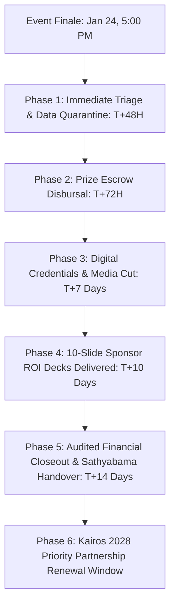

# KAIROS 2027 — Post-Event Impact Report, Sponsor ROI Deck & Closeout Master Manual

**Document Reference:** `docs/12_post_event_report_and_sponsor_roi_deck.md`  
**Host Entity:** AWS Student Builder Group (AWS SBG) — SIST Chapter  
**Sponsoring Institution:** Sathyabama Institute of Science and Technology (Deemed to be University), Jeppiaar Nagar, Rajiv Gandhi Salai, Chennai – 600119  
**Super Head Mandate:** Super Head 1 (Chief Partnerships & Finance Officer — CPFO) & Super Head 2 (Chief Technology Officer — CTO)  
**Governing Standards:** [00_hackathon_master_brief.md](./00_hackathon_master_brief.md) · [01_sponsorship_deck_and_outreach.md](./01_sponsorship_deck_and_outreach.md) · [03_budget_and_financial_tracker.md](./03_budget_and_financial_tracker.md) · [18_team_structure_leads_and_workforce_deployment.md](./18_team_structure_leads_and_workforce_deployment.md) · [20_indoor_auditorium_venue_transition_and_budget_plan.md](./20_indoor_auditorium_venue_transition_and_budget_plan.md)  
**Status:** `APPROVED PLAN` & `TEMPLATE`  
**Execution Window:** January 25 – February 10, 2027  
**Official Venue:** Sathyabama Indoor Stadium (Indoor Auditorium), Sathyabama Campus  

---

## 1. Executive Purpose & Governance SLA

The purpose of this manual is to govern the formal post-event closeout for **KAIROS 2027 (Grand Edition)**. High-stakes corporate sponsorships and institutional credibility require an institutional-grade reporting, financial auditing, and prize disbursement framework immediately following the hackathon finale on Sunday, January 24, 2027.



### 1.1 Core Deliverables SLA Matrix

| Deliverable | Recipient Stakeholder | Target Deadline | Accountable Squad | Verification & Quality Gate |
|---|---|:---:|---|---|
| **Opt-In Verified Talent Book** | Title, Powered-By & Associate Sponsors | **T+48 Hours (Jan 26, 18:00)** | Partnerships & Systems | GDPR/DPDP compliant opt-in verification; encrypted drive link. |
| **Cash Prize NEFT Transfers (₹1,75,000)** | Grand Champions & Track Winners | **T+72 Hours (Jan 27, 18:00)** | Treasury & Escrow Team | Dual-signed bank transfer UTR receipts + PAN/Identity verification. |
| **Verifiable Digital Credentials** | 450–600 Finalists & 106 Organizers | **T+4 Business Days (Jan 28)** | Software Systems Team | Unique cryptographic hash / Devfolio verifiable badge issuance. |
| **Official 4K Cinematic Aftermovie** | Public Premiere (YouTube / LinkedIn) | **T+7 Days (Jan 31, 19:00)** | Media & Broadcast Team | High-res color-graded cut featuring all sponsor banner placements. |
| **10-Slide Custom Sponsor ROI Deck** | Corporate Partners & University Board | **T+10 Business Days (Feb 05)** | CPFO & President | Customized metrics, photo proof of tier deliverables, engagement stats. |
| **Audited Financial Utilization Report** | Sathyabama Registrar & Dean | **T+14 Business Days (Feb 08)** | CPFO & Faculty Advisor | 100% voucher reconciliation, zero-cash-leakage certificate. |

---

## 2. Structure of the 10-Slide Sponsor ROI Presentation

Every corporate sponsor expects quantitative, visual, and talent metrics proving the return on their capital investment. The Partnerships squad generates a customized 10-slide deck per enterprise sponsor using the canonical template below:

```mermaid
graph LR
    S1[Slide 1: Executive Cover & Partner Credits] --> S2[Slide 2: Grand Scale & Zero-Fee Funnel]
    S2 --> S3[Slide 3: Dual-Phase Technical Screening]
    S3 --> S4[Slide 4: Track Prototypes & API Adoption]
    S4 --> S5[Slide 5: Live Stream & Social Media Analytics]
    S5 --> S6[Slide 6: Press PR & Campus Footfall]
    S6 --> S7[Slide 7: Arena Branding & Booth Footfall]
    S7 --> S8[Slide 8: Opt-In Talent Recruitment Data]
    S8 --> S9[Slide 9: Keynote & Participant Quotes]
    S9 --> S10[Slide 10: Acknowledgments & 2028 Renewal]
```



### 2.1 Slide-by-Slide Content & Asset Specifications

#### Slide 1: Title & Executive Co-Branding
* **Visual:** High-resolution co-branded title visual: `KAIROS 2027 × [SPONSOR NAME]`.
* **Sub-text:** *Empowering 600 Elite Engineers Across 48 Continuous Hours of Innovation*.
* **Key Callout:** Date of execution (January 22–24, 2027) · Sathyabama Indoor Stadium, Chennai.

#### Slide 2: Grand Scale & The Zero-Fee Quality Advantage
* **Core Narrative:** Unlike pay-to-play college hackathons, KAIROS 2027 operated as a **100% Free Participant Model**, funded entirely by enterprise visionaries.
* **Metrics:**
  * **2,000+** National Engineering Applicants across 120+ Premier Colleges.
  * **250** Semi-Finalist Teams in Phase 1 Online Qualifiers.
  * **100** Elite Finalist Teams shortlisted for the Physical Arena Grand Finale.
  * **450–600** High-Caliber Student Developers hacking continuously for 48 hours.

#### Slide 3: Dual-Phase Technical Merit Funnel
* **Architecture Graph:** Showcase the rigorous selection pipeline from initial application review (Round 0) to Online Qualifier live demos (Round 1) to On-Campus Deployment (Round 2 & 3).
* **Evaluation Integrity:** 100-point rubric, blinded evaluations, and Z-score normalization ensuring zero local institutional bias.

#### Slide 4: Track Prototypes & Sponsor API / Tooling Adoption
* **Dedicated Partner Spotlight:** Quantitative summary of how many teams integrated the sponsor's tech stack (e.g., AWS Bedrock, partner cloud APIs, developer tools, Web3 protocols).
* **Project Showcase:** 3 top GitHub repositories and functional demo URLs developed using the sponsor's technology during the hackathon.

#### Slide 5: Multi-Channel Digital Reach & Broadcast Analytics
* **Streaming Metrics:** 48 continuous hours of multi-cam live broadcast from the Sathyabama Indoor Stadium stream bay.
  * **[VERIFIED TARGET: 10,000+]** Unique live stream viewers across YouTube and Twitch.
* **Social Media Reach:**
  * Official Instagram ([`@awssbg_sist`](https://instagram.com/awssbg_sist)): **[TARGET: 75,000+]** organic impressions, reels, and stories.
  * LinkedIn Organizers & Hacker Posts: **[TARGET: 150,000+]** professional impressions using `#Kairos2027` and `#AWSSBG`.

#### Slide 6: Press, Campus Footfall & VIP Engagement
* **Campus Visibility:** Sathyabama campus population of 20,000+ students exposed to entrance concourse banners, EV shuttle posters, and auditorium displays.
* **VIP Engagement:** 25+ industry judges, faculty directors, and corporate technology leaders attending the inaugural and valedictory ceremonies.

#### Slide 7: On-Site Stadium Branding & Booth Engagement
* **Visual Proof Grid:** 4 high-definition photo embeds showing:
  1. Sponsor logo on the 50ft × 10ft Stage Backdrop.
  2. Sponsor video loop playing on the Main Stage LED Display.
  3. Sponsor branded floor standees and arena bays.
  4. Sponsor mentor interaction, keynote address, and dedicated workshop booth footfall.

#### Slide 8: Opt-In Talent Recruitment & Candidate Book Deliverables
* **Privacy Compliance:** In full compliance with DPDP regulations, all candidate profiles shared represent affirmative, student opt-in consent for corporate talent matching.
* **Talent Breakdown:**
  * Distribution of engineering disciplines (CS, AI/DS, ECE, IT, Cloud).
  * Year of graduation (2027, 2028, 2029 cohorts for internship and full-time hiring).
  * Direct encrypted access link provided to the sponsor's HR talent acquisition team.

#### Slide 9: Participant, Mentor & Judge Testimonials
* **Qualitative Impact:** 3 curated high-impact quotes:
  * Quote from an external Industry Jury member evaluating track solutions.
  * Quote from a winning finalist team highlighting the 48-hour continuous arena experience.
  * Quote from the sponsor's assigned on-ground mentor or representative.

#### Slide 10: Acknowledgments & Kairos 2028 Priority Partnership Bridge
* **Closing Statement:** Sincere gratitude to the sponsor's leadership and corporate relations squad.
* **Strategic Continuity:** Announcement of KAIROS 2028 expansion and a 30-day exclusive Right of First Refusal (ROFR) window for tier renewal.

---

## 3. Prize Escrow Disbursement & Audit Reconciliation

To maintain absolute credibility, the **₹1,75,000 Pure Cash Prize Escrow** must be disbursed to verified student bank accounts within **72 hours post-event** (by Wednesday, January 27, 2027, 18:00 IST).

### 3.1 Prize Disbursement Escrow Roster

| Prize Category | Winning Team & Track | Official Allocation | Banking Collection Check | Disbursed UTR & Date | Audit Status |
|---|---|:---:|:---:|:---:|:---:|
| **Grand Champion (1st Place)** | `[TEAM NAME / TRACK]` | **₹60,000** | PAN + Bank Passbook verified | `[UTR PENDING]` | `RESERVED IN ESCROW` |
| **First Runner-Up (2nd Place)** | `[TEAM NAME / TRACK]` | **₹35,000** | PAN + Bank Passbook verified | `[UTR PENDING]` | `RESERVED IN ESCROW` |
| **Second Runner-Up (3rd Place)** | `[TEAM NAME / TRACK]` | **₹20,000** | PAN + Bank Passbook verified | `[UTR PENDING]` | `RESERVED IN ESCROW` |
| **Track 1 Winner (Agentic AI)** | `[TEAM NAME]` | **₹7,000** | PAN + Bank Passbook verified | `[UTR PENDING]` | `RESERVED IN ESCROW` |
| **Track 2 Winner (Cloud-Native)** | `[TEAM NAME]` | **₹7,000** | PAN + Bank Passbook verified | `[UTR PENDING]` | `RESERVED IN ESCROW` |
| **Track 3 Winner (Web3 & Security)** | `[TEAM NAME]` | **₹7,000** | PAN + Bank Passbook verified | `[UTR PENDING]` | `RESERVED IN ESCROW` |
| **Track 4 Winner (FinTech & Trust)**| `[TEAM NAME]` | **₹7,000** | PAN + Bank Passbook verified | `[UTR PENDING]` | `RESERVED IN ESCROW` |
| **Track 5 Winner (Open Enterprise)**| `[TEAM NAME]` | **₹7,000** | PAN + Bank Passbook verified | `[UTR PENDING]` | `RESERVED IN ESCROW` |
| **Best All-Women Team Bounty** | `[TEAM NAME]` | **₹10,000** | PAN + Bank Passbook verified | `[UTR PENDING]` | `RESERVED IN ESCROW` |
| **Best Freshmen Team Bounty** | `[TEAM NAME]` | **₹7,500** | PAN + Bank Passbook verified | `[UTR PENDING]` | `RESERVED IN ESCROW` |
| **Most Scalable Cloud Arch Bounty** | `[TEAM NAME]` | **₹7,500** | PAN + Bank Passbook verified | `[UTR PENDING]` | `RESERVED IN ESCROW` |
| **TOTAL PURE CASH DISBURSED** | **11 WINNING SQUADS** | **₹1,75,000** | **100% RECONCILED** | — | **AUDIT SIGN-OFF REQUIRED** |

### 3.2 Bank Transfer Verification Protocol
1. **Lead Winner Verification:** Prize money is wired to the designated Team Lead's bank account following an affirmative signed authorization letter from all registered team members.
2. **Mandatory Documentation:**
   * Government Identity Proof (Aadhaar / Passport).
   * Permanent Account Number (PAN Card).
   * Cancelled Cheque or Bank Passbook front page (showing Name, Account Number, IFSC code).
   * Signed Prize Acceptance and Tax Liability Acknowledgement Form.
3. **Dual Authorization Sign-Off:** Every NEFT transaction requires joint cryptographic/portal authorization by the Student CPFO and the Faculty Advisor / University Escrow Signatory.

---

## 4. Financial Utilization & Operational Closeout Audit

Within **14 business days post-event**, the Finance & Treasury Squad produces the Consolidated Utilization Report reconciling the operational budget (₹3,50,000 baseline target) against actual certified expenditures.

### 4.1 Master Expense Ledger Reconciliation Format

```
+--------------------------------------------------------------------------------------------------+
| KAIROS 2027 CONSOLIDATED EXPENDITURE RECONCILIATION                                              |
| Host: AWS Student Builder Group · Venue: Sathyabama Indoor Stadium                               |
+------------------------------------+---------------+---------------+---------------+-------------+
| Budget Category                    | Budgeted (₹)  | Actual (₹)    | Variance (₹)  | GST Receipt |
+------------------------------------+---------------+---------------+---------------+-------------+
| Round Banquet Tables & Linens      |     ₹40,000   |    [ENTER]    |    [ENTER]    | [ATTACHED]  |
| Stage LED Video Display Rental     |     ₹15,000   |    [ENTER]    |    [ENTER]    | [ATTACHED]  |
| 50ft × 10ft Vinyl Backdrop Banner  |     ₹10,000   |    [ENTER]    |    [ENTER]    | [ATTACHED]  |
| Smart Badges & Custom Lanyards     |     ₹10,000   |    [ENTER]    |    [ENTER]    | [ATTACHED]  |
| Participant Welcome Kits & SWAG    |     ₹35,000   |    [ENTER]    |    [ENTER]    | [ATTACHED]  |
| Trophies, Medals & Mementos        |     ₹15,000   |    [ENTER]    |    [ENTER]    | [ATTACHED]  |
| Arena Rubber Cable Protectors/Tape |      ₹6,000   |    [ENTER]    |    [ENTER]    | [ATTACHED]  |
| 24/7 Tea/Coffee Fuel & Snacks      |     ₹25,000   |    [ENTER]    |    [ENTER]    | [ATTACHED]  |
| Midnight Energy Drinks & Red Bull  |     ₹10,000   |    [ENTER]    |    [ENTER]    | [ATTACHED]  |
| VIP Jury Hospitality & Green Room  |      ₹9,000   |    [ENTER]    |    [ENTER]    | [ATTACHED]  |
| High-Definition Live Stream & Audio|     ₹12,000   |    [ENTER]    |    [ENTER]    | [ATTACHED]  |
| Emergency Contingency Escrow       |     ₹13,000   |    [ENTER]    |    [ENTER]    | [ATTACHED]  |
| Ring-Fenced Pure Cash Prize Escrow |   ₹1,75,000   |   ₹1,75,000   |         ₹0    | [BANK UTR]  |
+------------------------------------+---------------+---------------+---------------+-------------+
| TOTAL CERTIFIED OUTFLOW            |   ₹3,65,000   |    [ENTER]    |    [ENTER]    | 100% VERIF. |
+------------------------------------+---------------+---------------+---------------+-------------+
```

### 4.2 In-Kind Institutional Valuation Certificate
To demonstrate full economic transparency, the closeout report records institutional support provided at zero cash charge by Sathyabama Institute of Science and Technology:
* **Indoor Stadium Venue Rental Waiver:** Valued at ₹1,50,000 (48 continuous hours).
* **Campus Catering Service (8 Services for 600 Pax):** Valued at ₹1,80,000.
* **Campus Power, Generator Fuel & 20 Wi-Fi APs:** Valued at ₹60,000.
* **Campus Hostel Accommodation (40 Guest Rooms):** Valued at ₹40,000.
* **Total In-Kind Institutional Support:** **₹4,30,000** (Formal acknowledgment recorded in the report).

---

## 5. Sponsor Net Promoter Score (NPS) & Partner Survey

Every enterprise sponsor and track partner receives an automated, confidential 5-minute Partner Experience Survey within 48 hours of event completion.

### 5.1 Survey Questions & Scoring Scale (1–10)
1. **Brand Exposure:** How satisfied are you with your brand's physical and digital visibility across the Sathyabama Indoor Stadium, live stream, and digital collateral?
2. **Technical Alignment:** How well did the student hackathon submissions align with your company's technology domain and problem statement guidelines?
3. **Talent Quality:** How satisfied is your technical and recruiting team with the caliber, problem-solving ability, and code velocity of the shortlisted finalist teams?
4. **On-Site Operations:** How smoothly did our on-ground Hospitality and VIP escort squads facilitate your jury, keynote, and booth experience?
5. **Renewal Intent:** How likely are you to renew or expand your corporate partnership for **KAIROS 2028**? (Scale: 1 = Highly Unlikely, 10 = Absolutely Yes).

---

## 6. Blameless Post-Mortem & Incident Retrospective

On **Saturday, January 30, 2027 (10:00 AM)**, all 6 Super Heads, Division Leads, and Core Organizers convene in the AV Auditorium for the official **KAIROS 2027 Blameless Post-Mortem**.

### 6.1 Review Protocols
* **Focus on Systems, Not Personal Fault:** Failures in logistics, power, Wi-Fi, or scheduling are analyzed as system design flaws rather than individual negligence.
* **Incident Log Verification:** The Chief Safety Officer (CSO) presents the verified 48-Hour Incident & Medical Log (referencing [11_crisis_management_and_safety_protocol.md](./11_crisis_management_and_safety_protocol.md)).
* **Retrospective Categories:**
  1. *What exceeded expectations?* (Highlights, unexpected efficiencies, student feedback).
  2. *What broken systems caused friction?* (Network congestion, power socket issues, food delivery delays).
  3. *What operational changes are required for KAIROS 2028?* (Infrastructure upgrades, earlier registration cutoff).

---

## 7. Sign-Off & Archive Signatures

| Role | Name & Register Number | Signature Status | Date Signed |
|---|---|:---:|:---:|
| **Chief Partnerships & Finance Officer** | *[CPFO Name / Reg No]* | `PENDING CLOSEOUT` | `[DD/MM/YYYY]` |
| **Chief Technology Officer** | *[CTO Name / Reg No]* | `PENDING CLOSEOUT` | `[DD/MM/YYYY]` |
| **President — AWS SBG SIST** | Thenappan T (Reg: 44110855) | `PENDING CLOSEOUT` | `[DD/MM/YYYY]` |
| **Faculty Coordinator — AWS SBG** | *[Faculty Coordinator Name]* | `PENDING CLOSEOUT` | `[DD/MM/YYYY]` |
| **Dean / Head of Institution** | *[Dean, Computing Sciences]* | `PENDING CLOSEOUT` | `[DD/MM/YYYY]` |
