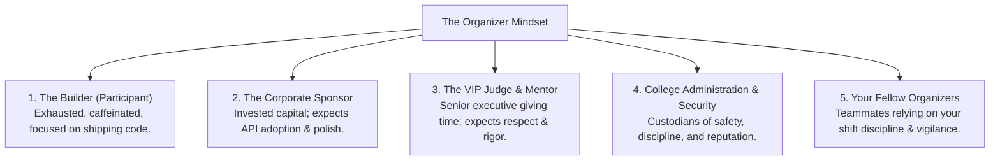
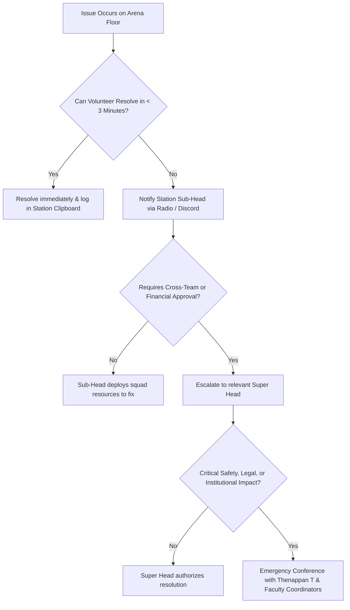

# KAIROS 2027 — Hackathon 101: Core Team Onboarding Primer (Grand Edition)

> **Document Status:** CANONICAL ONBOARDING & CULTURE RUNBOOK  
> **Host Organization:** AWS Student Builder Group (SIST Chapter), Sathyabama Institute of Science and Technology  
> **Target Audience:** All 106 Student Organizers, Sub-Heads, and Squad Specialists across the 6 Divisions  
> **Apex Leadership:** Thenappan T (President & SBGL, Reg: `44110855`)  
> **Faculty Coordinators:** Dr. K. Ashok Kumar & Dr. Balapriya S (Department of CSE, SIST)  
> **Venue:** Sathyabama Indoor Stadium (Indoor Auditorium), Chennai — `[APPROVED PLAN]`  
> **Source of Truth:** [`00_hackathon_master_brief.md`](./00_hackathon_master_brief.md) · [`18_team_structure_leads_and_workforce_deployment.md`](./18_team_structure_leads_and_workforce_deployment.md)

---

## 1. What is KAIROS 2027? (The 30-Second Elevator Pitch)

You are not organizing a standard college symposium or a localized coding contest.

**KAIROS 2027 is a Tier-1 National Flagship Engineering Summit.** Over 48 continuous hours (January 22–24, 2027), 400–600 of India's finest student developers—the Top 100 squads selected from 2,000+ national applications via an intensive virtual code qualifier—will assemble inside the **Sathyabama Indoor Stadium** to engineer production-grade systems on AWS Cloud and frontier AI models.

Operating under an uncompromised **100% Free / Zero Entry Fee** mandate, we provide complete lodging, 6 grand buffet meals, continuous high tea, and industrial-grade power/network infrastructure. The event is anchored by a **₹1,75,000 pure liquid cash prize pool held in audited university custody**, an operating budget target of **₹3,50,000 – ₹4,00,000**, and senior technology executives, AWS architects, and startup founders flying in to evaluate the prototypes.

---

## 2. Understanding the 5 Stakeholder Mindsets

To make flawless operational decisions in the heat of a 48-hour continuous marathon, every organizer must evaluate challenges through the eyes of our stakeholders:

### 2.1 The Participant (The Builder):
* **State of Mind:** Exhausted, caffeinated, ambitious, stressed, building under tight milestone timers.
* **What They Need:** High-speed Wi-Fi that never drops, abundant grounded power plugs, clean restrooms, hot food served punctually, zero administrative friction, and fair, transparent technical judging.
* **Golden Rule:** **Treat every builder like a visiting dignitary.** If they have a technical, hardware, or personal issue, you own it until it is completely resolved.

### 2.2 The Corporate Sponsor (The Enterprise Partner):
* **State of Mind:** Committed significant corporate marketing or recruitment capital; expecting measurable developer adoption of their APIs, executive polish, and qualified talent discovery.
* **What They Need:** Dedicated VIP escorting, a clean professional booth, sharp vector logos on the 3840×1920 LED Wall and backdrops, reliable Wi-Fi in the sponsor lounge, and timely delivery of the **Consent-Based Opt-In Finalist Book**.
* **Golden Rule:** **Extreme professional polish.** Never allow a corporate representative to wander unescorted, search for an adapter, or wait for an agenda transition.

### 2.3 The VIP Judge & Technical Mentor (The Evaluators):
* **State of Mind:** Senior industry engineering leaders and AWS Community Builders taking personal time off to evaluate student architectures.
* **What They Need:** Comfortable executive lounge seating, intuitive digital scoring sheets that do not crash, strict adherence to pitch timers, and five-star hospitality.
* **Golden Rule:** **Protect their time.** Ensure builder teams are lined up and laptops pre-cued 5 minutes before evaluation checkpoints begin.

### 2.4 College Management & Campus Security (The Custodians):
* **State of Mind:** Proud of institutional prestige, but acutely responsible for campus discipline, safety regulations, property integrity, and hostel welfare.
* **What They Need:** Strict enforcement of the 10:00 PM – 06:00 AM secure night lock-in, zero unauthorized wandering across campus, orderly boys and girls dining transit, clean venue hygiene, and absolute noise discipline outside the arena.
* **Golden Rule:** **Never compromise on campus safety or university regulations.**

### 2.5 You (The Organizer):
* **State of Mind:** Alert, disciplined, proud, operating in structured 8-hour shift rosters under your assigned Sub-Head and Super Head.
* **Golden Rule:** **The Zero-Bystander Rule.** If something is dirty, clean it. If someone is lost, escort them. If a cable is exposed, gaffer-tape it down immediately.

---

## 3. The 6-Division Workforce Structure & Command Chain

All 106 student organizers are deployed across six specialized operational divisions operating under the Incident Command System (ICS). Review [`18_team_structure_leads_and_workforce_deployment.md`](./18_team_structure_leads_and_workforce_deployment.md) for full squad rosters:

| Division | Super Head / Lead | Register No | Operational Mandate |
|---|---|:---:|---|
| **Division 1: Partnerships & Finance** | **Nikki (Nangaiyar M)** | `44612059` | Corporate sponsors, MoUs, university invoicing, prize escrow, deliverable fulfillment. |
| **Division 2: Technical & Infrastructure** | **Shaik Khaleelulla** | `44110756` | Qualifier platform, GitHub automation, 1 Gbps LAN, Wi-Fi 6 mesh, cloud sandboxes. |
| **Division 3: Operations & Logistics** | **Viswanathan Ashok** | `44110907` | Indoor Stadium arena bays (A1-D4), 65 kVA power grid, catering, bus fleets, hostel lodging. |
| **Division 4: Creative, UI/UX & Design** | **Rikish B** | `44110664` | Visual identity, evergreen branding, streetwear merch, smart badges, stage backdrops. |
| **Division 5: Marketing, PR & Media** | **Caroline Mary McPherson** | `44110124` | Social media engine, national ambassadors, 48H multi-camera broadcast, press releases. |
| **Division 6: Safety, Jury & Governance** | **Hemavarshine S** | `44110263` | Evaluation governance, VIP jury hospitality, 24/7 medical standby, night lock-in security. |

---

## 4. Operational Reflexes & Escalation Flowchart

When an operational bottleneck, technical outage, or emergency occurs, execute the **3-Minute Escalation Protocol**:

### Non-Negotiable Operational Mantras:
1. **Never Give Speculative Answers:** If a participant or corporate sponsor asks a policy, prize, or schedule question and you are uncertain, say: *"Let me connect with our Lead Coordinator immediately to confirm the exact protocol for you."*
2. **Safety Over Schedule:** If any individual experiences medical distress or an electrical hazard occurs, halt all nearby activity immediately, notify Division 6 (Safety), and escort medical personnel.
3. **Punctuality is Non-Negotiable:** Catering meals, checkpoint judging gates, and inaugural ceremonies run exactly to the minute specified in [`02_hard_office_copy_master_agenda.md`](./02_hard_office_copy_master_agenda.md).
