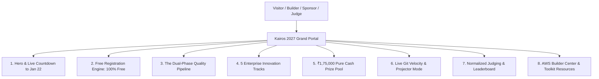

# Kairos 2027 — Website Design, UX Architecture & Product Specification (Grand Edition)

**Governing Standards:** `E:\AWS SBGL\ANTI-Help\05_COMMUNICATION_TEMPLATES_AND_INSTITUTIONAL_LETTERS.md` & `10_HACKATHON_SPONSORSHIP_LETTERS_AND_OUTREACH_KIT.md`  
**Executive Governance:** Super Head 5 (Chief Creative & Media Officer) in coordination with Super Head 2 (CTO)  
**Reporting Directly To:** Thenappan T (Register No: `44110855`), President & Student Builder Group Leader (AWS SBGL)  
**Faculty Coordinators:** Dr. K. Ashok Kumar & Dr. Balapriya .S (Department of CSE, SIST)  
**Production URL:** `https://kairos.sathyabama.ac.in`  
**Registration Model:** **100% FREE — ZERO ENTRY FEE**  
**Dual-Phase Quality Funnel:** 2,000+ Online Applications $\rightarrow$ 250 Online Semi-Finalists (Jan 02–04) $\rightarrow$ 100 Elite On-Campus Teams (Jan 22–24)  
**Cash Prize Pool:** **₹1,75,000 Pure Cash** + $50,000+ AWS Cloud Credits  
**Event Window:** January 22 – 24, 2027  
**Full Production Architecture Suite:** Located in [website/](file:///e:/AWS%20SBGL/Events/Kairos/website/)  

---

## 1. Product Vision & Dedicated Website Architecture Suite

The Kairos 2027 digital portal is an enterprise-grade, multi-page platform engineered to handle the complete lifecycle of India's premier 48-hour student hackathon. To ensure seamless execution across engineering, design, operations, and AWS compliance, the platform architecture is documented across five specialized master specifications:

| Master Specification Document | Focus Area & Operational Scope |
|:---|:---|
| **[1. Website Specification & Roadmap](file:///e:/AWS%20SBGL/Events/Kairos/website/website_specification_and_roadmap.md)** | Core product requirements, 15-route sitemap, UX wireframes, and phased development roadmap. |
| **[2. Pages & Routes Deep Dive](file:///e:/AWS%20SBGL/Events/Kairos/website/website_pages_and_routes_deepdive.md)** | Granular UI/UX layouts, component trees, states, and client logic across all 15 production routes. |
| **[3. Technical Architecture & API](file:///e:/AWS%20SBGL/Events/Kairos/website/website_technical_architecture_and_api.md)** | Next.js 14 App Router, PostgreSQL schema DDL, Redis caching, REST API specifications, and AWS deployment. |
| **[4. AWS SBG Brand & Toolkit Integration](file:///e:/AWS%20SBGL/Events/Kairos/website/aws_sbg_brand_and_event_toolkit_integration.md)** | Strict adherence to `E:\AWS SBGL\Leader Library`: Amazon Ember fonts, Builder Center, and CSAT. |
| **[5. Content & Copy Reference](file:///e:/AWS%20SBGL/Events/Kairos/website/website_content_and_copy_reference.md)** | Production-ready copy kit: hero headlines, track briefs, prize breakdowns, FAQ bank, and legal disclaimers. |

---

## 2. Design System & Aesthetics Ethos

* **Aesthetic Palette:** Deep Void Black dark mode canvas (`#000000`) accented by Electric Violet (`#A855F7`), Cyber Orchid (`#C084FC`), Astral White (`#FFFFFF`), and Starlight Lavender (`#E9D5FF`), anchored by the official Kairos Celestial Hourglass Logo and Circular Seal.
* **Official Typography:** `Amazon Ember Display` for bold display headings, `Amazon Ember` for body text, and `Amazon Ember Mono` / `Amazon Ember Duospace` for terminal, countdown, and telemetry data.
* **Micro-Interactions:** Smooth Framer Motion transitions, real-time countdown to January 22, 2027, interactive 3D track cards with floating telemetry badges, and live GitHub commit velocity trackers.



---

## 3. Free Registration Architecture (100% Free / Zero Fees)

```mermaid
sequenceDiagram
    autonumber
    actor Participant as Student Builder
    participant Kairos as Kairos Portal (Next.js 14)
    participant DB as Supabase PostgreSQL
    
    Participant->>Kairos: 1. Visit kairos.sathyabama.ac.in/register
    Participant->>Kairos: 2. Enter Student Profile & Contact Info (100% Free, ₹0)
    Kairos->>DB: 3. Store user record with zero-fee confirmation
    Kairos->>Participant: 4. Prompt: Create new team OR Join existing team via Team Code
    Note over Participant,Kairos: No payment gateway, zero transaction fee, 100% free participation
```

### Key Registration Rules
1. **Team Assembly (`/team/create` & `/team/join`):**
   * Team Lead creates a team profile (4–6 members) and receives an alphanumeric Team Join Code (`KAIROS-XXXX`).
   * Each invited member logs in and inputs the Team Join Code.
2. **Zero Entry Fee Guarantee:** No payment gateway or credit card input exists anywhere on the site. All amenities (food, accommodation, swags, cloud credits) are fully sponsored.

---

## 4. Multi-Page Production Route Structure

The portal consists of **15 distinct production routes** designed for high throughput, specialized operational workflows, and official recognition:

```
kairos.sathyabama.ac.in/
├── /                      # Grand Landing Page (Hero, Dual-Phase Pipeline, Tracks, Prizes, Sponsors)
├── /register              # Free Registration & Profile Onboarding
├── /team/create           # Team Creation Engine (Generates KAIROS-XXXX Join Code)
├── /team/join             # Member Join Interface (Validates Team Code)
├── /dashboard             # Participant Mission Control (Phases, Deliverables, Status)
├── /tracks                # Interactive 5 Innovation Tracks & AWS Starter Architectures
├── /online-qualifier      # Round 1 Hub (Jan 02–04: Repo submission, Loom video, Meet defense)
├── /on-campus             # Round 2 Finalist Guide (Jan 22–24: Travel, Campus Map, Amenities)
├── /resources             # AWS SBG Learning Toolkit (Cloud Quest, Bedrock, Storytelling)
├── /leaderboard           # Live Normalized Scoring & Commit Velocity Tracker
├── /stage                 # Ultra-Wide Stage Display (Live during Jan 22–24)
├── /judging               # Secured Multi-Criteria Scoring Engine for VIP Judges
├── /sponsors              # Corporate Partner Showcase (Title ₹1.25L, Powered-By ₹70k, Tracks)
├── /rules                 # Code of Conduct, Academic Integrity & IP Ownership
├── /members/leadership    # Higher Management Showcase (Batch 2026–2027: President & 6 Super Heads)
├── /members               # Public Hall of Fame & Recognition Directory for all 106 Student Organizers
├── /members/[username]    # Individual Contributor Dossier, Impact Metrics & Verifiable Certificate
└── /csat                  # Post-Event AWS Builder Center CSAT & Feedback Form
```

### 4.1 Higher Management & Member Recognition Architecture
* **Batch 2026–2027 Leadership Portal (`/members/leadership`):**
  * Dedicated executive showcase highlighting **President Thenappan T**, Faculty Coordinators (**Dr. K. Ashok Kumar & Dr. Balapriya .S**), and the **6 Super Heads** (CPFO, CTO, COO, CXO, CCMO, CSO).
  * Includes official portraits, division mandates, AWS certifications, and philosophy quotes.
* **All-Team Recognition Wall (`/members`):**
  * Searchable, filterable Hall of Fame celebrating all **106 student organizers and crew members**.
  * Shows concrete impact points, verifiable badges (`Diamond Builder`, `Systems Champion`), and links to individual dossiers (`/members/[username]`).

---

## 5. Dual-Phase Quality Pipeline Workflow

To ensure peak technical quality among on-campus finalists, the website coordinates a rigorous two-tier selection funnel:

1. **Phase 1: Online Technical Qualifier (January 02–04, 2027)**
   * Top 250 semi-finalist teams chosen from initial pool.
   * Teams build an end-to-end working MVP within 48 hours.
   * Required deliverables submitted via `/online-qualifier`:
     * GitHub Repository URL with CI/CD passing and continuous commit history.
     * AWS Architecture Diagram (using official AWS Architecture icons).
     * 3-Minute Loom Video Walkthrough demonstrating working cloud integration.
   * 7-Minute Google Meet Technical Defense with evaluation panel.

2. **Phase 2: On-Campus Grand Finale (January 22–24, 2027)**
   * Top 100 Elite Teams (Teams of 4–6 students, ~400–600 builders) converge directly at the Central Library Complex at Sathyabama Institute of Science and Technology on Event Day (no pre-event on-campus onboarding).
   * 48 hours of continuous, physical development at Central Library Complex.
   * Live checkpoint evaluations recorded via `/judging`.
   * Final Stage Pitches on January 24 evaluated via normalized Z-Score engine.

---

## 6. Official AWS Student Builder Group Alignment

All website assets strictly adhere to the guidelines set forth in `E:\AWS SBGL\Leader Library`:

1. **Legal Entity Statement:**
   > *"Kairos 2027 is proudly organized by AWS Student Builder Group — Sathyabama Institute of Science and Technology (SIST), an independent student organization. This event is not sponsored or administered directly by Amazon Web Services, Inc. or its affiliates."*
2. **Official Naming Conventions:**
   * Correct: *AWS Student Builder Group — Sathyabama Institute of Science and Technology* (or *AWS SBGL SIST*).
   * Prohibited: *AWS Club*, *AWS Student Club*, *AWS Chapter*, *Amazon Sathyabama*.
3. **Typography & Brandmarks:**
   * Strictly uses `Amazon Ember` fonts provided in `01- Creative Assets/Fonts/`.
   * Uses only approved AWS SBG logo lockups with the required 100% exclusion clear zone.
4. **Community Toolkit Integration:**
   * Showcases turnkey learning resources: AWS Cloud Quest, Storytelling for Career Readiness, and Bedrock AI starter kits.
   * Integrates post-event CSAT reporting (`/csat`).

---

## 7. Technical Stack & Operational Handover

* **Framework:** Next.js 14 (App Router), React 18, TypeScript 5.4.
* **Styling:** Tailwind CSS with custom Amazon Ember font family definitions and dark mode tokens.
* **Database & Auth:** Supabase (PostgreSQL 16) with Row-Level Security (RLS) + Redis for live leaderboard caching.
* **Hosting & CDN:** AWS Amplify Gen 2 / AWS CloudFront + S3 for asset delivery.
* **Team Governance:** Maintained by Super Head 2 (CTO) and Super Head 5 (Chief Creative Officer), reporting directly to President Thenappan T.
