# KAIROS 2027 (Grand Edition) — Master Workforce Architecture, Team Structure & Operational Deployment Manual

> **Governing Standard:** `E:\AWS SBGL\ANTI-Help\01_CHAPTER_GOVERNANCE_AND_LEADERSHIP_ROSTER.md` & `08_EXECUTIVE_OPERATIONAL_CHECKLISTS_AND_ACTION_TRACKER.md`  
> **Executive Directive:** "Build the grandest national hackathon ever organized. 100% Free — Zero Entry Fee for Participants."  
> **Apex Leadership:** Thenappan T (Register No: `44110855`), President & Student Builder Group Leader (AWS SBGL), Sathyabama Institute of Science and Technology  
> **Faculty Coordinators:** Dr. K. Ashok Kumar & Dr. Balapriya .S (Department of CSE, SIST)  
> **Command Principle:** **6 Super Heads (Direct Reports)** commanding a fully deployed, specialized workforce across Pre-Event, Online Qualifier Round, During-Event, and Post-Event operational phases.  
> **Registration Model:** **100% FREE — Zero Entry Fee** (100% funded by corporate enterprise sponsorships & institutional grant)  
> **Dual-Phase Selection Pipeline:** 2,000+ National Applicants $\rightarrow$ **Top 250 Online Semi-Finalists (Round 1: Jan 02–04, 2027)** $\rightarrow$ **Top 100 Elite On-Campus Finalists (Round 2: Jan 22–24, 2027)**  
> **Grand Finale Event Dates:** January 22 – 24, 2027 (48 Hours Non-Stop Continuous Sprint)  
> **Venue:** Central Library Complex (Auditorium, 1st Floor Computing Lab, 2nd Floor Lecture Halls 1–3, Top Floor VIP Executive Lounge), Sathyabama Campus  
> **Scale:** 100 Shortlisted National Finalist Teams (Teams of 4–6 students, ~400–600 Hackers) · ₹3,50,000 Operational Capital · ₹1,75,000 Pure Cash Prize Pool  

---

## 1. Apex Command Hierarchy & Incident Command System (ICS)

To maintain absolute operational precision without cognitive overload, **only 6 Super Heads report directly to the President (Thenappan T)**. Each Super Head commands dedicated Sub-Heads who oversee specialized squads. 

Every squad has crystal-clear mandates across:
* **Phase 1: Pre-Event Runway & National Outreach (September – December 2026)**
* **Phase 2: The Online Qualifier Round (Round 1: January 02–04, 2027) — Filtering Top 250 $\rightarrow$ Top 100 Teams**
* **Phase 3: The 48-Hour On-Campus Grand Finale (January 22–24, 2027)**
* **Phase 4: Post-Event Wrap, Escrow Disbursement & Sponsor ROI Handover (January 25 – February 10, 2027)**

```mermaid
graph TD
    APEX["THENAPPAN T<br/>President & Apex Organizer (Reg: 44110855)"] --- ADV["Faculty Coordinators<br/>Dr. K. Ashok Kumar & Dr. Balapriya .S"]
    
    APEX --> SH1["SUPER HEAD 1: CPFO<br/>Chief Partnerships & Finance Officer"]
    APEX --> SH2["SUPER HEAD 2: CTO<br/>Chief Technology & Infrastructure Officer"]
    APEX --> SH3["SUPER HEAD 3: COO<br/>Chief Operations & Logistics Officer"]
    APEX --> SH4["SUPER HEAD 4: CXO<br/>Chief Experience & Hospitality Officer"]
    APEX --> SH5["SUPER HEAD 5: CCMO<br/>Chief Creative & Media Officer"]
    APEX --> SH6["SUPER HEAD 6: CSO<br/>Chief Safety, Governance & Jury Officer"]

    %% Sub-Teams
    SH1 --> S1A["Enterprise Corporate Sponsors (Title ₹1.25L)"]
    SH1 --> S1B["Track Bounties & In-Kind Perks"]
    SH1 --> S1C["Treasury, Audit & Escrow"]

    SH2 --> S2A["Cloud Sandbox & AWS Bedrock"]
    SH2 --> S2B["Power Grid & High-Speed LAN/Wi-Fi"]
    SH2 --> S2C["Scoring Portal & Anti-Plagiarism"]

    SH3 --> S3A["Venue Architecture & Hack Bays"]
    SH3 --> S3B["Bus Fleet & Campus EV Transit"]
    SH3 --> S3C["Procurement, Swag & Inventory"]

    SH4 --> S4A["Mess Hall Buffet & Fuel Bar"]
    SH4 --> S4B["Participant Check-In & Helpdesk"]
    SH4 --> S4C["Midnight Quests & Hacker Wellness"]

    SH5 --> S5A["Brand Identity & Stage Visuals"]
    SH5 --> S5B["48H Multicam Broadcast & PR"]
    SH5 --> S5C["Campus Ambassador Network (120+)"]

    SH6 --> S6A["VIP Jury Protocol & CXO Lounge"]
    SH6 --> S6B["3-Gate Evaluation Governance"]
    SH6 --> S6C["Campus Security, Hostels & Medical"]
```



---

## 2. Workforce Summary & Span of Control

| Division | Super Head (Direct Report) | Sub-Heads | Squad Members | Total Headcount | Primary Mandate |
|---|---|:---:|:---:|:---:|---|
| **Division 1** | **CPFO** (Chief Partnerships & Finance Officer) | 3 | 9 | **13** | Close Title Sponsor (₹2L), manage ₹3.5L–₹4L operational capital, disburse ₹1.75L prize pool. |
| **Division 2** | **CTO** (Chief Technology & Infrastructure Officer) | 3 | 12 | **16** | Cloud sandboxes, Online Qualifier screening portal, campus LAN, power grid, anti-plagiarism engine. |
| **Division 3** | **COO** (Chief Operations & Logistics Officer) | 3 | 16 | **20** | Central Library bay architecture, bus fleet logistics, EV buggies, material procurement & swag inventory. |
| **Division 4** | **CXO** (Chief Experience & Hospitality Officer) | 3 | 15 | **19** | 100% free participant hospitality, buffet meals, coffee bars, midnight side-quests, wellness. |
| **Division 5** | **CCMO** (Chief Creative & Media Officer) | 3 | 14 | **18** | Stage visual media, 48H multicam live stream broadcast, aftermovie, nationwide ambassador outreach. |
| **Division 6** | **CSO** (Chief Safety, Governance & Jury Officer) | 3 | 12 | **16** | Online Round jury governance, VIP care, on-ground Z-score scoring integrity, 24/7 campus security. |
| **Executive** | **Apex Office** (President, Chief of Staff, Faculty) | — | 3 | **4** | Strategic command, emergency executive decisions, university administration liaisons. |
| **TOTALS** | **1 President + 6 Super Heads** | **18** | **81** | **106** | **The most disciplined, high-octane hackathon workforce ever assembled.** |

---

## 3. The 2-Tier Quality Gate: Online Qualifier $\rightarrow$ On-Campus Grand Finale

To ensure the technical quality of projects is **uncompromisingly peak**, Kairos 2027 implements a **Two-Tier Rigorous Technical Filter**:

```text
[Phase 0: Free National Applications (Oct 15 - Dec 15)] ──► 2,000+ Applicant Teams (Abstracts & Architecture)
                                                                       │
                                                                       ▼
[Phase 1: Round 1 Online Technical Qualifier (Jan 02 - 04)] ──► Top 250 Semi-Finalist Teams
  • 48-Hour Virtual Code Sprint & Working GitHub Prototype
  • 3-Minute Loom Architecture Video Walkthrough
  • Live 7-Minute Virtual Jury Grilling via Google Meet
                                                                       │
                                                                       ▼
[Technical Jury Calibration & Shortlist (Jan 06)] ─────────► Top 100 Elite Finalist Teams Selected (Peak Quality)
                                                                       │
                                                                       ▼
[Phase 2: Round 2 On-Campus 48-Hour Grand Finale (Jan 22-24)] ─► 100 Teams (Teams of 4–6 students, ~400–600 Hackers) On-Site at Sathyabama Institute of Science and Technology, Chennai
  • 100% FREE: Free Buffet Meals, Free Stay, Free Swag Kits & Smart Badges
  • 3 Milestone Checkpoints (Architecture ➔ Code ➔ Pitch)
  • ₹1,75,000 Pure Cash Prize Pool + $50k Cloud Credits
```

---

## 4. Division Deep-Dives Across the 4 Phases

### Division 1: Partnerships, Corporate Relations & Capital (CPFO)
* **Super Head 1 (CPFO & Sponsorship Lead):** **Nikki (Nangaiyar M)** (Register No: `44612059`, Phone: `+91 8754976892`, Email: `nangaiyarmuthkrishnan@gmail.com`)  
* **Reports Directly To:** Thenappan T (President)  
* **Total Division Strength:** 13 Organizers (1 Super Head + 3 Sub-Heads + 9 Squad Officers)
* **Pre-Event Runway (Sep–Dec):** Close Title Sponsor (**₹2,00,000 / 2 Lakhs**), Co-Powered By Sponsor (**₹1,00,000 / 1 Lakh**), Track Partners (**₹25,000 – ₹50,000 each**), and institutional grant (**₹50,000**), yielding **₹3,50,000 – ₹4,00,000 in working capital (Uncapped)**. Secure in-kind partnerships (Red Bull, AWS $50k credits, JetBrains, Postman). Enforce **₹0 participant fee policy** across all partner communication.
* **Online Qualifier Round (Jan 02–04):** Track sponsor bounties and API adoption across the Top 250 semi-finalist teams during the virtual review.
* **On-Campus 48-Hour Grand Finale (Jan 22–24):** Manage on-site VIP corporate sponsor delegations, sponsor exhibition kiosks, and talent scouting sessions. Oversee on-ground petty cash logs.
* **Post-Event Closeout (Jan 25–Feb 10):** Release the **₹1,75,000 pure cash prize pool** via direct bank NEFT escrow disbursement within 72 hours. Deliver 10-slide sponsor ROI reports, resume databases, and university financial utilization certificates.

---

### Division 2: Technology, Cloud Architecture & Cyber Infrastructure (CTO)
* **Super Head 2:** **Chief Technology & Infrastructure Officer (CTO)**  
* **Reports Directly To:** Thenappan T (President)  
* **Total Division Strength:** 16 Organizers (1 Super Head + 3 Sub-Heads + 12 Squad Engineers)
* **Pre-Event Runway (Sep–Dec):** Provision AWS Bedrock sandbox accounts and IAM organizations. Deploy the official Kairos web portal, screening pipeline, and GitHub webhook listeners. Audit Central Library electrical capacity.
* **Online Qualifier Round (Jan 02–04):** Host and operate the **Online Evaluation Portal**: ingest GitHub repos and Loom demo links for Top 250 teams; run automated code originality audits; manage 10 parallel Google Meet technical review rooms.
* **On-Campus 48-Hour Grand Finale (Jan 22–24):** Guarantee zero downtime across the campus network and dual generator failover (<10ms). Maintain real-time Z-score normalized scoring engine and live leaderboard.
* **Post-Event Closeout (Jan 25–Feb 10):** Safely decommission AWS sandboxes, publish open-source project showcase, and generate cloud telemetry audit.

---

### Division 3: Ground Operations, Venue Architecture & Fleet Logistics (COO)
* **Super Head 3:** **Chief Operations & Logistics Officer (COO)**  
* **Reports Directly To:** Thenappan T (President)  
* **Total Division Strength:** 20 Organizers (1 Super Head + 3 Sub-Heads + 16 Squad Specialists)
* **Pre-Event Runway (Sep–Dec):** Map Central Library floor layouts (Auditorium, Labs, Lecture Halls 1–3, Top Floor VIP Lounge). Coordinate Sathyabama College Bus routes across Chennai hubs and **2 Campus EV Shuttles** (operating continuous loops to transport girls and boys to the nearest best restrooms). Procure builder tees, smart badges, 40 industrial power strips, and print collaterals.
* **Online Qualifier Round (Jan 02–04):** Finalize inventory counts and verify shipping dispatch of developer swag kits for on-ground arrival.
* **On-Campus 48-Hour Grand Finale (Jan 22–24):** Run 8-hour rotating shifts across Lecture Halls 1–3. Manage participant check-in, bus shuttles, EV buggy restroom transfers, and venue maintenance. There is no pre-event on-campus onboarding; finalists report directly to the venue on Event Day.
* **Post-Event Closeout (Jan 25–Feb 10):** Restitute Central Library Complex within 12 hours. Complete equipment inventory audit.

---

### Division 4: Experience, Hospitality & Hacker Wellness (CXO)
* **Super Head 4:** **Chief Experience & Hospitality Officer (CXO)**  
* **Reports Directly To:** Thenappan T (President)  
* **Total Division Strength:** 19 Organizers (1 Super Head + 3 Sub-Heads + 15 Squad Coordinators)
* **Pre-Event Runway (Sep–Dec):** Coordinate buffet menus with campus mess and canteen. Formulate side-quests (Midnight CTF, Speed Typing, Arcade Arena). Manage online community.
* **Online Qualifier Round (Jan 02–04):** Coordinate online team onboarding, schedule virtual pitch slots, and provide 24/7 online helpdesk support for the 250 semi-finalists.
* **On-Campus 48-Hour Grand Finale (Jan 22–24):** Deliver **100% free hospitality**: buffet meals, continuous 24/7 coffee/tea station, midnight energy snacks, quiet rest zones, and hacker wellness sessions.
* **Post-Event Closeout (Jan 25–Feb 10):** Issue automated digital verified certificates of excellence and participation to all hackers.

---

### Division 5: Creative Direction, Stage Production & National Media (CCMO)
* **Super Head 5:** **Chief Creative & Media Officer (CCMO)**  
* **Media Leads:** **Caroline Mary McPherson** (Media Head 1) & **Harshith Raj S** (Socials Lead)  
* **Reports Directly To:** Thenappan T (President)  
* **Total Division Strength:** 18 Organizers (1 Super Head + 3 Sub-Heads + 14 Squad Specialists)
* **Pre-Event Runway (Sep–Dec):** Establish Obsidian-Amber visual identity. Manage official Instagram ([`@awssbg_sist`](https://instagram.com/awssbg_sist)) and LinkedIn. Mobilize the **120+ Campus Ambassador Network** across 20+ Indian states.
* **Online Qualifier Round (Jan 02–04):** Broadcast live updates of the Online Semi-Finals; publish spotlight graphics of the Top 250 projects; build anticipation for the Top 100 shortlist reveal.
* **On-Campus 48-Hour Grand Finale (Jan 22–24):** Direct stage visual media, run the 48-hour multicam live stream on YouTube and LinkedIn, and deploy 2 camera crews for 4K B-roll and viral social reels.
* **Post-Event Closeout (Jan 25–Feb 10):** Edit and premiere the **Kairos 2027 Cinematic Aftermovie** within 7 business days; distribute national media press releases.

---

### Division 6: Safety, Security, Governance & Jury Management (CSO)
* **Super Head 6:** **Chief Safety, Governance & Jury Officer (CSO)**  
* **Reports Directly To:** Thenappan T (President)  
* **Total Division Strength:** 16 Organizers (1 Super Head + 3 Sub-Heads + 12 Squad Officers)
* **Pre-Event Runway (Sep–Dec):** Curate and confirm 25+ high-profile industry judges and technical evaluators (AWS community builders, tech leads, startup founders, distinguished alumni, and any other industry professionals with technical knowledge who volunteer). Coordinate campus security permissions, police station intimation, and hospital ambulance liaison.
* **Online Qualifier Round (Jan 02–04):** Lead jury governance across the 10 virtual evaluation rooms; enforce standardized scoring rubrics and calibrate semi-final rankings.
* **On-Campus 48-Hour Grand Finale (Jan 22–24):** Manage Top Floor VIP Executive Lounge hospitality. Orchestrate the 3 physical evaluation gates. Enforce **10 PM – 6 AM night lock-in** and strictly segregated stairwells for boys/girls mess access.
* **Post-Event Closeout (Jan 25–Feb 10):** Audit final score sheets; present judge appreciation hampers; submit zero-incident safety report to University Registrar.

---

## 5. Master Itemized Procurement & Purchasing Catalog (₹3,50,000 Zero-Fee Model)

```text
========================================================================================================
KAIROS 2027 (GRAND EDITION) — ITEMIZED MASTER EXPENDITURE CATALOG (100% SPONSORED)
========================================================================================================
CATEGORY / ITEM DESCRIPTION                 SPECIFICATIONS & BRANDING            QTY   UNIT (₹) TOTAL (₹)
--------------------------------------------------------------------------------------------------------
1. PURE CASH PRIZE POOL (ESCROW DISBURSEMENT)
• Grand Champion (1st Place Overall)        Pure Cash + Trophy + VC Fast-Track   1       60,000   ₹60,000
• 1st Runner-Up (2nd Place Overall)         Pure Cash + Trophy                   1       35,000   ₹35,000
• 2nd Runner-Up (3rd Place Overall)         Pure Cash + Trophy                   1       20,000   ₹20,000
• 5 Grand Track Category Winners            5 Tracks × ₹7,000 Pure Cash          5        7,000   ₹35,000
• Best All-Women Hacker Team Bounty         Special Category Pure Cash Bounty    1       10,000   ₹10,000
• Best Freshman / Rookie Team Bounty        Special Category Pure Cash Bounty    1        7,500    ₹7,500
• Most Scalable AWS Architecture Bounty     Special Category Pure Cash Bounty    1        7,500    ₹7,500
--------------------------------------------------------------------------------------------------------
SUBTOTAL: CASH PRIZES                                                                           ₹1,75,000
--------------------------------------------------------------------------------------------------------

2. PARTICIPANT MERCHANDISE, STREETWEAR & DEVELOPER KITS (100% COMPLIMENTARY)
• Dry-Fit Builder T-Shirts (180 GSM)        Cyber Gradient / Official Hackathon  500         70   ₹35,000
• Laser-Etched Smart ID Badges & Lanyards   Matte Finish + Custom Woven Ribbon   500         25   ₹12,500
• Tech Sticker Packs & Badges               Die-Cut Vinyl AWS/Kairos Stickers    500 pk      10    ₹5,000
• Certificate Printing & Folders            High-GSM Embossed Foil Certificates  500 sets    15    ₹7,500
--------------------------------------------------------------------------------------------------------
SUBTOTAL: SWAG & DEVELOPER KITS                                                                  ₹60,000
--------------------------------------------------------------------------------------------------------

3. CATERING SUPPLEMENT, REFRESHMENTS & MIDNIGHT ENERGY STATIONS
• Mess Hall Buffet Coordination Supplement  High-Protein Subsidy & Water Cans    450 pax     40   ₹18,000
• Evening High Tea & Fresh Snacks (2 Days)  Samosas / Cutlets / Filter Coffee    450 pax     30   ₹13,500
• Midnight Coffee, Tea & Biscuit Fuel       Continuous 01:30 AM Fuel Bar (2 Nts) 2 nts    6,750   ₹13,500
--------------------------------------------------------------------------------------------------------
SUBTOTAL: CATERING & FUEL                                                                        ₹45,000
--------------------------------------------------------------------------------------------------------

4. STAGE PRODUCTION, AUDIO-VISUAL & SOUND REINFORCEMENT
• Auditorium Line Array PA & Sound System   Concert Sound Tops + Audio Mixer     3 days  15,000   ₹15,000
• Stage Truss Lighting & Foyer Spots        Sharpy Moving Lights + Stage Washes  3 days  10,000   ₹10,000
• Wireless Cordless & Collar Microphones    Shure UHF Multi-Frequency Mics       8 units  5,000    ₹5,000
--------------------------------------------------------------------------------------------------------
SUBTOTAL: STAGE & AV PRODUCTION                                                                  ₹30,000
--------------------------------------------------------------------------------------------------------

5. VIP JURY CARE, DIGNITARY HOSPITALITY & MEMENTOS
• Top Floor VIP Executive Lounge Dining     High Tea, Dry Fruits & Special Lunch 35 pax     300   ₹10,500
• Traditional Silk Shawls & Mementos        Handcrafted Sandalwood/Brass Mementos 20 units   475    ₹9,500
--------------------------------------------------------------------------------------------------------
SUBTOTAL: VIP JURY & DIGNITARY CARE                                                             ₹20,000
--------------------------------------------------------------------------------------------------------

6. INFRASTRUCTURE, ELECTRICAL EXTENSIONS & HARDWARE
• Heavy-Duty Multi-Socket Power Strips      6A/16A Spike Protected (40 units)    1 lot    6,000    ₹6,000
• Industrial DB Hub Cables & Connectors     Master DB Distribution & Cabling     1 lot    4,000    ₹4,000
--------------------------------------------------------------------------------------------------------
SUBTOTAL: ELECTRICAL & INFRASTRUCTURE                                                            ₹10,000
--------------------------------------------------------------------------------------------------------

7. PRINT, SIGNAGE & AWARDS
• Metal Standee Display Banners (6x3ft)     16 Units across Central Library      16 units   350    ₹5,600
• Main Stage Metal Frame Backdrop Banner    20ft × 10ft High-Res Vinyl Banner    1 unit   2,400    ₹2,400
• Custom Trophy Set (Champions & Tracks)    Laser Engraved Acrylic & Metal       8 units    250    ₹2,000
--------------------------------------------------------------------------------------------------------
SUBTOTAL: PRINT, SIGNAGE & AWARDS                                                                ₹10,000
--------------------------------------------------------------------------------------------------------

========================================================================================================
GRAND TOTAL MASTER OPERATIONAL EXPENDITURE: ₹3,50,000 | BALANCED AGAINST INFLOW: ₹3,50,000
========================================================================================================
```

---

## 6. Sign-Off & Implementation Ratification

This workforce deployment plan is hereby ratified as the official operational standard for **KAIROS 2027 (Grand Edition)**.

**Ratified By:**

<br/>

____________________________________________  
**Thenappan T** (Register No: 44110855)  
President & Student Builder Group Leader (AWS SBGL)  
AWS Student Builder Group — SIST Chapter  
Sathyabama Institute of Science and Technology  
Phone: `+91 6381801640` | Email: `sistawscc@gmail.com`  

<br/>

**Endorsed By:**  

| Dr. K. Ashok Kumar / Dr. Balapriya .S | Dr. L. Lakshmanan | Dr. T. Sasipraba |
| :---: | :---: | :---: |
| Faculty Coordinators, AWS SBG | Dean, School of Computing | Vice Chancellor |
| Sathyabama Institute of Science and Technology | Sathyabama Institute of Science and Technology | Sathyabama Institute of Science and Technology |
| <br/><br/>___________________________ | <br/><br/>___________________________ | <br/><br/>___________________________ |
| Signature & Date | Signature & Date | Signature & Date |
