# KAIROS 2027 (Grand Edition) — Master Workforce Architecture, Team Structure & Operational Deployment Manual

> **Governing Standards:** AWS Student Builder Group Chapter Charter & Incident Command System (ICS)  
> **Executive Directive:** "Build the grandest national hackathon ever organized. 100% Free — Zero Entry Fee for Participants."  
> **Apex Leadership:** Thenappan T (Register No: `44110855`), President & Student Builder Group Leader (AWS SBGL)  
> **Faculty Coordinators:** Dr. K. Ashok Kumar & Dr. Balapriya S (Department of CSE, SIST)  
> **Command Principle:** **6 Super Heads (Direct Reports)** commanding a fully deployed, specialized workforce of 106 student organizers across Pre-Event, Online Qualifier, During-Event, and Post-Event phases.  
> **Registration Model:** **100% FREE — Zero Entry Fee** (Fully funded via corporate partnerships and institutional grant)  
> **Dual-Phase Selection Pipeline:** 2,000+ National Applicants $\rightarrow$ **Top 250 Online Semi-Finalists (Round 1: Jan 02–04, 2027)** $\rightarrow$ **Top 100 Elite On-Campus Finalists (Round 2: Jan 22–24, 2027)**  
> **Grand Finale Event Dates:** January 22 – 24, 2027 (48 Hours Non-Stop Continuous Sprint)  
> **Venue:** Sathyabama Indoor Stadium (Indoor Auditorium), Chennai — `[APPROVED PLAN]`  
> **Scale:** 100 Shortlisted National Finalist Teams (~400–600 Hackers) · ₹3,50,000 – ₹4,00,000 Operational Budget · ₹1,75,000 Pure Cash Prize Escrow  
> **Source of Truth:** [`00_hackathon_master_brief.md`](./00_hackathon_master_brief.md) · [`20_indoor_auditorium_venue_transition_and_budget_plan.md`](./20_indoor_auditorium_venue_transition_and_budget_plan.md)

---

## 1. Apex Command Hierarchy & Incident Command System (ICS)

To maintain absolute operational precision without cognitive overload, **only 6 Super Heads report directly to the President (Thenappan T)**. Each Super Head commands dedicated Sub-Heads who oversee specialized squads. 

Every squad has crystal-clear mandates across:
* **Phase 1: Pre-Event Runway & National Outreach (September – December 2026)**
* **Phase 2: The Online Qualifier Round (Round 1: January 02–04, 2027) — Filtering Top 250 $\rightarrow$ Top 100 Teams**
* **Phase 3: The 48-Hour On-Campus Grand Finale (January 22–24, 2027)**
* **Phase 4: Post-Event Wrap, Escrow Disbursement & Sponsor ROI Handover (January 25 – February 10, 2027)**

```mermaid
graph TD
    APEX["THENAPPAN T<br/>President & Apex Organizer (Reg: 44110855)"] --- ADV["Faculty Coordinators<br/>Dr. K. Ashok Kumar & Dr. Balapriya S"]
    
    APEX --> SH1["SUPER HEAD 1: CPFO<br/>Chief Partnerships & Finance Officer<br/>Nikki (Nangaiyar M)"]
    APEX --> SH2["SUPER HEAD 2: CTO<br/>Chief Technology & Infrastructure Officer<br/>Shaik Khaleelulla"]
    APEX --> SH3["SUPER HEAD 3: COO<br/>Chief Operations & Logistics Officer<br/>Viswanathan Ashok"]
    APEX --> SH4["SUPER HEAD 4: CCO<br/>Chief Creative & Design Officer<br/>Rikish B"]
    APEX --> SH5["SUPER HEAD 5: CMO<br/>Chief Media & PR Officer<br/>Caroline Mary McPherson"]
    APEX --> SH6["SUPER HEAD 6: CSGO<br/>Chief Safety, Governance & Jury Officer<br/>Hemavarshine S"]

    %% Sub-Teams
    SH1 --> S1A["Enterprise Corporate Sponsors (Title ₹2L / Co-Powered ₹1L)"]
    SH1 --> S1B["Track Bounties & In-Kind Partner Perks"]
    SH1 --> S1C["Treasury, Audit & University Bank Escrow"]

    SH2 --> S2A["Cloud Sandbox, AWS Bedrock & IAM Sandboxes"]
    SH2 --> S2B["Indoor Stadium Arena Power Grid & High-Speed LAN/Wi-Fi"]
    SH2 --> S2C["Qualifier Screening Portal & Anti-Plagiarism Engine"]

    SH3 --> S3A["Indoor Stadium Arena Bay Architecture (Bays A1-D4)"]
    SH3 --> S3B["Bus Fleet Logistics & Campus EV Buggy Transit"]
    SH3 --> S3C["Procurement, Swag Vault & Hardware Inventory"]

    SH4 --> S4A["Brand Identity, Merch Design & Obsidian-Amber UI"]
    SH4 --> S4B["Stage Backdrops, 3840×1920 LED Wall & Signage"]
    SH4 --> S4C["Participant Streetwear, Smart Badges & Certificate Design"]

    SH5 --> S5A["48H Multicam Live Stream Broadcast & Video Production"]
    SH5 --> S5B["National Marketing Funnel & PR Coverage"]
    SH5 --> S5C["Nationwide Campus Ambassador Network (120+ Leads)"]

    SH6 --> S6A["VIP Jury Protocol & CXO Executive Hospitality"]
    SH6 --> S6B["3-Gate Evaluation Governance & Scoring Integrity"]
    SH6 --> S6C["Campus Security, 10 PM - 6 AM Lock-In & 24/7 Medical"]
```



---

## 2. Workforce Summary & Span of Control

| Division | Super Head (Direct Report) | Sub-Heads | Squad Members | Total Headcount | Primary Mandate |
|---|---|:---:|:---:|:---:|---|
| **Division 1** | **CPFO** (Nikki / Nangaiyar M, Reg: `44612059`) | 3 | 9 | **13** | Close Title Sponsor (₹2L), manage ₹3.5L–₹4L operational budget, disburse ₹1.75L prize pool. |
| **Division 2** | **CTO** (Shaik Khaleelulla, Reg: `44110756`) | 3 | 12 | **16** | Cloud sandboxes, Online Qualifier screening portal, arena LAN, 65 kVA power grid, plagiarism engine. |
| **Division 3** | **COO** (Viswanathan Ashok, Reg: `44110907`) | 3 | 16 | **20** | Indoor Stadium bay architecture, bus fleet logistics, EV buggies, material procurement & swag inventory. |
| **Division 4** | **CCO** (Rikish B, Reg: `44110664`) | 3 | 14 | **18** | Visual identity, print freeze execution, stage backdrops, LED wall graphics, streetwear merch. |
| **Division 5** | **CMO** (Caroline Mary McPherson, Reg: `44110124`) | 3 | 15 | **19** | 48H multicam live stream broadcast, aftermovie, social media engine, 120+ campus ambassador network. |
| **Division 6** | **CSGO** (Hemavarshine S, Reg: `44110263`) | 3 | 12 | **16** | VIP jury protocol, scoring rubric governance, 24/7 medical desk, night lock-in enforcement. |
| **Executive** | **Apex Office** (President Thenappan T, Chief of Staff, Faculty) | — | 3 | **4** | Strategic command, emergency executive decisions, university administration liaisons. |
| **TOTALS** | **1 President + 6 Super Heads** | **18** | **81** | **106** | **The most disciplined, high-octane student hackathon workforce ever assembled.** |

---

## 3. The 2-Tier Quality Gate: Online Qualifier $\rightarrow$ On-Campus Grand Finale

To ensure the technical quality of projects is **uncompromisingly peak**, Kairos 2027 implements a **Two-Tier Rigorous Technical Filter**:

```text
[Phase 0: Free National Applications (Oct 15 - Dec 15)] ──► 2,000+ Applicant Teams (Abstracts & Architecture)
                                                                       │
                                                                       ▼
[Phase 1: Round 1 Online Technical Qualifier (Jan 02 - 04)] ──► Top 250 Semi-Finalist Teams
  • 48-Hour Virtual Code Sprint & Working GitHub Prototype
  • 3-Minute Loom Architecture Video Walkthrough
  • Live 7-Minute Virtual Jury Grilling via Google Meet
                                                                       │
                                                                       ▼
[Technical Jury Calibration & Shortlist (Jan 06)] ─────────► Top 100 Elite Finalist Teams Selected (Peak Quality)
                                                                       │
                                                                       ▼
[Phase 2: Round 2 On-Campus 48-Hour Grand Finale (Jan 22-24)] ─► 100 Teams (~400–600 Hackers) On-Site at Sathyabama Indoor Stadium
  • 100% FREE: Free Buffet Meals, Free Stay, Free Swag Kits & Smart Badges
  • 3 Milestone Checkpoints (Architecture ➔ Code ➔ Pitch)
  • ₹1,75,000 Pure Liquid Cash Prize Escrow + In-Kind Cloud Credits & Tooling
```

---

## 4. Division Deep-Dives Across the 4 Phases

### Division 1: Partnerships, Corporate Relations & Capital (CPFO)
* **Super Head 1 (CPFO & Sponsorship Lead):** **Nikki (Nangaiyar M)** (Register No: `44612059`, Phone: `+91 8754976892`, Email: `nangaiyarmuthkrishnan@gmail.com`)  
* **Reports Directly To:** Thenappan T (President)  
* **Total Division Strength:** 13 Organizers (1 Super Head + 3 Sub-Heads + 9 Squad Officers)
* **Pre-Event Runway (Sep–Dec):** Pitch Title Sponsor (**₹2,00,000**), Co-Powered By Sponsor (**₹1,00,000**), Track Partners (**₹25,000 each**), and institutional grant (**₹50,000**), targeting **₹3,50,000 – ₹4,00,000 in liquid operational capital**. Secure in-kind partnerships (Red Bull, AWS cloud credits, JetBrains, Postman). Enforce **₹0 participant fee policy** across all partner communication.
* **Online Qualifier Round (Jan 02–04):** Track sponsor bounties and API adoption across the Top 250 semi-finalist teams during the virtual review.
* **On-Campus 48-Hour Grand Finale (Jan 22–24):** Manage on-site VIP corporate sponsor delegations, sponsor exhibition kiosks, and talent scouting sessions. Oversee on-ground petty cash logs.
* **Post-Event Closeout (Jan 25–Feb 10):** Release the **₹1,75,000 pure cash prize pool** via direct bank NEFT escrow disbursement within 72 hours. Deliver 10-slide sponsor ROI reports, consent-based opt-in candidate books, and university financial utilization certificates.

---

### Division 2: Technology, Cloud Architecture & Cyber Infrastructure (CTO)
* **Super Head 2:** **Shaik Khaleelulla** (Register No: `44110756`)  
* **Reports Directly To:** Thenappan T (President)  
* **Total Division Strength:** 16 Organizers (1 Super Head + 3 Sub-Heads + 12 Squad Engineers)
* **Pre-Event Runway (Sep–Dec):** Provision AWS Bedrock sandbox accounts and IAM organizations. Deploy the official Kairos web portal, screening pipeline, and GitHub webhook listeners. Audit Sathyabama Indoor Stadium electrical capacity.
* **Online Qualifier Round (Jan 02–04):** Host and operate the **Online Evaluation Portal**: ingest GitHub repos and Loom demo links for Top 250 teams; run automated code originality audits; manage 10 parallel Google Meet technical review rooms.
* **On-Campus 48-Hour Grand Finale (Jan 22–24):** Guarantee zero downtime across the campus network and dual generator failover (<10ms). Maintain real-time Z-score normalized scoring engine and live leaderboard.
* **Post-Event Closeout (Jan 25–Feb 10):** Safely decommission AWS sandboxes, publish open-source project showcase, and generate cloud telemetry audit.

---

### Division 3: Ground Operations, Venue Architecture & Fleet Logistics (COO)
* **Super Head 3:** **Viswanathan Ashok** (Register No: `44110907`)  
* **Reports Directly To:** Thenappan T (President)  
* **Total Division Strength:** 20 Organizers (1 Super Head + 3 Sub-Heads + 16 Squad Specialists)
* **Pre-Event Runway (Sep–Dec):** Map Sathyabama Indoor Stadium floor layouts (Arena Bays A1–D4, VIP Executive Lounge, Stage, Foyer Registration). Coordinate Sathyabama College Bus routes across Chennai hubs and **2 Campus EV Shuttles** (operating continuous loops for campus transit). Procure builder tees, smart badges, 40 industrial power strips, and print collaterals.
* **Online Qualifier Round (Jan 02–04):** Finalize inventory counts and verify shipping dispatch of developer swag kits for on-ground arrival.
* **On-Campus 48-Hour Grand Finale (Jan 22–24):** Run 8-hour rotating shifts across Arena Bays A1–D4. Manage participant check-in, bus shuttles, EV buggy transfers, and venue maintenance. Finalists report directly to the venue on Event Day.
* **Post-Event Closeout (Jan 25–Feb 10):** Restitute Sathyabama Indoor Stadium within 12 hours. Complete equipment inventory audit.

---

### Division 4: Creative Direction, UI/UX & Scenography (CCO)
* **Super Head 4:** **Rikish B** (Register No: `44110664`)  
* **Reports Directly To:** Thenappan T (President)  
* **Total Division Strength:** 18 Organizers (1 Super Head + 3 Sub-Heads + 14 Squad Designers)
* **Pre-Event Runway (Sep–Dec):** Establish Obsidian-Amber visual identity. Design streetwear hoodies, participant t-shirts, smart ID badges, 20×10ft stage backdrop, and 3840×1920 LED Wall graphics. Enforce **December 20, 2026 Print Freeze**.
* **Online Qualifier Round (Jan 02–04):** Publish digital spotlight cards and qualifier visual assets for Top 250 semi-finalist teams.
* **On-Campus 48-Hour Grand Finale (Jan 22–24):** Supervise physical scenography, directional signage, banner tensioning, and visual display calibration across the Indoor Stadium arena.
* **Post-Event Closeout (Jan 25–Feb 10):** Design high-res certificate templates, social victory cards, and the visual assets for the post-event impact report.

---

### Division 5: Media Production, Broadcast & PR (CMO)
* **Super Head 5:** **Caroline Mary McPherson** (Register No: `44110124`)  
* **Reports Directly To:** Thenappan T (President)  
* **Total Division Strength:** 19 Organizers (1 Super Head + 3 Sub-Heads + 15 Squad Specialists)
* **Pre-Event Runway (Sep–Dec):** Direct social media channels ([`@awssbg_sist`](https://instagram.com/awssbg_sist) on Instagram and LinkedIn). Mobilize the **120+ Campus Ambassador Network** across 20+ Indian states. Produce teaser trailers.
* **Online Qualifier Round (Jan 02–04):** Stream live qualifier highlights, share participant stats, and build momentum toward the Top 100 finalist reveal.
* **On-Campus 48-Hour Grand Finale (Jan 22–24):** Operate the 48-hour continuous multi-camera broadcast on YouTube and LinkedIn with ATEM Mini Pro video switching, sponsor video commercial stingers, lower-third tickers, and 4K B-roll reel production.
* **Post-Event Closeout (Jan 25–Feb 10):** Edit and release the **Kairos 2027 Official Aftermovie** within 7 business days; distribute national press releases to major tech publications.

---

### Division 6: Safety, Security, Governance & Jury Management (CSGO)
* **Super Head 6:** **Hemavarshine S** (Register No: `44110263`)  
* **Reports Directly To:** Thenappan T (President)  
* **Total Division Strength:** 16 Organizers (1 Super Head + 3 Sub-Heads + 12 Squad Officers)
* **Pre-Event Runway (Sep–Dec):** Curate and confirm 20+ industry judges and AWS Community Builders. Coordinate institutional security permissions, medical desk deployment, and Apollo hospital ambulance standby.
* **Online Qualifier Round (Jan 02–04):** Lead jury governance across 10 virtual evaluation rooms; enforce standardized scoring rubrics and calibrate semi-final rankings.
* **On-Campus 48-Hour Grand Finale (Jan 22–24):** Manage VIP Executive Lounge hospitality. Orchestrate the 3 physical evaluation checkpoints. Enforce **10:00 PM – 06:00 AM secure lock-in** and strictly segregated boys/girls dining transit.
* **Post-Event Closeout (Jan 25–Feb 10):** Audit final score sheets; present judge appreciation hampers; submit zero-incident safety report to University Registrar.

---

## 5. Master Itemized Operational Expenditure Model (₹3,50,000 Target)

```text
========================================================================================================
KAIROS 2027 (GRAND EDITION) — ITEMIZED MASTER EXPENDITURE CATALOG (100% SPONSORED)
========================================================================================================
CATEGORY / ITEM DESCRIPTION                 SPECIFICATIONS & BRANDING            QTY   UNIT (₹) TOTAL (₹)
--------------------------------------------------------------------------------------------------------
1. PURE CASH PRIZE POOL (ESCROW DISBURSEMENT)
• Grand Champion (1st Place Overall)        Pure Cash + Trophy + VC Fast-Track   1       60,000   ₹60,000
• 1st Runner-Up (2nd Place Overall)         Pure Cash + Trophy                   1       35,000   ₹35,000
• 2nd Runner-Up (3rd Place Overall)         Pure Cash + Trophy                   1       20,000   ₹20,000
• 5 Grand Track Category Winners            5 Tracks × ₹7,000 Pure Cash          5        7,000   ₹35,000
• Best All-Women Hacker Team Bounty         Special Category Pure Cash Bounty    1       10,000   ₹10,000
• Best Freshman / Rookie Team Bounty        Special Category Pure Cash Bounty    1        7,500    ₹7,500
• Most Scalable AWS Architecture Bounty     Special Category Pure Cash Bounty    1        7,500    ₹7,500
--------------------------------------------------------------------------------------------------------
SUBTOTAL: CASH PRIZES (AUDITED ESCROW)                                                               ₹1,75,000
--------------------------------------------------------------------------------------------------------

2. PARTICIPANT MERCHANDISE, STREETWEAR & DEVELOPER KITS (100% COMPLIMENTARY)
• Dry-Fit Builder T-Shirts (180 GSM)        Cyber Gradient / Official Hackathon  500         70   ₹35,000
• Laser-Etched Smart ID Badges & Lanyards   Matte Finish + Custom Woven Ribbon   500         25   ₹12,500
• Tech Sticker Packs & Badges               Die-Cut Vinyl AWS/Kairos Stickers    500 pk      10    ₹5,000
• Certificate Printing & Folders            High-GSM Embossed Foil Certificates  500 sets    15    ₹7,500
--------------------------------------------------------------------------------------------------------
SUBTOTAL: SWAG & DEVELOPER KITS                                                                      ₹60,000
--------------------------------------------------------------------------------------------------------

3. CATERING SUPPLEMENT, REFRESHMENTS & MIDNIGHT ENERGY STATIONS
• Mess Hall Buffet Coordination Supplement  High-Protein Subsidy & Water Cans    450 pax     40   ₹18,000
• Evening High Tea & Fresh Snacks (2 Days)  Samosas / Cutlets / Filter Coffee    450 pax     30   ₹13,500
• Midnight Coffee, Tea & Biscuit Fuel       Continuous 01:30 AM Fuel Bar (2 Nts) 2 nts    6,750   ₹13,500
--------------------------------------------------------------------------------------------------------
SUBTOTAL: CATERING & FUEL                                                                            ₹45,000
--------------------------------------------------------------------------------------------------------

4. STAGE PRODUCTION, AUDIO-VISUAL & SOUND REINFORCEMENT
• Indoor Stadium PA & Audio Rig             Concert Sound Tops + Audio Mixer     3 days  15,000   ₹15,000
• Stage Truss Lighting & Foyer Spots        Sharpy Moving Lights + Stage Washes  3 days  10,000   ₹10,000
• Wireless Cordless & Collar Microphones    Shure UHF Multi-Frequency Mics       8 units  5,000    ₹5,000
--------------------------------------------------------------------------------------------------------
SUBTOTAL: STAGE & AV PRODUCTION                                                                      ₹30,000
--------------------------------------------------------------------------------------------------------

5. VIP JURY CARE, DIGNITARY HOSPITALITY & MEMENTOS
• VIP Executive Lounge Dining               High Tea, Dry Fruits & Special Lunch 35 pax     300   ₹10,500
• Traditional Silk Shawls & Mementos        Handcrafted Sandalwood/Brass Plaque  20 units   475    ₹9,500
--------------------------------------------------------------------------------------------------------
SUBTOTAL: VIP JURY & DIGNITARY CARE                                                                  ₹20,000
--------------------------------------------------------------------------------------------------------

6. INFRASTRUCTURE, ELECTRICAL EXTENSIONS & HARDWARE
• Heavy-Duty Multi-Socket Power Strips      6A/16A Spike Protected (40 units)    1 lot    6,000    ₹6,000
• Industrial DB Hub Cables & Connectors     Master DB Distribution & Cabling     1 lot    4,000    ₹4,000
--------------------------------------------------------------------------------------------------------
SUBTOTAL: ELECTRICAL & INFRASTRUCTURE                                                                ₹10,000
--------------------------------------------------------------------------------------------------------

7. PRINT, SIGNAGE & AWARDS
• Metal Standee Display Banners (6x3ft)     16 Units across Indoor Stadium       16 units   350    ₹5,600
• Main Stage Backdrop Banner (20x10ft)      High-Res Vinyl Stage Backdrop        1 unit   2,400    ₹2,400
• Custom Trophy Set (Champions & Tracks)    Laser Engraved Acrylic & Metal       8 units    250    ₹2,000
--------------------------------------------------------------------------------------------------------
SUBTOTAL: PRINT, SIGNAGE & AWARDS                                                                    ₹10,000
--------------------------------------------------------------------------------------------------------

========================================================================================================
GRAND TOTAL MASTER OPERATIONAL EXPENDITURE: ₹3,50,000 | BALANCED AGAINST INFLOW: ₹3,50,000
========================================================================================================
```

---

## 6. Sign-Off & Implementation Ratification

This workforce deployment plan is ratified as the official operational standard for **KAIROS 2027 (Grand Edition)**.

**Ratified By:**

<br/>

____________________________________________  
**Thenappan T** (Register No: `44110855`)  
President & Student Builder Group Leader (AWS SBGL)  
AWS Student Builder Group — SIST Chapter  
Sathyabama Institute of Science and Technology  
Phone: `+91 6381801640` | Email: `thenappanmasterz1311@gmail.com`  

<br/>

**Endorsed By:**  

| Dr. K. Ashok Kumar & Dr. Balapriya S | Dr. L. Lakshmanan | Dr. T. Sasipraba |
| :---: | :---: | :---: |
| Faculty Coordinators, AWS SBG | Dean, School of Computing | Vice Chancellor |
| Sathyabama Institute of Science and Technology | Sathyabama Institute of Science and Technology | Sathyabama Institute of Science and Technology |
| <br/><br/>___________________________ | <br/><br/>___________________________ | <br/><br/>___________________________ |
| Signature & Date | Signature & Date | Signature & Date |
