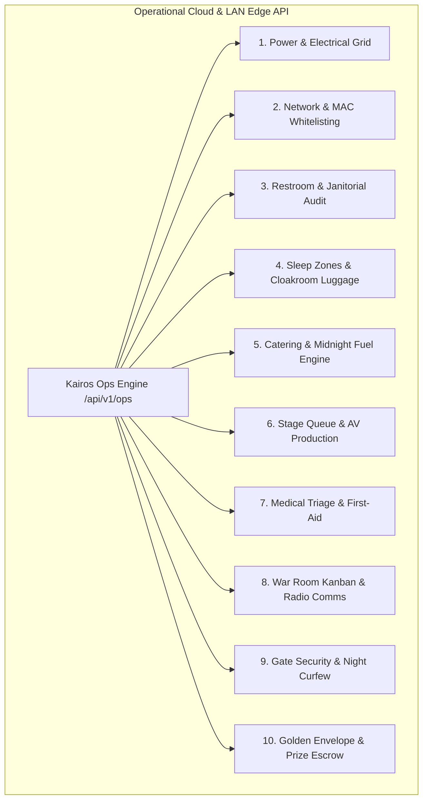

# KAIROS 2027 — Operations, Logistics & Micro-Systems CRUD Specification (Grand Edition)
> **Master Technical & Operational CRUD Architecture for On-Ground Event Execution**  
> **Target Event:** KAIROS 2027 | Central Library Complex, Sathyabama Institute of Science and Technology  
> **Authority:** Super Head 2 (CTO) & Super Head 3 (COO) | Approved by President Thenappan T

---

## 1. Architectural Overview

This document specifies the complete **Create, Read, Update, Delete (CRUD)** data models, RESTful API contracts, validation constraints, and operational state machines for all 10 on-ground micro-logistics domains of the hackathon platform.



---

## 2. Module 1: Power, Electrical & Table Grid

### 2.1 Relational Schema (PostgreSQL)
```sql
CREATE TYPE electrical_phase AS ENUM ('RED', 'YELLOW', 'BLUE');
CREATE TYPE asset_condition AS ENUM ('PRISTINE', 'FUNCTIONAL', 'DAMAGED', 'DECOMMISSIONED');

CREATE TABLE power_circuits (
    circuit_id VARCHAR(32) PRIMARY KEY, -- e.g., 'CIRCUIT-LH2-PHASE-R'
    venue_floor VARCHAR(32) NOT NULL,    -- '2ND_FLOOR_LH2'
    phase electrical_phase NOT NULL,
    max_amperage NUMERIC(5,2) DEFAULT 63.00,
    current_load_kw NUMERIC(5,2) DEFAULT 0.00,
    mcb_switch_number VARCHAR(16) NOT NULL,
    is_ups_buffered BOOLEAN DEFAULT TRUE,
    created_at TIMESTAMPTZ DEFAULT NOW(),
    updated_at TIMESTAMPTZ DEFAULT NOW()
);

CREATE TABLE table_power_strips (
    strip_id VARCHAR(32) PRIMARY KEY,     -- 'STRIP-LH2-T042-A'
    circuit_id VARCHAR(32) REFERENCES power_circuits(circuit_id) ON DELETE RESTRICT,
    table_number INT NOT NULL,           -- Table 1 to 100
    assigned_team_code VARCHAR(16),      -- 'KAIROS-T042'
    total_sockets INT DEFAULT 6,
    active_sockets_used INT DEFAULT 0,
    condition asset_condition DEFAULT 'PRISTINE',
    has_cable_ramp BOOLEAN DEFAULT TRUE,
    last_inspected_by VARCHAR(64),
    updated_at TIMESTAMPTZ DEFAULT NOW()
);
```

### 2.2 CRUD Operations & REST Contracts
* **Create (`POST /api/v1/ops/power/circuits`):**
  * Ingests newly mapped branch circuits and links to DB distribution boxes.
  * *Request Body:* `{"circuit_id": "CIRCUIT-LH1-PHASE-Y", "venue_floor": "2ND_FLOOR_LH1", "phase": "YELLOW", "max_amperage": 63.0, "mcb_switch_number": "DB-2A-SW14", "is_ups_buffered": true}`
  * *Response 201 Created:* `{"status": "SUCCESS", "circuit_id": "CIRCUIT-LH1-PHASE-Y"}`
* **Read (`GET /api/v1/ops/power/telemetry`):**
  * Returns real-time aggregate load across Red, Yellow, and Blue phases to preempt MCB breaker trips.
  * *Response 200 OK:* `{"timestamp": "2027-01-22T14:30:00Z", "total_draw_kw": 31.4, "phases": {"RED": 10.2, "YELLOW": 11.1, "BLUE": 10.1}, "status": "NOMINAL"}`
* **Update (`PATCH /api/v1/ops/power/strips/:strip_id`):**
  * Modifies socket utilization or flags a unit as damaged for rapid replacement by runners.
  * *Request Body:* `{"active_sockets_used": 5, "condition": "DAMAGED", "notes": "Loose pin connection on socket #2"}`
* **Delete (`DELETE /api/v1/ops/power/strips/:strip_id`):**
  * Decommissions damaged spike strips from active venue layout.

---

## 3. Module 2: Network Infrastructure & MAC Whitelisting

### 3.1 Relational Schema (PostgreSQL)
```sql
CREATE TYPE device_category AS ENUM ('BUILDER_LAPTOP', 'TEST_RIG', 'ORGANIZER_MACHINE', 'JURY_TABLET', 'STAGE_FEED');

CREATE TABLE device_whitelist (
    mac_address MACADDR PRIMARY KEY,
    team_code VARCHAR(16) REFERENCES teams(team_code) ON DELETE CASCADE,
    device_owner_name VARCHAR(120) NOT NULL,
    category device_category DEFAULT 'BUILDER_LAPTOP',
    ip_assignment INET,
    allocated_bandwidth_mbps INT DEFAULT 30,
    is_blacklisted BOOLEAN DEFAULT FALSE,
    blacklist_reason TEXT,
    registered_at TIMESTAMPTZ DEFAULT NOW(),
    last_seen_ap VARCHAR(64)
);

CREATE TABLE firewall_whitelisted_domains (
    domain_id SERIAL PRIMARY KEY,
    hostname VARCHAR(255) UNIQUE NOT NULL,
    port_number INT DEFAULT 443,
    service_name VARCHAR(64) NOT NULL, -- 'AWS_BEDROCK', 'DOCKER_HUB', 'GITHUB_SSH'
    is_active BOOLEAN DEFAULT TRUE,
    created_at TIMESTAMPTZ DEFAULT NOW()
);
```

### 3.2 CRUD Operations & REST Contracts
* **Create (`POST /api/v1/ops/network/whitelist`):**
  * Bypasses captive portal for validated developer laptops (maximum 4 per team).
  * *Request Body:* `{"mac_address": "3A:F2:C1:89:44:E2", "team_code": "KAIROS-T012", "device_owner_name": "Aditya Verma", "category": "BUILDER_LAPTOP"}`
* **Read (`GET /api/v1/ops/network/devices?team_code=KAIROS-T012`):**
  * Retrieves all authorized MACs and IP assignments for a specific team.
* **Update (`PATCH /api/v1/ops/network/whitelist/:mac_address`):**
  * Dynamically throttles bandwidth, increases allocation for live demos, or flags network abuse.
  * *Request Body:* `{"allocated_bandwidth_mbps": 50, "is_blacklisted": false}`
* **Delete (`DELETE /api/v1/ops/network/whitelist/:mac_address`):**
  * Removes network authorization immediately upon disqualification or event closure.

---

## 4. Module 3: Restroom Audits & Janitorial Dispatch

### 4.1 Relational Schema (PostgreSQL)
```sql
CREATE TYPE restroom_gender AS ENUM ('MALE', 'FEMALE', 'NEUTRAL');
CREATE TYPE audit_status AS ENUM ('CLEAN', 'NEEDS_ATTENTION', 'CRITICAL_DISPATCH', 'CLOSED_MAINTENANCE');

CREATE TABLE restroom_facilities (
    facility_id VARCHAR(32) PRIMARY KEY, -- 'RR-LH2-NORTH-FEMALE'
    floor_level VARCHAR(32) NOT NULL,
    gender restroom_gender NOT NULL,
    stalls_count INT NOT NULL,
    urinals_count INT DEFAULT 0,
    sanitary_pad_dispenser BOOLEAN DEFAULT FALSE,
    current_status audit_status DEFAULT 'CLEAN',
    last_cleaned_at TIMESTAMPTZ DEFAULT NOW()
);

CREATE TABLE restroom_inspection_logs (
    log_id UUID PRIMARY KEY DEFAULT gen_random_uuid(),
    facility_id VARCHAR(32) REFERENCES restroom_facilities(facility_id) ON DELETE CASCADE,
    audited_by_volunteer VARCHAR(64) NOT NULL,
    soap_dispenser_full BOOLEAN NOT NULL,
    water_pressure_normal BOOLEAN NOT NULL,
    dustbin_emptied BOOLEAN NOT NULL,
    floor_dry BOOLEAN NOT NULL,
    sanitary_stock_ok BOOLEAN NOT NULL,
    air_freshener_present BOOLEAN NOT NULL,
    overall_status audit_status NOT NULL,
    corrective_actions_dispatched TEXT,
    created_at TIMESTAMPTZ DEFAULT NOW()
);
```

### 4.2 CRUD Operations & REST Contracts
* **Create (`POST /api/v1/ops/sanitation/inspections`):**
  * QR-code triggered audit submitted by student volunteers every 45 minutes.
  * *Request Body:* `{"facility_id": "RR-LH2-NORTH-FEMALE", "audited_by_volunteer": "Sneha R", "soap_dispenser_full": true, "water_pressure_normal": true, "dustbin_emptied": true, "floor_dry": false, "sanitary_stock_ok": true, "air_freshener_present": true, "overall_status": "NEEDS_ATTENTION", "corrective_actions_dispatched": "Floor wet; janitor team 2 alerted"}`
* **Read (`GET /api/v1/ops/sanitation/telemetry`):**
  * Alerts War Room when any restroom has gone >60 minutes without an inspection or shows `CRITICAL_DISPATCH`.
* **Update (`PATCH /api/v1/ops/sanitation/facilities/:facility_id`):**
  * Janitorial supervisor stamps the restroom as `CLEAN` after mopping and soap replenishment.
* **Delete (`DELETE /api/v1/ops/sanitation/inspections/:log_id`):**
  * Soft-delete restricted to Super Head 3 (COO) for compliance record pruning.

---

## 5. Module 4: Sleep Zones & Luggage Cloakroom

### 5.1 Relational Schema (PostgreSQL)
```sql
CREATE TYPE cloakroom_status AS ENUM ('DEPOSITED', 'TEMPORARY_RETRIEVAL', 'FINAL_CLAIMED');

CREATE TABLE cloakroom_deposits (
    token_number INT PRIMARY KEY, -- Physical Brass/PVC Token 1 to 500
    team_code VARCHAR(16) REFERENCES teams(team_code),
    owner_name VARCHAR(120) NOT NULL,
    owner_phone VARCHAR(15) NOT NULL,
    bag_count INT DEFAULT 1,
    bag_description TEXT,
    status cloakroom_status DEFAULT 'DEPOSITED',
    deposited_at TIMESTAMPTZ DEFAULT NOW(),
    retrieved_at TIMESTAMPTZ,
    desk_volunteer VARCHAR(64) NOT NULL
);

CREATE TABLE rest_zone_occupancy (
    zone_id VARCHAR(32) PRIMARY KEY, -- 'REST-MALE-LH3-A'
    zone_name VARCHAR(64) NOT NULL,
    gender restroom_gender NOT NULL,
    max_mattresses INT NOT NULL,
    occupied_mattresses INT DEFAULT 0,
    earplugs_stock INT DEFAULT 100,
    eyemasks_stock INT DEFAULT 100,
    updated_at TIMESTAMPTZ DEFAULT NOW()
);
```

### 5.2 CRUD Operations & REST Contracts
* **Create (`POST /api/v1/ops/cloakroom/deposit`):**
  * Issues physical brass token and creates a digital custodial log.
  * *Request Body:* `{"token_number": 84, "team_code": "KAIROS-T014", "owner_name": "Rohan Nair", "owner_phone": "9840123456", "bag_count": 2, "bag_description": "Wildcraft blue trolley + black laptop bag", "desk_volunteer": "Vignesh K"}`
* **Read (`GET /api/v1/ops/cloakroom/lookup/:token_number`):**
  * Displays owner name, phone number, and bag description for verification before handover.
* **Update (`PATCH /api/v1/ops/cloakroom/claim/:token_number`):**
  * Updates state to `FINAL_CLAIMED` and timestamps retrieval.
* **Delete (`DELETE /api/v1/ops/cloakroom/:token_number`):**
  * Re-cycles the token number into the available inventory pool.

---

## 6. Module 5: Catering, Meal Tokens & Midnight Graveyard Fuel

### 6.1 Relational Schema (PostgreSQL)
```sql
CREATE TYPE meal_type AS ENUM (
    'BREAKFAST_D1', 'LUNCH_D1', 'HIGH_TEA_D1', 'DINNER_D1', 'MIDNIGHT_MAGGI_D1',
    'BREAKFAST_D2', 'LUNCH_D2', 'HIGH_TEA_D2', 'DINNER_D2', 'GRAVEYARD_COFFEE_D2',
    'BREAKFAST_D3'
);
CREATE TYPE dietary_pref AS ENUM ('VEG', 'NON_VEG', 'JAIN');

CREATE TABLE meal_vouchers (
    voucher_id UUID PRIMARY KEY DEFAULT gen_random_uuid(),
    participant_qr_code VARCHAR(64) NOT NULL,
    team_code VARCHAR(16) REFERENCES teams(team_code),
    participant_name VARCHAR(120) NOT NULL,
    dietary dietary_pref DEFAULT 'NON_VEG',
    meal meal_type NOT NULL,
    is_redeemed BOOLEAN DEFAULT FALSE,
    redeemed_at TIMESTAMPTZ,
    counter_volunteer VARCHAR(64),
    CONSTRAINT uq_participant_meal UNIQUE (participant_qr_code, meal)
);

CREATE TABLE midnight_fuel_inventory (
    item_id VARCHAR(32) PRIMARY KEY,
    item_name VARCHAR(64) NOT NULL,
    initial_stock INT NOT NULL,
    dispatched_stock INT DEFAULT 0,
    remaining_stock INT GENERATED ALWAYS AS (initial_stock - dispatched_stock) STORED,
    batch_drop_time TIMESTAMPTZ NOT NULL
);
```

### 6.2 CRUD Operations & REST Contracts
* **Create/Redeem (`POST /api/v1/ops/catering/redeem`):**
  * Scans participant badge QR at the buffet gate. Rejects duplicate scans immediately.
  * *Request Body:* `{"participant_qr_code": "KAIROS-P-024-1", "meal": "LUNCH_D1", "counter_volunteer": "Harish P"}`
  * *Response 200 OK:* `{"status": "VALID", "participant_name": "Siddharth M", "dietary": "NON_VEG", "redeemed_at": "2027-01-22T13:15:00Z"}`
  * *Response 409 Conflict:* `{"status": "ALREADY_REDEEMED", "redeemed_at": "2027-01-22T13:02:11Z", "counter_volunteer": "Harish P"}`
* **Read (`GET /api/v1/ops/catering/headcount?meal=LUNCH_D1`):**
  * Provides real-time consumed vs. pending counts to allow the caterer to stagger hot roti batches.
* **Update (`PATCH /api/v1/ops/catering/midnight-surge/:item_id`):**
  * Increments dispatched count of instant Maggi cups, Red Bull cans, and coffee flasks.
* **Delete (`DELETE /api/v1/ops/catering/vouchers/:voucher_id`):**
  * Super-admin reset in case a student's badge was erroneously scanned.

---

## 7. Module 6: Stage Queue, AV Production & Demo Timers

### 7.1 Relational Schema (PostgreSQL)
```sql
CREATE TYPE pitch_state AS ENUM ('WAITING_GREEN_ROOM', 'TECH_CHECKED', 'ON_STAGE', 'COMPLETED', 'DISQUALIFIED_NO_SHOW');

CREATE TABLE stage_pitch_queue (
    queue_id SERIAL PRIMARY KEY,
    pitch_order INT UNIQUE NOT NULL,
    team_code VARCHAR(16) REFERENCES teams(team_code),
    project_title VARCHAR(150) NOT NULL,
    hdmi_tested BOOLEAN DEFAULT FALSE,
    offline_backup_video_verified BOOLEAN DEFAULT FALSE,
    state pitch_state DEFAULT 'WAITING_GREEN_ROOM',
    scheduled_time TIMESTAMPTZ NOT NULL,
    actual_start_time TIMESTAMPTZ,
    pitch_duration_seconds INT DEFAULT 0,
    qa_duration_seconds INT DEFAULT 0,
    stage_manager VARCHAR(64) NOT NULL
);
```

### 7.2 CRUD Operations & REST Contracts
* **Create (`POST /api/v1/ops/stage/queue`):**
  * Loads the 10 selected Grand Finalist teams into the presentation sequence.
  * *Request Body:* `{"pitch_order": 1, "team_code": "KAIROS-T004", "project_title": "Bedrock Serverless Medical Triage", "scheduled_time": "2027-01-24T15:30:00Z", "stage_manager": "Dinesh K"}`
* **Read (`GET /api/v1/ops/stage/telemetry`):**
  * Feeds the 20x10ft LED screen and speaker confidence monitor with remaining seconds and speaker names.
* **Update (`PATCH /api/v1/ops/stage/queue/:queue_id/advance`):**
  * Advances team status: `WAITING_GREEN_ROOM` $\rightarrow$ `TECH_CHECKED` $\rightarrow$ `ON_STAGE` $\rightarrow$ `COMPLETED`.
  * *Request Body:* `{"state": "TECH_CHECKED", "hdmi_tested": true, "offline_backup_video_verified": true}`
* **Delete (`DELETE /api/v1/ops/stage/queue/:queue_id`):**
  * Adjusts run order if a finalist team forfeits or is disqualified.

---

## 8. Module 7: Medical Triage, First-Aid & Emergency Incidents

### 8.1 Relational Schema (PostgreSQL)
```sql
CREATE TYPE severity_tier AS ENUM ('MILD', 'MODERATE', 'CRITICAL_AMBULANCE');

CREATE TABLE medical_incidents (
    incident_id UUID PRIMARY KEY DEFAULT gen_random_uuid(),
    patient_name VARCHAR(120) NOT NULL,
    team_code VARCHAR(16),
    symptoms TEXT NOT NULL,
    medication_dispensed TEXT,
    severity severity_tier DEFAULT 'MILD',
    duty_first_aider VARCHAR(64) NOT NULL,
    ambulance_dispatched BOOLEAN DEFAULT FALSE,
    hospital_name VARCHAR(120),
    parents_notified BOOLEAN DEFAULT FALSE,
    faculty_escort VARCHAR(64),
    admitted_at TIMESTAMPTZ DEFAULT NOW(),
    resolved_at TIMESTAMPTZ
);
```

### 8.2 CRUD Operations & REST Contracts
* **Create (`POST /api/v1/ops/medical/incident`):**
  * Logs medical intake in the 1st Floor Medical Room.
  * *Request Body:* `{"patient_name": "Kavya S", "team_code": "KAIROS-T065", "symptoms": "Severe dehydration, dizziness", "medication_dispensed": "ORS in 500ml water", "severity": "MILD", "duty_first_aider": "Campus Health Nurse"}`
* **Read (`GET /api/v1/ops/medical/active`):**
  * Live feed visible to Chief Safety Officer (CSO) and Faculty Coordinators.
* **Update (`PATCH /api/v1/ops/medical/incident/:incident_id`):**
  * Records patient recovery timestamp or hospital transfer details.
* **Delete (`DELETE /api/v1/ops/medical/incident/:incident_id`):**
  * Endpoint blocked. Medical records are permanent legal audit trails.

---

## 9. Module 8: War Room Kanban, Volunteer Shifts & Radio Comms

### 9.1 Relational Schema (PostgreSQL)
```sql
CREATE TYPE ticket_priority AS ENUM ('LOW', 'MEDIUM', 'HIGH', 'CRITICAL_BLOCKED');
CREATE TYPE ticket_status AS ENUM ('OPEN', 'DISPATCHED', 'IN_PROGRESS', 'RESOLVED');

CREATE TABLE war_room_tickets (
    ticket_id SERIAL PRIMARY KEY,
    title VARCHAR(120) NOT NULL,
    category VARCHAR(64) NOT NULL,
    venue_location VARCHAR(64) NOT NULL,
    priority ticket_priority DEFAULT 'HIGH',
    status ticket_status DEFAULT 'OPEN',
    created_by_radio_call VARCHAR(64) NOT NULL,
    assigned_runner_name VARCHAR(64),
    assigned_runner_phone VARCHAR(15),
    opened_at TIMESTAMPTZ DEFAULT NOW(),
    resolved_at TIMESTAMPTZ,
    resolution_notes TEXT
);

CREATE TABLE volunteer_shifts (
    shift_id SERIAL PRIMARY KEY,
    volunteer_name VARCHAR(120) NOT NULL,
    register_number VARCHAR(16) NOT NULL,
    phone_number VARCHAR(15) NOT NULL,
    shift_cohort VARCHAR(16) NOT NULL, -- 'ALPHA', 'BRAVO', 'CHARLIE'
    assigned_domain VARCHAR(32) NOT NULL,
    radio_unit_id VARCHAR(16),
    is_on_duty BOOLEAN DEFAULT FALSE,
    check_in_time TIMESTAMPTZ,
    check_out_time TIMESTAMPTZ
);
```

### 9.2 CRUD Operations & REST Contracts
* **Create (`POST /api/v1/ops/war-room/tickets`):**
  * Radio operator creates ticket following a voice call from a floor volunteer.
  * *Request Body:* `{"title": "Table 82 Wi-Fi disconnected", "category": "NETWORK", "venue_location": "LH1_DESK_82", "priority": "HIGH", "created_by_radio_call": "Lead Tech (Radio Ch 2)"}`
* **Read (`GET /api/v1/ops/war-room/kanban`):**
  * Real-time WebSocket / SSE endpoint for the War Room projection wall.
* **Update (`PATCH /api/v1/ops/war-room/tickets/:ticket_id`):**
  * Assigns runner and advances status from `OPEN` to `RESOLVED`.
* **Delete (`DELETE /api/v1/ops/war-room/tickets/:ticket_id`):**
  * Voids duplicate or mistaken tickets.

---

## 10. Module 9: Gate Security, Night Curfew & EV Buggy Escort

### 10.1 Relational Schema (PostgreSQL)
```sql
CREATE TYPE pass_type AS ENUM ('BUILDER_RED', 'VOLUNTEER_BLUE', 'JURY_GOLD', 'FACULTY_GREEN');

CREATE TABLE wristband_registry (
    wristband_rfid VARCHAR(32) PRIMARY KEY,
    participant_qr_code VARCHAR(64) UNIQUE NOT NULL,
    pass_category pass_type NOT NULL,
    team_code VARCHAR(16),
    holder_name VARCHAR(120) NOT NULL,
    holder_phone VARCHAR(15) NOT NULL,
    is_active BOOLEAN DEFAULT TRUE,
    issued_at TIMESTAMPTZ DEFAULT NOW()
);

CREATE TABLE night_lockin_permits (
    permit_id UUID PRIMARY KEY DEFAULT gen_random_uuid(),
    wristband_rfid VARCHAR(32) REFERENCES wristband_registry(wristband_rfid),
    exit_reason TEXT NOT NULL,
    approved_by_faculty VARCHAR(64) NOT NULL,
    parent_verified_phone VARCHAR(15) NOT NULL,
    departed_at TIMESTAMPTZ DEFAULT NOW(),
    expected_return_at TIMESTAMPTZ NOT NULL,
    actual_return_at TIMESTAMPTZ,
    security_gate_officer VARCHAR(64) NOT NULL
);
```

### 10.2 CRUD Operations & REST Contracts
* **Create (`POST /api/v1/ops/security/wristband/pair`):**
  * Pairs RFID wristband to checked-in participant.
* **Read (`GET /api/v1/ops/security/headcount/inside-venue`):**
  * Real-time headcount inside the library complex.
* **Update (`PATCH /api/v1/ops/security/curfew/:permit_id/return`):**
  * Gate security logs participant return from hostel.
* **Delete (`DELETE /api/v1/ops/security/wristband/:wristband_rfid`):**
  * Deactivates damaged or lost wristbands.

---

## 11. Module 10: Golden Envelope & Prize Escrow Disbursement

### 11.1 Relational Schema (PostgreSQL)
```sql
CREATE TYPE prize_tier_enum AS ENUM (
    'TITLE_CHAMPION', 'RUNNER_UP_1', 'RUNNER_UP_2',
    'TRACK_WINNER_GENAI', 'TRACK_WINNER_SERVERLESS', 'TRACK_WINNER_IOT',
    'TRACK_WINNER_FINTECH', 'TRACK_WINNER_OPEN', 'SPECIAL_BOUNTY'
);

CREATE TABLE golden_envelope_records (
    envelope_id VARCHAR(32) PRIMARY KEY,
    prize_tier prize_tier_enum NOT NULL,
    cash_amount_inr NUMERIC(10,2) NOT NULL,
    assigned_team_code VARCHAR(16) REFERENCES teams(team_code),
    winning_team_name VARCHAR(100) NOT NULL,
    bank_account_holder_name VARCHAR(120),
    bank_account_number VARCHAR(32),
    bank_ifsc_code VARCHAR(16),
    pan_card_number VARCHAR(10),
    tds_deducted_inr NUMERIC(10,2) DEFAULT 0.00,
    net_disbursed_inr NUMERIC(10,2),
    neft_utr_number VARCHAR(32),
    faculty_signoff_name VARCHAR(64),
    envelope_sealed_by VARCHAR(64),
    disbursement_completed_at TIMESTAMPTZ
);
```

### 11.2 CRUD Operations & REST Contracts
* **Create (`POST /api/v1/ops/prizes/envelopes`):**
  * Pre-generates the golden envelope allocations prior to the closing ceremony.
* **Read (`GET /api/v1/ops/prizes/envelope/:envelope_id`):**
  * Secure credential inspection for CPFO and Faculty.
* **Update (`PATCH /api/v1/ops/prizes/disburse/:envelope_id`):**
  * Captures winner bank details, computes TDS, and logs NEFT UTR.
* **Delete (`DELETE /api/v1/ops/prizes/envelopes/:envelope_id`):**
  * Strictly blocked by API layer.
