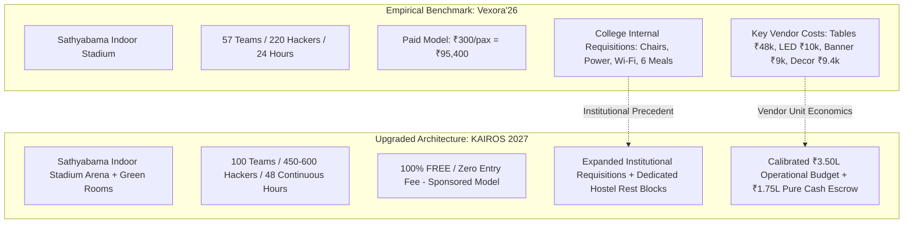
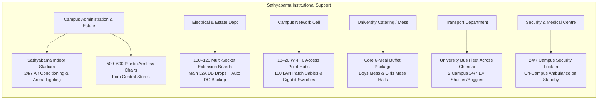
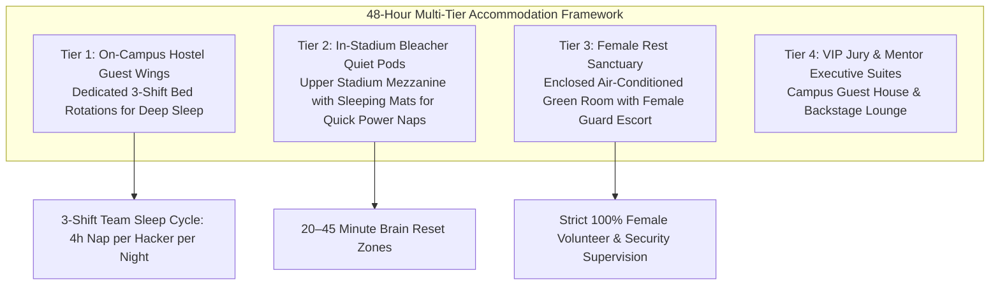

# KAIROS 2027 — Indoor Auditorium (Sathyabama Indoor Stadium) Venue Architecture, College Provisions, Accommodation & Calibrated Master Budget Plan

**Governing Standard:** [03_budget_and_financial_tracker.md](./03_budget_and_financial_tracker.md) · [08_event_operations_and_volunteer_manual.md](./08_event_operations_and_volunteer_manual.md) · Empirical Learnings from `Vexora'26 (ACM Sathyabama Chapter Report)`  
**Host Entity:** AWS Student Builder Group (AWS SBG) — SIST Chapter  
**Sponsoring Institution:** Sathyabama Institute of Science and Technology (Deemed to be University), Chennai – 600119  
**Event Window:** January 22 – 24, 2027 (48 Continuous Hours, Friday 08:00 AM to Sunday 05:00 PM)  
**Scale:** 100 Shortlisted National Finalist Teams (Teams of 4–6 students, ~400–600 Developers) · 106 Student Organizers · 25+ Industry VIPs & Evaluators  
**Registration Model:** **100% FREE — ZERO ENTRY FEE** (Merit-based admission via Phase 1 Online Qualifier)  
**Venue Transition:** Relocated from Central Library Complex to **Sathyabama Indoor Stadium (Indoor Auditorium)**  

---

## 1. Executive Transition Context & Empirical Baseline

Following administrative alignment and venue capacity optimization, the physical grand finale for **KAIROS 2027 (Grand Edition)** is officially planned for the **Sathyabama Indoor Stadium (Indoor Auditorium)**. 

To ensure airtight execution, our planning directly incorporates the empirical findings, vendor accounts, institutional requisition frameworks, and operational lessons from **Vexora’26** (the 24-Hour National Level Hackathon organized by the ACM Sathyabama Student Chapter at the same venue on January 31 – February 1, 2026).



---

## 2. Deep Dive: What Vexora’26 Proved & What We Assume

From the official Vexora’26 Post-Event Report and Audit Ledger, the following ground realities and institutional mechanisms have been established:

### 2.1 College-Level Providings (Free of Charge via Formal Requisition)
Vexora’26 successfully requisitioned and received complete internal institutional support from Sathyabama Management, Estate Office, Maintenance, and Catering without direct cash deductions from their event budget:
1. **Chairs:** 220 institutional plastic banquet/student chairs were supplied directly from the university central stores.
2. **Electrical Infrastructure:** 80 multi-plug extension socket boards and heavy main distribution board cabling were deployed by the campus maintenance department.
3. **High-Speed Networking:** 15 Wi-Fi access hubs/routers and 80 LAN patch cables were supplied and configured by the university IT/Network cell.
4. **Audio & Podium Equipment:** 2 public address speakers and handheld microphones were provided by the Audio-Visual Department.
5. **Continuous Food & Refreshment Service (University Mess):** The university catering/mess department provided all major food services as an internal arrangement:
   * Lunch (Day 1)
   * Evening Snacks & Tea (5:00 PM)
   * Dinner (Day 1 Night)
   * Breakfast (Day 2)
   * Morning Snacks & Tea (11:00 AM)
   * Lunch (Day 2)
   * Dedicated Food and Snacks for External Speakers / Judges

### 2.2 Paid Vendor Expenditures & Ground Economics in the Indoor Stadium
Vexora’26 incurred direct expenditures totaling **₹99,893** (against ₹95,400 registration collections and ₹15,000 ACM India ABF grant). Their audited accounts reveal essential cost points for operating inside the Sathyabama Indoor Stadium:
* **Round Table Rental with Cover Cloth:** **₹48,000** for 60 round tables (approx. ₹800 per table with linen frills for 24h).
* **Stage LED Video Display (8ft × 4ft):** **₹10,000** for 1 active rental display on the stage.
* **Mega Indoor Stadium Backdrop Banner:** **₹9,000** (Supplied by vendor *Vetrivel*, 55ft × 11ft stadium truss banner).
* **ID Cards, Lanyards & Badges + 4×6 Banner:** **₹4,780** (Supplied by *DC Printers / Saravanan Sir* for 300 units).
* **Branded Participant Water Bottles (Goodies):** **₹11,328** (160 units + 18% GST via *Shree Ganesh Marketing*) + ₹4,398 (74 units) + ₹1,500 + ₹2,898 = **₹20,124** total.
* **Venue Decor & Ambience:** **₹9,363** (*Paint, POP, ropes, chart sheets, cardboard, masking tape, spray paint, glue*).
* **Xerox, Rule Sheets & Printouts:** **₹3,414** (Via *Live Xerox*).
* **On-Spot Venue Setup & Mat Taping:** **₹1,510** (*Heavy adhesive tape for venue floor mats/cable routing, audio cables, cutters, cups*).
* **Night Activity Refreshment Supplies:** **₹170** (*Paper cups and balloons for midnight engagement*).
* **Chief Guest Book / Mementos:** **₹700** (*Crossword book for VIP keynote*).
* **Cash Prize Disbursement:** **₹30,000** (1st Prize ₹20,000 + 2nd Prize ₹10,000 paid via NEFT through the Dean, School of Computing).

---

## 3. Comparison Matrix: Vexora’26 vs. KAIROS 2027

| Parameter | Vexora’26 (ACM Sathyabama) | KAIROS 2027 (AWS SBG) | Strategic Adaptation for Kairos |
|---|---|---|---|
| **Duration** | 24 Hours (Overnight) | **48 Hours Continuous** | Requires formal sleep shifts, hygiene logistics, and double meal cycles. |
| **Participant Scale** | 57 Teams (220 Participants) | **100 Teams (450–600 Developers)** | Requires expanded arena floor layout and higher electrical density. |
| **Registration Fee** | Paid (₹300 / participant) | **100% FREE (Zero Entry Fee)** | Funded entirely via corporate sponsorships & institutional grant. |
| **Cash Prize Pool** | ₹30,000 (Winner 20k, Runner 10k) | **₹1,75,000 Pure Liquid Cash** | 1st: ₹60k, 2nd: ₹35k, 3rd: ₹20k, 5 Tracks: ₹35k, Bounties: ₹25k. |
| **Total Cash Budget** | ~₹1,00,000 – ₹1,32,000 | **₹3,50,000 Target (₹4,00,000 Stretch)** | Comprehensive enterprise sponsorship funding pool. |
| **Seating & Tables** | 60 Rented Round Tables (₹48,000) | **80–100 Team Pods** | Hybrid sourcing: Requisition internal tables + rent linens/accent covers. |
| **Chairs** | 220 Provided by College | **500–600 Provided by College** | Sourced free of charge from SIST Central Stores. |
| **Stage & Visuals** | 8×4 ft LED Display (₹10,000) | **12×8 ft or 8×4 ft High-Res LED Wall** | Real-time AWS architecture demos, live countdown & sponsor loops. |
| **Stadium Backdrop** | 55ft × 11ft Vinyl Banner (₹9,000) | **50ft × 10ft Cyber Stage Backdrop** | High-GSM vinyl backdrop with AWS & Corporate Sponsor lockups. |
| **Power Distribution** | 80 Multi-plug Boards (College) | **100–120 Multi-plug Boards + Cable Mats** | Heavy rubber floor cable protectors + floor mat tape for arena safety. |
| **Wi-Fi Network** | 15 Wi-Fi Boxes / Hubs (College) | **18–20 High-Density Wi-Fi 6 APs** | Dual-ISP failover with dedicated subnets for hackers and judges. |
| **Meals & Catering** | 6 Meals/Snacks via College Mess | **8 Full Food Services via College Mess** | 6 full buffet meals + 2 evening high tea sessions + midnight coffee. |
| **Accommodation** | Arena floor staying (24h) | **College Hostels + Arena Quiet Pods** | 48h non-stop requires dedicated hostel rest wings & 3-shift sleep rotations. |

---

## 4. College-Level Providings Requisition (Zero Budget Charge)

Following the precedent set by Vexora’26 and our formal administrative requisition channels ([14_official_letters_and_administrative_approvals.md](./14_official_letters_and_administrative_approvals.md)), the following resources will be provided directly by Sathyabama Institute of Science and Technology without depleting the hackathon's cash sponsorship capital:



### 4.1 Itemized College Provision Specifications
1. **Venue Facilities (Estate Office):**
   * Complete exclusive reservation of the **Sathyabama Indoor Stadium** from January 21, 2027 (Setup @ 10:00 AM) to January 24, 2027 (Tear-down @ 08:00 PM).
   * **24/7 Uninterrupted Central Air Conditioning** for the entire 48-hour event duration.
   * Arena high-bay sports floodlights, stage warm lights, and concourse lighting.
   * Access to backstage green rooms (designated as VIP Jury Suite & Female Rest Sanctuary) and administrative control rooms.
2. **Seating Inventory (Central Furniture Depot):**
   * **550–600 Plastic Banquet Chairs** delivered to the indoor stadium floor on January 21.
3. **Power Grid & Electrical Safety (Maintenance Office):**
   * **100–120 Heavy-Duty 6A/16A Multi-plug Extension Boards** (5-meter leads).
   * 4 Dedicated industrial 32A 3-Phase Main Distribution Board (DB) feed lines dropped from the stadium perimeter panels to the arena floor trunk channels.
   * Uninterrupted tie-in to **Dual Campus 125 kVA Diesel Generators** with automatic synchronized switchover (<10ms).
4. **Networking & Leased Lines (University IT Cell):**
   * **18–20 Enterprise Dual-Band Wi-Fi Access Points (APs)** deployed around the stadium perimeter and elevated rafters to eliminate RF dead-zones.
   * **100 Cat6 LAN Cables (10m & 15m)** for jury scoring terminals, video broadcast workstations, and mentor evaluation pods.
   * Dedicated symmetrical campus leased line bandwidth allocation (1 Gbps+ guaranteed QoS for the event subnet).
5. **Core Food & Dining Services (Mess & Student Affairs):**
   * Provision of **6 Major Buffet Meals** across the 48 hours for 500 attendees (400 participants + 100 organizers/volunteers):
     * *Day 1 (Jan 22):* Lunch (01:00 PM) & Dinner (08:30 PM)
     * *Day 2 (Jan 23):* Breakfast (07:30 AM), Lunch (01:00 PM) & Dinner (08:30 PM)
     * *Day 3 (Jan 24):* Breakfast (07:30 AM)
   * Served at the university **Boys Mess Hall** and **Girls Mess Hall** (strictly segregated access routes).
6. **Campus Transit & University Bus Fleet (Transport Office):**
   * Authorization for external registered hackathon delegates to board all regular morning Sathyabama college buses on Friday, January 22, 2027.
   * Evening departure bus service on Sunday, January 24, 2027 at 05:30 PM from the campus bus bay.
   * **2 Dedicated Campus Electric (EV) Buggies / Shuttles** operating 24/7 continuous loops connecting the Indoor Stadium, Restrooms, Hostels, and Dining Halls.
7. **Security, Governance & First Aid (Chief Security Officer & Health Centre):**
   * 24/7 security cordon with perimeter lock-in between **10:00 PM and 06:00 AM**.
   * Dedicated male and female security guards posted at the stadium entry/exit portals and green rooms.
   * On-campus 24/7 ambulance positioned at the stadium portico with basic first-aid dispensary staff.

---

## 5. Accommodation, Rest & Hygiene Architecture (48-Hour Plan)

In a 24-hour event like Vexora, participants generally stay awake at their desks with minor resting on chairs. However, **KAIROS 2027 is a 48-Hour National Hackathon**. Sustaining human focus, mental sharpness, and health over two consecutive nights requires a strictly managed rest and hygiene protocol.



### 5.1 Tier 1: University Hostel Guest Wings (Deep Rest Rotations)
* **Requisition:** 40 hostel guest rooms / dedicated dormitory wings requisitioned through the Dean (Student Affairs) across:
  * **Sathyabama Boys Hostel Block** (for male outstation developers)
  * **Sathyabama Girls Hostel Block** (for female outstation developers)
* **3-Shift Team Rotation Protocol:**
  * Hackathon teams comprise 4–6 members. All 4–6 developers are never permitted to leave their hack bay simultaneously.
  * Teams operate on a **staggered rest rotation**:
    * *Shift A (00:00 – 03:30 AM):* 2 members rest in hostel dorms while 2–4 code and defend checkpoints.
    * *Shift B (03:30 – 07:00 AM):* Next 2 members rotate into hostel dorms for sleep and showers.
* **Security & Transit:** Movement between the Indoor Stadium and hostel blocks between 10:00 PM and 06:00 AM is conducted exclusively via **Campus EV Buggies** under organizer and security escort.

### 5.2 Tier 2: In-Stadium Bleacher Quiet Nap Pods
* **Location:** The elevated spectator bleachers / galleries of the Sathyabama Indoor Stadium.
* **Setup:** The upper tier is partitioned from the main brightly-lit arena floor using dark drape dividers.
* **Amenities:** 40 portable padded rest mats, neck pillows, and light fleece blankets.
* **Purpose:** Allows hackers to take 30- to 60-minute quick power naps without leaving the stadium arena.
* **Rules:** Strictly enforced silent zone; zero laptop usage, zero phone calls.

### 5.3 Tier 3: Female Hacker Rest & Security Sanctuary
* **Location:** Fully furnished, air-conditioned backstage VIP Green Room 1 inside the Indoor Stadium.
* **Access Control:** Restricted electronic/security access strictly limited to female participants, female faculty coordinators (**Dr. Balapriya .S**), and lady student organizers.
* **Facilities:** Attached clean private washrooms, cushioned couches, resting mattresses, vanity mirrors, sanitization kits, and first-aid supplies.
* **Security:** 24/7 stationed lady security guard at the green room entrance.

### 5.4 Tier 4: Morning Shower & Freshen-Up Circuit
* **Schedule:** Daily between **06:00 AM and 08:30 AM** (both Saturday, Jan 23 and Sunday, Jan 24).
* **Execution:**
  * Staggered token system per team to prevent crowding.
  * EV buggies run continuous 5-minute loops shuttling participants to hostel shower blocks and back.
  * Stadium permanent restroom blocks are continuously sanitized by university housekeeping staff on 2-hour cleaning cycles.

---

## 6. Indoor Stadium Master Budget Estimation Plan (Focused for Us)

### 6.1 Operational Inflow Architecture
Kairos 2027 operates on a **100% Free / Zero Entry Fee Model**. All working capital is sourced through corporate enterprise partnerships and the approved university grant:

| Revenue Stream | Baseline Model (₹) | Target Grand Model (₹) | Stretch Enterprise (₹) | Commitment Status |
|---|:---:|:---:|:---:|---|
| **Title Sponsor (Presented By)** | ₹1,50,000 | **₹2,00,000** | ₹2,50,000 | In Active Sponsor Pipeline |
| **Co-Powered By Sponsor** | ₹75,000 | **₹1,00,000** | ₹1,25,000 | In Active Sponsor Pipeline |
| **Track & Associate Bounty Partners** | ₹50,000 | **₹50,000 – ₹1,00,000** | ₹1,00,000 | 2–4 Partners @ ₹25k each |
| **Sathyabama Institutional Grant** | ₹50,000 | **₹50,000** | ₹50,000 | Approved by Management |
| **Participant Entry Fees** | **₹0 (FREE)** | **₹0 (FREE)** | **₹0 (FREE)** | **100% Free Meritocracy** |
| **TOTAL WORKING OPERATIONAL INFLOW** | **₹3,25,000** | **₹3,50,000 – ₹4,00,000** | **₹4,50,000+** | — |

---

### 6.2 Itemized Master Expenditure Catalog (Calibrated for Indoor Stadium)

The budget below incorporates the exact cost lessons from Vexora’26 (table rentals with cloth, mega indoor stadium backdrop banners, stage LED wall, venue decor, and floor cable taping) while preserving our flagship **₹1,75,000 Pure Liquid Cash Prize Pool**:

```text
========================================================================================================
KAIROS 2027 (INDOOR AUDITORIUM EDITION) — ITEMIZED MASTER EXPENDITURE CATALOG
========================================================================================================
REF   CATEGORY / ITEM DESCRIPTION                 SPECIFICATIONS & NOTES        QTY    UNIT (₹) TOTAL (₹)
--------------------------------------------------------------------------------------------------------
1. PURE CASH PRIZE POOL (ESCROW DISBURSEMENT VIA DIRECT WIRE)
1.1   Grand National Champion (1st Place Overall) Pure Liquid Cash + Trophy + VC  1      60,000   ₹60,000
1.2   First Runner-Up (2nd Place Overall)         Pure Liquid Cash + Trophy       1      35,000   ₹35,000
1.3   Second Runner-Up (3rd Place Overall)        Pure Liquid Cash + Trophy       1      20,000   ₹20,000
1.4   5 Enterprise Track Category Winners         5 Tracks × ₹7,000 Pure Cash     5       7,000   ₹35,000
1.5   Best All-Women Hacker Team Bounty           Special Category Cash Bounty    1      10,000   ₹10,000
1.6   Best Freshman / Rookie Team Bounty          Special Category Cash Bounty    1       7,500    ₹7,500
1.7   Most Scalable AWS Architecture Bounty       Special Category Cash Bounty    1       7,500    ₹7,500
--------------------------------------------------------------------------------------------------------
SUBTOTAL: CASH PRIZES (NON-NEGOTIABLE ESCROW)                                                 ₹1,75,000
--------------------------------------------------------------------------------------------------------

2. VENUE FLOOR INFRASTRUCTURE & ARENA TABLE SETUP (INDOOR STADIUM REQUIREMENT)
2.1   Banquet Round Tables with Heavy Cover Cloth 5ft Round Foldable Tables +     75        360   ₹27,000
                                                  Full Black/Navy Fitted Linens
                                                  (Negotiated 48h campus bulk rate;
                                                  ref. Vexora paid ₹48k for 60)
2.2   Heavy-Duty Rubber Floor Cable Ramps & Mats  Dual-Channel Cable Cross Ramps  20        300    ₹6,000
                                                  protecting power runs on arena
2.3   Arena Cable Binding & Heavy Floor Mat Tape  High-adhesion gaffer/duct tape  12 rolls   250   ₹3,000
                                                  (Ref. Vexora mat tape entry)
2.4   Extra 16A Spike Boards / Surge Adapters     Buffer units for central hubs   10        200    ₹2,000
--------------------------------------------------------------------------------------------------------
SUBTOTAL: ARENA FLOOR & TABLE INFRASTRUCTURE                                                   ₹38,000
--------------------------------------------------------------------------------------------------------

3. STAGE PRODUCTION, LED VIDEO WALL & STADIUM AUDIO REINFORCEMENT
3.1   Stage P2.5/P3 High-Res LED Video Display    12ft × 8ft Active Stage Canvas  3 days  18,000  ₹18,000
                                                  (Leaderboards, Timer, Demos;
                                                  ref. Vexora 8x4 LED was ₹10k)
3.2   Stadium Acoustic Line-Array PA Reinforcement 4 Concert Tops + Audio Mixer +  3 days   9,000   ₹9,000
                                                  Equalizer tuned for stadium echo
3.3   Wireless Cordless UHF & Lapel Microphones   Shure UHF tuned multi-channel   6 sets   5,000   ₹5,000
--------------------------------------------------------------------------------------------------------
SUBTOTAL: STAGE PRODUCTION & AUDIO-VISUAL                                                      ₹32,000
--------------------------------------------------------------------------------------------------------

4. PARTICIPANT MERCHANDISE, SMART ID BADGES & DEVELOPER KITS
4.1   Dry-Fit Builder T-Shirts (180 GSM)          Cyber Gradient AWS/Kairos Tee   450        55   ₹24,750
4.2   Smart Lanyards & Laser-Etched QR ID Badges  Matte PVC Badge + Woven Ribbon  450        22    ₹9,900
                                                  (Ref. Vexora DC Printers entry)
4.3   Vinyl Die-Cut Laptop Sticker Packs (4/pack) Custom AWS & Kairos Vinyl Art   450 pk     12    ₹5,400
4.4   High-GSM Foil Embossed Participation Certs  Hard Stock Folders + Seals      450 sets   11    ₹4,950
--------------------------------------------------------------------------------------------------------
SUBTOTAL: MERCHANDISE, BADGES & DEVELOPER KITS                                                 ₹45,000
--------------------------------------------------------------------------------------------------------

5. CONTINUOUS REFRESHMENTS, 48-HOUR MIDNIGHT FUEL & SNACKS SUPPLEMENT
5.1   Evening High Tea & Fresh Snacks Supplement  Tea/Filter Coffee + Hot Snacks  450 pax    18    ₹8,100
                                                  (Samosas/Cutlets) both evenings
5.2   Midnight Continuous Fuel Bar (Both Nights)  01:30 AM Fresh Hot Coffee/Tea   2 nights 4,450   ₹8,900
                                                  and High-Energy Glucose Biscuits
5.3   Mineral Water Bubble Tops & Dispensers      20L Water Cans placed in arena  60 cans    80    ₹4,800
5.4   In-Kind Red Bull Activation & Chiller Logistics Chiller setup, ice & cups   1 lot    3,200   ₹3,200
--------------------------------------------------------------------------------------------------------
SUBTOTAL: REFRESHMENTS & MIDNIGHT FUEL                                                         ₹25,000
--------------------------------------------------------------------------------------------------------

6. VIP JURY CARE, DIGNITARY HOSPITALITY & GREEN ROOM AMENITIES
6.1   Backstage VIP Lounge Gourmet Hospitality    Espresso Bar, Fresh Dry Fruits, 30 pax    250    ₹7,500
                                                  Assorted Cookies & Refreshments
6.2   Grand Jury Day 3 Executive Buffet Lunch     Special Chef Buffet for VCs &   25 pax    180    ₹4,500
                                                  Sponsor CXOs (Library/Lounge)
6.3   Traditional Shawls & Custom Mementos        Handcrafted Brass/Wood Memento  15 units  200    ₹3,000
                                                  for Industry Judges
--------------------------------------------------------------------------------------------------------
SUBTOTAL: VIP HOSPITALITY & MEMENTOS                                                           ₹15,000
--------------------------------------------------------------------------------------------------------

7. STADIUM BRANDING, MEGA BACKDROP, STANDEES & TROPHY SUITE
7.1   Indoor Stadium Mega Stage Backdrop Banner   50ft × 10ft High-Res Vinyl      1 unit   5,500   ₹5,500
                                                  (Ref. Vexora Vetrivel banner ₹9k)
7.2   Roll-Up Metal Standees (6ft × 3ft)          Track info & sponsor branding   10 units  350    ₹3,500
7.3   Indoor Stadium Entrance Welcome Arch Banner 15ft × 6ft Arch Vinyl           1 unit   1,200   ₹1,200
7.4   Laser-Cut Acrylic & Metal Trophies          Champions & Track Award Set     8 units   225    ₹1,800
--------------------------------------------------------------------------------------------------------
SUBTOTAL: BRANDING, MEGA BANNERS & AWARDS                                                      ₹12,000
--------------------------------------------------------------------------------------------------------

8. ON-SPOT VENUE OPERATIONS, DECOR & CONTINGENCY BUFFER
8.1   Arena Floor Decor & Creative Ambience       Black drapes, neon signage,     1 lot    3,500   ₹3,500
                                                  props (Ref. Vexora Decor ₹9.4k)
8.2   Live Printouts, Score Sheets & Stationeries Evaluation forms, clipboard pads 1 lot   2,000   ₹2,000
                                                  (Ref. Vexora Live Xerox entry)
8.3   On-Spot Emergency Consumables & Tools       Scissors, cutters, extra cords, 1 lot    2,500   ₹2,500
                                                  marker pens, first-aid replenishments
--------------------------------------------------------------------------------------------------------
SUBTOTAL: ARENA DECOR, PRINTING & CONTINGENCY                                                   ₹8,000
--------------------------------------------------------------------------------------------------------

========================================================================================================
GRAND TOTAL EXPENDITURE BUDGET: ₹3,50,000 | BALANCED AGAINST OPERATIONAL INFLOW: ₹3,50,000
========================================================================================================
```

---

### 6.3 Stretch Budget Model (At ₹4,00,000 Inflow Allocation)
If sponsor outreach closes at the upper target of **₹4,00,000**, the surplus **₹50,000** will be deployed strictly into high-impact experiential upgrades:
1. **+₹15,000 into Participant Merch:** Upgrade to premium 240 GSM hoodies for all 10 track finalist teams and top performers.
2. **+₹15,000 into Stage LED & Visual Production:** Expand stage LED wall canvas to 16ft × 10ft with dynamic curved side wings.
3. **+₹10,000 into Midnight Energy Bar:** Add midnight hot Maggi / cup noodles and fruit energy bowls for hackers at 03:00 AM on both nights.
4. **+₹10,000 into Pure Cash Bounty Escrow:** Introduce two ₹5,000 industry spot challenge bounties sponsored by track partners.

---

## 7. Indoor Stadium Arena Floorplan & Power Distribution Architecture

```text
+--------------------------------------------------------------------------------------------------+
|                                    SATHYABAMA INDOOR STADIUM                                     |
|                                                                                                  |
|  +--------------------------------------------------------------------------------------------+  |
|  |                                  ELEVATED STAGE COMPLEX                                    |  |
|  |  [MEGA STADIUM BACKDROP: 50ft x 10ft]       [P2.5 LED VIDEO WALL: 12ft x 8ft]              |  |
|  |  [Podium / Audio Mix]                      [Jury Evaluation & Pitching Deck]               |  |
|  +--------------------------------------------------------------------------------------------+  |
|                                                                                                  |
|   [BACKSTAGE GREEN ROOM 1]                                           [BACKSTAGE GREEN ROOM 2]    |
|   (Female Hacker Rest Sanctuary)                                     (VIP Industry Jury Lounge)  |
|                                                                                                  |
|  ============================== MAIN DB POWER FEED LINE 1 =====================================  |
|                                                                                                  |
|      TRACK 1: AGENTIC AI             TRACK 2: CLOUD-NATIVE            TRACK 3: WEB3 & SECURITY   |
|   [T01] [T02] [T03] [T04] [T05]   [T21] [T22] [T23] [T24] [T25]   [T41] [T42] [T43] [T44] [T45]  |
|   [T06] [T07] [T08] [T09] [T10]   [T26] [T27] [T28] [T29] [T30]   [T46] [T47] [T48] [T49] [T50]  |
|   [T11] [T12] [T13] [T14] [T15]   [T31] [T32] [T33] [T34] [T35]   [T51] [T52] [T53] [T54] [T55]  |
|   [T16] [T17] [T18] [T19] [T20]   [T36] [T37] [T38] [T39] [T40]   [T56] [T57] [T58] [T59] [T60]  |
|                                                                                                  |
|  ============================== MAIN DB POWER FEED LINE 2 =====================================  |
|                                                                                                  |
|      TRACK 4: FINTECH & TRUST        TRACK 5: OPEN ENTERPRISE         CENTRAL APEX WAR ROOM      |
|   [T61] [T62] [T63] [T64] [T65]   [T81] [T82] [T83] [T84] [T85]   [Ops & Logistics Terminal]  |
|   [T66] [T67] [T68] [T69] [T70]   [T86] [T87] [T88] [T89] [T90]   [AWS Architecture Helpdesk] |
|   [T71] [T72] [T73] [T74] [T75]   [T91] [T92] [T93] [T94] [T95]   [Network NOC & Stream Bay]  |
|   [T76] [T77] [T78] [T79] [T80]   [T96] [T97] [T98] [T99] [T100]  [Live Media Broadcast Deck]  |
|                                                                                                  |
|  ============================== MAIN DB POWER FEED LINE 3 =====================================  |
|                                                                                                  |
|  +--------------------------------------------------------------------------------------------+  |
|  | UPPER SPECTATOR BLEACHERS / MEZZANINE (QUIET NAP PODS - 40 MATS - 100% SILENT ZONE)        |  |
|  +--------------------------------------------------------------------------------------------+  |
|                                                                                                  |
|  [FOYER / ENTRANCE CONCOURSE]                                                                    |
|  • Check-in Desks & Smart Badge Scanning Station                                                 |
|  • 24/7 Filter Coffee / Tea Fuel Bar & Red Bull Station                                          |
|  • Sponsor Showcase Booths & Photo Booth Backdrop                                                |
|  • On-Campus Ambulance & Medical First-Aid Post (Outer Portico)                                  |
|  • 2 Dedicated Campus EV Shuttles / Buggy Terminals (Transit to Hostels & Mess)                  |
+--------------------------------------------------------------------------------------------------+
```

### 7.1 Arena Power Grid & Sports Floor Safety Standards
1. **Sports Floor Preservation:**
   * Sathyabama Indoor Stadium features a treated synthetic/wooden athletic floor. Dragging metal furniture or running bare wires without protection is strictly prohibited.
   * All table legs must have rubber glides/shoes.
   * All high-traffic floor cable crossings must be encased inside **heavy-duty industrial dual-channel rubber cable ramps** and taped flush using residue-free venue mat tape.
2. **Electrical Load Architecture:**
   * Total Estimated Arena Load: **~55 kW (~65 kVA)** (600 laptops, chargers, LED video wall, Line Array PA, broadcast rigs, and coffee brewers).
   * 3 Main 3-Phase 32A power lines dropped from stadium distribution boxes. Each feeder powers one bank of 30–35 team pods.
   * Every team pod receives a dedicated 6-socket spike-protected extension board providing a minimum of 4 usable ports per team.
3. **Zero-Downtime Guarantee:**
   * Central UPS system buffers the stage LED wall and network routing gear.
   * Main transformer is backed by two campus 125 kVA diesel generators with auto-start switchover in <10 milliseconds.

---

## 8. Summary of Action Items for Event Leadership

1. **Super Head 1 (CPFO - Finance):**
   * Lock the ₹3.50L budget allocations against active corporate sponsorship proposals.
   * Set up vendor accounts with preferred local campus vendors (*DC Printers* for badges/standees, *Vetrivel* for stadium backdrop banner, and local tent vendor for round banquet tables and black cloths).
2. **Super Head 3 (COO - Operations):**
   * Submit revised venue requisition to the Estate Office officially updating the venue to **Sathyabama Indoor Stadium**.
   * Requisition 550 plastic chairs from central stores, 120 extension boards from Maintenance, and 20 Wi-Fi APs from IT Cell.
   * Finalize the table rental contract (75–80 round banquet tables with linens @ ₹350–₹360/unit).
3. **Super Head 4 (CXO - Hospitality):**
   * Submit the 6-meal requisition to the University Mess Office.
   * Requisition 40 hostel guest rooms / dormitory beds (20 boys, 20 girls) through Dean (Student Affairs) for the 3-shift sleep rotation.
   * Reserve Backstage Green Room 1 as the female rest sanctuary and Green Room 2 as the VIP jury lounge.
   * Lock in 2 campus EV buggies with the Transport Department for continuous 24/7 shuttle service.
4. **Super Head 6 (CSO - Safety & Governance):**
   * Coordinate 10:00 PM – 06:00 AM stadium perimeter lock-in protocol with Campus Chief Security Officer.
   * Brief rotating female faculty proctors and student volunteers for female green room and hostel transit safety.
