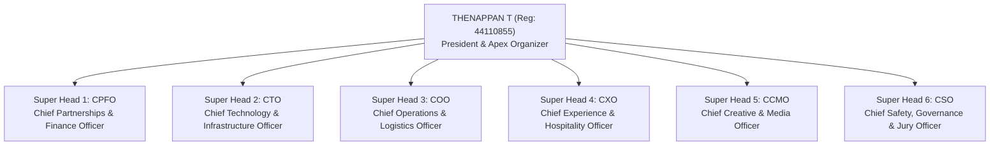

# AWS Student Builder Group Sathyabama — 48hr National Hackathon
## Master Plan & Grand Edition Roadmap (January 2027)

**Governing Standard:** `E:\AWS SBGL\ANTI-Help\04_FLAGSHIP_EVENT_DEEPDIVES_AND_POST_EVENT_REPORTS.md` & `10_HACKATHON_SPONSORSHIP_LETTERS_AND_OUTREACH_KIT.md`  
**Host Entity:** AWS Student Builder Group (AWS SBG) — SIST Chapter  
**Sponsoring Institution:** Sathyabama Institute of Science and Technology, Chennai – 600119  
**Event Window:** January 22–24, 2027 (48 Hours Non-Stop, Friday 08:00 AM to Sunday 05:00 PM)  
**Execution Runway:** September 2026 – January 2027 (5-Month Strategic Runway)  
**Registration Model:** **100% FREE — ZERO ENTRY FEE** for all participants  
**Dual-Phase Quality Gate:**  
* **Phase 0:** Free National Applications & Abstract Screening (Oct 15 – Dec 15, 2026) $\rightarrow$ 2,000+ Teams  
* **Round 1 (Online Qualifier):** Virtual Code Sprint, Loom Video Demo & Live Technical Defense (Jan 02 – 04, 2027) $\rightarrow$ Top 250 Semi-Finalists  
* **Round 2 (On-Campus Grand Finale):** 48-Hour Non-Stop Physical Sprint at Sathyabama (Jan 22 – 24, 2027) $\rightarrow$ Top 100 Elite Teams (400–500 Developers)  
**Corporate Sponsorship Target:** **₹3,00,000** (Title Partner ₹1.25L, Powered-By ₹70k, Track Partners ₹1.05L)  
**Working Operational Capital:** **₹3,50,000** (Corporate Sponsorships + ₹50,000 College Grant)  
**Pure Cash Prize Pool:** **₹1,75,000 Pure Cash** (1st: ₹60k, 2nd: ₹35k, 3rd: ₹20k, 5 Tracks: ₹35k, Bounties: ₹25k) + $50,000+ AWS Cloud Credits  
**Venue:** Central Library Complex (Auditorium, 1st Floor Computing Lab, 2nd Floor Lecture Halls 1–3, Top Floor VIP Lounge)  
**Leadership:** Thenappan T (Register No: `44110855`), President & SBGL | Faculty Coordinators: Dr. Balapriya .S & Dr. K. Ashok Kumar  
**Official Email:** `sistawscc@gmail.com` | **Phone:** `+91 6381801640` | **Instagram:** [`@awssbg_sist`](https://instagram.com/awssbg_sist)  

---

## 0. Master Context Prompt (Reusable for AI & Team Syncs)

Paste this block at the top of any conversation — with your team, or with an AI assistant:

> We are AWS Student Builder Group Sathyabama, organizing India's premier 48-hour national hackathon on our university campus, **"KAIROS 2027 (Grand Edition)"**, scheduled for **January 22–24, 2027**. The hackathon has **ZERO ENTRY FEE (100% FREE for all participants)** and is backed by **₹3,00,000 in external corporate sponsorships** (Title Partner ₹1.25L, Powered By ₹70k, Track Bounty Partners ₹25k each, plus Red Bull energy partnerships, and $50k+ AWS cloud credits). To guarantee peak technical quality, Kairos implements a **Dual-Phase Selection Funnel**: 2,000+ national applicant teams are filtered to **Top 250 Semi-Finalists for the Online Qualifier Round (Round 1: Jan 02–04, 2027)**, where teams defend their GitHub repositories and Loom prototypes live with AWS architects. Only the **Top 100 Elite National Teams (400–500 developers)** advance to the on-campus 48-hour grand finale. The event features a **₹1,75,000 pure cash prize pool** and 3 progressive on-ground evaluation gates. The organization is led by **6 Super Heads** reporting directly to President Thenappan T (Register No: 44110855) across 106 student organizers. All venue amenities (Central Library complex), power strips, high-speed campus Wi-Fi, university bus fleet, campus EV buggies, buffet meals, developer kits, smart badges, and 24/7 security with strictly segregated boys/girls stairwells are 100% complimentary for all finalist hackers. Faculty Coordinators: **Dr. Balapriya .S** & **Dr. K. Ashok Kumar**. Official Email: **sistawscc@gmail.com**.

---

## 1. The Strategic Opportunity of January 2027 & The Zero-Fee Model

1. **Unfiltered National Talent Inflow (Zero Financial Barrier):** Making the hackathon 100% free removes every barrier for talent across IITs, NITs, BITS, and regional engineering colleges. Applications are projected to surge beyond 2,000+ teams.
2. **The Online Qualifier Round (Quality Guarantee):** Rather than accepting teams based merely on slide decks, the **January 02–04 Online Technical Qualifier** forces the Top 250 teams to prove working codebases, architecture diagrams, and live defenses before earning an on-campus invitation.
3. **Closing Corporate Sponsors (Calibrated Tier Matrix):** Corporate marketing and CSR decision-makers prefer funding 100% free student initiatives, allowing us to close a ₹1,25,000 Title Sponsor and corporate track partners within realistic enterprise budgets.
4. **World-Class Experiential Production:** 100% free buffet meals, builder tees, smart badges, and an inspiring venue setup in Sathyabama's Central Library Complex.

---

## 2. Apex Command Structure: The 6 Super Heads

Under the Incident Command System (ICS), **only 6 Super Heads report directly to President Thenappan T**:

### The 6 Super Heads & Core Mandates:
1. **Super Head 1: Chief Partnerships & Finance Officer (CPFO)**
   * *Mandate:* Secure Title Sponsor (₹1.25L) and track sponsors; manage ₹3.5L zero-fee ledger; disburse ₹1.75L prize escrow.
2. **Super Head 2: Chief Technology & Infrastructure Officer (CTO)**
   * *Mandate:* Online Qualifier portal operations, AWS developer sandboxes, campus network, power grid, and real-time scoring engine.
3. **Super Head 3: Chief Operations & Logistics Officer (COO)**
   * *Mandate:* Central Library floorplans, hacking bays, university bus fleet transit, campus EV buggies, and equipment inventory.
4. **Super Head 4: Chief Experience & Hospitality Officer (CXO)**
   * *Mandate:* 100% free participant care: buffet meal management, continuous coffee/tea fuel bar, energy snacks, and quiet rest pods.
5. **Super Head 5: Chief Creative & Media Officer (CCMO)**
   * *Mandate:* Brand visual identity, stage visual media, 48-hour live broadcast, cinematic aftermovie, and 120+ Campus Ambassador network.
6. **Super Head 6: Chief Safety, Governance & Jury Officer (CSO)**
   * *Mandate:* Online & On-Campus jury governance, VIP hospitality for judges, 3-gate evaluation governance, 24/7 campus security lock-in, and medical care.

---

## 3. Master Financial Model (₹3,50,000 Fully Sponsored)

* **Operational Inflow (100% Sponsored / Zero Entry Fee):**
  * Title Sponsor (Presented By): **₹1,25,000** *(> ₹1 Lakh)*
  * Co-Powered By Sponsor: **₹70,000**
  * Track & Associate Partners: **₹1,05,000**
  * Sathyabama Management Institutional Grant: **₹50,000**
  * Participant Entry Fees: **₹0 (100% FREE)**
  * **Total Operational Working Inflow:** **₹3,50,000**
* **Outflow Allocations:**
  * Pure Cash Prizes: **₹1,75,000** (1st: ₹60k, 2nd: ₹35k, 3rd: ₹20k, 5 Tracks: ₹35k, Bounties: ₹25k)
  * Participant Merch, Badges & Kits: **₹60,000**
  * Catering Supplement & Refreshments: **₹45,000**
  * Stage & Line Array Sound: **₹30,000**
  * VIP Jury Care & Lounge Hospitality: **₹20,000**
  * Power Grid & Network Infrastructure: **₹10,000**
  * Signage, Standees, Banners & Awards: **₹10,000**
  * **Total Operational Outflow:** **₹3,50,000** (Balanced to the rupee).

---

## 4. Master Navigation & Documentation Index

All operational, financial, technical, and branding specifications are accessible via the Master Hub:  
👉 [KAIROS 2027 Documentation Hub (`README.md`)](file:///e:/AWS%20SBGL/Events/Kairos/README.md)
