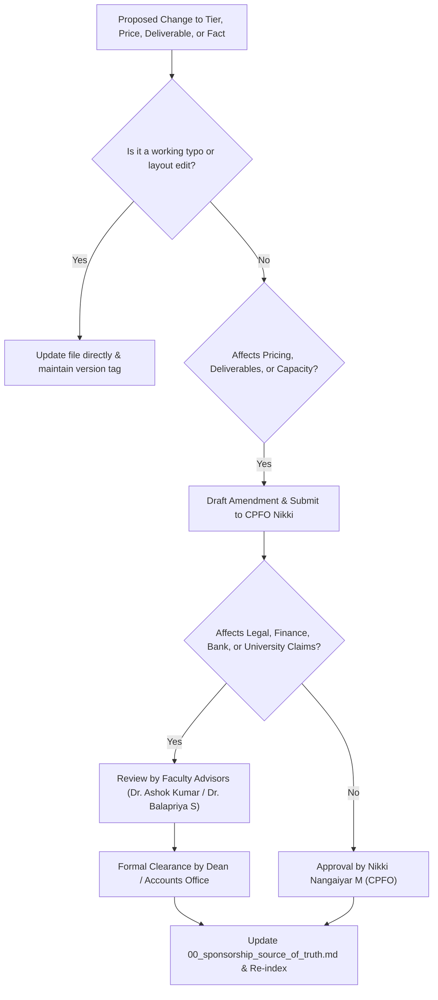

# KAIROS 2027 — Sponsorship Source of Truth & Decision Register

> **Document Status:** CANONICAL SOURCE OF TRUTH (LOCKED & CONTROLLED)  
> **Audience:** Sponsorship Team, Event Leadership, Faculty Advisors, Institutional Reviewers  
> **Direct Owner:** Nikki (Nangaiyar M), Chief Partnerships & Finance Officer (CPFO) & Sponsorship Lead  
> **Approved By:** Pending Final Institutional Ratification  
> **Current Working Date:** 17 October 2026  
> **Target Event Dates:** 22–24 January 2027 (Grand Finale) | 02–04 January 2027 (Online Qualifier)  
> **Dependencies:** [Master README](./README.md) · [Strategy & Packages](./01_sponsorship_strategy_and_package_matrix.md) · [Finance Controls](./05_finance_controls_and_pipeline_review.md)

---

## 1. Purpose and Governance Authority

This document is the **single authoritative source of truth** for all facts, operational parameters, package tiers, pricing models, and financial policies governing the Sponsorship and Corporate Partnerships division of KAIROS 2027.

1. **Hierarchy of Authority:** If any statement, package price, slot count, or deliverable in another sponsorship document contradicts this file, **this file takes precedence**.
2. **Change Control Protocol:** No changes to tier prices, package deliverables, capacity numbers, or legal commitments may be made without written sign-off from both:
   - **Sponsorship Lead:** Nikki (Nangaiyar M), Register No: `44612059`
   - **Faculty Coordinator / Institutional Signatory:** Dr. K. Ashok Kumar / Dr. Balapriya S / Dean, School of Computing
3. **External vs. Internal Use Rules:** Only facts marked **`[Verified]`** or **`[Approved Plan]`** may appear in external proposals, pitch decks, and corporate correspondence without caveat. Items marked **`[Target / Forecast]`**, **`[Prospect / Proposed]`**, or **`[APPROVAL REQUIRED]`** must be explicitly qualified or kept internal.

---

## 2. Fact Verification and Status Taxonomy

All operational claims across the sponsorship workspace must adhere strictly to these defined status labels:

| Status Label | Formal Definition | External Pitch Permissibility |
|---|---|---|
| **Verified** | Supported by a primary authoritative document or institutional approval artifact currently in the repository. | Permitted directly without caveat. |
| **Approved Plan** | Formally ratified by faculty advisors or the student organizing committee as the official execution roadmap. | Permitted as planned event specification. |
| **Target / Forecast** | An operational or outreach aspiration; not an achieved result or binding commitment. | Permitted ONLY when explicitly identified as a goal (e.g., "Targeting 2,000+ applicants"). |
| **Prospect / Proposed** | A prospective partner organization or custom package being pitched; no commitment exists. | Permitted ONLY in internal trackers; NEVER state as confirmed partner. |
| **In Discussion** | Active corporate communication underway, evidenced by dated meeting minutes or written correspondence. | Strictly Internal; never claim as partner in marketing collateral. |
| **Committed** | Backed by a countersigned Memorandum of Understanding (MoU) or formal written corporate authorization. | Permitted for public announcement once MoU execution conditions are met. |
| **Paid / Received** | Backed by verified bank credit receipt or finance-authorized transaction voucher into the university account. | Permitted in financial accounting and audited reports. |
| **Delivered** | Deliverable executed on-ground and verified with physical Proof of Performance (PoP) photographic/digital artifacts. | Permitted in post-event ROI reports. |
| **[APPROVAL REQUIRED]** | Policy, pricing, legal term, or institutional mechanism awaiting formal university administration sign-off. | Strictly prohibited from external publication until resolved. |
| **[VERIFY]** | Working parameter requiring confirmation against official university records or external registries. | Internal review flag; qualify with caveats if referenced. |

---

## 3. Canonical Working Facts (Baseline vs. Unverified)

The following parameters represent the verified working baseline for KAIROS 2027. Any deviation must be submitted to the decision register.

| Dimension | Working Parameter | Status | Evidence / Source Authority | External Use Guidance |
|---|---|---|---|---|
| **Event Name** | KAIROS 2027 (Grand Edition) | **Approved Plan** | Apex Chapter Charter, SIST | Canonical title for all documentation. |
| **Organizing Chapter** | AWS Student Builder Group — SIST Chapter | **Verified** | Amazon Web Services Student Builder Groups Program | Authorized organizing student chapter. |
| **Host Institution** | Sathyabama Institute of Science and Technology (Deemed to be University), Chennai | **Verified** | Institutional Charter, NAAC A++ accreditation | Always cite official institutional eminence. |
| **Event Venue** | Sathyabama Indoor Stadium (Indoor Auditorium), Chennai | **Approved Plan** | `DOC-20 (Indoor Auditorium Transition & Budget Plan)` | Primary physical venue; capacity ~2,500 seats. |
| **Grand Finale Dates** | 22–24 January 2027 (48 Hours continuous) | **Approved Plan** | Master Hackathon Blueprint | Working dates; subject to university academic calendar approval. |
| **Online Qualifier Dates** | 02–04 January 2027 (48 Hours virtual sprint) | **Approved Plan** | Qualifier Evaluation Framework | Virtual qualifier filtering applicants to Top 100 teams. |
| **Application Window** | 15 October – 15 December 2026 | **Approved Plan** | Event Schedule | Planned registration timeline. |
| **Participant Fee** | ₹0 (100% Free Entry, Boarding, and Buffet Meals) | **Approved Plan** | Student Accessibility Charter | Core value pillar; non-negotiable meritocratic model. |
| **Audience Scale (Finalists)** | 100 Teams (Teams of 4–6 students, ~400–600 Finalists) | **Approved Plan** | Venue Allocation Plan | Confirmed capacity limit of Indoor Stadium floor. |
| **Applicant Pool** | 2,000+ Students Nationwide (Target) | **Target / Forecast** | Outreach Strategy Projection | Must label as "Projected National Applicant Target". |
| **Working Capital Target** | ₹3,50,000 – ₹4,00,000 | **Target / Forecast** | `DOC-03 (Budget & Financial Tracker)` | Core operational budget baseline; uncapped ceiling. |
| **Pure Cash Prize Pool** | ₹1,75,000 Total Escrow | **Approved Plan** | Prize Architecture Specification | Guaranteed cash pool to be held in university escrow. |
| **Prize Breakdown** | 1st: ₹60k, 2nd: ₹35k, 3rd: ₹20k, 5 Tracks: ₹7k each (₹35k), Bounties: ₹25k | **Approved Plan** | Prize Model | Strict cash prize allocation. |
| **Sponsorship Lead** | Nikki (Nangaiyar M), Reg: `44612059` | **Verified** | `DOC-18 (Master Workforce Deployment)` | Sole operational head of sponsorship. |
| **Apex Chapter Lead** | Thenappan T, Reg: `44110855` | **Verified** | AWS SBGL Student Lead | Chapter President & Institutional Representative. |
| **Faculty Coordinators** | Dr. K. Ashok Kumar & Dr. Balapriya S, Dept of CSE | **Verified** | Department of CSE, SIST | Institutional endorsement and university approval leads. |
| **Institutional Signatory** | Dean, School of Computing / Registrar, SIST | **[APPROVAL REQUIRED]** | University Delegation Policy | Required signatory for legal corporate MoUs. |
| **University Bank Account** | Indian Bank, SIST Branch (IFSC: `IDIB000S201`) | **[VERIFY BEFORE USE]** | Existing documentation | Bank details must be verified by University Accounts Office prior to sending formal invoice. |

---

## 4. Prioritized Decision Register

The following operational decisions are currently unresolved or pending institutional sign-off. Each item has a proposed default recommendation to keep operations moving without overstepping authority.

| Ref # | Decision Topic | Why It Matters | Recommended Default | Approver | Deadline | Status |
|:---:|---|---|---|---|:---:|:---:|
| **DEC-01** | **Tier Pricing & Capital Arithmetic** | Sum of individual tier targets (₹2L Title + ₹1L Co-Powered + ₹1.25L Tracks + ₹50k Grant = ₹4.75L) exceeds ₹3.5L–₹4.0L base budget. | Adopt the **Calibrated Base Scenario** (₹3.75L cash target: 1 Title @ ₹1.5L–₹2.0L OR 2 Co-Powered @ ₹1.0L + 3–4 Tracks @ ₹25k + ₹50k University Grant). Treat additional inflows as scale contingency. | Nikki & Thenappan T | 25 Oct 2026 | `[APPROVAL REQUIRED]` |
| **DEC-02** | **Co-Powered By Slot Limit** | Previous documents alternately cite 1 slot or 1–2 slots, creating potential exclusivity conflicts. | Cap at **maximum 2 non-competing slots** (e.g., 1 Cloud/Infrastructure + 1 Enterprise SaaS/FinTech). No direct industry competitors. | Nikki (CPFO) | 22 Oct 2026 | `[APPROVAL REQUIRED]` |
| **DEC-03** | **Rainmaker Referral Bounty Policy** | Prior README described an unapproved 10%–15% cash commission model for students sourcing sponsors. This carries legal, tax, and university code-of-conduct risks. | **Quarantine immediately.** Do not offer cash commissions to students. Replace with official recognition (Letters of Commendation, VIP Passes, Stage Awards, Swag Kits) pending formal written approval from University Finance. | Registrar / Finance Officer | 30 Oct 2026 | `[APPROVAL REQUIRED — DO NOT OFFER]` |
| **DEC-04** | **Student Data & Resume Access** | Blanket promises of "unrestricted access to 2,000+ student resumes and GitHubs" violate privacy norms and university policy. | Transition to a **Consent-Based Opt-In Talent Book**. Only participants who explicitly opt in during registration/qualifier share contact and resume data with specific tier sponsors. | Faculty Advisors & Dean | 25 Oct 2026 | `[APPROVAL REQUIRED]` |
| **DEC-05** | **Institutional Invoice & Bank Routing** | Corporates require GST-compliant invoices and specific beneficiary name verification before disbursing funds. | Mandate that all funds route via official Sathyabama University Accounts Office. Provide bank placeholders in draft MoUs until University Accounts Office issues formal payment requisition. | Accounts Officer, SIST | 28 Oct 2026 | `[APPROVAL REQUIRED]` |
| **DEC-06** | **In-Kind Valuation Standard** | In-kind contributions (cloud credits, energy drinks, software licenses) cannot be counted towards cash operational expenses (food, stage, prize money). | Enforce strict separation in accounting: Cash sponsorship vs. In-kind fair market value. In-kind value is reported as "Estimated Partner In-Kind Value" and never blended into the liquid operational pool. | Treasury Sub-Head & Nikki | 22 Oct 2026 | `[Approved Plan]` |
| **DEC-07** | **Title Partner Exclusivity Boundary** | Defining whether Title Partner has complete category exclusivity (e.g., if AWS is Title, can another cloud vendor partner?). | Title Partner receives **Naming Rights & Category Exclusivity** in their core product domain (e.g., Primary Cloud Provider). Non-competing enterprise platforms may join at lower tiers. | Nikki & Faculty Advisors | 25 Oct 2026 | `[APPROVAL REQUIRED]` |
| **DEC-08** | **Participant Code & IP Protection** | Guaranteeing student ownership of hackathon creations protects event reputation and builder participation. | Reaffirm: **100% Student IP Ownership**. Sponsors receive right of first interview/hiring and may negotiate commercial licenses independently post-event, but obtain zero automatic ownership of participant code. | Faculty Advisors | 20 Oct 2026 | `[Approved Plan]` |

---

## 5. Inconsistency & Conflict Register across Repository

This register documents historical discrepancies identified across legacy files, along with the reconciled standard enforced in this operating system.

| Conflict Area | Legacy Document Location | Historical Contradiction | Canonical Reconciled Fact | Action Taken / Required |
|---|---|---|---|---|
| **Venue Name** | `pitch_decks/README.md` (Line 36) | Refers to "Sathyabama Central Library venue" | Venue is confirmed as **Sathyabama Indoor Stadium (Indoor Auditorium)** | Updated in pitch deck specifications and all active collateral. |
| **Presentation Theme** | `pitch_decks/README.md` (Line 20) | Refers to Electric Violet (`#A855F7`) and 11 slides | Canonical corporate pitch is **14 Slides** in Obsidian Dark (`#0D1117`) and Amber (`#D97706`) | Aligned with corporate branding standards in [Deck Kit](./03_pitch_deck_and_sponsor_meeting_kit.md). |
| **Closed-Won Status** | `company_leads_tracker/corporate_sponsorship_pipeline_crm.md` | JetBrains marked as `STAGE 6: CLOSED WON (₹1,25,000)` | No signed agreement or cash receipt exists in repo; licenses are educational in-kind. | Reset to `Prospect / In-Kind Discussion — [VERIFY]`; removed ₹1.25L from cash ledger. |
| **Fulfillment Checkboxes** | `sponsor_deliverables_and_assets/sponsor_benefit_fulfillment_checklist.md` | Pre-filled checkboxes showing AWS, Presidio, Zoho, Freshworks, Red Bull as partially approved/delivered | These are prospective targets, not executed contracts. | Table reset to operational blank; moved targets to prospective pipeline tracker. |
| **Outreach Task Dates** | `corporate_sponsorship_pipeline_crm.md` | Action deadlines listed in September & early October 2026 (past dates) | Current working date is **17 October 2026**. | Flagged as overdue; reset into active 7-day sprint priorities. |
| **Bank Account Publication** | `non_tech_corporate_sponsorship_proposal_letter.md` & `signed_mous_and_contracts/README.md` | Published specific Indian Bank account and IFSC details without university accounts disclaimer | Bank details must be confirmed by university finance before external transmission. | Replaced with verification placeholders and official accounts office routing steps. |
| **Referral Commissions** | Team `README.md` (Section 2.1) | Detailed "Rainmaker Bounty" with 10%–15% cash commissions to students | Unapproved by university administration; severe regulatory/tax risks. | Quarantined as `[APPROVAL REQUIRED — DO NOT OFFER]`. Removed from active proposals. |

---

## 6. Sponsorship Change Control & Approval Workflow

1. **Tier Price or Benefit Modification:** Requires written concurrence of CPFO Nikki and President Thenappan T.
2. **Legal Terms & Institutional Commitments:** Requires review by Faculty Coordinators and clearance from Dean / University Legal Officer.
3. **Financial Escrow & Invoicing Procedures:** Requires direct confirmation from Sathyabama Institute Accounts Office.
