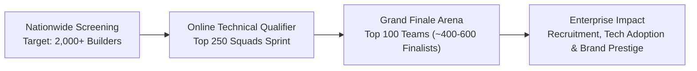
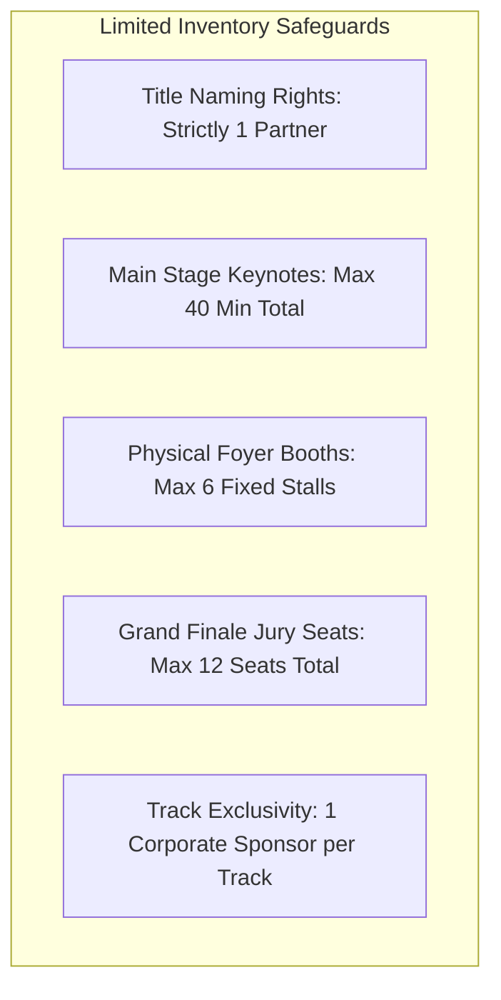

# KAIROS 2027 — Sponsorship Strategy & Package Matrix

> **Document Status:** WORKING SPECIFICATION (`[APPROVAL REQUIRED]` for final prices & slots)  
> **Audience:** Sponsorship Team, Executive Council, Prospective Enterprise Partners  
> **Direct Owner:** Nikki (Nangaiyar M), Sponsorship Team Lead  
> **Source of Truth:** [`00_sponsorship_source_of_truth.md`](./00_sponsorship_source_of_truth.md)  
> **Last Updated:** 17 October 2026 | **Event Working Dates:** 22–24 January 2027

---

## 1. Executive Value Proposition & Audience Segmentation

KAIROS 2027 is the national flagship 48-hour continuous student hackathon hosted by the AWS Student Builder Group (SIST Chapter) at Sathyabama Institute of Science and Technology, Chennai. Operating under an uncompromising **100% Free / Zero Entry Fee** mandate, the event guarantees pure meritocracy while providing enterprise partners with high-density access to top builder talent.



### Why Corporate Enterprises Partner with KAIROS 2027

1. **Pre-Filtered Engineering Density:** Unlike massive open-registration job fairs, corporate partners interface with the top 5% of student builders in the country. Finalist squads undergo a rigorous 48-hour online qualifier featuring code submission, Loom architecture demonstrations, and live jury interviews before being invited to the physical arena.
2. **Deep Developer Tech Adoption:** Companies can integrate their proprietary LLMs, foundation models, APIs, SDKs, or cloud services as flagship track challenges. Over 400+ developers actively stress-test and build production-grade prototypes on your stack for 48 continuous hours.
3. **High-Trust Talent Engagement:** Connect with top engineering talent through structured tech talks, jury evaluation, booth interactions, and opt-in talent books—eliminating the noise of standard resume dumps.
4. **Authentic Campus & Digital Reach:** Generate high-impact visibility across 120+ colleges in 20+ Indian states, amplified by an active campus ambassador network and a multi-camera live stream broadcast.

### Sponsor Motivations & Fit Criteria

| Corporate Segment | Primary Motivation | Best-Fit Package / Engagement Model | Fit Criteria & Disqualifiers |
|---|---|---|---|
| **Cloud, Foundation AI & DevTools** | Developer advocacy, API adoption, platform benchmarking, ecosystem evangelism. | **Title Sponsor** or **Co-Powered By**; dedicated track challenge. | **Fit:** Scalable developer APIs, developer tools.<br/>*Disqualifier:* No developer sandbox or technical support. |
| **Enterprise SaaS, BFSI & Tech Platforms** | Recruitment of top full-stack, cloud-native, and AI engineers; brand positioning. | **Co-Powered By** or **Track Partner** (FinTech, Agentic AI, Cloud-Native). | **Fit:** Active graduate/internship hiring charters.<br/>*Disqualifier:* Pure marketing agency with no tech presence. |
| **Recruitment & Talent Consultancies** | Pipeline discovery, direct evaluation of team problem-solving under stress. | **Associate Partner** + Opt-In Candidate Book Access. | **Fit:** Verified hiring mandates for entry-level tech talent.<br/>*Disqualifier:* Third-party lead aggregators seeking to scrape data. |
| **FMCG, Energy, Nutrition & Lifestyle** | High-energy product sampling, Gen-Z brand immersion, 48-hour physical engagement. | **Official In-Kind Energy / Fuel Partner**; booth activations. | **Fit:** Ready-to-consume beverages, snacks, student lifestyle products.<br/>*Disqualifier:* Unhealthy or non-permitted products under university policy. |
| **Corporate Foundations & CSR Divisions** | Supporting diversity in tech, underprivileged student innovators, zero-fee meritocracy. | **Special Category Bounty Endowments** (Women in Tech, First-Gen Builders). | **Fit:** Alignment with UN SDGs 4, 8, 9, and institutional CSR guidelines.<br/>*Disqualifier:* Requires commercial advertising return on CSR funds. |

---

## 2. Master Sponsorship Package Matrix

> [!NOTE]
> All tier pricing and slot counts represent proposed working parameters pending final administrative ratification (`[APPROVAL REQUIRED]`). Deliverables are designed with hard capacity limits to prevent over-promising.

| Deliverable Dimension | Title Presenting Partner | Co-Powered By Partner | Associate Partner | Track Bounty Partner | In-Kind / Fuel Partner |
|---|:---:|:---:|:---:|:---:|:---:|
| **Proposed Investment** | **₹2,00,000** | **₹1,00,000** | **₹50,000** | **₹25,000** | **Goods / Services Equivalent** |
| **Proposed Slot Limit** | **1 Slot (Exclusive)** | **Max 2 Slots** | **Max 4 Slots** | **5 Slots (1 per Track)** | **2–3 Category Partners** |
| **Approval Status** | `[APPROVAL REQUIRED]` | `[APPROVAL REQUIRED]` | `[APPROVAL REQUIRED]` | `[APPROVAL REQUIRED]` | `[Approved Plan]` |
| **Naming Rights Lockup** | *"KAIROS 2027 Presented by [Brand]"* | *"KAIROS 2027 Co-Powered by [Brand]"* | *"Official Associate Partner"* | *"[Brand] Track Partner"* | *"Official [Product] Partner"* |
| **Main Stage LED Wall (3840×1920)** | Sole Prominent Center Crest | Large Side Flanking Logo | Grid Placement Logo | Rotating Lower Third | Rotating Break Slide |
| **Stage Backdrop (20×10 ft)** | Hero Header Crest (35% surface) | Sub-Hero Crest (20% surface) | Footer Grid Placement | Track Specific Banner | Shared Footer Grid |
| **Rollup Standees (16 Total)** | Logo on all 16 Units | Logo on 10 Units | Logo on 4 Units | Logo on Track Standee | Logo on 2 Food/Lounge Units |
| **Auditorium Speaking Slot** | 20-Min Keynote (Inauguration) | 10-Min Session (Plenary) | — | 5-Min Track Intro | — |
| **Evaluation Jury Seats** | 2 VIP Grand Finale Jury Seats | 1 VIP Grand Finale Jury Seat | Virtual Screening Reviewer | 1 Dedicated Track Jury Seat | Product Experience Judge |
| **Talent & Recruitment Engagement** | Opt-In Finalist Book + Priority Interview Room | Opt-In Finalist Book + Shared Interview Desk | Opt-In Finalist Directory | Opt-In Track Finalist Resumes | Networking Foyer Access |
| **Live Stream Commercial Stingers** | 30s Video Stinger (every 2h) | 15s Video Stinger (every 4h) | Static Digital Slide | Lower-Third Ticker Mention | Product Placement Mention |
| **Physical Exhibition Space** | 10×10 ft Experiential Lounge | 6×6 ft Foyer Exhibition Kiosk | Tabletop Space in Foyer | Tabletop Space in Foyer | Sampling Station / Chiller |
| **Custom Problem Bounties** | Right to Anchor Grand Champion | Co-Endow Challenge Bounty | Standard Track Bounties | Endow ₹7,000+ Track Bounty | Swag Drop for Track Winners |
| **Operational Delivery Owner** | Nikki (Sponsorship Lead) & Rikish B (Design Lead) | Enterprise Outreach Sub-Head | Outreach Squad | Track Partnerships Sub-Head | Logistics & Hospitality Lead |
| **Fulfillment Deadline** | Assets by 20 Dec 2026 | Assets by 20 Dec 2026 | Assets by 25 Dec 2026 | Problem Brief by 28 Dec 2026 | Delivery by 21 Jan 2027 |

---

## 3. Inventory Constraints & Anti-Double-Selling Rules

To safeguard sponsor trust and institutional integrity, the following physical and digital inventory caps are strictly enforced:



1. **Title Exclusivity & Category Lock:** Only **ONE** Title Presenting Partner will be contracted. The Title Partner receives category exclusivity in their primary sector (e.g., if a cloud hyperscaler is Title, no competing hyperscaler may purchase Title or Co-Powered tier).
2. **Keynote Speaking Time Budget:** The Inaugural Ceremony agenda allocates a maximum of **40 total minutes** for corporate addresses:
   - Title Partner: 20 minutes maximum.
   - Co-Powered Partners: 10 minutes maximum each (up to 2 partners).
   - No speaking slots will be sold or promised outside this budget.
3. **Physical Exhibition Booth Capacity:** Sathyabama Indoor Stadium entrance foyer accommodates a maximum of **six (6) branded physical stalls** (one 10×10 ft lounge for Title, two 6×6 ft kiosks for Co-Powered, and three tabletop stations for Associate/Track partners). No additional booths may be sold without written operations clearance.
4. **Jury Seat Limits:** The Grand Finale Plenary Evaluation Panel is capped at **twelve (12) total evaluators** (4 Institutional Academic Chairs, 4 Independent Industry/AWS Community Builders, 2 Title Partner Delegates, and 2 Co-Powered Partner Delegates). Track-specific juries are capped at 3 evaluators per track.
5. **No Double-Selling of Tracks:** Each of the 5 technical tracks (Agentic AI, Cloud-Native, Web3, FinTech, Healthcare) may have only **one (1) exclusive corporate naming partner**.

---

## 4. Cash vs. In-Kind Separation & Valuation Rules

> [!WARNING]
> In-kind contributions cannot be spent on food, generators, prize money, or physical printing. **Never mix in-kind estimated value with cash budget accounting.**

| In-Kind Category | Acceptable Items | Valuation Methodology | Accounting Treatment |
|---|---|---|---|
| **Cloud Credits & Sandboxes** | AWS Bedrock / Compute Credits, API Credits | Official retail public pricing value of allocated credits. | Recorded as *Non-Cash Developer Tooling Value*; excluded from cash operational budget. |
| **Software Licenses** | IDE vouchers, API subscriptions, design software | Manufacturer’s suggested retail price (MSRP) for educational/pro tiers. | Recorded as *Educational In-Kind Grant*; zero cash credit. |
| **F&B and Nutrition Products** | Energy drinks, ready-to-drink coffee, snack bars | Wholesale cost of goods or retail value of delivered units. | Offsets catering line items *only if* it directly replaces a budgeted food/beverage expense. |
| **Hardware & Dev Kits** | Microcontrollers, IoT sensor kits, edge devices | Invoice value of borrowed or donated evaluation hardware. | Recorded as *Hardware Loan / Lab Grant*; returned or gifted as track prizes. |
| **Student Merchandise & Swag** | T-shirts, stickers, notebooks, branded backpacks | Verified manufacturing cost per unit delivered. | Offsets swag budget line items *only if* it meets Division 2 design quality specs. |

---

## 5. Funding Scenarios & Target Arithmetic

The operational expense target for KAIROS 2027 is **₹3,50,000 – ₹4,00,000**. Because corporate deal cycles carry natural variance, the team operates under three calibrated funding scenarios.

```
SCENARIO ARITHMETIC AT A GLANCE:
─────────────────────────────────────────────────────────────────────────────
• Conservative Baseline:  ₹2,50,000 Cash Inflow  (Core survival budget)
• Balanced Target Model:  ₹3,75,000 Cash Inflow  (Full operational delivery)
• Optimized Growth Model: ₹5,00,000 Cash Inflow  (Expanded prizes & perks)
─────────────────────────────────────────────────────────────────────────────
```

### Scenario Breakdown

| Funding Stream | Conservative Scenario (₹2.5L) | Balanced Target Model (₹3.75L) | Optimized Growth Model (₹5.0L) |
|---|:---:|:---:|:---:|
| **Title Sponsor** | ₹1,50,000 (1 discounted slot) | ₹2,00,000 (1 full slot) | ₹2,00,000 (1 full slot) |
| **Co-Powered By** | ₹0 (No tier closed) | ₹1,00,000 (1 slot closed) | ₹2,00,000 (2 slots closed) |
| **Associate Partners** | ₹0 | ₹0 | ₹50,000 (1 slot closed) |
| **Track Partners** | ₹50,000 (2 tracks @ ₹25k) | ₹75,000 (3 tracks @ ₹25k) | ₹1,00,000 (4 tracks @ ₹25k) |
| **Institutional University Grant** | ₹50,000 | ₹50,000 | ₹50,000 |
| **TOTAL LIQUID CASH INFLOW** | **₹2,50,000** | **₹3,75,000** | **₹5,50,000 (Capped at ₹5.0L Target)** |
| **Estimated Partner In-Kind Value** | *~$10,000 Credits + In-Kind* | *~$50,000 Credits + Fuel* | *~$100,000 Credits + Tooling + Fuel* |

### Expense Balancing Rules:
- If inflows equal the **Conservative Model (₹2.5L)**: Prize pool is protected at ₹1,75,000; catering, merchandise, and AV production are trimmed to baseline specifications.
- If inflows equal the **Balanced Target Model (₹3.75L)**: All budgeted operational line items (streetwear hoodies, smart badges, 6 buffet meals, high-density power failover) execute as designed.
- If inflows reach the **Optimized Model (₹5.0L+)**: Surplus funds are allocated to scale travel subsidies for outstation finalist teams, expanded track bounties, and contingency reserves.

---

## 6. Sponsor Customization Worksheet

When engaging enterprise prospects with specialized marketing or recruitment goals, use this worksheet to structure tailored proposals without violating core event policies.

```text
================================================================================
KAIROS 2027 — SPONSOR PACKAGE CUSTOMIZATION WORKSHEET
================================================================================
Date: [YYYY-MM-DD]                 Lead Owner: [Name & Contact]
Prospective Sponsor: [Company Name] Target Tier: [Title / Co-Powered / Track / In-Kind]

1. PRIMARY SPONSOR OBJECTIVE:
   [ ] Developer Relations / Technical API Adoption
   [ ] Graduate / Internship Engineering Recruitment
   [ ] Brand Equity / C-Suite Thought Leadership
   [ ] Corporate Social Responsibility (CSR) / Diversity in Tech
   [ ] Product Sampling / Gen-Z Consumer Immersion

2. SELECTED PACKAGE BASELINE:
   Base Package Tier: ________________________ Base Price: ₹ _________________

3. CUSTOM DELIVERABLES REQUESTED:
   Deliverable Description               Feasibility (Operations Check)  Agreed (Y/N)
   a) ________________________________   [Checked with Lead: ________]   [ ]
   b) ________________________________   [Checked with Lead: ________]   [ ]
   c) ________________________________   [Checked with Lead: ________]   [ ]

4. NON-NEGOTIABLE EXCLUSIONS & BOUNDARIES VERIFIED:
   [x] Participant Code & IP remains 100% owned by student builders.
   [x] Student personal contact data shared strictly via opt-in consent book.
   [x] Commercial funds route exclusively through verified institutional bank account.
   [x] No unapproved stage speaking slots outside official ceremony agendas.

5. PROOF OF PERFORMANCE (PoP) METRICS COMMITTED:
   Deliverable                           Measurable Evidence Artifact
   - Stage Logo Placement                High-res DSLR photo of 3840x1920 LED Wall
   - Keynote Address                     Video recording + multi-cam live stream timestamp
   - Exhibition Stall                    Photo of branded booth with participant crowd
   - API / Track Challenge               GitHub repository links of teams using sponsor API
   - Talent Engagement                   Opt-in candidate book dispatch confirmation

6. APPROVAL SIGN-OFF:
   Sponsorship Lead Approval: Nikki (Nangaiyar M) [ ]   Faculty Clearance: Dr. K. Ashok Kumar [ ]
   Commercial Value: ₹ _________________        Agreement Due Date: ___________________
================================================================================
```
