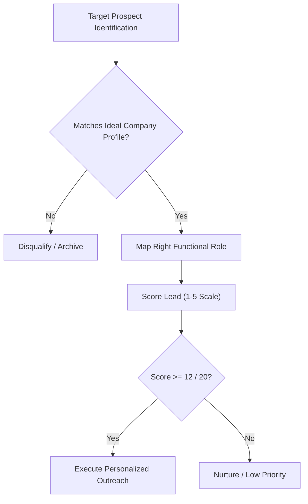
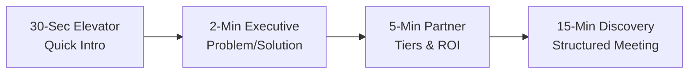

# KAIROS 2027 — Prospecting, Outreach & Negotiation Playbook

> **Document Status:** OPERATIONAL FIELD PLAYBOOK  
> **Audience:** Sponsorship Lead (Nikki), Enterprise Outreach Squad, Chapter Leadership  
> **Direct Owner:** Nikki (Nangaiyar M), Chief Partnerships & Finance Officer (CPFO)  
> **Source of Truth:** [`00_sponsorship_source_of_truth.md`](./00_sponsorship_source_of_truth.md)  
> **Current Working Date:** 17 October 2026 | **Event Working Dates:** 22–24 January 2027

---

## 1. Ideal Prospect Profile (ICP) & Research Checklist

To ensure high outreach conversion and maintain developer credibility, the sponsorship team targets companies fitting distinct strategic profiles:



### Ideal Company Categories:
1. **Developer Tooling & Cloud Platforms:** Companies building APIs, foundation models, developer infrastructure, database engines, or security frameworks seeking developer adoption.
2. **High-Growth Enterprise Tech & BFSI:** Corporations with active graduate hiring, summer internships, or leadership acceleration programs in engineering.
3. **Consumer, Energy & Lifestyle Brands:** Youth-centric FMCG, beverage, snack, audio, or lifestyle brands seeking 48 hours of physical engagement with Gen-Z student leaders.
4. **Corporate Social Responsibility (CSR):** Foundations focused on technical education, diversity in STEM, or open-source community development.

### Lead Research Checklist & Role Mapping
Before sending any email or LinkedIn message, verify these data points:
- [ ] **Organization Domain & Sector:** Confirm current product releases and engineering priorities.
- [ ] **Appropriate Functional Roles:** Do NOT invent contacts. Look for verifiable corporate titles on LinkedIn, corporate press releases, or GitHub:
  - *DevRel / Developer Marketing:* Head of Developer Relations, Developer Community Manager, Technical Evangelist.
  - *Engineering Leadership:* VP of Engineering, Chief Technology Officer (CTO), Director of Cloud Architecture.
  - *Talent & Campus Recruitment:* Head of University Relations, Lead Campus Recruiter, Director of Talent Acquisition.
  - *Brand Marketing & CSR:* Chief Marketing Officer (CMO), Head of Brand Partnerships, CSR Director.
- [ ] **Public Source Citation:** Record the source URL (e.g., public company leadership page, official press release) and access date in the CRM.
- [ ] **Past University Engagement:** Note whether the organization has sponsored student hackathons, open-source grants, or college conferences in the past 12 months.

---

## 2. Practical 5-Dimension Lead Scoring Rubric

Evaluate every prospect on a 1–4 scale across five criteria (Maximum Score: 20 points):

| Dimension | 1 Point (Poor Fit) | 2 Points (Moderate Fit) | 3 Points (Strong Fit) | 4 Points (Apex Fit) |
|---|---|---|---|---|
| **1. Strategic Alignment** | No developer or tech focus; non-aligned product. | Broad consumer focus; minimal direct tech overlap. | Tech company or enterprise with software engineering division. | Cloud, AI, or developer platform with active developer ecosystem programs. |
| **2. Budget & Authority** | Small local business; no established sponsorship budget. | Early startup (<$2M raised); limited discretionary marketing funds. | Mid-market tech firm; defined annual campus/event budget. | Enterprise / Multinational with dedicated DevRel, CSR, or campus recruitment budget. |
| **3. Timing & Readiness** | Q1 budget already frozen or event dates conflict. | Unknown budget cycle; prolonged procurement process. | Q1 budget review matches Oct–Nov outreach cycle. | Active Q4/Q1 campaign seeking immediate student or developer engagement. |
| **4. Value Exchange** | Seeking free brand exposure with zero mutual benefit. | Willing to provide minimal swag or low-value stickers only. | Interested in track bounty or in-kind developer tooling credits. | Direct alignment on cash sponsorship (Title/Co-Powered) + deep tech adoption. |
| **5. Reachable Decision-Maker** | Generic info@ / contact-us form only; zero direct leads. | Distant corporate contact; no regional Indian presence. | 2nd-degree connection or verified corporate email of functional lead. | Warm alumni introduction or direct direct contact with active decision-maker. |

### Scoring Guidance:
- **16–20 Points (Tier 1 Priority):** Immediate personalized outreach by CPFO Nikki; target 15-minute discovery call within 48 hours.
- **12–15 Points (Tier 2 Priority):** Standard personalized outreach via Enterprise Squad; follow up within 4 business days.
- **< 12 Points (Tier 3 / Archive):** Nurture through automated campaign or defer to in-kind / track partner outreach.

---

## 3. Outreach Communication Templates

> [!IMPORTANT]
> Always replace `[PLACEHOLDER]` brackets with verified research. Do not send raw template tags. Avoid manufactured urgency, fake scarcity, or exaggerated claims.

### Template 1: First Cold Email (DevRel / Engineering Focus)

```text
Subject: Partnering with India's Top 100 Builder Squads — KAIROS 2027 (AWS SBG)

Dear [First Name],

I am writing from the AWS Student Builder Group at Sathyabama Institute of Science and Technology, Chennai. 

From January 22 to 24, 2027, our chapter is hosting KAIROS 2027 (Grand Edition)—a 48-hour continuous national hackathon bringing together the top 100 shortlisted student engineering squads (400–600 developers) selected from a projected applicant pool of 2,000+ builders across 20+ Indian states. 

Operating under a strict 100% Free / Zero Entry Fee model, the summit guarantees absolute meritocracy. Our finalists are filtered through an intensive 48-hour online qualifier featuring code submission and live technical interviews.

Given [Company Name]'s leadership in [Specific Tech Domain, e.g., Agentic AI / Developer APIs], we would welcome the opportunity to integrate your developer platform into our challenge tracks:
1. Technical Adoption: Over 400+ developers actively building and stress-testing prototypes on your stack for 48 continuous hours.
2. Talent Discovery: Direct, opt-in engagement with pre-vetted engineers specializing in Cloud-Native, Foundation AI, and Distributed Systems.
3. C-Suite & Brand Presence: High-visibility keynotes, dedicated foyer demo kiosks, and national live stream exposure.

Would you be open to a brief 15-minute introductory call this week to explore how we can align with [Company Name]'s Q1 developer and recruitment goals?

Best regards,

Nikki (Nangaiyar M)
Chief Partnerships & Finance Officer (CPFO) & Sponsorship Lead
AWS Student Builder Group — SIST Chapter
Phone: +91 8754976892 | Email: nangaiyarmuthkrishnan@gmail.com
Campus: Sathyabama Institute of Science and Technology, Chennai
Portal: https://kairos.sistawscc.org [VERIFY BEFORE USE]
```

---

### Template 2: Warm Introduction / Alumni Referral

```text
Subject: KAIROS 2027 Partnership — Introduction via [Referrer Name]

Dear [First Name],

[Referrer Name] recommended I connect with you regarding corporate engagement opportunities for student innovators. 

I head Corporate Partnerships for the AWS Student Builder Group at Sathyabama Institute of Science and Technology. On January 22–24, 2027, we are hosting KAIROS 2027, bringing 100 elite student engineering teams (~400–600 finalists) to our campus for a 48-hour continuous innovation sprint.

Because [Company Name] is pioneering [Specific Area], we would love to explore an official track partnership or campus recruitment engagement tailored to your team's objectives.

I have attached a brief one-page overview for your reference. Could we schedule a 10-minute sync this [Tuesday/Thursday] at your convenience?

Warm regards,

Nikki (Nangaiyar M)
Chief Partnerships & Finance Officer (CPFO)
AWS Student Builder Group — SIST Chapter | +91 8754976892
```

---

### Template 3: LinkedIn InMail / Connection Message (Character-Constrained)

```text
Hi [First Name] — Noticed your leadership in [DevRel/Talent] at [Company Name]. I lead partnerships for AWS Student Builder Group at Sathyabama. On Jan 22–24, 2027, we are hosting KAIROS 2027, convening 100 elite student engineering teams (400+ developers) for a 48-hour hackathon. We'd love to explore hosting a dedicated [Company Name] challenge track or recruitment booth. Open to a 10-min chat?
```

---

### Template 4: Follow-Up 1 (Day 4 — Value Add)

```text
Subject: Re: Partnering with India's Top 100 Builder Squads — KAIROS 2027 (AWS SBG)

Dear [First Name],

Following up on my note regarding KAIROS 2027. 

To give you a better sense of the technical rigor, our finalist squads are filtered from 2,000+ national applicants through a 48-hour online qualifier requiring working GitHub code and live Loom architecture demos. Zero vanity pitches.

If [Company Name] is looking to expand developer awareness for [Product/API] or recruit top-tier cloud/AI engineers in Q1, we can reserve a dedicated track challenge or workshop slot for your engineering team.

Would you have 10 minutes available this Thursday or Friday?

Best regards,

Nikki (Nangaiyar M) | +91 8754976892
```

---

### Template 5: Follow-Up 2 (Day 8 — Specific Proposal Angle)

```text
Subject: Re: Partnering with India's Top 100 Builder Squads — KAIROS 2027 (AWS SBG)

Dear [First Name],

I recognize your schedule is demanding. I wanted to share a specific partnership option that has resonated with other enterprise partners:

Our Dedicated Track Bounty Partner tier (₹25,000 or tool credit equivalent) allows [Company Name] to:
- Frame a custom challenge statement in our [Track Name, e.g., Agentic AI] track.
- Provide developer access to your APIs for 48 hours of hands-on building.
- Have a company engineer serve on the track evaluation panel.

Happy to share the track specification sheet if this aligns with your current priorities.

Best regards,

Nikki (Nangaiyar M) | +91 8754976892
```

---

### Template 6: Follow-Up 3 (Day 14 — Graceful Break-Up / Nurture Close)

```text
Subject: KAIROS 2027 Partnership — Closing the Loop

Dear [First Name],

I understand this may not be the optimal cycle for [Company Name] to partner with student hackathons given current quarterly commitments.

We will proceed with finalize our physical venue and collateral branding allocations by late December. If your priorities change or if you would like to explore campus recruitment for a later edition, please feel free to reach out.

Wishing you and the [Company Name] team continued success.

Warm regards,

Nikki (Nangaiyar M)
Chief Partnerships & Finance Officer (CPFO)
AWS Student Builder Group — SIST Chapter
```

---

### Template 7: Post-Discovery Call Recap & Action Plan

```text
Subject: Summary & Next Steps — KAIROS 2027 x [Company Name] Partnership

Dear [First Name],

Thank you for your time today. It was great discussing [Company Name]'s developer advocacy and talent objectives with you and [Colleague Name].

As discussed during our call, here is the agreed roadmap:
1. Proposed Engagement: [Tier Name, e.g., Co-Powered By / Track Bounty Partner]
2. Key Deliverables Aligned:
   - [Deliverable 1, e.g., Dedicated Track Challenge on Company APIs]
   - [Deliverable 2, e.g., 6x6 ft Foyer Exhibition Kiosk]
   - [Deliverable 3, e.g., 1 VIP Evaluation Jury Seat]
   - [Deliverable 4, e.g., Opt-in finalist candidate book access]
3. Investment Consideration: ₹ [Amount] (+ applicable university invoice terms)
4. Next Actions:
   - Our team: Deliver customized 14-slide proposal deck and draft MoU by [Date].
   - [Company Name] team: Review deliverables internally and confirm technical track brief by [Date].

Please let me know if I have missed any nuance from our discussion. Looking forward to partnering!

Best regards,

Nikki (Nangaiyar M) | +91 8754976892
```

---

## 4. Pitching Formats & Discovery Call Agenda

> [!NOTE]
> Do NOT use extended multi-hour presentations for corporate calls. Pitching formats must be concise, calibrated, and conversational. (The 2-hour speech deck in the repository is strictly for internal team motivation and training).



### The 30-Second Elevator Pitch
> *"KAIROS 2027 is India's premier 48-hour student hackathon hosted by the AWS Student Builder Group at Sathyabama Institute of Science and Technology. On January 22–24, 2027, we assemble the top 100 pre-screened student engineering teams—400+ builders—selected through a rigorous 48-hour online qualifier. Operating under a 100% free model, we provide enterprise sponsors with deep technical API adoption, direct opt-in talent engagement, and high-impact brand visibility across 20+ states."*

### The 2-Minute Executive Pitch
> Focus: Problem, Filtered Quality, Enterprise Value.
> 1. **The Context (30s):** Student hackathons often suffer from vanity projects and unfiltered crowds. KAIROS eliminates noise through a dual-phase funnel: 2,000+ national applicants filtered to 250 qualifier squads, down to the Top 100 elite squads on our Chennai campus.
> 2. **The Immersion (45s):** 48 hours of non-stop building across Agentic AI, Cloud-Native, Web3, FinTech, and Healthcare. Participants receive 100% free food, stay, and cloud sandboxes.
> 3. **The Partnership ROI (45s):** Corporate partners don't just put logos on banners. You can endow a challenge track on your proprietary APIs, evaluate prototypes on our jury, and connect directly with high-caliber graduating engineers via our consent-based talent book.

### Standard 15–20 Minute Corporate Discovery Call Agenda

| Minute Window | Agenda Topic | Goal & Discussion Prompt |
|---|---|---|
| **00:00 – 03:00** | Warm Welcome & Context Setting | Confirm meeting length, introduce AWS Student Builder Group charter, establish mutual agenda. |
| **03:00 – 08:00** | Discovery & Active Listening | Uncover sponsor priorities: *"What are your primary goals for developer relations and campus hiring this upcoming quarter?"* |
| **08:00 – 14:00** | Calibrated Solution Pitch | Map their objectives to a specific tier (Title, Co-Powered, Track, or In-Kind) using the [Package Matrix](./01_sponsorship_strategy_and_package_matrix.md). |
| **14:00 – 17:00** | Commercials, Approvals & Timeline | Explain university contracting workflow, deliverable milestones, and institutional bank routing. |
| **17:00 – 20:00** | Next Steps & Mutual Commitment | Agree on deliverable due date for customized deck and follow-up sync. |

---

## 5. Objection Handling & Negotiation Guardrails

```
NEGOTIATION COMPASS:
─────────────────────────────────────────────────────────────────────────────
• PROTECT AT ALL COSTS:  Participant 100% IP Ownership · Opt-In Data Privacy
• ALLOWED TO TRADE:      Extra banner placements · Additional jury seat
• ALLOWED TO DISCOUNT:   Max 10%–15% cash discount in exchange for multi-year MoU
• STRICTLY PROHIBITED:   Direct student resume dumps · Private cash/UPI routing
─────────────────────────────────────────────────────────────────────────────
```

### Common Corporate Objections & Response Battlecards

#### Objection 1: "We don't have budget for student college events this quarter."
- **Empathetic Pivot:** *"Understood. Many enterprise partners manage student engagement under different budget lines. Would this align better with your Campus Talent Acquisition budget for Q1 graduate hiring, or your Developer Marketing budget for API adoption?"*
- **Alternative Pathway:** *"If cash sponsorship is frozen, we would welcome exploring an Official Tooling or In-Kind Partnership—such as providing developer API credits, platform sandboxes, or software licenses for our 100 finalist squads."*

#### Objection 2: "Can you guarantee that 500+ participants will use our API?"
- **Honest Reality Check:** *"We believe in genuine developer adoption rather than forced, superficial usage. By anchoring an official challenge track with a dedicated bounty (e.g., ₹7,000+ pure cash prize), we typically see 15–25 elite teams build deep, production-grade architectures on your stack. Quality and depth of integration deliver far higher ROI than vanity API calls."*

#### Objection 3: "We want exclusive ownership of the intellectual property (IP) created by winning teams."
- **Non-Negotiable Boundary:** *"Under Sathyabama Institute of Science and Technology policy and our chapter charter, all software IP remains 100% the property of the student builders. However, as an official sponsor, your leadership receives right of first interview, priority hiring access, and the open gateway to negotiate commercial licensing or incubator support directly with the team post-event."*

#### Objection 4: "Can you provide us with a full Excel sheet of all 2,000 applicants with their phone numbers and resumes?"
- **Data Protection Guardrail:** *"To comply with institutional privacy policies and digital data protection standards, we do not perform unconsented personal data dumps. Instead, we provide an Opt-In Candidate Book containing detailed GitHub profiles, project portfolios, and resumes of participants who have explicitly consented to share their details with our corporate partners."*

#### Objection 5: "Your package price is too high compared to other college symposiums."
- **Value Justification:** *"Traditional college symposiums run 6-hour paper presentations for local students. KAIROS 2027 is a 48-hour continuous national hackathon with pre-screened teams from 20+ states, 100% free food and accommodation, an audited cash prize pool, and multi-camera live streaming. The depth of developer engagement over 48 hours is equivalent to a multi-week corporate sprint."*
