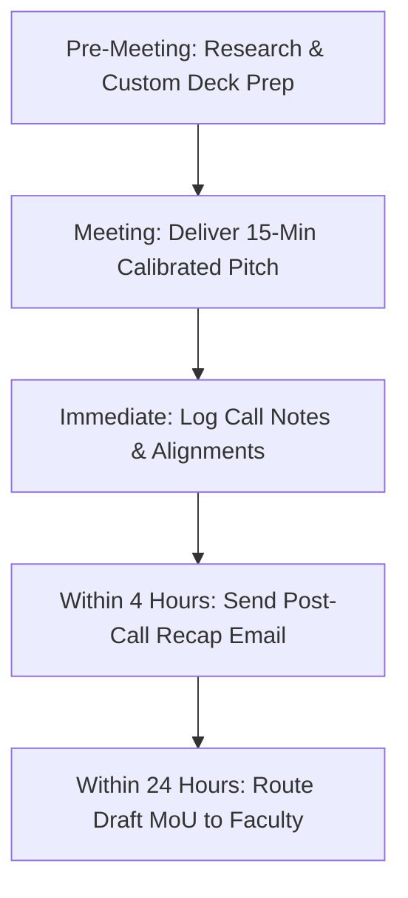

# KAIROS 2027 — Pitch Deck & Sponsor Meeting Kit

> **Document Status:** CANONICAL SPECIFICATION & MEETING OPERATING KIT  
> **Audience:** Sponsorship Pitchers, Executive Presenters (Nikki / Thenappan), Corporate Decision-Makers  
> **Direct Owner:** Nikki (Nangaiyar M), Chief Partnerships & Finance Officer (CPFO)  
> **Design Collaborator:** Rikish B (Design Lead)  
> **Source of Truth:** [`00_sponsorship_source_of_truth.md`](./00_sponsorship_source_of_truth.md)  
> **Current Working Date:** 17 October 2026 | **Event Working Dates:** 22–24 January 2027

---

## 1. Master 14-Slide Presentation Architecture

All corporate presentations must strictly follow this 14-slide narrative structure. Each slide is designed with a singular purpose, explicit visual suggestion, speaker note, and verification safeguards to ensure that claims remain evidence-backed.

```
SLIDE RUN ORDER AT A GLANCE:
─────────────────────────────────────────────────────────────────────────────
01. Hero Cover & Lockup         06. Corporate Sponsor ROI        11. Track Record & Credibility
02. Institutional Eminence      07. Calibrated Tier Matrix       12. Capital & Budget Blueprint
03. Two-Tier Quality Funnel     08. 48-Hour Experience & Ops     13. Onboarding & Contracting
04. Strategic Track Pillars     09. Broadcast Reach & Media      14. Executive Contacts & Desk
05. Pure Cash Prize Escrow      10. Governance & Safety
─────────────────────────────────────────────────────────────────────────────
```

---

### Slide 1: Hero Cover & Title Lockup
- **Purpose:** Establish developer prestige, institutional pedigree, and event grandeur within the first 5 seconds.
- **Headline:** `KAIROS 2027: THE GRAND HORIZON`
- **One Key Message:** India's Flagship 48-Hour Student Cloud & Agentic AI Hackathon.
- **Evidence / Verification:** Event dates (22–24 Jan 2027), host chapter (AWS SBG SIST), host university.
- **Visual Concept:** Deep Obsidian Abyss (`#0D1117`) background with subtle amber energy lines (`#D97706`). High-res lockup of AWS Student Builder Group logo and Sathyabama Institute official seal.
- **Badges:** `100% FREE ENTRY` · `100 SHORTLISTED TEAMS` · `₹1.75L PURE CASH PRIZE ESCROW` · `CHENNAI`
- **Speaker Note:** *"Good morning. On behalf of the AWS Student Builder Group at Sathyabama Institute of Science and Technology, Chennai, we are thrilled to present KAIROS 2027—a 48-hour continuous national arena uniting India's top builder talent."*

---

### Slide 2: Institutional Eminence & Organizing Chapter
- **Purpose:** Demonstrate administrative stability, governance maturity, and institutional backing.
- **Headline:** `Institutional Pedigree & Global Chapter Alignment`
- **One Key Message:** Grounded in a top-tier deemed university and officially chartered under the AWS global community program.
- **Evidence / Verification:** Sathyabama NAAC A++ accreditation, Category-1 Deemed University status, NIRF Top 50 ranking.
- **Visual Concept:** Institutional campus aerial imagery overlaid with official accreditation crests and global AWS Student Builder Group badges.
- **Speaker Note:** *"Sathyabama Institute of Science and Technology represents over three decades of engineering excellence. Our chapter operates under the worldwide AWS Student Builder Groups charter, bridging classroom theory with real-world enterprise engineering."*

---

### Slide 3: The 2-Tier Quality Funnel (Anti-Noise Filter)
- **Purpose:** Dismantle the common corporate objection that student hackathons produce low-quality vanity projects.
- **Headline:** `Engineering Density: Zero Noise, Pure Meritocracy`
- **One Key Message:** We pre-screen 2,000+ national applicants so corporate partners interface exclusively with the top 5% of builder talent.
- **Evidence / Verification:** 48-hour online qualifier requirements (GitHub code repository, Loom architecture video, live jury defense). Label 2,000+ applicants as a **projected national target**.
- **Visual Concept:** Inverted triangular funnel infographic:
  - *Top (Target):* 2,000+ Nationwide Applicant Teams.
  - *Middle (Screening):* Top 250 Squads compete in 48-Hour Virtual Sprint (Jan 02–04).
  - *Bottom (Finalists):* Top 100 Elite Teams (~400–600 Finalists) invited to Chennai Grand Finale.
- **Speaker Note:** *"We do not host open-floor chaotic expos. Every squad on our floor has already built working code, passed a multi-stage code review, and defended their architecture in live technical interviews."*

---

### Slide 4: Strategic Tracks & Industry Pillars
- **Purpose:** Showcase technical domains and demonstrate where sponsor products fit into the event.
- **Headline:** `Architectural Arenas & Frontier Technology Tracks`
- **One Key Message:** High-impact problem tracks built around enterprise tech stacks, not toy applications.
- **Evidence / Verification:** 5 distinct tracks defined in master event specifications:
  1. *Agentic AI & Foundation Models (Multi-agent orchestration, LLM sandboxes)*
  2. *Cloud-Native Resilient Systems & Microservices (Serverless, Kubernetes, High-Availability)*
  3. *Decentralized Infrastructure & Cryptographic Security (Web3, Zero-Knowledge proofs)*
  4. *Next-Gen FinTech & Algorithmic Engines (Open banking APIs, fraud telemetry)*
  5. *Smart Healthcare, Ambient Intelligence & Edge IoT (Biomedical sensors, edge computing)*
- **Visual Concept:** 5 modern dark cards with subtle neon accent borders, icon lockups, and technical tags.
- **Speaker Note:** *"Whether your engineering priorities center on Generative AI, cloud reliability, or distributed systems, our five tracks provide dedicated sandboxes for deep developer adoption."*

---

### Slide 5: The Pure Cash Prize Escrow Architecture
- **Purpose:** Demonstrate event seriousness, student incentive, and financial transparency.
- **Headline:** `₹1,75,000 Pure Cash Prize Escrow`
- **One Key Message:** Guaranteed, audited cash incentives disbursed directly to student winners within 72 hours of the finale.
- **Evidence / Verification:** Prize pool model approved in `00_sponsorship_source_of_truth.md`:
  - Champion (1st Place): ₹60,000 Pure Cash
  - 1st Runner-Up (2nd Place): ₹35,000 Pure Cash
  - 2nd Runner-Up (3rd Place): ₹20,000 Pure Cash
  - 5 Track Champions: ₹7,000 each = ₹35,000 Pure Cash
  - Category Bounties: ₹25,000 Pure Cash (Women in Tech ₹10k, Freshmen ₹7.5k, Cloud Architecture ₹7.5k)
- **Visual Concept:** Clean financial escrow breakdown with cash badges and University Accounts escrow guarantee callout.
- **Speaker Note:** *"All cash prizes are held in institutional escrow. This guarantees that student builders are competing for real, life-changing cash awards rather than speculative non-cash vouchers."*

---

### Slide 6: Corporate Sponsor ROI & Value Proposition
- **Purpose:** Articulate the four core returns on corporate partnership capital.
- **Headline:** `Multidimensional Corporate Return on Investment`
- **One Key Message:** Direct hiring access, deep technical adoption, executive thought leadership, and high brand equity.
- **Evidence / Verification:** Clarify talent access is **opt-in consent based** (no unconditional raw data dumps).
- **Visual Concept:** 4-quadrant grid:
  1. *Developer Tech Adoption:* 400+ engineers stress-testing your SDKs and APIs for 48 hours.
  2. *Precision Talent Acquisition:* Opt-in candidate book with GitHub commits and code telemetry.
  3. *Executive Brand Immersion:* Primetime keynote addresses, LED wall branding, and VIP jury seats.
  4. *National Reach & ESG:* Alignment with zero-entry-fee meritocracy and diversity in engineering.
- **Speaker Note:** *"We provide a customized engagement framework. You can evaluate candidate code in real time, keynote the inauguration, and test your newest platform capabilities with top student developers."*

---

### Slide 7: Sponsorship Packages & Calibrated Investment Matrix
- **Purpose:** Present transparent commercial options and clear tier differentiation.
- **Headline:** `Partnership Investment & Benefit Matrix`
- **One Key Message:** Tiered packages calibrated for enterprise presence, track ownership, or in-kind support.
- **Evidence / Verification:** Link directly to [01_sponsorship_strategy_and_package_matrix.md](./01_sponsorship_strategy_and_package_matrix.md). Label all prices as `[APPROVAL REQUIRED]` working figures.
- **Visual Concept:** Comparison matrix table highlighting Title (₹2.0L), Co-Powered (₹1.0L), Associate (₹50k), and Track Partner (₹25k) deliverables.
- **Speaker Note:** *"We offer structured tiers from full Title Naming Rights down to dedicated Track Bounties, with clear deliverable caps to ensure your brand receives prominent exposure."*

---

### Slide 8: 48-Hour Physical Arena & Production Infrastructure
- **Purpose:** Address logistics, power redundancy, and participant comfort to reassure corporate safety.
- **Headline:** `Industrial-Grade Infrastructure & Floor Operations`
- **One Key Message:** Continuous 48-hour operations backed by dedicated power grids, high-speed networking, and 100% free hospitality.
- **Evidence / Verification:** Sathyabama Indoor Stadium specs, dual generator failover, 1 Gbps networking, 6 buffet meals.
- **Visual Concept:** Floorplan schematic of Indoor Stadium showing hacker bays, sponsor lounges, stage arena, and catering zones.
- **Speaker Note:** *"Our participants are supported around the clock with dual generator backup, enterprise Wi-Fi 6, 6 full buffet meals, and continuous nutrition drops so they can focus entirely on shipping code."*

---

### Slide 9: National Broadcast Reach & Digital Media Engine
- **Purpose:** Showcase brand impressions and external visibility beyond the physical hall.
- **Headline:** `Continuous Multi-Camera Broadcast & Digital Reach`
- **One Key Message:** 48 hours of continuous live streaming, digital storytelling, and regional outreach.
- **Evidence / Verification:** Multicam YouTube/LinkedIn live stream, social media accounts (`@awssbg_sist`). Label impressions (500k+) and ambassadors (120+) as **targets/projections**.
- **Visual Concept:** Mockups of YouTube live stream overlay featuring sponsor lower-thirds and Instagram carousel graphics.
- **Speaker Note:** *"Your brand reach extends far beyond Chennai. Our dedicated media crew broadcasts live interviews, project pitches, and sponsor video commercials throughout the 48-hour marathon."*

---

### Slide 10: Governance, Safety & Participant Integrity
- **Purpose:** Mitigate corporate risk regarding event safety, code plagiarism, and security.
- **Headline:** `Disciplined Governance, Safety & Intellectual Property`
- **One Key Message:** Rigorous security protocols, zero-plagiarism enforcement, and 100% student IP ownership.
- **Evidence / Verification:** Incident Command System (ICS) structure, 24/7 security and medical standby, automated GitHub plagiarism screening.
- **Visual Concept:** Security and code integrity badges with bullet points on night lock-in and student code ownership.
- **Speaker Note:** *"We enforce strict student IP ownership and strict safety standards. Every line of code is originality-screened, and on-campus operations operate under full university security supervision."*

---

### Slide 11: Past Milestones & Community Traction
- **Purpose:** Provide social proof of past execution capability without exaggerating historical metrics.
- **Headline:** `Community Momentum & Execution Track Record`
- **One Key Message:** A proven track record of executing technical bootcamps, developer workshops, and cloud challenges.
- **Evidence / Verification:** Real photographic documentation of prior AWS Student Builder Group campus workshops and developer meetups.
- **Visual Concept:** Photo gallery of high-density student auditoriums, active laptop hacking, and faculty mentorship sessions.
- **Speaker Note:** *"Our team has consistently organized high-turnout technical workshops and hands-on bootcamps at Sathyabama, building an engaged community of serious software builders."*

---

### Slide 12: Capital Deployment & Financial Architecture
- **Purpose:** Demonstrate financial transparency and show exactly where corporate sponsorship funds go.
- **Headline:** `Transparent Operational Capital Deployment`
- **One Key Message:** 100% of sponsorship capital directly funds student prizes, infrastructure, nutrition, and meritocratic access.
- **Evidence / Verification:** ₹3.5L–₹4.0L budget model: Cash Prizes (₹1.75L), Participant Hospitality & Nutrition (₹65k), Streetwear & Smart Badges (₹65k), Stage AV & Broadcast (₹25k), Power Grid & Security (₹20k).
- **Visual Concept:** Clean donut chart or stacked bar visualization showing transparent fund allocation.
- **Speaker Note:** *"Every rupee invested is deployed into high-impact student infrastructure, audited cash prize escrows, and professional event production. Zero administrative leakage."*

---

### Slide 13: Next Steps & Immediate Onboarding Workflow
- **Purpose:** Close the meeting with a frictionless, clear call to action.
- **Headline:** `Seamless Partnership Onboarding & Next Steps`
- **One Key Message:** A four-step pathway from package selection to institutional MoU execution and deliverable intake.
- **Evidence / Verification:** Institutional MoU routing through University Accounts and Faculty Advisors.
- **Visual Concept:** Linear 4-step chevron process:
  1. *Package Alignment & Custom Brief Lock* (Day 1–3)
  2. *Institutional MoU Review & Countersignature* (Day 4–7)
  3. *University Bank Routing & Official Invoice* (Day 8–10)
  4. *Brand Asset Ingestion & Technical Track Launch* (Day 11+)
- **Speaker Note:** *"Onboarding is straightforward. We align on deliverables, execute an institutional agreement vetted by our university administration, and initiate brand and challenge asset intake immediately."*

---

### Slide 14: Executive Contacts & Corporate Partnerships Desk
- **Purpose:** Provide verified direct contact details for rapid follow-up.
- **Headline:** `Corporate Partnerships & Leadership Desk`
- **One Key Message:** Dedicated executive contacts ready to support proposal customization and technical integration.
- **Evidence / Verification:** Verified names and official institutional contact channels.
- **Visual Concept:** Professional executive contact cards featuring CPFO Nikki, President Thenappan T, and Faculty Coordinators.
- **Contact Details Displayed:**
  - **Nikki (Nangaiyar M)**, CPFO & Sponsorship Lead: `+91 8754976892` | `nangaiyarmuthkrishnan@gmail.com`
  - **Thenappan T**, President & SBGL: `+91 6381801640` | `thenappanmasterz1311@gmail.com`
  - **Dr. K. Ashok Kumar & Dr. Balapriya S**, Faculty Coordinators: Dept of CSE, SIST
  - **Institutional Portal:** `https://kairos.sistawscc.org` [VERIFY BEFORE USE]
- **Speaker Note:** *"Thank you for your time and consideration. We would be honored to partner with [Company Name] and welcome you to Chennai this January. Let us open the floor for any questions."*

---

## 2. One-Page Corporate Brief (Tear-Sheet)

Use this concise executive brief when corporate leads request an instant email attachment or printable one-pager before committing to a full slide presentation:

```text
================================================================================
KAIROS 2027 (GRAND EDITION) — CORPORATE PARTNERSHIP ONE-PAGER
Host: AWS Student Builder Group (SIST Chapter) | Sathyabama Institute of Science and Tech
Dates: January 22–24, 2027 (48H Non-Stop) | Venue: Sathyabama Indoor Stadium, Chennai
================================================================================

1. THE SUMMIT AT A GLANCE:
   • Scale: 100 Elite Finalist Teams (~400–600 Developers) shortlisted from 2,000+ national applicants.
   • Policy: 100% Free Entry, Boarding & Meals to ensure uncompromised student meritocracy.
   • Rigor: 48-hour continuous hacking across 5 Frontier Tech Tracks (Agentic AI, Cloud-Native, 
     Web3, FinTech, and Healthcare).
   • Pure Cash Escrow: ₹1,75,000 guaranteed cash prize pool held in audited university escrow.

2. WHY ENTERPRISE CORPORATIONS PARTNER:
   • Deep Developer Adoption: Over 400+ developers actively building on your APIs, models, and SDKs.
   • Pre-Vetted Talent Acquisition: Direct opt-in engagement with India's top 5% student builders.
   • Brand Immersion: 3840×1920 LED Wall center crest, 48-hour live stream stingers, experiential foyer stalls.
   • Zero Noise: Every team on the floor has passed an intensive 48-hour technical code qualifier.

3. CALIBRATED PARTNERSHIP TIERS (PROPOSED BASELINE):
   • Title Presenting Partner (₹2,00,000 | 1 Exclusive Slot): Exclusive naming rights ("Kairos 2027 
     Presented by [Brand]"), 20-min Inaugural Keynote, 2 Grand Finale Jury Seats, 10x10ft Demo Lounge, 
     Center LED Wall crest, Opt-in Finalist Candidate Book.
   • Co-Powered By Partner (₹1,00,000 | Max 2 Slots): Co-branding rights ("Co-Powered by [Brand]"), 
     10-min Plenary Session, 1 Grand Finale Jury Seat, 6x6ft Foyer Kiosk, Flanking LED Wall logo.
   • Track Bounty Partner (₹25,000 | 5 Slots): Exclusive naming of 1 Problem Track, custom API challenge 
     integration, 1 Track Jury Seat, tabletop demo space, stage trophy conferral.
   • Official In-Kind Partner (Goods/Services): Beverage, nutrition, cloud credits, or developer tooling.

4. INSTITUTIONAL COMPLIANCE & GOVERNANCE:
   • Direct Institutional Escrow: All funds route via audited Sathyabama University project bank account.
   • 100% Student IP: Participants retain full ownership of code; sponsors receive priority hiring rights.
   • Privacy Standard: Participant contact sharing operates strictly via verified opt-in consent books.

5. CONTACT PARTNERSHIP DESK:
   • CPFO & Lead: Nikki (Nangaiyar M) | +91 8754976892 | nangaiyarmuthkrishnan@gmail.com
   • Chapter President: Thenappan T | +91 6381801640 | thenappanmasterz1311@gmail.com
================================================================================
```

---

## 3. Pre-Meeting & Post-Meeting Operating Checklist



### Pre-Meeting Preparation Checklist (T-24 Hours to T-1 Hour)
- [ ] Research attendee profiles on LinkedIn (confirm current role and technical background).
- [ ] Duplicate the master deck and customize Slide 1, Slide 4, and Slide 7 with the prospect’s logo and relevant API tracks.
- [ ] Verify that no unverified claims or internal strategy notes remain visible in presenter notes.
- [ ] Test screen-sharing, slide animations, and Google Meet / Zoom audio.

### Post-Meeting Action Checklist (T+0 to T+24 Hours)
- [ ] Log complete meeting notes in the CRM within **1 hour** using [`company_leads_tracker/meeting_notes_template.md`](./company_leads_tracker/meeting_notes_template.md).
- [ ] Send formal Post-Call Recap Email (Template 7 in [`02_prospecting_outreach_and_negotiation_playbook.md`](./02_prospecting_outreach_and_negotiation_playbook.md)) within **4 hours**.
- [ ] Update CRM deal stage and next action due date.
- [ ] If legal review is requested, notify Faculty Coordinators and prepare draft MoU using [`04_proposal_contracting_and_approval_workflow.md`](./04_proposal_contracting_and_approval_workflow.md).
