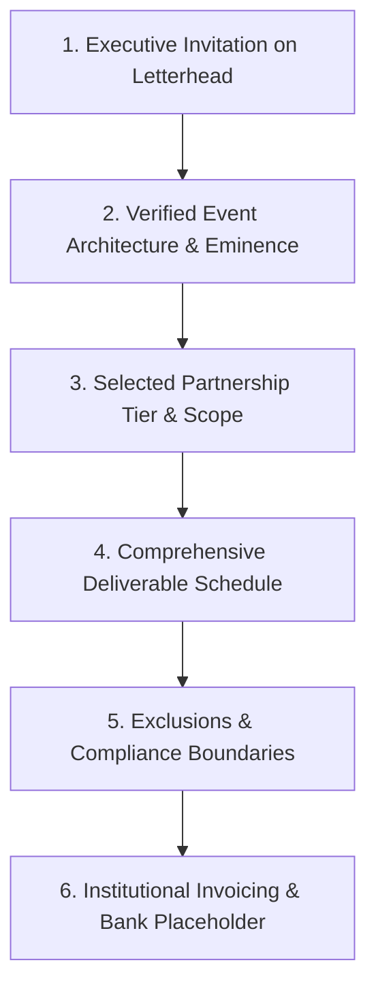
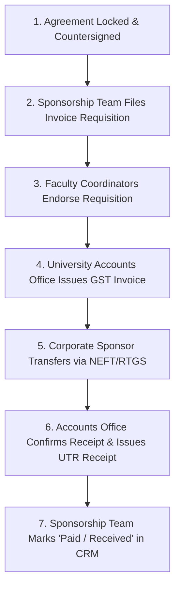

# KAIROS 2027 — Proposal, Contracting & Approval Workflow

> **Document Status:** GOVERNANCE WORKFLOW & LEGAL REVIEW CHECKLIST  
> **Notice:** `DRAFT — NOT FOR SIGNATURE UNTIL UNIVERSITY REVIEW AND APPROVAL`  
> **Audience:** Sponsorship Lead, Faculty Coordinators, Legal Counsel, University Accounts Office  
> **Direct Owner:** Nikki (Nangaiyar M), Chief Partnerships & Finance Officer (CPFO)  
> **Source of Truth:** [`00_sponsorship_source_of_truth.md`](./00_sponsorship_source_of_truth.md)  
> **Current Working Date:** 17 October 2026 | **Event Working Dates:** 22–24 January 2027

---

## 1. Modular Proposal Structure (Reusable External Copy)

To ensure consistency, professional presentation, and legal compliance, all formal written proposals submitted to corporate prospects must be structured into this modular sequence:



### Modular Proposal Sections:

1. **Executive Invitation & Official Letterhead:** Sent on official departmental/institutional letterhead bearing official reference numbers (`SIST/CSE/AWS-SBG/2026-27/EXT/SPON-[SERIAL]`).
2. **Verified Event Overview:** Contextualizing KAIROS 2027 as a 48-hour continuous national hackathon bringing together 100 shortlisted finalist teams (~400–600 builders) selected from 2,000+ national applicants under a 100% Free / Zero Entry Fee mandate.
3. **Selected Partnership Package:** Clear statement of the agreed tier (Title, Co-Powered, Associate, or Track Bounty) and total financial or in-kind contribution.
4. **Itemized Deliverable Schedule:** Exhaustive table of physical and digital deliverables with dimensions, quantities, and delivery milestones.
5. **Non-Negotiable Policy Boundaries:** Explicit affirmation of:
   - 100% Student IP Ownership over all participant creations.
   - Privacy-compliant, opt-in consent model for talent engagement.
   - Zero student-level private payment collection.
6. **Institutional Payment Routing Caveat:** Direct routing via Sathyabama University official accounts; GST invoice generation handled by University Accounts.
7. **Authorized Signatory Placeholders:** Pre-cleared sign-off block featuring CPFO Nikki, Chapter President Thenappan T, Faculty Coordinators, and the Dean/Registrar.

---

## 2. Institutional Approval & RACI Governance Matrix

To maintain strict compliance with university administration policies, the following RACI framework governs every deal:

* **R (Responsible):** The individual who executes the operational task.
* **A (Accountable):** The individual who possesses ultimate approval authority.
* **C (Consulted):** Key stakeholders whose input or vetting must be obtained.
* **I (Informed):** Leadership kept updated on task completion.

| Workflow Step / Activity | Lead Owner (R) | Approval Authority (A) | Consulted (C) | Informed (I) | Required Artifact |
|---|---|---|---|---|---|
| **Lead Qualification & Initial Outreach** | Enterprise Outreach Squad | CPFO Nikki | Assigned Mentors | President Thenappan T | CRM Entry |
| **Discovery Call & Deck Delivery** | CPFO Nikki | CPFO Nikki | Sub-Heads | Faculty Advisors | Meeting Minutes |
| **Package Customization & Discounts** | CPFO Nikki | President Thenappan T & Faculty | Design / Ops Leads | Organizing Committee | Customization Sheet |
| **University Letterhead Requisition** | CPFO Nikki | **Dr. K. Ashok Kumar & Dr. Balapriya S** | Dean, School of Computing | Chapter Leadership | Signed Requisition |
| **Drafting Bilateral MoU Agreement** | CPFO Nikki | **Dr. K. Ashok Kumar (Faculty)** | Institutional Legal Cell | Corporate Counsel | Redline Word Draft |
| **MoU Legal Terms Clearance** | Corporate Counsel | **Dean / Registrar, SIST** | Faculty Coordinators | CPFO Nikki | Final Vetted PDF |
| **GST Invoice Generation Request** | Treasury Sub-Head | **Finance Officer / Accounts Office** | Faculty Coordinators | CPFO Nikki | Formal Invoice PDF |
| **Payment Transfer & Credit Verification** | Corporate Treasury | **University Accounts Office** | Treasury Sub-Head | CPFO Nikki | Bank UTR / Receipt |
| **MoU Formal Countersignature** | Corporate Signatory | **Dean / Registrar, SIST** | Faculty Coordinators | Chapter Leadership | Executed Signed MoU |
| **Deliverable Ingestion & Staging** | Design & Media Leads | CPFO Nikki | Operations Head | Sponsor Lead | Ingestion Checksheet |
| **Proof of Performance (PoP) Delivery** | CPFO Nikki & Media Lead | CPFO Nikki | Faculty Advisors | Corporate Partner | 10-Slide ROI Dossier |

---

## 3. Standard Agreement Review Checklist & Clause Guide

> [!WARNING]
> This guide is an operational review checklist for student organizers and faculty coordinators, **not formal legal advice**. All agreements must undergo formal review by the Sathyabama Institute of Science and Technology administrative and legal authorities before execution.

Every corporate sponsorship agreement must be verified against this 12-point review checklist:

- [ ] **1. Exact Legal Entity Names:** Correct identification of SATHYABAMA INSTITUTE OF SCIENCE AND TECHNOLOGY (Deemed to be University under Section 3 of UGC Act, 1956) and the Corporate Sponsor's registered corporate entity name, CIN, and registered address.
- [ ] **2. Authorized Signatory Verification:** Ensure the corporate signatory holds valid board authority or power of attorney to execute sponsorship contracts.
- [ ] **3. Consideration & Tax Treatment:** Total sponsorship consideration explicitly stated in figures and words, specifying whether the sum is inclusive or exclusive of Goods and Services Tax (GST).
- [ ] **4. Official Institutional Payment Terms:** Mandate 100% electronic fund transfer (NEFT/RTGS) directly into the verified Sathyabama University project account within 15 business days of signing.
- [ ] **5. Strict Student IP Protection:** Non-negotiable clause affirming that all intellectual property, source code, patents, and designs created by student participants remain 100% their exclusive property.
- [ ] **6. Talent Engagement & Privacy Standard:** Sponsor engagement with student candidates must operate strictly via an institutionally approved, opt-in consent book; zero bulk scraping or personal data dumps.
- [ ] **7. Brand Asset Usage & Trademark Licenses:** Mutual, limited, non-exclusive license granted solely for the promotion and execution of KAIROS 2027; zero implied corporate endorsement of unauthorized university initiatives.
- [ ] **8. Media & Content Rights:** Host institution retains the right to record, photograph, and broadcast the event (including sponsor logo displays and booth activity) for academic, promotional, and live streaming purposes.
- [ ] **9. Deliverable Acceptance & Verification Evidence:** Definition of completion standards (high-resolution photographic and video proof of performance) required for deliverable sign-off.
- [ ] **10. Cancellation & Refund Policy:** Terms governing cancellation by either party; sponsor payments are non-refundable once physical marketing collateral has entered print freeze (December 20, 2026).
- [ ] **11. Force Majeure:** Standard protection excusing performance in cases of natural disasters, epidemics, government orders, power blackouts, or civil unrest.
- [ ] **12. Dispute Escalation & Jurisdiction:** Amicable resolution period (30 days) followed by arbitration; exclusive legal jurisdiction vested in the competent courts of Chennai, Tamil Nadu.

---

## 4. Official Institutional Payment Routing & Invoicing Process



### Mandatory Operational Protocol:

1. **Zero Private Payment Handing:** Under no circumstances may student organizers provide personal UPI handles, personal bank account numbers, third-party wallet links, or cash collection envelopes. Any attempt to route sponsorship capital through unofficial channels constitutes a severe breach of university discipline.
2. **Bank Account Placeholders in External Drafts:** In all draft proposal letters and draft MoUs, university bank details must be marked as:
   ```text
   Beneficiary Name: SATHYABAMA INSTITUTE OF SCIENCE AND TECHNOLOGY
   Bank Name: [Official University Banker, e.g., Indian Bank]
   Branch: [Sathyabama University Branch, Chennai - 600119]
   Account Number: [Shared formally on Official University Tax Invoice]
   IFSC Code: [Shared formally on Official University Tax Invoice]
   ```
3. **Formal Invoice Generation:** When a deal reaches `STAGE 5: LEGAL & MOU`, CPFO Nikki files an Institutional Invoice Requisition with Faculty Coordinators Dr. K. Ashok Kumar and Dr. Balapriya S. The requisition must include:
   - Corporate legal entity name, billing address, and GSTIN.
   - Agreed package tier and net consideration amount.
   - Authorized corporate procurement contact.
4. **Audit-Proof Receipt Logging:** Once the corporate sponsor executes the transfer, they provide the Unique Transaction Reference (UTR) number. The Treasury Sub-Head coordinates with University Accounts to obtain the official stamped university receipt. The deal status in the CRM may be updated to `Paid / Received` **only after the official bank credit voucher is verified**.
