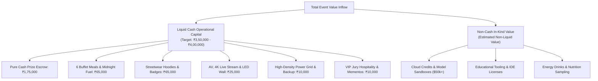
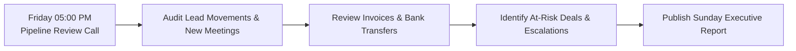

# KAIROS 2027 — Finance Controls & Pipeline Review

> **Document Status:** CANONICAL FINANCIAL CONTROLS & PIPELINE CADENCE  
> **Audience:** Sponsorship Lead (Nikki), Treasury Sub-Head, Chapter President, Faculty Coordinators  
> **Direct Owner:** Nikki (Nangaiyar M), Chief Partnerships & Finance Officer (CPFO)  
> **Source of Truth:** [`00_sponsorship_source_of_truth.md`](./00_sponsorship_source_of_truth.md)  
> **Current Working Date:** 17 October 2026 | **Event Working Dates:** 22–24 January 2027

---

## 1. Cash vs. In-Kind Forecast Scenarios & Ledger Architecture

To maintain rigorous fiscal control, KAIROS 2027 enforces strict separation between **Liquid Cash Inflows** (used for food, stage, power, and cash prizes) and **In-Kind Contributions** (cloud credits, tooling licenses, and physical beverages).



### Calibrated Funding Scenarios & Mathematical Breakdown

The following scenarios model event capital inflows based on commercial closing probability. **Probability-weighted numbers are planning forecasts only, never booked cash.**

| Revenue Stream | Conservative Model (₹2.5L) | Balanced Target Model (₹3.75L) | Optimized Growth Model (₹5.0L) | Probability Assumption | Revenue Source Category |
|---|:---:|:---:|:---:|:---:|---|
| **Title Sponsor** | ₹1,50,000 | ₹2,00,000 | ₹2,00,000 | 40% Base / 60% High | Corporate Cash |
| **Co-Powered By Partners** | ₹0 | ₹1,00,000 (1 slot) | ₹2,00,000 (2 slots) | 50% Base / 70% High | Corporate Cash |
| **Associate Partners** | ₹0 | ₹0 | ₹50,000 (1 slot) | 30% Growth | Corporate Cash |
| **Track Bounty Partners** | ₹50,000 (2 tracks @ ₹25k) | ₹75,000 (3 tracks @ ₹25k) | ₹1,00,000 (4 tracks @ ₹25k) | 70% Base / 85% High | Corporate Cash |
| **Institutional Grant (SIST)** | ₹50,000 | ₹50,000 | ₹50,000 | 90% (Formal Proposal) | University Capital |
| **TOTAL LIQUID CASH POOL** | **₹2,50,000** | **₹3,75,000** | **₹6,00,000 (Capped @ ₹5.0L)** | — | **Liquid Operational Capital** |
| *Estimated Non-Cash In-Kind Value* | *~$10,000 Credits* | *~$50,000 Credits + Fuel* | *~$100,000 Credits + Tooling + Fuel* | Separate Non-Liquid | Tooling & Beverage Value |

### Operational Expense Protection Rules:
1. **Protected Cash Prize Floor:** The **₹1,75,000 Pure Cash Prize Escrow** is legally and operationally ring-fenced. In the event of a Conservative funding scenario (₹2.5L total inflow), prize money remains 100% funded, while merchandise, stage production, and venue decor budgets are scaled down to baseline necessities.
2. **Budget Surplus Reallocation:** Any liquid capital secured above ₹4,00,000 is automatically routed to:
   - Outstation travel subsidies for finalist student teams from Tier-2/Tier-3 engineering institutions.
   - Additional hardware and serverless compute sandboxes.
   - Chapter reserve contingency pool for future hackathons.

---

## 2. Weekly Pipeline Review Cadence & Meeting Agenda

To maintain momentum and ensure no corporate leads stall, the sponsorship division conducts a mandatory **Weekly Pipeline Review** every **Friday at 05:00 PM**.



### Standard 45-Minute Review Agenda

| Time Window | Agenda Item | Discussion Owner | Expected Deliverable / Outcome |
|---|---|---|---|
| **00:00 – 00:10** | **Top of Funnel & Ingestion** | Outreach Sub-Head | Count of new qualified leads researched, outreach dispatched, and initial responses received. |
| **00:10 – 00:20** | **Discovery Calls & Proposals** | CPFO Nikki | Review of meetings held, corporate feedback, custom proposal decks sent, and open questions. |
| **00:20 – 00:30** | **Legal & Institutional Review** | Treasury Sub-Head & Faculty | Review of MoUs under legal review, invoice requests filed with Accounts, and signed contracts. |
| **00:30 – 00:40** | **Bank Reconciliation & Cash Inflow** | Treasury Sub-Head | Stamped university receipts, verified NEFT/RTGS transaction credits, and cash ledger update. |
| **00:40 – 00:45** | **Action Assignments & Escalations** | President Thenappan T | Clear 7-day task commitments assigned with explicit deadlines for the upcoming week. |

---

## 3. Weekly Executive Council Report Template

Following each Friday pipeline review, CPFO Nikki compiles and transmits this compact executive dashboard to President Thenappan T, Chapter Faculty Coordinators, and the Dean's Office by **Sunday at 08:00 PM**:

```text
================================================================================
KAIROS 2027 — SPONSORSHIP PIPELINE EXECUTIVE REPORT
Report Week: [Week Ending Date, e.g., 24 Oct 2026]
Lead Officer: Nikki (Nangaiyar M), CPFO & Sponsorship Head
================================================================================

1. EXECUTIVE PIPELINE SNAPSHOT:
   • Total Active Pipeline Targets:         [Count, e.g., 42]
   • Outbound Communications Sent:          [Count, e.g., 28]
   • First Responses Received:              [Count, e.g., 9] (Response Rate: [__]%)
   • Discovery Meetings Completed:          [Count, e.g., 4]
   • Formal Proposals & Decks Out:          [Count, e.g., 3]
   • Agreements in Legal Review (MoU):      [Count, e.g., 2]
   • Signed Binding Commitments:            [Count, e.g., 0]
   • Formally Verified Cash Received:       ₹ [0.00] (Audited University Receipts)
   • Formally Verified In-Kind Secured:     [e.g., $0.00 Tooling / Credits]

2. WEIGHTED PIPELINE FORECAST (ESTIMATED PLANNING VALUE):
   • Conservative Forecast (High Probability Deals):  ₹ [___________]
   • Base Target Forecast (Calibrated Pipeline):      ₹ [___________]
   • Best-Case Stretch Forecast:                      ₹ [___________]
   *(Note: Forecasts represent planning targets only and are not treated as booked funds).*

3. DEALS CLOSED THIS SPRINT:
   • [Company Name] — [Tier Name] — ₹ [Amount] / [In-Kind Description]
     (Status: Signed MoU / Verified Bank Receipt / Ingestion Underway)

4. HIGH-PRIORITY AT-RISK LEADS & ESCALATIONS:
   • Lead: [Company Name] | Stage: [Stage] | Blocker: [e.g., Awaiting GST Invoice from Accounts]
     Required Intervention: [Action by Faculty Coordinator / Dean]
   • Lead: [Company Name] | Stage: [Stage] | Blocker: [e.g., Procurement cycle delayed]
     Required Intervention: [Follow-up by CPFO Nikki]

5. OUTSTANDING DECISIONS REQUIRING INSTITUTIONAL SIGN-OFF:
   • [Decision ID from 00_sponsorship_source_of_truth.md, e.g., DEC-05 Bank routing]

6. CRITICAL PRIORITIES FOR THE NEXT 7 DAYS:
   1. [Action 1 with Owner & Exact Due Date]
   2. [Action 2 with Owner & Exact Due Date]
   3. [Action 3 with Owner & Exact Due Date]
   4. [Action 4 with Owner & Exact Due Date]
================================================================================
```

---

## 4. Policy Enforcement: Referral Bounty Quarantine

> [!CAUTION]
> **COMPLIANCE MANDATE: STUDENT COMMISSIONS REMAIN STRICTLY QUARANTINED**  
> 
> As established in [`00_sponsorship_source_of_truth.md`](./00_sponsorship_source_of_truth.md) and [`README.md`](./README.md), the previously drafted "Rainmaker Bounty" (paying 10%–15% cash commissions to students for sourcing sponsors) is **NOT an active policy**.
> 
> 1. **Zero Financial Liabilities:** Team members, student ambassadors, and organizers are strictly prohibited from promising, offering, or distributing cash commissions, percentages, or finder's fees.
> 2. **Institutional Prerequisite:** Sathyabama Institute of Science and Technology administrative and legal regulations prohibit disbursement of university-held funds to students as commercial finder's fees without formal statutory compliance, tax deduction (TDS), and written sanction from the Finance Officer.
> 3. **Non-Cash Recognition Standard:** Student contributors who introduce verified corporate sponsors are honored through formal non-monetary recognition:
>    - Official Letter of Commendation from Chapter President Thenappan T and Faculty Coordinators.
>    - Stage honors during the Grand Finale Inaugural Ceremony.
>    - VIP All-Access Main Stage & Jury Lounge passes.
>    - Exclusive KAIROS Cyber Streetwear merchandise packages.
