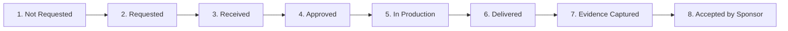
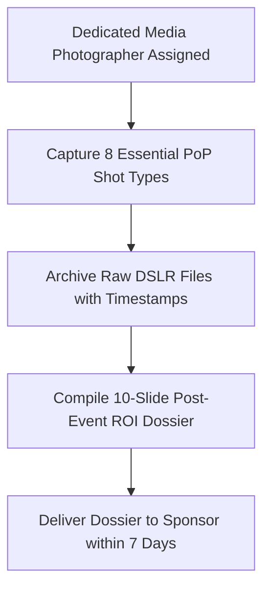

# KAIROS 2027 — Fulfillment Assets & Proof of Performance (PoP)

> **Document Status:** CANONICAL FULFILLMENT & DELIVERABLE OPERATING MANUAL  
> **Audience:** Sponsorship Lead (Nikki), Design Lead (Rikish), Media Head (Caroline), Operations Team  
> **Direct Owner:** Nikki (Nangaiyar M), Chief Partnerships & Finance Officer (CPFO)  
> **Collaborators:** Rikish B (Design Lead), Caroline Mary McPherson (Media Head 1)  
> **Source of Truth:** [`00_sponsorship_source_of_truth.md`](./00_sponsorship_source_of_truth.md)  
> **Current Working Date:** 17 October 2026 | **Event Working Dates:** 22–24 January 2027

---

## 1. Deliverable Lifecycle & Operational Status Taxonomy

To eliminate dropped balls and guarantee that every contractual promise made to corporate sponsors is executed on-ground, every deliverable transitions through eight standardized lifecycle states:



| Lifecycle State | Operational Definition | Exit Criteria / Verification Artifact |
|---|---|---|
| **1. Not Requested** | Contract signed, but asset intake window has not yet opened. | MoU countersigned; onboarding timeline scheduled. |
| **2. Requested** | Formal intake communication dispatched to corporate POC with technical specs. | Sent intake email logged with timestamp. |
| **3. Received** | Assets submitted by sponsor; awaiting technical compliance QA. | Raw files saved in `sponsor_deliverables_and_assets/`. |
| **4. Approved** | Design and Media leads certify vector resolution, audio levels, and brand compliance. | QA sign-off by Rikish B (Design) or Caroline (Media). |
| **5. In Production** | Assets sent to physical pre-press print shop or cued in OBS broadcast switcher. | Printer job ticket / OBS scene profile saved. |
| **6. Delivered** | Banner erected on campus, video aired on live stream, or booth operational. | Physical or digital execution confirmed on event day. |
| **7. Evidence Captured** | High-resolution DSLR photograph or timestamped video recording captured. | Photo/video file archived in PoP repository. |
| **8. Accepted by Sponsor** | Corporate partner reviews Proof of Performance dossier and acknowledges fulfillment. | Written email confirmation or formal post-event sign-off. |

---

## 2. Master Sponsor Asset Intake Specifications

All assets received from corporate partners must comply with strict physical and digital production standards:

```
PRODUCTION ASSET STANDARDS AT A GLANCE:
─────────────────────────────────────────────────────────────────────────────
• Vector Logos:          SVG / EPS / AI  (Strictly vector, or 300 DPI transparent PNG)
• Video Stingers:        1080p 60fps H.264 MP4, -14 LUFS Audio Normalization
• Physical Banners:      300 DPI CMYK TIFF/PDF with 2-inch Bleed Margins
• Presentation Decks:    16:9 Widescreen (3840×2160 or 1920×1080) PDF/PPTX
• Problem Statements:    Standardized PDF/Markdown Brief with API Sandbox Access
─────────────────────────────────────────────────────────────────────────────
```

### Detailed Intake Requirements by Asset Type

| Asset Type | Mandatory Technical Specifications | Acceptable File Formats | Production Lead Time | Cross-Team Owner |
|---|---|---|:---:|---|
| **Corporate Logos** | 1. Primary Full-Color Vector.<br/>2. Monochrome Inverted White (for `#0D1117` Obsidian surfaces).<br/>3. Square 1:1 App Monogram (for badges & web).<br/>*Strictly NO low-res raster or JPEGs with white square boxes.* | `.svg`, `.ai`, `.eps`, or 300 DPI transparent `.png` (min 2500×2500 px) | Due by **20 Dec 2026** (Print Freeze) | **Rikish B** (Design Lead) |
| **Live Stream Video Commercials** | 1920 × 1080 px (1080p) at 60.00 fps. Audio normalized to broadcast standard **`-14 LUFS`**. Duration: Exactly 15.0s (Co-Powered) or 30.0s (Title). | `.mp4` container, `H.264 / AVC` video codec, `AAC 320 kbps` audio | Due by **10 Jan 2027** (Broadcast Cue) | **Caroline Mary McPherson** (Media Head) |
| **Executive Speaker Profile** | High-resolution professional headshot (min 1500×1500 px), executive biography (150 words max), LinkedIn handle, and slide deck title. | Headshot: `.jpg` / `.png`<br/>Bio: Markdown / Text | Due by **05 Jan 2027** (Brochure Print) | **Nikki (CPFO)** & Media Squad |
| **Keynote Slide Deck** | 16:9 widescreen format. Formatted for high-contrast auditorium projection. Embedded videos must be packaged locally. | `.pdf` (vector compressed) or `.pptx` | Due by **18 Jan 2027** (AV Rehearsal) | Stage AV Coordinator |
| **Physical Exhibition Stall Collateral** | Stall dimensions: 10×10 ft (Title) or 6×6 ft (Co-Powered). Rollup banners: 6×3 ft vertical standees (300 DPI CMYK). | Print-ready `.pdf` or `.tiff` with 2-inch bleed margins | Due by **25 Dec 2026** (Fabrication) | Logistics & Venue Floor Head |
| **Technical Track Problem Statement** | Challenge Title, Background, Evaluation Rubric, Approved API/SDK Links, Developer Sandbox Credentials, and Jury Contact. | Standardized Markdown or PDF | Due by **28 Dec 2026** (Pre-Qualifier) | Track Partnerships Sub-Head |

---

## 3. Operational Deliverable Tracking Table (Master Spec)

> [!IMPORTANT]
> The table below defines the structural schema for tracking signed sponsor deliverables. Statuses remain blank or `Not Requested` until verified agreements exist. Never pre-populate tickboxes or mark claims as delivered without physical proof.

| Sponsor Name | Agreed Tier | Deliverable Item | Exact Technical Specification | Production Deadline | Cross-Team Dependency | Lifecycle Status | QA Evidence File Location | Completion Sign-Off |
|---|---|---|---|:---:|---|:---:|---|:---:|
| *[Illustrative Example]* | *Title Partner* | Main Stage LED Wall Crest | 3840×1920 px Center Crest (Monochrome White) | 15 Jan 2027 | Media & LED Switcher | `[Approved]` | `assets/led/title_crest_v1.png` | Rikish B |
| *[Illustrative Example]* | *Co-Powered* | Stage Backdrop Logo | 20×10 ft Stage Backdrop, Sub-Hero position | 20 Dec 2026 | Print & Logistics | `[In Production]` | `print_proofs/stage_backdrop_proof.pdf` | Operations Lead |
| *[Open Slot]* | Title Sponsor | Inaugural Keynote Address | 20-Minute Primetime Slot (Opening Day 11:15 AM) | 22 Jan 2027 | Event Management & MC | `Not Requested` | Awaiting Executed MoU | — |
| *[Open Slot]* | Co-Powered | 15s Broadcast Commercial | 1080p60 MP4, -14 LUFS, 15.0s exactly | 10 Jan 2027 | Media & Broadcast | `Not Requested` | Awaiting Executed MoU | — |
| *[Open Slot]* | Track Partner | Problem Statement Launch | Published on Portal & Track Briefing Session | 28 Dec 2026 | Web & Track Leads | `Not Requested` | Awaiting Executed MoU | — |
| *[Open Slot]* | Associate | Rollup Standee Logo | 6×3 ft Standee, High-Res Vector placement | 20 Dec 2026 | Design & Print | `Not Requested` | Awaiting Executed MoU | — |

---

## 4. On-Site Proof of Performance (PoP) Capture Protocol

To protect sponsor trust, guarantee renewals for future editions, and provide irrefutable evidence of deliverable execution, Division 5 (Media & Production) deploys a dedicated **PoP Capture Protocol** during the event:



### The 8 Mandatory PoP Photographic Artifacts:
1. **Main Stage LED Wall:** High-resolution wide-angle and telephoto DSLR shots of the 3840×1920 LED Wall displaying the sponsor’s crest behind keynote speakers and during the grand inauguration.
2. **Physical Stage Backdrop & Venue Banners:** High-res photographs of the 20×10 ft stage backdrop, 12×8 ft grand foyer backdrop, and 6×3 ft vertical rollup standees with sponsor crests clearly visible and sharp.
3. **Auditorium Keynote & Executive Speaking:** Crisp action photographs of corporate executives delivering their keynote address or technical session on the main stage.
4. **Exhibition Stall & Demo Interaction:** High-energy candid photographs of student hackers crowded around the corporate booth, interacting with company engineers, and testing product demos.
5. **Participant Merchandise & Smart Badges:** Macro close-up photographs of student hackers wearing official heavy-cotton hoodies, developer t-shirts, jacquard lanyards, and smart badges featuring sponsor branding.
6. **Evaluation Jury & Mentorship:** Action shots of corporate judges actively reviewing student project prototypes and scoring teams during judging rounds.
7. **Broadcast Live Stream Screenshots:** Timestamped multi-camera broadcast screen captures showing sponsor video stingers, lower-third graphic tickers, and live stream overlays.
8. **Award Conferral & Trophy Handover:** On-stage photographs of corporate executives conferring trophies, giant ceremonial cheques, or custom track bounties to winning student squads.
