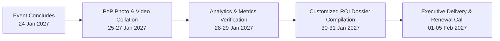
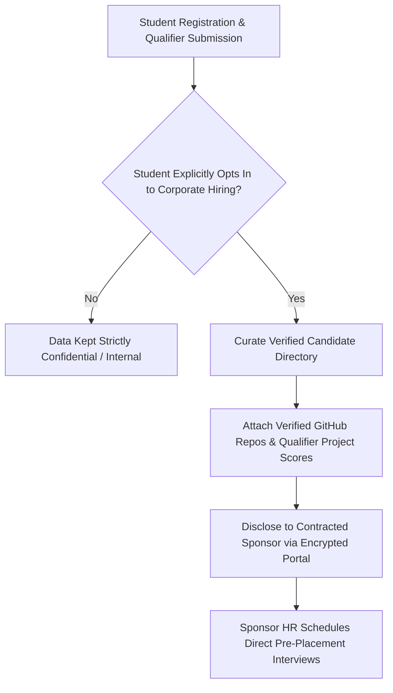

# KAIROS 2027 — Post-Event ROI Reporting & Partner Renewal

> **Document Status:** CANONICAL POST-EVENT OPERATING FRAMEWORK  
> **Audience:** Sponsorship Lead (Nikki), Media Team, Executive Leadership, Signed Corporate Partners  
> **Direct Owner:** Nikki (Nangaiyar M), Chief Partnerships & Finance Officer (CPFO)  
> **Source of Truth:** [`00_sponsorship_source_of_truth.md`](./00_sponsorship_source_of_truth.md)  
> **Current Working Date:** 17 October 2026 | **Event Working Dates:** 22–24 January 2027

---

## 1. Evidence-Led Post-Event Sponsor ROI Report Structure

Within **seven (7) to ten (10) business days** following the conclusion of KAIROS 2027, the sponsorship team compiles and delivers an evidence-backed **Executive Sponsor ROI Dossier** to each corporate partner.



### 10-Slide Post-Event Dossier Outline:

1. **Title & Executive Summary:** Official event dates, final attendance metrics, total participating institutions, and custom sponsor tier recap.
2. **Contracted Deliverables vs. Actual Performance Matrix:** Side-by-side audit verifying 100% fulfillment of all contracted brand, stage, and recruitment deliverables.
3. **Main Stage & Venue Branding Impact:** Full-bleed DSLR photo collage showcasing the 3840×1920 LED Wall center crest, 20×10 ft stage backdrop, and foyer rollup standees.
4. **Keynote & Executive Thought Leadership:** High-res photographs of corporate speakers delivering inaugural keynotes, technical sessions, and panel remarks.
5. **On-Ground Booth & Hacker Immersion:** Photographic evidence of participant engagement at the corporate kiosk/lounge, product demonstrations, and technical mentorship.
6. **Technical API / Track Adoption Outcomes:** Number of teams choosing the sponsor’s track, verified GitHub repository links of winning projects built on the sponsor’s API, and judge evaluation summaries.
7. **Verified Digital Broadcast & Media Metrics:** Multi-camera YouTube/LinkedIn broadcast analytics (peak concurrent viewers, total watch time hours), and social media reach (`@awssbg_sist`).
8. **Opt-In Talent & Recruitment Metrics:** Number of qualified candidates opting into the sponsor’s recruitment book, breakdown of graduating batches (2027/2028), and technical skill distributions.
9. **Student & Faculty Feedback:** Curated feedback quotes from finalist teams and faculty coordinators highlighting the sponsor’s technical contribution.
10. **KAIROS 2028 Renewal Invitation & Priority Window:** Formal expression of gratitude and early-bird reservation invitation for the subsequent edition.

---

## 2. Guaranteed Contracted Deliverables vs. Measured Outcomes

To preserve absolute credibility, the post-event report strictly distinguishes between **Guaranteed Contractual Deliverables** (what the team had 100% control over executing) and **Measured Ecosystem Outcomes** (actual audience engagement and organic metrics).

| Metric / Dimension | Contractual Guarantee (What We Promised) | Measured Outcome (What We Track & Report) | Primary Data Source | Verification Owner |
|---|---|---|---|---|
| **Logo Placements** | Guaranteed inclusion on LED wall, backdrop, banners, badges, and portal. | Photographic timestamped gallery verifying exact display across all collateral. | DSLR Raw Photos (Focal length, EXIF data) | Rikish B (Design) |
| **Auditorium Keynote** | Guaranteed 20-min (Title) or 10-min (Co-Powered) stage slot. | Multi-camera video recording link + YouTube broadcast timestamp. | ATEM Mini Pro / YouTube Stream Archive | Caroline (Media) |
| **Jury Representation** | Guaranteed 1–2 VIP evaluation seats on Grand Finale Plenary panel. | Official judging scorecards signed and stage photos with winning teams. | Academic Evaluation Master Sheet | Faculty Coordinators |
| **Physical Exhibition Space** | Guaranteed 10×10 ft or 6×6 ft space in Sathyabama Indoor Stadium. | High-resolution photos of booth crowd density and student interactions. | On-Site DSLR Photography | Operations Lead |
| **Finalist Attendance** | Guaranteed 100 pre-screened finalist teams (~400–600 developers) on campus. | Final audited on-site registration roster and badge issuance count. | QR Check-in Telemetry / Security Log | Registration Lead |
| **Digital Broadcast Impressions** | Guaranteed airing of 15s/30s commercial video stingers during stream. | Verified broadcast logs, total view counts, and live stream engagement metrics. | YouTube Studio Analytics & LinkedIn Page Insights | Caroline (Media) |
| **Opt-In Talent Engagement** | Provision of verified candidate book of students consenting to corporate sharing. | Audited candidate directory containing GitHub profiles and opted-in resumes. | Registration Portal Opt-In Database | Web & Tech Squad |

---

## 3. Opt-In Talent Engagement & Post-Event Recruiting Workflow

> [!IMPORTANT]
> **COMPLIANCE NOTICE: ZERO RAW RESUME DUMPING**  
> In compliance with university student welfare policies and digital personal data protection norms, personal candidate data is never shared indiscriminately. Corporate partners interface with talent through a structured, consent-driven workflow.



### Structured Talent Delivery Process:
1. **Consent Capture:** During registration and qualifier submission, participants choose whether their profile, GitHub link, and contact details may be shared with official KAIROS 2027 enterprise recruitment partners.
2. **Portfolio & Code Telemetry:** Profiles of consenting students are enriched with their verified hackathon code submissions, track choices, and qualifier evaluation scores.
3. **Encrypted Directory Dispatch:** Within **5 business days** post-event, the compiled Opt-In Candidate Book is securely delivered to authorized corporate talent acquisition leads.
4. **Campus Interview Support:** For Title and Co-Powered partners, the chapter coordinates on-campus interview rooms or virtual follow-up interview blocks with shortlisted candidates.

---

## 4. KAIROS 2028 Partnership Renewal & Nurture Playbook

Sponsorship acquisition is an ongoing institutional relationship, not a one-time transaction. The renewal engine initiates immediately following deliverable acceptance.

### Renewal Timeline & Action Milestones

```
RENEWAL TIMELINE AT A GLANCE:
─────────────────────────────────────────────────────────────────────────────
• Event Day + 7 Days:     Deliver 10-Slide Executive PoP Dossier
• Event Day + 14 Days:    Conduct 20-Minute Debrief & Feedback Video Sync
• Event Day + 30 Days:    Present Exclusive Early-Bird Renewal Proposal for 2028
• Event Day + 60 Days:    Lock First-Look Exclusivity Agreement
─────────────────────────────────────────────────────────────────────────────
```

### The 20-Minute Partner Debrief Sync
- **Agenda:**
  1. Review Proof of Performance artifacts and confirm total satisfaction.
  2. Gather qualitative corporate feedback on team code quality and event logistics.
  3. Discuss corporate engineering and hiring priorities for the upcoming year.
  4. Offer **First-Look Exclusivity** for KAIROS 2028.

### Early-Bird Renewal Incentives (KAIROS 2028):
- **Price Protection Guarantee:** Returning partners lock current 2027 package pricing for the 2028 edition, regardless of event budget expansion.
- **First Right of Refusal on Title / Naming Rights:** The 2027 Title and Co-Powered partners receive a 30-day exclusive window to renew their tier before it is opened to competitive corporate bidding.
- **Year-Round Community Presence:** Renewing partners receive featured placement in AWS Student Builder Group developer workshops, campus bootcamps, and hackathons throughout the academic year.
