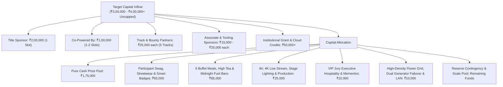

# KAIROS 2027 (Grand Edition) — Sponsorship & Corporate Partnerships Workspace

> **Domain:** Corporate Outreach, Enterprise Partnerships, Grants & Financial Escrow  
> **Host Organization:** AWS Student Builder Group — SIST Chapter, Sathyabama Institute of Science and Technology  
> **Event Dates:** January 22 – 24, 2027 (48-Hour Non-Stop Hackathon at Sathyabama Institute of Science and Technology, Chennai)  
> **Scale Standard:** **₹3,50,000 – ₹4,00,000 Operating Capital Pool (Uncapped)**  
> **Participant Policy:** **100% FREE — Zero Entry Fee for All Students**  

---

## 1. Domain Leadership & Accountability Roster

Every document, pitch, and agreement in this directory is owned, directed, and managed by **Nikki (Nangaiyar M)**, who serves as the Chief Partnerships & Finance Officer (CPFO) and Sponsorship Head. All sponsor leads, corporate pitches, outreach pipelines, and contract fulfillment are driven by her domain.

| Role | Officer | Register No | Contact Details | Responsibilities |
|---|---|:---:|---|---|
| **Super Head 1: CPFO & Sponsorship Lead** | **Nikki (Nangaiyar M)** | `44612059` | `+91 8754976892` `nangaiyarmuthkrishnan@gmail.com` | **Sole operational head of sponsorships**: corporate outreach pipeline, deck customization, enterprise negotiation, contract closing, sponsor deliverables, and capital realization. |
| **Sub-Head: Enterprise Tier** | Corporate Outreach Lead | Assigned Lead | Internal Slack/WhatsApp | Tier 1/2 leads (Title, Powered-By, Tech Giants), scheduling discovery calls with Nikki. |
| **Sub-Head: Track & Bounties** | Track Partnerships Lead | Assigned Lead | Internal Slack/WhatsApp | Web3, AI, FinTech, and Cloud track bounty sponsors, API credits & tooling perks. |
| **Sub-Head: Finance & Escrow** | Treasury & Audit Lead | Assigned Lead | Internal Slack/WhatsApp | Invoice raising, university account reconciliation, 72-hour prize escrow tracking. |
| **Faculty Coordinator** | **Dr. K. Ashok Kumar** | Faculty CSE | `ashokkumar.cse@sathyabama.ac.in` | University endorsement letters, institutional representation, administrative approvals. |
| **Faculty Coordinator** | **Dr. Balapriya .S** | Faculty CSE | `balapriya.cse@sathyabama.ac.in` | University endorsement letters, MoU vetting, institutional accounting clearance. |
| **President & SBGL (Apex Chapter)** | **Thenappan T** | `44110855` | `+91 6381801640` `thenappanmasterz1311@gmail.com` | Macro chapter oversight & institutional representation (not responsible for day-to-day sponsorships). |

---

## 2. Financial Architecture: ₹3,50,000 – ₹4,00,000 Model

To produce the grandest hackathon in the nation with 100 elite teams (teams of 4–6 students, ~400–600 hackers), 100% free food, 100% free stay, premium merchandise, and heavy-duty infrastructure, our baseline operational budget is **₹3,50,000 – ₹4,00,000** with **NO UPPER LIMIT**.

### 2.1 Crowdsourced 3rd-Party Sponsorship Referral Engine ("The Rainmaker Bounties")

To multiply our corporate acquisition pipeline tenfold, Kairos 2027 operates an **open, decentralized sponsorship commission model**. Any student in India—whether a Campus Ambassador, registered participant, or independent college connector—can source corporate sponsors for Kairos 2027 and earn a direct percentage-based cash commission.

| Sponsorship Tier Closed | Deal Size | Commission % Range | Cash Payout to Student | Additional Honors & Perks |
|---|:---:|:---:|:---:|---|
| **Title Presenting Partner** | **₹2,00,000** | **10% – 15%** | **₹20,000 – ₹30,000** | National Corporate Rainmaker Trophy on stage, VIP Main-Stage Pass, Recommendation Letter from President Thenappan T |
| **Co-Powered By Partner** | **₹1,00,000** | **10% – 12%** | **₹10,000 – ₹12,000** | VIP Jury Lounge Access, Letter of Recommendation, Cyber Streetwear Hoodie |
| **Associate / Gold Partner** | **₹50,000** | **10%** | **₹5,000** | Exclusive Merch Kit, Recommendation Certificate |
| **Track & Bounty Partner** | **₹25,000** | **10%** | **₹2,500** | Official Partner Certificate, Merch Kit |
| **In-Kind F&B / Fuel Deals** | Product Value | — | **₹3,000 – ₹5,000** fixed bounty | Swag Drop & Official Recognition |

* **Zero Financial Risk / Self-Funding Model:** Commissions are disbursed strictly upon the sponsor's payment clearing into the official Sathyabama University escrow account.
* **Lead Protection SLA:** Students log leads via the `/refer-sponsor` portal or email `sistawscc@gmail.com`. First timestamp locks the lead to the student for 21 days.
* **Executive Pitch Support:** CPFO Nikki (Nangaiyar M) and President Thenappan T handle corporate pitching, slide deck customization, and contract execution.
* **Rapid Payout SLA:** Cash commission transferred via UPI/NEFT within **48–72 hours** of corporate fund clearance.

---

## 3. Directory Structure & Subfolder Mandates

This directory is organized into 4 mission-critical subfolders. Every folder contains its own `README.md` and actionable templates:

### 📁 [`pitch_decks/`](./pitch_decks/)
- **Mandate:** Stores master presentation slide decks, corporate customized one-pagers, and presentation exports.
- **Key Deliverable:** 14-slide master corporate deck in 16:9 4K PDF and PPTX formats, strictly adhering to Amazon Ember typography and Obsidian-Amber visual branding.
- **Owner:** Nikki (Nangaiyar M, CPFO) & Rikish B (Design Lead).

### 📁 [`company_leads_tracker/`](./company_leads_tracker/)
- **Mandate:** Active CRM tracking pipeline from initial prospect discovery to signed agreement and received funds.
- **Key Deliverable:** Live CRM markdown matrix tracking 50+ enterprise targets across 7 distinct pipeline stages.
- **Owner:** Enterprise Outreach Sub-Head & Nikki (Nangaiyar M, CPFO).

### 📁 [`signed_mous_and_contracts/`](./signed_mous_and_contracts/)
- **Mandate:** Repository of executed Memorandums of Understanding (MoUs), sponsorship agreements, GST invoices, and bank transaction confirmation receipts.
- **Key Deliverable:** Institutional standard legal contract templates, non-tech corporate proposal letter formats, university bank escrow details, and countersigned agreements.
- **Owner:** Nikki (Nangaiyar M, CPFO) & Treasury Lead.

### 📁 [`sponsor_deliverables_and_assets/`](./sponsor_deliverables_and_assets/)
- **Mandate:** Ingestion, storage, and QA of sponsor brand assets, vector logos, video advertisements, booth guidelines, and judging rep assignments.
- **Key Deliverable:** Sponsor brand asset vault, resolution compliance checklist (SVG / 300 DPI vector), and booth allocation map.
- **Owner:** Track Partnerships Lead & Media Head 1 (Caroline).

---

## 4. Weekly Sprint & Review Rhythm

1. **Monday 09:00 AM:** Pipeline Status Call — review new company outreach, open leads, and follow-ups.
2. **Wednesday 06:00 PM:** Deck Customization Review — align custom problem statements for prospective sponsors.
3. **Friday 05:00 PM:** Escrow & Finance Reconciliation — verify bank transfers, GST invoice generation, and update the master ledger.
4. **Sunday 08:00 PM:** Weekly Executive Council Report to Thenappan T & Faculty Coordinators.
