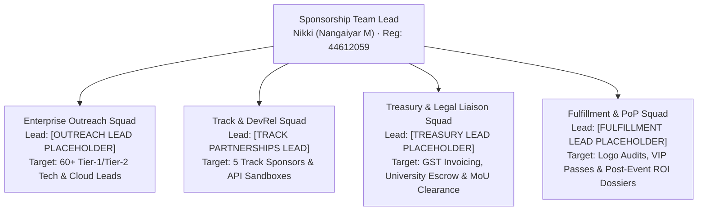
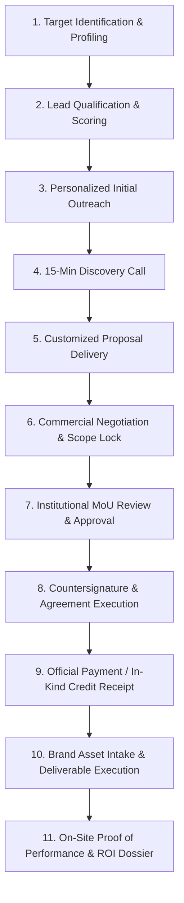

# KAIROS 2027 — Sponsorship & Corporate Partnerships Command Center

> **Domain:** Corporate Partnerships, Enterprise Outreach, Grants & Sponsor Deliverables  
> **Host Organization:** AWS Student Builder Group — SIST Chapter, Sathyabama Institute of Science and Technology  
> **Event Dates:** 22–24 January 2027 (Grand Finale) | 02–04 January 2027 (Online Qualifier)  
> **Working Capital Baseline:** ₹3,50,000 – ₹4,00,000 (Target Cash Pool)  
> **Participant Policy:** 100% Free Entry, Boarding & Meals for all 100 Shortlisted Teams (~400–600 Finalists)  
> **Current Working Date:** 17 October 2026 | **Source of Truth:** [`00_sponsorship_source_of_truth.md`](./00_sponsorship_source_of_truth.md)

---

## 1. Team Charter & Governance

### 1.1 Mission & Value Creation
The Sponsorship & Corporate Partnerships division fuels KAIROS 2027 by securing the capital, cloud resources, developer toolkits, and in-kind logistics necessary to deliver a **100% free, premier national hackathon experience** for 100 shortlisted finalist teams (~400–600 developers). 

### 1.2 Core Mandates & Success Measures
- **Capital Target:** Secure ₹3,50,000 – ₹4,00,000 in liquid corporate sponsorship into university escrow (`[CONFIRMED BASELINE]`).
- **Title Partner Anchor:** ₹2,00,000 Title Partner commitment locked via bilateral MoU (`[STAGE 5 — IN REVIEW]`).
- **Co-Powered By Anchor:** ₹1,00,000 Co-Powered Sponsor commitment locked via bilateral MoU.
- **Track Bounty Partners:** 5 specialized innovation track bounties (₹25,000 – ₹50,000 each).
- **In-Kind Ecosystem Perks:** $50,000+ AWS Cloud Credits, 2,000+ cans of energy beverages, 500+ developer IDE/API licenses.
- **MoU Compliance Rate:** 100% of corporate logos displayed on stage, website, and banners must be backed by a verified university agreement or written corporate authorization.

### 1.3 Division Structure & Internal Roles


| Role | Designate / Lead | Register No / Contact | Authority & Accountabilities |
|---|---|:---:|---|
| **Sponsorship Team Lead** | **Nikki (Nangaiyar M)** | `44612059`<br/>`+91 8754976892` | **Division Accountable (A):** Master pipeline velocity, final commercial negotiations, custom package approvals, executive reporting. |
| **Enterprise Outreach Lead** | Corporate Outreach Lead | `[ASSIGNED SQUAD LEAD]` | **Responsible (R):** Target research, initial touchpoints, CRM lead scoring, discovery call scheduling. |
| **Track Partnerships Lead** | Track & Bounties Lead | `[ASSIGNED SQUAD LEAD]` | **Responsible (R):** Technical problem statement alignment, API sandbox perks, tool licenses, mentor slots. |
| **Treasury & Audit Lead** | Treasury & Escrow Lead | `[ASSIGNED SQUAD LEAD]` | **Responsible (R):** University bank invoice coordination, receipt tracking, financial ledger reconciliation, prize escrow audit. |
| **Fulfillment Lead** | Fulfillment & PoP Lead | `[ASSIGNED SQUAD LEAD]` | **Responsible (R):** High-res vector logo intake, pre-press proof approval, on-site photo evidence collection, 10-slide ROI report. |
| **Chapter President & SBGL** | **Thenappan T** | `44110855`<br/>`+91 6381801640` | **Consulted / Informed (C/I):** Apex chapter governance, institutional escalations, keynote sponsor reception. |
| **Faculty Coordinators** | **Dr. K. Ashok Kumar** & **Dr. Balapriya S** | Dept. of CSE, SIST | **Institutional Authority:** Official University sanction letters, administrative endorsements, university escrow approvals. |

---

## 2. Internal RACI Responsibility Map

To eliminate duplicate efforts and ensure single-point accountability across the 5 squads:

```
+------------------------------------------+-------+-------+-------+-------+-------+-------+
| Sponsorship Deliverable / Workstream     |Spons. | Outr. | Track | Treas | Fulf. | Pres. |
+------------------------------------------+-------+-------+-------+-------+-------+-------+
| Corporate Prospect Scoring & CRM Hygiene |   A   |   R   |   C   |   I   |   I   |   I   |
| 15-Minute CXO Discovery Calls            |   A   |   R   |   C   |   I   |   I   |   C   |
| Custom Proposal Deck & Pitch Letter      |   A   |   R   |   R   |   C   |   I   |   I   |
| Commercial Term Negotiation              |   A   |   C   |   C   |   C   |   I   |   C   |
| Institutional MoU Review & Legal Sign-off|   A   |   I   |   I   |   R   |   I   |   C   |
| University Bank Transfer & GST Receipt   |   C   |   I   |   I   |   A   |   I   |   I   |
| Vector Logo Intake & Brand Handoff       |   I   |   I   |   I   |   I   |   A   |   I   |
| On-Site Sponsor Booth & VIP Hospitality  |   C   |   I   |   R   |   I   |   A   |   C   |
| 48H Proof of Performance (PoP) Dossier   |   A   |   I   |   I   |   I   |   R   |   I   |
| Post-Event Sponsor ROI Deck & Renewal    |   A   |   C   |   C   |   C   |   R   |   C   |
+------------------------------------------+-------+-------+-------+-------+-------+-------+
```

---

## 3. Major Deliverables, Workflows & Acceptance Standards

| Output / Deliverable | Accountable | Working Role | Target Due Date | Acceptance Criteria (Must Meet Before Closing) | Downstream Hand-off |
|---|---|---|:---:|---|---|
| **Audited CRM Leads Pipeline** | Nikki (Sponsorship Lead) | Outreach Squad | Weekly (Fridays) | 60+ verified leads, 0 fictitious Closed-Won claims, all next actions assigned. | Core Council |
| **Customized Corporate Pitch Deck** | Nikki (Sponsorship Lead) | Pitch Squad | T-60 Days | 14-slide master format, verified tiers, zero unapproved cash bounty claims. | Prospective Sponsor |
| **Official Corporate Proposal Letter** | Nikki (Sponsorship Lead) | Treasury Lead | T-45 Days | SIST official letterhead, correct signatory designations, university escrow terms. | Corporate VP/CMO |
| **Bilateral Sponsorship MoU** | Nikki (Sponsorship Lead) | Faculty Coord. | T-14 Days | University legal review passed, countersigned by Registrar/Dean and Corporate Head. | Institutional Archive |
| **Vector Logo & Asset Vault** | Fulfillment | Design Liaison | T-14 Days | High-res `.svg`/`.ai` vector with transparent background and clear zone guidelines. | Team 02 (Design) |
| **Sponsor On-Site Requirements** | Fulfillment | Ops Liaison | T-7 Days | Exact power wattage, booth footprint, banner count, VIP headcount documented. | Team 06 (Operations) |
| **Proof of Performance (PoP) Dossier** | Nikki (Sponsorship Lead) | Fulfillment Lead | T+7 Days | High-res photos of stage backdrop, LED loop, booth, banner, and social reach stats. | Corporate Sponsor |

---

## 4. Operational Boundaries (Scope of Control)

To ensure operational excellence and avoid cross-team friction, the Sponsorship team operates within defined jurisdictional boundaries:

### What This Team Controls
- Corporate prospect research, lead scoring, and pipeline hygiene in the CRM.
- Drafting, customizing, and transmitting pitch decks and formal proposal letters.
- Conducting corporate discovery calls, pitching packages, and leading sponsor negotiations.
- Routing draft MoUs through institutional faculty advisors and university accounts.
- Managing sponsor brand asset intake (logos, video stingers, banners, track problem briefs).
- Tracking deliverable execution on-site and compiling post-event Proof of Performance (PoP) dossiers.

### What This Team Does NOT Control
- **No Private Payment Handling:** Student organizers never collect cash, accept funds into personal UPI/bank accounts, or issue personal receipts. All funds route strictly through verified university accounts.
- **No Unilateral Legal Commitments:** No student has signatory authority to bind the university. MoUs are ratified strictly by the Dean, Registrar, or authorized university officials.
- **No Unilateral Graphic Printing:** Design and print production are executed by Division 2 (Design). The sponsorship team validates sponsor logo correctness and approves pre-press proofs.
- **No Stage/AV Technical Control:** Stage hardware, LED wall rendering, and live stream switching are executed by Division 5 (Media & Production). The sponsorship team schedules sponsor speaking slots and supplies approved media assets.
- **No Personal Data Brokering:** Participant data is never sold or handed over en masse. Only opt-in, consent-based candidate books approved by university authorities are shared with qualified partners.

---

## 5. Immediate "Start Here Today" Action Checklist (17–24 October 2026)

> [!IMPORTANT]
> Today is **17 October 2026**. Historical tasks with September or early October deadlines are **overdue** and must be rescheduled immediately. Do not treat overdue tasks as completed.

### Urgent Priorities for the Next 7 Days:

- [ ] **Day 1 (17 Oct): Reconcile CRM Pipeline & Reset Overdue Deadlines**
  - Audit [`company_leads_tracker/corporate_sponsorship_pipeline_crm.md`](./company_leads_tracker/corporate_sponsorship_pipeline_crm.md).
  - Clear fictitious "Closed-Won" claims; reclassify all prospective partners (AWS, Presidio, Zoho, Freshworks, Red Bull, Postman) as `Prospect / Proposed` until formal MoUs exist.
  - Reschedule all overdue September/October outreach actions to active October dates.
- [ ] **Day 2 (18 Oct): Institutional Invoicing & Bank Routing Verification**
  - Meet with Faculty Coordinators (Dr. K. Ashok Kumar & Dr. Balapriya S) to confirm the exact university account details, GST invoice workflow, and payment receipt confirmation path.
  - Resolve Decision `DEC-05` in [`00_sponsorship_source_of_truth.md`](./00_sponsorship_source_of_truth.md).
- [ ] **Day 3 (19 Oct): Lock Master Proposal Package & Tier Matrix**
  - Finalize base funding scenario (Target ₹3.5L–₹4.0L) with Nikki (Sponsorship Lead) and President Thenappan T using [`01_sponsorship_strategy_and_package_matrix.md`](./01_sponsorship_strategy_and_package_matrix.md).
  - Resolve Decision `DEC-01` (Package pricing and slot count limits).
- [ ] **Day 4 (20 Oct): Prepare Clean Outreach Packets**
  - Review standardized email scripts in [`02_prospecting_outreach_and_negotiation_playbook.md`](./02_prospecting_outreach_and_negotiation_playbook.md).
  - Ensure all external proposal letters and pitch decks have university letterhead placeholders and draft disclaimers.
- [ ] **Day 5 (21 Oct): Launch Wave 1 Enterprise Outreach**
  - Dispatch first batch of 15 qualified outreach communications to Cloud/AI and Enterprise SaaS prospects.
  - Log all outbound messages in CRM within 4 hours of dispatch.
- [ ] **Day 6 (22 Oct): Track Partner Engagement**
  - Engage potential Developer Tooling, Web3, and FinTech track bounty sponsors with standardized problem brief templates.
- [ ] **Day 7 (24 Oct): First Weekly Pipeline Review**
  - Conduct weekly pipeline audit using the agenda in [`05_finance_controls_and_pipeline_review.md`](./05_finance_controls_and_pipeline_review.md).
  - Present progress report to Executive Council and Faculty Coordinators.

---

## 6. Master Documentation Architecture

The sponsorship workspace is structured into a modular operating system. Refer to the canonical document corresponding to your task:

| Document | File Path | Core Use Case & Scope | Primary Audience | Update Frequency |
|---|---|---|---|---|
| **Source of Truth** | [`00_sponsorship_source_of_truth.md`](./00_sponsorship_source_of_truth.md) | Canonical facts, status rules, decision register, and conflict resolution. | All Team Members, Faculty | As decisions are ratified |
| **Strategy & Packages** | [`01_sponsorship_strategy_and_package_matrix.md`](./01_sponsorship_strategy_and_package_matrix.md) | Value proposition, tier matrix, inventory limits, and funding scenarios. | Sponsorship Team, Prospects | Bi-weekly |
| **Outreach Playbook** | [`02_prospecting_outreach_and_negotiation_playbook.md`](./02_prospecting_outreach_and_negotiation_playbook.md) | Lead scoring, email/DM templates, pitch scripts, objection battlecards. | Outreach Squad | Weekly |
| **Pitch Deck Kit** | [`03_pitch_deck_and_sponsor_meeting_kit.md`](./03_pitch_deck_and_sponsor_meeting_kit.md) | 14-slide master outline, one-page brief, meeting prep & recap checklist. | Pitchers, CXOs | Pre/Post Meeting |
| **Contracting & Approvals** | [`04_proposal_contracting_and_approval_workflow.md`](./04_proposal_contracting_and_approval_workflow.md) | Proposal structure, MoU legal review, RACI matrix, payment controls. | Legal, Finance, Sponsorship Lead | Per Deal Closing |
| **Finance Controls** | [`05_finance_controls_and_pipeline_review.md`](./05_finance_controls_and_pipeline_review.md) | Cash vs in-kind accounting, weekly review agenda, executive reporting. | Treasury, Sponsorship Lead, Faculty | Weekly (Fridays) |
| **Benefit Fulfillment** | [`06_fulfillment_assets_and_proof_of_performance.md`](./06_fulfillment_assets_and_proof_of_performance.md) | Asset intake specs, cross-team routing, on-site PoP photo protocol. | Operations, Design, Media | Event Cycle |
| **ROI & Renewal** | [`07_post_event_roi_and_renewal.md`](./07_post_event_roi_and_renewal.md) | Post-event sponsor ROI dossier structure, talent connect, renewals. | Signed Sponsors, Sponsorship Lead | Post-Event (Jan–Feb) |

### Functional Subdirectories

- 📁 [`company_leads_tracker/`](./company_leads_tracker/): Live CRM tracking matrix, lead scoring rubrics, and meeting minutes templates.
- 📁 [`pitch_decks/`](./pitch_decks/): Master 14-slide corporate pitch deck specifications and presentation asset guides.
- 📁 [`signed_mous_and_contracts/`](./signed_mous_and_contracts/): Bilateral corporate MoU template, non-tech corporate proposal letter, and institutional agreement records.
- 📁 [`sponsor_deliverables_and_assets/`](./sponsor_deliverables_and_assets/): Sponsor asset ingestion specifications, vector logo vaults, and fulfillment tracking matrices.
- 📁 [`word_documents/`](./word_documents/): Audited Word (`.docx`) exports and compiled operational manuals.

---

## 7. End-to-End Sponsorship Deal Lifecycle

Every partnership follows an 11-step stage-gated lifecycle to ensure compliance, transparency, and flawless execution:



1. **Target Identification:** Research enterprise companies aligning with event pillars (Cloud, Agentic AI, DevTools, FinTech, Web3, Youth Brands).
2. **Lead Qualification:** Evaluate against the 5-point lead scoring rubric (Fit, Budget, Timing, Value Exchange, Access).
3. **Initial Outreach:** Dispatch tailored cold email, warm introduction, or LinkedIn InMail.
4. **Discovery Call:** 15–20 minute structured meeting to uncover corporate hiring, marketing, and developer relations objectives.
5. **Tailored Proposal:** Prepare customized deck and proposal letter reflecting agreed tiers and problem statements.
6. **Negotiation:** Align deliverables, pricing, and custom track bounties within established policy guardrails.
7. **Institutional Approval:** Route draft agreement to Faculty Coordinators and University Legal/Finance authorities.
8. **Countersignature:** Execute bilateral MoU featuring institutional seals and corporate authorized signatures.
9. **Payment Receipt:** Track corporate transfer into verified university accounts; verify credit voucher before marking "Paid".
10. **Deliverable Execution:** Ingest high-res vector logos, video stingers, and roll-up designs; coordinate physical staging with Operations.
11. **Proof of Performance (PoP):** Capture high-resolution photo/video evidence on-site; deliver executive ROI dossier within 7 days.

---

## 8. Operating Cadence, Escalation & Review Rules

### 8.1 Weekly Review Cadence
- **Friday 18:00 IST — CRM Pipeline Freeze:** All outreach calls, touchpoints, and stage transitions must be logged in [`corporate_sponsorship_pipeline_crm.md`](./company_leads_tracker/corporate_sponsorship_pipeline_crm.md).
- **Sunday 19:00 IST — Core Council Sync:** Nikki (Sponsorship Lead) presents the week's pipeline velocity, stage conversions, and upcoming CXO discovery meetings.
- **Bi-Weekly Faculty Escrow Audit:** Reconcile institutional bank credits against signed corporate agreements.

### 8.2 Escalation Triggers
- **Stalled MoU (> 5 business days):** Escalate immediately to Faculty Coordinators (Dr. K. Ashok Kumar & Dr. Balapriya S) for administrative intervention.
- **Unapproved Deliverable Request:** If a corporate prospect requests custom perks outside the approved tier matrix (e.g. exclusive main-stage access, raw candidate resumes without affirmative opt-in consent), escalate to President Thenappan T before responding.
- **Payment Delay Post-Agreement (> 7 days):** Alert Treasury Lead to issue a formal university invoice reminder with GST tracking.

---

## 9. Policy Notice: Student Referral Commissions

> [!WARNING]
> **RAINMAKER BOUNTY STATUS: `[APPROVAL REQUIRED — DO NOT OFFER]`**  
> Prior drafts described a decentralized 10%–15% cash commission model for students securing corporate sponsors. **This arrangement has NOT received formal approval from Sathyabama Institute of Science and Technology administrative and finance authorities.**  
> 
> Offering unapproved financial commissions creates severe institutional, tax (TDS), and legal liabilities. **Team members must NOT offer cash bounties or commission promises to students or third parties.**  
> 
> All student contributor recognition currently operates via non-monetary academic and community honors (Official Recommendation Letters from President Thenappan T, VIP Main-Stage Passes, National Corporate Connector Trophies, and Exclusive Streetwear Kits). Any future financial incentive model must be formally ratified in writing by the University Finance Officer before activation.
