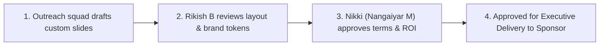

# Pitch Decks & Corporate Collateral Specification

> **Subfolder:** `teams/01_sponsorship_and_partnerships/pitch_decks/`  
> **Direct Lead & Final Approver:** **Nikki (Nangaiyar M)** (CPFO & Sponsorship Lead, Reg: `44612059`, Phone: `+91 8754976892`, Email: `nangaiyarmuthkrishnan@gmail.com`)  
> **Creative Collaborator:** Rikish B (Design Lead, Reg: `44110664`, Phone: `+91 9597430250`)  
> **Faculty Coordinators:** Dr. K. Ashok Kumar & Dr. Balapriya .S (Department of CSE)  

---

## 1. Scope & Mandate

This folder contains all master slide decks, customized corporate pitch decks, executive one-pagers, and export artifacts presented to corporate sponsors, venture funds, and institutional grant bodies.

### What Must Be Done in This Folder
1. Maintain the canonical 14-slide master corporate deck in both PowerPoint (`.pptx`) and print/vector PDF (`.pdf`).
2. Generate customized pitch decks for tier-1 prospective sponsors (e.g., tailoring Slide 6 to feature AWS Bedrock, Presidio Cloud, Zoho SaaS, or Red Bull fueling).
3. Export lightweight, high-resolution PDF one-pagers for email attachments (< 5MB) and 4K uncompressed versions for in-person C-suite presentations.

---

## 2. Who Fills What (Accountability)

| Section / Deliverable | Primary Owner | Co-Owner / Reviewer | Target Delivery |
|---|---|---|---|
| **Master 14-Slide Deck Copy** | Nikki (Nangaiyar M) | Rikish B | September 20, 2026 |
| **Visual Styling & Slide Typography** | Rikish B | Caroline McPherson | September 25, 2026 |
| **Custom Sponsor Addendums** | Enterprise Outreach Sub-Head | Nikki (Nangaiyar M) | 48h before client call |
| **1-Page Executive PDF Brief** | Documentation Sub-Head | Nikki (Nangaiyar M) | October 01, 2026 |
| **Slide Export & Cloud Drive Upload** | Treasury Lead | Nikki (Nangaiyar M) | Rolling |

---

## 3. Technical Specifications & Dimensions

* **Aspect Ratio:** **16:9 Widescreen** (Strictly 3840 × 2160 px for 4K presentation displays or 1920 × 1080 px standard).
* **Typography:** Official **Amazon Ember** typeface family only:
  - Slide Titles (H1): `Amazon Ember Display Bold` (36pt – 44pt, `#FFFFFF`)
  - Subheadings & Accents: `Amazon Ember Display Medium` (20pt – 24pt, `#FF9900` Smile Amber)
  - Body Text: `Amazon Ember Display Regular` (14pt – 16pt, `#D5DBDB` Cloud Silver)
  - Code & Metrics: `Amazon Ember Duospace` / `Amazon Ember Mono`
* **Color Palette:**
  - Canvas Background: Obsidian Abyss (`#0D1117`) or Deep Squid Ink (`#232F3E`)
  - Accent Color: AWS Smile Amber (`#FF9900`)
  - Secondary Card Fill: Cyber Slate (`#1A2433`)
  - Positive Metrics: Terminal Green (`#3FB950`)
* **File Naming Standard:**
  - Canonical: `KAIROS_2027_Master_Sponsorship_Deck_v[Major].[Minor].pdf`
  - Tailored: `KAIROS_2027_PitchDeck_[Company_Name]_[Tier].pdf`
  - Executive 1-Pager: `KAIROS_2027_Executive_OnePager_v[Major].pdf`

---

## 4. Quality Gates & Sign-Off Workflow

1. **No unauthorized discounts:** Tiers must adhere to the Master Budget (Title: ₹2,00,000; Powered-By: ₹1,00,000; Track Partner: ₹25,000–₹50,000; Operational Capital: ₹3,50,000–₹4,00,000).
2. **Logo usage:** Never place third-party company logos without maintaining clear space buffers and high-res SVG assets.
