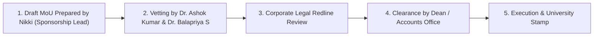

# Signed MoUs, Contracts & Financial Governance Specification

> **Subfolder:** `teams/01_sponsorship_and_partnerships/signed_mous_and_contracts/`  
> **Direct Lead & Sponsorship Head:** **Nikki (Nangaiyar M)** (Sponsorship Team Lead, Reg: `44612059`, Phone: `+91 8754976892`)  
> **Institutional Signatory:** Dean, School of Computing & Registrar, Sathyabama Institute of Science and Technology  
> **Faculty Coordinators:** Dr. K. Ashok Kumar & Dr. Balapriya S (Department of CSE)  
> **Source of Truth:** [`../00_sponsorship_source_of_truth.md`](../00_sponsorship_source_of_truth.md) · [`../04_proposal_contracting_and_approval_workflow.md`](../04_proposal_contracting_and_approval_workflow.md)

---

## 1. Scope & Mandate

This directory serves as the legal and contractual repository for KAIROS 2027. It houses standardized bilateral Memorandums of Understanding (MoUs), customized proposal letters, and archival records for countersigned sponsorship agreements, GST tax invoices, and university payment receipts.

> [!WARNING]
> **GOVERNANCE NOTICE: DRAFT STATUS**  
> All legal and financial templates in this directory are marked **`DRAFT — NOT FOR SIGNATURE UNTIL UNIVERSITY REVIEW AND APPROVAL`**. Student organizers have no legal standing to execute binding agreements. All MoUs must be vetted by Faculty Coordinators and formally executed by authorized university authorities (Dean / Registrar).

---

## 2. Directory Resources & Standard Templates

- 📄 [`corporate_sponsorship_mou_standard_template.md`](./corporate_sponsorship_mou_standard_template.md): Formal bilateral MoU agreement for corporate partners featuring 100% student IP protection, opt-in talent engagement clauses, and institutional bank routing notes.
- 📄 [`non_tech_corporate_sponsorship_proposal_letter.md`](./non_tech_corporate_sponsorship_proposal_letter.md): Formal institutional invitation letter for corporate, BFSI, FMCG, retail, and CSR enterprise partners.

---

## 3. Contract Routing & Approval Workflow



| Document / Step | Responsible Person | Approving Authority | Verification Artifact |
|---|---|---|---|
| **Drafting Standard MoU** | Nikki (Nangaiyar M) | Dr. K. Ashok Kumar & Dr. Balapriya S | Word / Markdown draft |
| **Corporate Legal Vetting** | Corporate Counsel | Institutional Legal Cell | Redline markup document |
| **Faculty & Dean Endorsement** | Dr. K. Ashok Kumar & Dr. Balapriya S | Dr. L. Lakshmanan (Dean) | Physical signature & departmental seal |
| **University Bank Account & Invoice** | University Accounts Office | Finance Officer, SIST | Official GST invoice with SIST GSTIN |
| **Payment Receipt & Ledger Update** | Treasury Sub-Head | Nikki (Nangaiyar M) | Bank UTR / Transaction credit slip |

---

## 4. Contract Archival & File Naming Conventions

All executed PDF agreements must be archived using this strict taxonomy:
- `MOU_[Company_Name]_[Tier]_[Amount]_SIGNED.pdf` (e.g., `MOU_AcmeCorp_CoPoweredBy_100K_SIGNED.pdf`)
- `INV_[Invoice_No]_[Company_Name]_[Date].pdf` (e.g., `INV_SIST_2026_094_AcmeCorp.pdf`)
- `UTR_[Company_Name]_[Transaction_ID].pdf` (e.g., `UTR_AcmeCorp_HDFC294819482.pdf`)

---

## 5. University Bank Account & Invoicing Protocol

All commercial payments must be executed via direct NEFT/RTGS into the official university account. In draft materials, bank details are represented via placeholders:

```text
Beneficiary Name: SATHYABAMA INSTITUTE OF SCIENCE AND TECHNOLOGY
Account Type: Institutional Project / Current Account
Bank Name: [Official University Banker, e.g., Indian Bank]
Branch: [Sathyabama University Branch, Chennai - 600119]
Account Number: [Formally Disclosed upon Official GST Invoice Issuance]
IFSC Code: [Formally Disclosed upon Official GST Invoice Issuance]
Purpose Remark: KAIROS 2027 HACKATHON SPONSORSHIP - [COMPANY NAME]
```
