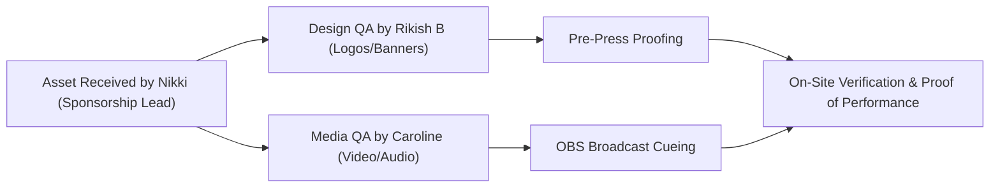

# Sponsor Deliverables & Brand Assets Specification

> **Subfolder:** `teams/01_sponsorship_and_partnerships/sponsor_deliverables_and_assets/`  
> **Direct Lead:** **Nikki (Nangaiyar M)** (Sponsorship Team Lead, Reg: `44612059`, Phone: `+91 8754976892`)  
> **Collaborating Leads:** Rikish B (Design Lead, Reg: `44110664`) & Caroline Mary McPherson (Media Head 1, Reg: `44110124`)  
> **Source of Truth:** [`../00_sponsorship_source_of_truth.md`](../00_sponsorship_source_of_truth.md) · [`../06_fulfillment_assets_and_proof_of_performance.md`](../06_fulfillment_assets_and_proof_of_performance.md)  
> **Hard Print Freeze Deadline:** **20 December 2026**

---

## 1. Scope & Mandate

This directory manages the intake, technical validation, secure storage, and cross-team routing of corporate sponsor assets for KAIROS 2027. Once an enterprise sponsor commits via an executed bilateral MoU, their brand assets are ingested according to strict production standards for physical banners, digital broadcasts, stage LED walls, and print collateral.

### Core Resources in this Directory:
- 📄 [`sponsor_benefit_fulfillment_checklist.md`](./sponsor_benefit_fulfillment_checklist.md): The live master deliverable tracking matrix across all contracted partners.
- 📄 [`sponsor_asset_intake_and_delivery_spec.md`](./sponsor_asset_intake_and_delivery_spec.md): Comprehensive technical specifications for vector logos, video commercials, stage presentations, and banner dimensions.

---

## 2. Ingestion Accountability & Cross-Team Workflow



| Ingestion Step | Responsible Person | Quality Verification Method |
|---|---|---|
| **Request Asset Package from Sponsor POC** | Nikki (Nangaiyar M) | Standardized intake email with specs sheet |
| **Vector & Resolution Validation** | Rikish B (Design Lead) | Adobe Illustrator / Figma SVG node audit |
| **Video Audio-Level & Codec Check** | Caroline Mary McPherson | OBS / VLC render test (1080p60 H.264, -14 LUFS) |
| **Placement on Physical Print Proofs** | Rikish B | Banner pre-press proofs checked before Dec 20 |
| **Live Stream Overlay Integration** | Caroline Mary McPherson | ATEM Mini Pro & OBS scene switch test |
| **On-Site Proof of Performance (PoP)** | Nikki & Dedicated Photographer | 8-shot photographic protocol compiled into ROI dossier |

---

## 3. Directory Structure for Ingested Corporate Assets

Upon executing an official agreement, the team provisions a dedicated partner folder within this directory:

```text
sponsor_deliverables_and_assets/
├── logos/                  # Vector logos (SVG, EPS, AI, 300 DPI transparent PNG)
├── video_stingers/         # 1080p 60fps video commercials for live stream breaks (15s / 30s)
├── slide_templates/        # Keynote deck slides and presentation decks from partners
├── booth_collateral/       # Stall design blueprints, roll-up banner print files
└── track_bounties/         # Problem statement markdown/PDFs, API keys, documentation links
```
