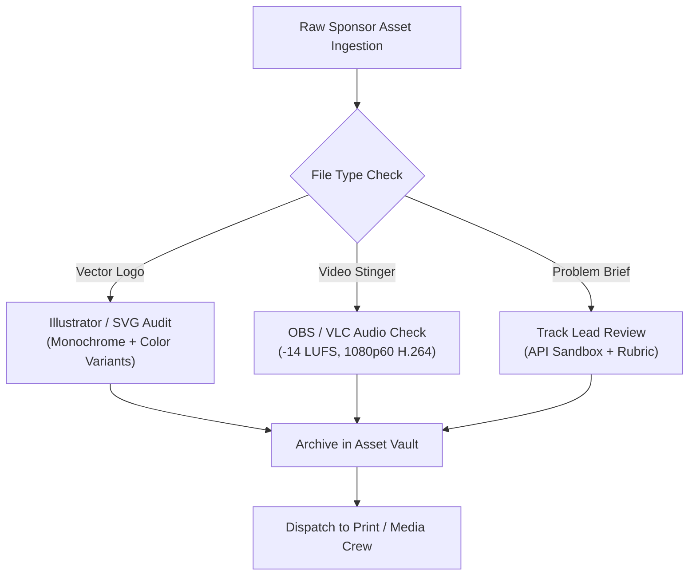

# KAIROS 2027 — Sponsor Brand Asset Intake & Delivery Specification

> **Document Status:** CANONICAL TECHNICAL SPECIFICATION  
> **Audience:** Sponsorship Team, Design Team (Rikish B), Media Team (Caroline Mary McPherson), Sponsor Corporate Marketing  
> **Direct Accountability:** **Nikki (Nangaiyar M)** (Sponsorship Team Lead), Rikish B (Design Lead)  
> **Source of Truth:** [`../00_sponsorship_source_of_truth.md`](../00_sponsorship_source_of_truth.md) · [`../06_fulfillment_assets_and_proof_of_performance.md`](../06_fulfillment_assets_and_proof_of_performance.md)  
> **Hard Print Freeze Deadline:** **20 December 2026** (Non-negotiable)

---

## 1. Scope & Objective

This document defines the technical intake, quality assurance, and physical/digital staging standards for all corporate sponsor brand assets for KAIROS 2027. Flawless asset execution protects sponsor brand integrity and ensures high-prestige presentation across all physical, print, and live stream surfaces.

---

## 2. Technical Asset Intake Specifications

### 1. Corporate Logo Guidelines & Standards

To ensure crisp rendering on 4K digital displays and large-format physical canvas:
- **Mandatory Formats:** Vector formats strictly required: `.svg`, `.ai`, or `.eps`. High-resolution raster `.png` (min 3000 × 3000 px at 300 DPI with transparent background) accepted only as fallback.
- **Required Colorway Variants:**
  1. *Primary Full-Color:* For white/light surfaces (program booklets, website light badges).
  2. *Monochrome Inverted White:* For Deep Obsidian (`#0D1117`) surfaces (3840×1920 LED Wall, stage backdrop, hoodies, dark web pages).
  3. *Square 1:1 Monogram / App Icon:* For participant smart badges, mobile navigation, and small digital credits.
- **Strict Prohibition:** JPEGs with white square backgrounds, pixelated web scrapes, low-res bitmaps (< 300 DPI), or stretched/distorted aspect ratios are **strictly rejected** at intake.

---

### 2. Live Stream Video Commercial Stingers

For broadcast over the continuous 48-hour multi-camera YouTube and LinkedIn live stream:
- **Resolution:** Full HD `1920 × 1080 px` (1080p).
- **Frame Rate:** Exactly `60.00 fps` (frames per second) progressive.
- **Codec & Container:** `H.264 / AVC` video in an `.mp4` container. Target video bitrate: `12–16 Mbps`.
- **Audio Standards:** Stereo `AAC 320 kbps` at `48.0 kHz`. **Audio normalization mandatory: integrated loudness at `-14 LUFS` (±1 LUFS)** to match broadcast switching levels.
- **Duration Limits:**
  - Co-Powered By Partners: Exactly **15.0 seconds**.
  - Title Presenting Partner: Exactly **30.0 seconds**.
  - *(Videos exceeding time limits will be returned for trimming).*

---

### 3. Stage Keynote Slide Decks

For corporate presentations during Inaugural and Plenary sessions:
- **Aspect Ratio:** **16:9 Widescreen** (3840 × 2160 px or 1920 × 1080 px).
- **Format:** Vector-compressed `.pdf` or standalone `.pptx`.
- **Media Packaging:** Any embedded video or audio clips must be provided as separate raw media files in a companion folder.
- **Auditorium Optimization:** High-contrast text designed for projection in Sathyabama Indoor Stadium. Minimum recommended body font size: `24pt`.

---

### 4. Physical Venue Banners & Rollup Standees

For physical fabrication by Division 2 (Design) and print vendors:
- **Color Mode:** **CMYK** (Cyan, Magenta, Yellow, Key Black) for accurate print ink reproduction.
- **Resolution:** `300 DPI` at final output scale.
- **Bleed Margins:** Minimum `2.0 inches` (50 mm) bleed margin on all four sides.
- **Canvas Dimensions:**
  - Stage Backdrop: `20 ft × 10 ft` (W × H).
  - Grand Foyer Welcome Backdrop: `12 ft × 8 ft` (W × H).
  - Vertical Rollup Standees: `6 ft × 3 ft` (W × H).

---

### 5. Technical Track Problem Statements & API Access

For companies anchoring a dedicated technical track or custom problem bounty:
- **Documentation Format:** Standardized Markdown (`.md`) or PDF document.
- **Mandatory Sections:**
  1. *Challenge Title & Strategic Context* (What industry problem are builders solving?).
  2. *Technical Scope & Recommended Tech Stack* (Which APIs, SDKs, or models must be used?).
  3. *Developer Sandbox & Credentials* (Test account access, API keys, documentation links, credit vouchers).
  4. *Evaluation Rubric* (Weighted criteria: Architecture 30%, Innovation 30%, Usability 20%, Impact 20%).
  5. *Designated Jury POC* (Name, title, email, and on-site / virtual availability).

---

## 3. Production Lead Times & Hard Deadlines

To prevent print delays, shipping bottlenecks, and AV glitches:

| Asset Milestone | Milestone Hard Deadline | Operational Consequence if Missed |
|---|:---:|---|
| **Vector Logos Ingestion** | **20 December 2026 (Print Freeze)** | Logo cannot be printed on physical hoodies, badges, stage backdrops, or standees. Only digital LED/web credit possible. |
| **Physical Stall Fabrication Specs** | **25 December 2026** | Custom booth fabrication unavailable; standard basic tabletop setup provided. |
| **Track Challenge Briefs & Sandbox APIs** | **28 December 2026** | Problem statement cannot be included in Online Qualifier; deferred to on-site bonus bounty only. |
| **Executive Headshot & Speaker Bio** | **05 January 2027** | Speaker profile omitted from printed official event guide and inaugural brochure. |
| **Video Commercial Stingers** | **10 January 2027** | Video excluded from automated OBS broadcast switching schedule. |
| **Final Keynote Presentation Deck** | **18 January 2027** | Deck excluded from pre-event AV technical rehearsal. |
