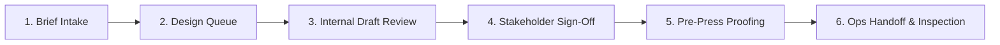
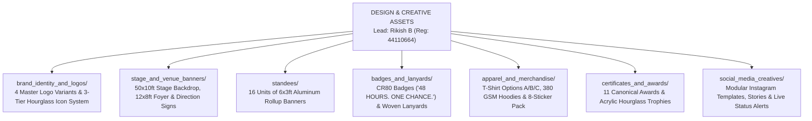

# KAIROS — Design & Creative Assets Workspace

**Document Reference:** `teams/02_design_and_creative_assets/README.md`  
**Host Entity:** AWS Student Builder Group (AWS SBG) — SIST Chapter  
**Sponsoring Department:** School of Computing, Sathyabama Institute of Science and Technology, Chennai – 600119  
**Direct Lead:** **Rikish B** (Design Lead, Reg: `44110664`, Phone: `+91 9597430250`, Email: `rikish2006@gmail.com`)  
**Collaborating Lead:** **Caroline Mary McPherson** (Media & PR Team Lead, Reg: `44110124`, Phone: `+91 8838990182`)  
**Supervising Authority:** **Thenappan T** (President & SBGL, Reg: `44110855`, Phone: `+91 6381801640`)  
**Master Brand Book Reference:** `DOC-04 (Design & Branding Guidelines)`  
**Governing Standards (Executive Planning Framework):** `DOC-00 (Master Brief)` · `DOC-06 (Tracks & Tech Architecture)` · `DOC-20 (Indoor Stadium Transition Plan)`  
**Master Slogan:** **`KAIROS: MAKE TIME. MAKE SOMETHING.`**  
**Core Narrative:** `Time → Idea → Build → Ship`  
**Recognition Mandate:** *Someone should see any KAIROS asset for 2 seconds and immediately recognize the hackathon.*  
**Status:** `CONFIRMED MASTER OPERATING STANDARD`  

---

## 1. Team Charter & Operational Scope

### 1.1 Mission & Design Philosophy
Division 2 establishes and guards the master visual identity of KAIROS 2027. Under our core thesis—**"Someone should see any KAIROS asset for 2 seconds and immediately recognize the hackathon"**—the team crafts an immersive Obsidian-Violet cyber-aesthetic spanning massive 50×10ft stage vinyls, laser-etched smart NFC badges, developer streetwear, acrylic hourglass trophies, and high-engagement social media campaigns.

### 1.2 Core Mandates & Success Measures
- **2-Second Visual Recognition:** 100% adherence to the Obsidian-Violet (`#050505` / `#A855F7`) design system.
- **Zero Pixelation Guarantee:** All printed assets exported as vector PDFs or minimum 300 DPI high-resolution CMYK raster files with calibrated 3mm bleed margins.
- **Evergreen Logo Integrity:** Primary circular emblem preserved across all collateral with zero hardcoded date lockups.
- **Pre-Press Delivery Deadline:** All print-ready artwork (backdrop, 16 standees, 600 badges, 550 tees) approved and delivered to vendors by `T-7 Days` (`[DEADLINE: 15 JAN 2027]`).
- **Physical Inspection Acceptance:** 100% of vendor physical proofs inspected and verified before bulk production run.

### 1.3 Operational Boundaries (Scope of Control)
- **What This Team Controls:** Vector logo vaults, typography guidelines, stage and venue banner artwork, rollup standees, badge/lanyard graphic specs, merchandise mockups, trophy/certificate vectors, Figma UI component design.
- **What This Team Does NOT Control:**
  - *No Code Implementation:* Web frontend deployment and React/Next.js components are coded by Division 5 (Hands-On Builder & Website).
  - *No Physical Stage Rigging:* Physical truss mounting, banner zip-tying, and LED wall cable runs are executed by Division 6 (Operations).
  - *No Copywriting or Social Publishing:* Post captions, hashtag strategies, and live posting schedules are executed by Division 4 (Media & PR).
  - *No Financial Vendor Contracting:* Vendor price negotiations, purchase orders, and invoice clearance route strictly through Nikki (Sponsorship Lead) and University Accounts.

---

## 2. Internal RACI Responsibility Map

```
+------------------------------------------+-------+-------+-------+-------+-------+-------+
| Creative Deliverable / Workstream        | Rikish| Carol.| Social| Print | Merch | Pres. |
|                                          | (Lead)| (Media)| Desgn | Lead  | Lead  | Then. |
+------------------------------------------+-------+-------+-------+-------+-------+-------+
| Master Brand Guidelines & Vector Vault   |   A   |   C   |   R   |   I   |   I   |   C   |
| 50×10ft Stage Backdrop & LED Video Wall  |   A   |   C   |   I   |   R   |   I   |   C   |
| 16 Venue Rollup Standees (6×3ft)         |   A   |   I   |   I   |   R   |   I   |   I   |
| CR80 Smart NFC Badge & Woven Lanyards    |   A   |   I   |   I   |   R   |   C   |   I   |
| T-Shirts, Hoodies & Sticker Pack         |   A   |   I   |   I   |   I   |   R   |   C   |
| 11 Hourglass Trophies & Certificates     |   A   |   I   |   I   |   R   |   I   |   C   |
| Instagram Grid (4:5) & Stories (9:16)    |   C   |   A   |   R   |   I   |   I   |   I   |
| Sponsor Vector Logo Placement & Pre-Press|   A   |   I   |   I   |   R   |   I   |   I   |
+------------------------------------------+-------+-------+-------+-------+-------+-------+
```

---

## 3. Creative Asset Intake & Production Workflow

Every design request follows a rigorous 6-step quality control pipeline:



1. **Brief Intake:** Initiating squad submits dimensions, required copy, sponsor tier logos, and delivery deadline using Template 3.
2. **Design Queue:** Design Lead Rikish B logs asset into the Figma workspace and assigns a designated squad designer.
3. **Internal Review (Round 1):** Review against Obsidian-Violet color tokens, typography hierarchy, and safe margins.
4. **Stakeholder Sign-Off (Round 2):** Team Lead and relevant functional lead approve visual proof.
5. **Pre-Press Proofing:** Export in CMYK (U.S. Web Coated SWOP v2 or Fogra39), 300 DPI, vector curves converted to outlines, 3mm bleed added.
6. **Physical Inspection & Handoff:** Physical sample proof verified for color drift; handed off to Operations for installation.

---

## 4. Executive Brand Identity Framework

All physical and digital artifacts produced by Division 2 must adhere to the **KAIROS Brand System**:



### ⚠️ Critical Evergreen Logo Mandate
Do NOT embed `"48-HOUR HACKATHON"` inside the primary circular logo badge. Keep the logo evergreen (`KAIROS` + Hourglass + `AWS STUDENT BUILDER GROUP SATHYABAMA`). Event descriptors (e.g. `"48 HOURS. ONE CHANCE."` or `"48 HOURS TO BUILD WHAT'S NEXT."`) belong exclusively on supporting collateral.

---

## 5. Official Brand Assets & Typography

### Master Assets in [`brand_identity_and_logos/`](./brand_identity_and_logos/README.md)
1. **Primary Circular Logo (4 Variants):**
   * **Variant A (Dark):** Void Black background (`#050505`), White typography, Electric Violet glow & orbit.
   * **Variant B (Light):** Crisp White background (`#FFFFFF`), Black typography, Violet accents.
   * **Variant C (Monochrome):** Pure Black silhouette or Pure White reverse.
   * **Variant D (Icon-Only):** Standalone Celestial Hourglass mark (no text) as secondary brand mark.
2. **The KAIROS Icon System (3 Variants):**
   * **Icon 01 (Full Hourglass):** Hourglass + orbit + stardust + sparkle stars (high-res print, stage, splash).
   * **Icon 02 (Minimal Hourglass):** High-contrast silhouette (apparel chest print, stickers, watermarks).
   * **Icon 03 (Micro Icon):** Simplified geometric mark optimized for 16–32 px (favicons, app icons, status pills).

### Typography System
- **Display & Hero Headings:** `Space Grotesk Bold` / `Syne Bold` (48pt – 64pt, `#FFFFFF` with `#A855F7` glow)
- **Section Headings:** `Space Grotesk SemiBold` (28pt – 36pt, `#FFFFFF`)
- **Subheadings & Accents:** `Plus Jakarta Sans SemiBold` (18pt – 22pt, `#A855F7` / `#C084FC`)
- **Body Text:** `Inter Regular` (14pt – 16pt, `#FFFFFF` / `#E9D5FF` on `#050505`, line height 1.5)
- **Monospace / Terminal / Timers:** `JetBrains Mono Medium` (10pt – 14pt, `#FFFFFF` / `#38BDF8`)

### Digital Event UI Tokens
| Token Name | Hex Code | Purpose |
|---|:---:|---|
| **Background Canvas** | `#050505` | Infinite dark body canvas; clean and flat so glowing logo pops |
| **Card Surfaces** | `#121212` | Elevated containers, modular panels, tables |
| **Border Strokes** | `#27272A` / `rgba(168, 85, 247, 0.25)` | Clean dividing lines; subtle purple hover highlights |
| **Primary Text** | `#FFFFFF` | Headings, hero labels, key data values |
| **Electric Violet (Core)** | `#A855F7` | **Primary Brand Accent**, CTA buttons, active glows |
| **Deep Violet (Secondary)**| `#3B0764` | Radial shadows, container backdrops, subtle ambient glow |
| **Cyber Orchid (Glow)** | `#C084FC` | Secondary shimmer, highlight text |
| **Matrix Emerald** | `#10B981` | Verification checkmarks, live server nodes |

---

## 6. The 5 Recurring Visual Motifs

All graphics must weave together these 5 celestial motifs:
1. ⏳ **Time:** The Celestial Hourglass
2. ✦ **Innovation:** Four-Point Sparkle Star
3. ◯ **Movement:** Elliptical Planetary Orbital Ring
4. • **Progress:** Descending Stardust Sand Beads
5. → **Momentum:** Sweeping Orbital Comet Tail

---

## 7. Minimum Brand Package (Top 15 Asset Execution Priority)

| Priority | Asset Name | Assigned Lead | Status | Primary Destination |
|:---:|---|---|:---:|---|
| 🔴 **1** | Primary Circular Logo (Evergreen) | Rikish B | Certified | Brand Vault, Stage Backdrop, Web |
| 🔴 **2** | Hourglass Icon (Full, Minimal, Micro) | Rikish B | Certified | Favicon, Discord, Watermark, Badges |
| 🔴 **3** | Dark Logo Lockup (Black Canvas) | Rikish B | In Vault | Dark Web, Hoodies, OLED Screen |
| 🔴 **4** | Light Logo Lockup (White Canvas) | Rikish B | In Vault | University Letters, Invoices |
| 🔴 **5** | Instagram Profile Avatar (1080×1080) | Caroline McPherson | Ready | `@awssbg_sist` Social Profile |
| 🔴 **6** | Instagram Post Template (4:5) | Caroline McPherson | Template Ready | Feed Announcements, Track Cards |
| 🔴 **7** | Instagram Story Template (9:16) | Harshith Raj S | Template Ready | Daily Hype, Speaker Spotlight |
| 🔴 **8** | Website Hero + Giant Countdown | Rikish B & Builder Squad | Wireframed | `kairos.sathyabama.ac.in` |
| 🔴 **9** | Participant Badge + Lanyard | Rikish B | Spec Completed | CR80 Badges & Woven Lanyards |
| 🟠 **10** | T-Shirt Blueprint (Options A/B/C) | Rikish B & Nangaiyar M | Spec Completed | Vendor PO (550 Units) |
| 🟠 **11** | 8-Sticker Collector Sheet | Rikish B | Spec Completed | Swag Kit (600 Packs) |
| 🟠 **12** | Official Certificates (11 Categories)| Hemavarshine S & Rikish B | Drafted | Valedictory & Digital Credentials |
| 🟠 **13** | Main Stage 50×10ft Backdrop & LED Wall | Rikish B & Nangaiyar M | Ready for Flex | Sathyabama Indoor Stadium Main Stage |
| 🟠 **14** | Presentation Master Template (11 Slides)| Nikki & Rikish B | Template Ready | Corporate Pitch & Orientation Decks |
| 🟠 **15** | Countdown Graphics Suite (T-48 to T-00)| Rikish B | Storyboarded | LED Wall, Web, Social Feeds |

---

## 8. Creative Lifecycle & Operating Cadence

### 8.1 5-Phase Production Lifecycle
1. **Phase 1: Brand System Lock (T-90 Days):** Typography, color tokens, and evergreen logo vectors frozen.
2. **Phase 2: Digital Asset Deployment (T-60 Days):** Website UI SVGs delivered to Team 05; social media templates delivered to Team 04.
3. **Phase 3: Pre-Press Freeze & Vendor PO (T-14 Days):** All physical print proofs (50×10ft backdrop, 16 standees, 600 CR80 badges) signed off with vendors.
4. **Phase 4: Live Event Stage Loops (Event Window Jan 22–24):** 12×8ft LED video loop, 48-hour terminal countdown, live stage motion slides.
5. **Phase 5: Master Asset Archiving (T+7 Days):** All final `.ai`, `.svg`, and 300 DPI exports committed to the permanent brand vault.

### 8.2 Deliverable Acceptance Standards
- **Vector Guarantee:** All logos, icons, and trophies must be delivered in clean `.svg` or native vector `.ai` with text converted to curves.
- **Color Drift Limit:** CMYK print proofs must not deviate more than Delta E < 2.5 from calibrated `#A855F7` electric violet.
- **Bleed & Crop:** Full-bleed vinyls (backdrop and standees) must include minimum 1-inch wrapper hem margins; badges must include 3mm outer bleed.

---

## 9. Subfolder Directory Map & Deliverables

0. [**`brand_identity_and_logos/`**](./brand_identity_and_logos/README.md): 4 master logo variants, 3 hourglass icon system tiers, vector SVGs, and clearspace rules.
1. [**`stage_and_venue_banners/`**](./stage_and_venue_banners/README.md): 50×10ft stage backdrop with circular logo, 12×8ft entrance banner, registration desk wrap, and purple directional arrows for Sathyabama Indoor Stadium.
2. [**`standees/`**](./standees/README.md): Engineering specs and placement tracker for 16 units of 6×3ft rollup display standees.
3. [**`badges_and_lanyards/`**](./badges_and_lanyards/README.md): Participant identity specs: Front (`48 HOURS. ONE CHANCE.`), Back (QR to portal), and woven black lanyard with purple hourglasses.
4. [**`apparel_and_merchandise/`**](./apparel_and_merchandise/README.md): T-Shirt Options A, B, C; 380 GSM fleece hoodies; and 8-sticker collector pack.
5. [**`certificates_and_awards/`**](./certificates_and_awards/README.md): Participant & Winner certificates (11 canonical categories) and custom laser-cut acrylic hourglass trophies (`BUILD • CREATE • SHIP`).
6. [**`social_media_creatives/`**](./social_media_creatives/README.md): Modular Instagram post/story templates, 6-stage countdown cards, and live hackathon status updates.
