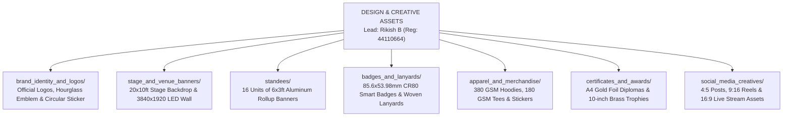

# KAIROS 2027 (Grand Edition) — Design & Creative Assets Workspace

> **Domain:** Visual Identity, Physical Print Engineering, Merchandise, Stage Scenography & Digital UI/UX  
> **Direct Lead:** **Rikish B** (Design Lead, Reg: `44110664`, Phone: `+91 9597430250`, Email: `rikish2006@gmail.com`)  
> **Collaborating Lead:** **Caroline Mary McPherson** (Media Head 1, Reg: `44110124`, Phone: `+8838990182`)  
> **Supervising Authority:** **Thenappan T** (President & SBGL, Reg: `44110855`, Phone: `+91 6381801640`)  
> **Governing Standards:** `ANTI-Help/06_BRANDING_CREATIVE_ASSETS_AND_DIGITAL_MEDIA_GUIDE.md`  

---

## 1. Executive Brand Identity Framework

All physical and digital artifacts produced by this vertical must adhere to the official **Cosmic Cyber Violet & Deep Void Obsidian** design system of Kairos 2027:

---

## 2. Official Brand Assets, Color Tokens & Typography

### Master Assets in [`brand_identity_and_logos/`](./brand_identity_and_logos/)
1. **Primary Wordmark & Hackathon Lockup:** [`kairos_primary_logo_lockup.png`](./brand_identity_and_logos/kairos_primary_logo_lockup.png) — "K A [Hourglass] R O S" with orbital comet tail, "A 48-HOUR HACKATHON", and "IDEAS TODAY — IMPACT TOMORROW" tagline.
2. **Celestial Hourglass Emblem:** [`kairos_hourglass_emblem.png`](./brand_identity_and_logos/kairos_hourglass_emblem.png) — Standalone celestial hourglass with planetary ring and cosmic stars.
3. **Official Circular Patch / Sticker Seal:** [`kairos_official_circular_sticker_seal.jpg`](./brand_identity_and_logos/kairos_official_circular_sticker_seal.jpg) — Dual concentric ring seal with "K A I R O S" and "AWS STUDENT BUILDER GROUP SATHYABAMA".

### Typography System
- **Page Titles & Hero Display:** `Syne` / `Space Grotesk Bold` (48pt – 64pt, `#FFFFFF` with `#A855F7` glow)
- **Section Headings:** `Space Grotesk SemiBold` (28pt – 36pt, `#FFFFFF`)
- **Subheadings & Accents:** `Plus Jakarta Sans SemiBold` (18pt – 22pt, `#C084FC`)
- **Body Text:** `Inter Regular` (14pt – 16pt, `#E9D5FF` / `#D5DBDB`, line height 1.5)
- **Monospace / Code / Metrics:** `JetBrains Mono Medium` (10pt – 12pt, `#38BDF8` / `#A855F7`)

### Color Token Palette
| Color Token | Hex Code | RGB | CMYK (Print) | Application |
|---|:---:|:---:|:---:|---|
| **Void Black (Canvas)** | `#000000` | `0, 0, 0` | `75, 68, 67, 90` | Infinite canvas background, stage LED backdrop, hoodie fabric. |
| **Deep Nebula Dark** | `#0B0616` | `11, 6, 22` | `78, 75, 55, 80` | Card containers, modal sheets, elevated UI surfaces. |
| **Electric Violet (Core)** | `#A855F7` | `168, 85, 247` | `45, 72, 0, 0` | **Primary brand accent**, CTA buttons, active glows, trophy accents. |
| **Cyber Orchid (Glow)** | `#C084FC` | `192, 132, 252` | `32, 54, 0, 0` | Secondary gradients, orbital ring shimmer, badge highlights. |
| **Astral White** | `#FFFFFF` | `255, 255, 255` | `0, 0, 0, 0` | Primary typography, hourglass structural framing, star sparkles. |
| **Starlight Lavender** | `#E9D5FF` | `233, 213, 255` | `10, 18, 0, 0` | Subtitles, pill badge backgrounds, subtle rules. |
| **Matrix Emerald** | `#10B981` | `16, 185, 129` | `75, 0, 60, 0` | Live badges, verified checkmarks, security tags. |

---

## 3. Subfolder Directory Map & Deliverables

0. **[`brand_identity_and_logos/`](./brand_identity_and_logos/)**: Master source assets: Primary Wordmark, Celestial Hourglass Emblem, and Official Circular Sticker Seal.
1. **[`stage_and_venue_banners/`](./stage_and_venue_banners/)**: Production specs and source files for the 20x10ft main stage backdrop banner, 12x8ft foyer welcome backdrop, and 3840×1920 LED screen graphics.
2. **[`standees/`](./standees/)**: Engineering specs, content copy, and print files for 16 units of 6ft × 3ft rollup display standees placed across the Central Library complex.
3. **[`badges_and_lanyards/`](./badges_and_lanyards/)**: CR80 NFC smart badge artwork, 5-tier role color coding, QR encoding schema, and 20mm woven lanyard ribbons.
4. **[`apparel_and_merchandise/`](./apparel_and_merchandise/)**: Streetwear hoodie blueprints, dry-fit participant tees, die-cut vinyl laptop stickers, and sizing curves.
5. **[`certificates_and_awards/`](./certificates_and_awards/)**: Gold-foil stamped certificate layouts, anti-counterfeit QR codes, and laser-cut acrylic/brass trophy CAD drawings.
6. **[`social_media_creatives/`](./social_media_creatives/)**: Figma templates, 4:5 Instagram carousels, 9:16 vertical reels covers, and YouTube 4K stream thumbnail graphics.

---

## 4. Pre-Press Production & Print Vendor SLA

- **Print Vendor Proofing:** All physical banners, standees, and badges must be verified via printed physical 1:1 color sample proof before bulk production run.
- **Color Space:** All physical print exports must be rendered in **CMYK 300 DPI** with 3mm bleed. Never send RGB files to commercial flex or offset printers.
- **Vector Integrity:** All sponsor and university logos must remain as vector curves (never rasterized).
- **Inspection Gate:** Rikish B and Thenappan T conduct the physical vendor audit 72 hours prior to load-in.
