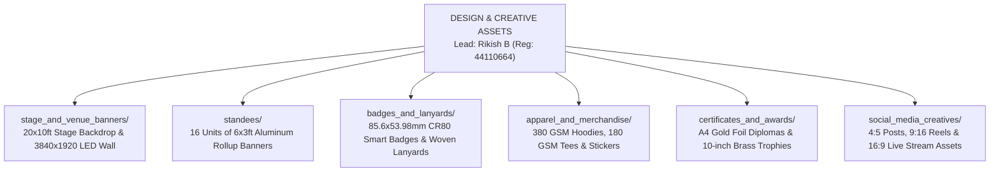

# KAIROS 2027 (Grand Edition) — Design & Creative Assets Workspace

> **Domain:** Visual Identity, Physical Print Engineering, Merchandise, Stage Scenography & Digital UI/UX  
> **Direct Lead:** **Rikish B** (Design Lead, Reg: `44110664`, Phone: `+91 9597430250`, Email: `rikish2006@gmail.com`)  
> **Collaborating Lead:** **Caroline Mary McPherson** (Media Head 1, Reg: `44110124`, Phone: `+8838990182`)  
> **Supervising Authority:** **Thenappan T** (President & SBGL, Reg: `44110855`, Phone: `+91 6381801640`)  
> **Governing Standards:** `ANTI-Help/06_BRANDING_CREATIVE_ASSETS_AND_DIGITAL_MEDIA_GUIDE.md`  

---

## 1. Executive Brand Identity Framework

All physical and digital artifacts produced by this vertical must adhere to the official **Obsidian-Amber Cyber Engineering** design system of the AWS Student Builder Group — SIST Chapter.

---

## 2. Official Brand Assets, Color Tokens & Typography

### Amazon Ember Typeface System
*Source: `Leader Library/01- Creative Assets _ Fonts, Icons, Etc_/Fonts/Fonts/`*
- **Page Titles & Hero Display:** `Amazon Ember Display Heavy` (48pt – 64pt, `#FFFFFF`)
- **Section Headings:** `Amazon Ember Display Bold` (28pt – 36pt, `#FFFFFF` or `#FF9900`)
- **Subheadings & Accents:** `Amazon Ember Display Medium` (18pt – 22pt, `#D5DBDB`)
- **Body Text:** `Amazon Ember Display Regular` (14pt – 16pt, `#E0E0E0`, line height 1.5)
- **Monospace / Code / Metrics:** `Amazon Ember Mono Regular` & `Amazon Ember Duospace Bold`

### Color Token Palette
| Color Token | Hex Code | RGB | CMYK (Print) | Application |
|---|:---:|:---:|:---:|---|
| **AWS Smile Amber** | `#FF9900` | `255, 153, 0` | `0, 45, 100, 0` | Primary brand accent, primary CTA buttons, trophy accents, stage highlights. |
| **Deep Squid Ink** | `#232F3E` | `35, 47, 62` | `83, 68, 50, 52` | Primary dark surface, banner footers, smart badge card containers. |
| **Obsidian Abyss** | `#0D1117` | `13, 17, 23` | `75, 68, 67, 90` | Canvas background, stage LED backdrop canvas, hoodie fabric tone. |
| **Cyber Slate** | `#1A2433` | `26, 36, 51` | `80, 65, 52, 60` | Card borders, secondary containers, lanyard background weave. |
| **Pure Light** | `#FFFFFF` | `255, 255, 255` | `0, 0, 0, 0` | Primary typography, inverted logo lockups. |
| **Cloud Silver** | `#D5DBDB` | `213, 219, 219` | `16, 11, 12, 0` | Secondary copy, subtle grid lines, certificate border accents. |
| **Terminal Green** | `#3FB950` | `63, 185, 80` | `65, 0, 85, 0` | Live badges, verified checkmarks, security tags. |

---

## 3. Subfolder Directory Map & Deliverables

1. **[`stage_and_venue_banners/`](./stage_and_venue_banners/)**: Production specs and source files for the 20x10ft main stage backdrop banner, 12x8ft foyer welcome backdrop, and 3840×1920 LED screen graphics.
2. **[`standees/`](./standees/)**: Engineering specs, content copy, and print files for 16 units of 6ft × 3ft rollup display standees placed across the Central Library complex.
3. **[`badges_and_lanyards/`](./badges_and_lanyards/)**: CR80 NFC smart badge artwork, 5-tier role color coding, QR encoding schema, and 20mm woven lanyard ribbons.
4. **[`apparel_and_merchandise/`](./apparel_and_merchandise/)**: Streetwear hoodie blueprints, dry-fit participant tees, die-cut vinyl laptop stickers, and sizing curves.
5. **[`certificates_and_awards/`](./certificates_and_awards/)**: Gold-foil stamped certificate layouts, anti-counterfeit QR codes, and laser-cut acrylic/brass trophy CAD drawings.
6. **[`social_media_creatives/`](./social_media_creatives/)**: Figma templates, 4:5 Instagram carousels, 9:16 vertical reels covers, and YouTube 4K stream thumbnail graphics.

---

## 4. Pre-Press Production & Print Vendor SLA

- **Print Vendor Proofing:** All physical banners, standees, and badges must be verified via printed physical 1:1 color sample proof before bulk production run.
- **Color Space:** All physical print exports must be rendered in **CMYK 300 DPI** with 3mm bleed. Never send RGB files to commercial flex or offset printers.
- **Vector Integrity:** All sponsor and university logos must remain as vector curves (never rasterized).
- **Inspection Gate:** Rikish B and Thenappan T conduct the physical vendor audit 72 hours prior to load-in.
