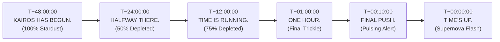

# KAIROS — Stage & Venue Scenography Engineering Specification

**Document Reference:** `teams/02_design_and_creative_assets/stage_and_venue_banners/README.md`  
**Host Entity:** AWS Student Builder Group (AWS SBG) — SIST Chapter  
**Sponsoring Department:** School of Computing, Sathyabama Institute of Science and Technology, Chennai – 600119  
**Direct Lead:** **Rikish B** (Design Lead, Reg: `44110664`, Phone: `+91 9597430250`)  
**Operations Lead:** **Nangaiyar M** (Community & Events Lead, Reg: `44612059`)  
**Sign-Off Authority:** **Thenappan T** (President & SBGL, Reg: `44110855`)  
**Governing Standards (Executive Planning Framework):** `DOC-04 (Design & Branding Guidelines)` · `DOC-20 (Indoor Stadium Transition Plan)`  
**Master Slogan:** **`KAIROS: MAKE TIME. MAKE SOMETHING.`**  
**Status:** `APPROVED PLAN`  

---

## 1. Physical Event Branding Suite

Physical scenography transforms the **Sathyabama Indoor Stadium (Indoor Auditorium)** into an unforgettable high-contrast arena using bold typography, deep obsidian surfaces, and luminous Electric Violet (`#A855F7`) accents:

```
┌────────────────────────────────────────────────────────────────────────┐
│                        VENUE BRANDING ARTIFACTS                        │
├────────────────────────────────────────────────────────────────────────┤
│ 1. MAIN ENTRANCE FOYER WELCOME BANNER (12 ft × 8 ft)                   │
│    "KAIROS"                                                            │
│    "48 HOURS TO BUILD WHAT'S NEXT."                                    │
├────────────────────────────────────────────────────────────────────────┤
│ 2. MEGA STADIUM STAGE BACKDROP (50 ft × 10 ft) + 12×8ft LED VIDEO WALL │
│    Huge illuminated circular KAIROS logo centered with sponsor lockups │
│    Underneath: "AWS STUDENT BUILDER GROUP SATHYABAMA"                  │
├────────────────────────────────────────────────────────────────────────┤
│ 3. REGISTRATION & VERIFICATION DESK WRAP                               │
│    "WELCOME TO KAIROS" with central celestial hourglass               │
├────────────────────────────────────────────────────────────────────────┤
│ 4. DIRECTIONAL SIGNAGE SYSTEM (Electric Violet Arrow Language)         │
│    • REGISTRATION →                                                    │
│    • ARENA HACKING BAYS A–D →                                          │
│    • MENTOR & WAR ROOM ZONE →                                          │
│    • DINING & MESS HALLS →                                             │
│    • MEZZANINE REST AREA →                                             │
└────────────────────────────────────────────────────────────────────────┘
```

---

## 2. Mechanical Dimensions & Print Specifications

| ID | Banner Description | Dimensions (ft) | Pixel Canvas (300 DPI) | Substrate / Subsystem | Finish / Mounting |
|:---:|---|:---:|:---:|---|---|
| **B1** | **Mega Stadium Stage Backdrop** | 50 ft × 10 ft | Vector / 300 DPI CMYK | 340 GSM Blackout StarFlex | Heavy truss frame with brass eyelets every 2 ft |
| **B2** | **Main Stage LED Video Wall** | 12 ft × 8 ft (or 16:9) | 3840 × 1920 px | Active P2.5 Video Display | 60fps MP4 loops & live countdown overlays |
| **B3** | **Grand Entrance Foyer Welcome** | 12 ft × 8 ft | 144 in × 96 in | Heavy StarFlex | Free-standing MS iron box frame |
| **B4** | **Registration Desk Wrap** | 8 ft × 3.5 ft | 96 in × 42 in | Matte Self-Adhesive Vinyl | Desk fascia mount with spot-UV hourglass |
| **B5** | **Venue Direction Signs** | 5 Units (4×2 ft) | 48 in × 24 in | 5mm Foam-Board | Eye-level wall & stanchion mount |

### Direction Signage Hierarchy (Purple Visual Language):
All arrows utilize the sweeping orbital purple curve (`#A855F7`) for maximum visibility:
* **`REGISTRATION →`** (Placed at portico entrance toward check-in bays)
* **`ARENA HACKING BAYS A–D →`** (Placed at arena double doors toward team tables)
* **`MENTOR & WAR ROOM ZONE →`** (Placed at central arena corridor toward ops pod)
* **`DINING & MESS HALLS →`** (Placed at exit corridors leading toward campus mess halls)
* **`MEZZANINE REST AREA →`** (Placed at bleacher stairwells toward quiet nap pods)

---

## 3. The Signature Progressive Countdown System (P2.5 LED Screen)

On the main stage 4K LED display (3840 × 1920 px), the central hourglass **progressively empties** across the 48 hours:



* **T−48:00:00:** `KAIROS HAS BEGUN.` (Hourglass brimming with glowing purple stardust).
* **T−24:00:00:** `HALFWAY THERE.` (50% sand depleted; checkpoint gate 1 review).
* **T−12:00:00:** `TIME IS RUNNING.` (75% depleted; midnight sprint alert).
* **T−01:00:00:** `ONE HOUR.` (Final grains trickling; repository commit lock countdown).
* **T−00:10:00:** `FINAL PUSH.` (Intense flashing starlight perimeter).
* **T−00:00:00:** `TIME'S UP.` (Screen erupts into celebratory violet supernova burst).
